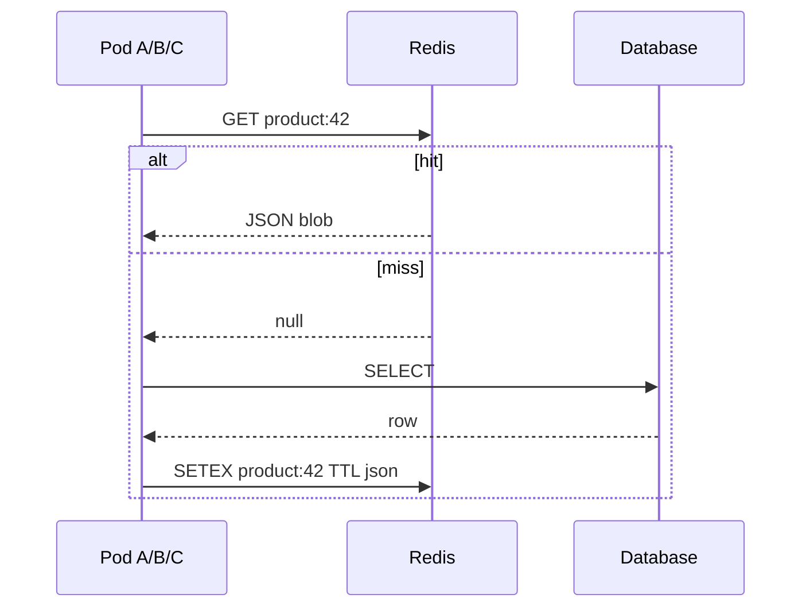
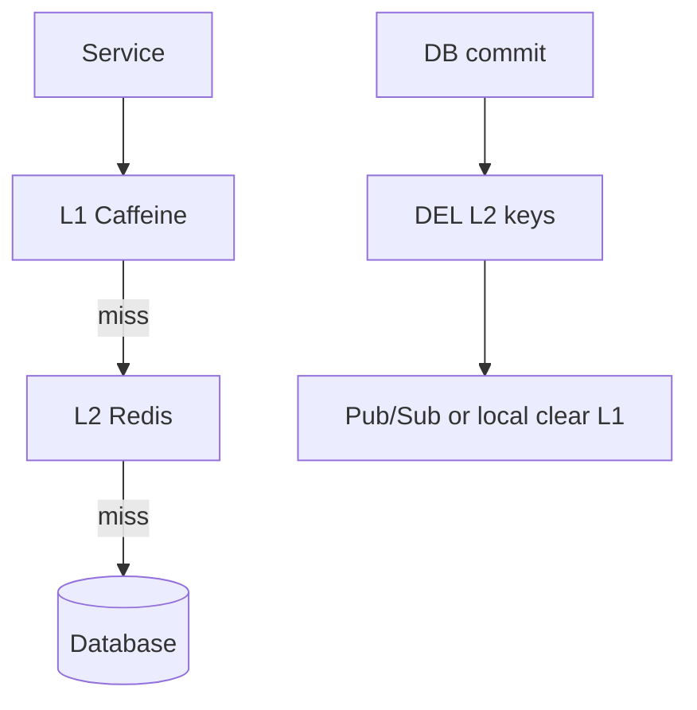
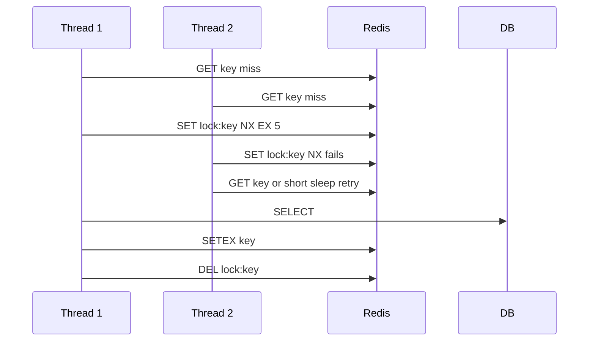

# Redis and Invalidation

> **Status:** Completed  
> **Module:** 46 — Caching and Performance Engineering  
> **Target Java version:** 21  
> **Last reviewed:** 2026-11-11  
> **Chapter profile:** Technical  
> **Depth target:** Levels 2–3

**Note:** Runnable Redis examples require a Redis server and client library (Lettuce/Jedis). Command shapes below are **reference** for staging labs—do **not** treat them as fabricated local scrape/session output. This chapter is complete without a live Redis instance.

## 1. Learning Objectives

After completing this chapter, you should be able to:

- Use **Redis** as distributed cache, session store, and rate-limit counter for clustered Java services.
- Compare **Redis** to in-process **Caffeine** caches and design **two-level** L1/L2 hierarchies.
- Design **invalidation** across app instances and **cache stampede** controls tied to Ch.01 patterns.
- Choose serialization formats at the cache boundary and avoid caching JPA entities verbatim.
- Apply **security** basics: AUTH, TLS, no sensitive data without encryption (Module 43).
- Plan **degraded modes** when Redis is unavailable (Module 44 circuit breakers).

## 2. Prerequisites

- [01-caching-strategies.md](01-caching-strategies.md) — cache-aside, TTL, thundering herd, immutable DTOs.
- **Module 39** — session vs stateless JWT trade-offs (optional but useful for Spring Session Redis).
- **Module 45** — event-driven invalidation consumers (optional).
- **Module 32** — HTTP timeouts; Redis RTT is another network hop with the same discipline.

**Refresher:** An **in-process cache** lives inside one JVM heap. A **distributed cache** is a remote service multiple JVMs share. Sharing buys hit-rate after deploy and across pods; it costs network latency, ops ownership, and harder invalidation.

## 3. Why This Concept Exists

In-process caches (Caffeine, `ConcurrentHashMap`) do not **share** entries across JVMs. Each pod has its own hit ratio; after deploy, every instance is **cold**. **Redis** (remote in-memory data store) centralizes hot entries, session state, and coordination primitives (locks, counters) for horizontal scale—at the cost of network latency, operational ownership, and **split-brain** behavior if treated as authoritative without a database behind it.

Teams adopt Redis when:

1. Replica count > 1 and cache miss storms after rolling deploys hurt the DB.
2. Sessions or rate limits must be consistent across instances.
3. Short-lived coordination (single-flight locks, feature-flag fanout) needs a shared place.

They regret Redis when they treat it as the system of record for orders, skip AUTH/TLS, or leave invalidation undefined.

## 4. Conceptual Explanation

### 4.1 Redis as a cache backend—not a second database of truth

Redis is **not** a replacement for PostgreSQL: it is a **fast tier** with optional durability (RDB/AOF) tuned for different goals. For handbook-style Spring services, treat Redis cache as **derivable** from DB unless you explicitly model Redis-native structures (counters, leaderboards) with clear ownership rules.

| Role | Redis OK? | Caveat |
|------|-----------|--------|
| Product DTO cache | Yes | Invalidate on write; TTL backstop |
| Session store | Yes | Serializable attributes; size limits |
| Rate-limit counters | Yes | Atomic `INCR` + TTL |
| Order ledger | No (as sole store) | DB authoritative |

### 4.2 Java client landscape

Nothing in the JDK speaks Redis; dependencies are explicit.

| Client | Model | Notes |
|--------|-------|-------|
| **Lettuce** | Async/reactive, Netty | Default in Spring Data Redis |
| **Jedis** | Blocking pool | Mature; tune pool size to RPS × commands |
| **Spring Data Redis** | `RedisTemplate`, cache abstraction | Hides command details; still need TTL/key policy |

```java
// Conceptual — requires lettuce/Spring Data Redis on classpath
// redis.setex("product:42", 3600, json);
// redis.get("product:42");
```

### 4.3 Redis data structures (usage map)

| Structure | Use | Avoid for |
|-----------|-----|-----------|
| **String** | Serialized JSON blob, counters | Multi-MB blobs |
| **Hash** | Fielded objects with partial updates | Deep nested graphs |
| **Set / ZSet** | Tags, leaderboards | Primary order storage |
| **List** | Simple queues | Durable messaging (prefer Kafka, Module 45) |
| **Pub/Sub** | Cache invalidation fanout | Durable event log |

Pub/Sub is **fire-and-forget**: if a pod is down during an invalidate message, it may keep stale L1 until TTL—pair Pub/Sub with TTL backstops.

### 4.4 Key naming conventions

Good keys are **stable, scoped, and greppable**:

```text
tenant:{tenantId}:product:{productId}
session:{sessionId}
ratelimit:{clientId}:{yyyyMMddHHmm}
```

Bad keys: raw URLs, unbounded user-generated strings, missing tenant scope, `KEYS`-friendly wildcards that encourage `KEYS *` in production.

## 5. Mechanism and Execution Flow

### 5.1 Distributed cache-aside (same logic as Ch.01)



On **update**, application commits DB then **DEL** keys or publishes an invalidation event so all pods drop L1 and L2.

### 5.2 Two-level L1 + L2

| Tier | Latency | Scope | Failure mode |
|------|---------|-------|--------------|
| **L1 Caffeine** | Microseconds | Single JVM | Stale until local invalidate/TTL |
| **L2 Redis** | Milliseconds | Cluster-wide | Network/Redis outage |



**Write path:** invalidate **both** L1 (local) and L2 (Redis) on authoritative DB update, or rely on versioned keys so stale L1 cannot serve wrong semantics.

**Read path cost:** L1 hit → done; L1 miss + L2 hit → deserialize + optional L1 fill; both miss → DB + populate both tiers.

### 5.3 Invalidation strategies

| Strategy | Mechanism | When |
|----------|-----------|------|
| **TTL only** | `SETEX` | Reference data; bounded staleness OK |
| **Delete on write** | `DEL product:42` | Stronger; must list all derived keys |
| **Version in key** | `product:42:v7` | Avoid delete races; old versions expire |
| **Pub/Sub `invalidate`** | All nodes drop local L1 | After L2 delete |

Event-driven: `ProductUpdated` consumer deletes keys (Module 45). Document **every** derived key shape in a runbook—missed keys are silent staleness bugs.

### 5.4 Stampede lock pattern (conceptual)



Only the lock holder loads origin; others wait or serve stale with `max-stale` policy if the product allows. Always set **EX** on the lock so a crashed holder cannot block forever.

### 5.5 Spring Data Redis cache manager knobs

| Property | Effect |
|----------|--------|
| `spring.cache.redis.time-to-live` | Default TTL |
| `spring.cache.redis.cache-null-values` | Whether to cache negative results |
| Lettuce pool max | Caps concurrent Redis commands per pod |

Tune pool with expected RPS × commands per request—Redis RTT dominates when the pool is starved. Mirror the Hikari lesson from Module 33: **threads waiting on a tiny pool look like “Redis is slow.”**

### 5.6 Sessions and rate limiting

- **Session store:** Spring Session Redis for sticky-less scaling; serializable session attributes only; watch session size growth.
- **Rate limit:** `INCR` + TTL bucket per client id at API gateway or servlet filter; fail open vs fail closed is a product decision.

Never store raw passwords or PAN in Redis; encrypt sensitive payloads if required (Module 43).

## 6. Terminology

| Term | Meaning |
|------|---------|
| **SETEX** | Set string with seconds TTL |
| **SET NX EX** | Set if Not eXists with expiry (lock pattern) |
| **SCAN** | Cursor-based key iteration (production-safe vs `KEYS *`) |
| **Single-flight** | One loader per key (Ch.01); can be Redis `SETNX` lock |
| **Split brain** | Redis and DB diverge after partial failure |
| **Hot key** | One key absorbing disproportionate traffic on one shard |

## 7. Serialization Formats at the Cache Boundary

| Format | Pros | Cons |
|--------|------|------|
| JSON (String value) | Human-debuggable in `redis-cli` | Larger, slower parse |
| JDK serialization | Easy with `RedisTemplate` default | Fragile across class versions; security risk |
| Protocol Buffers / Avro | Compact, schema evolution | Extra codegen pipeline |

Prefer **versioned DTO + JSON** for handbook-style services; never cache JPA entities verbatim (Ch.01). Include a **schema version field** inside the blob or in the key so rolling deploys do not deserialize incompatible shapes.

### Incorrect

```java
redisTemplate.opsForValue().set(id, jpaEntity); // managed entity / JDK serialize risk
```

### Corrected

```java
redisTemplate.opsForValue().set(id, objectMapper.writeValueAsString(ProductDto.from(entity)), Duration.ofMinutes(10));
```

## 8. Real-World Use Cases

- Flash sale: Redis holds inventory counters with Lua atomic decrement; DB remains ledger of record after checkout.
- Feature flags cached per tenant with 60s TTL and Pub/Sub bust on admin change.
- JWT blocklist (logout) with TTL = token expiration.
- Two-level catalog cache: Caffeine L1 for hot SKUs, Redis L2 shared after rolling deploy.

## 9. Edge Cases and Limitations

- **Redis unavailable:** degrade to DB (circuit breaker, Module 44) or fail closed for security reads—product decision, not library default.
- **Large values:** multi-megabyte JSON is the wrong tool—use object store for blobs; Redis for pointers/metadata.
- **Hot keys:** single Redis shard saturation; mitigate with local L1, key splitting, or read replicas carefully (replica lag = staleness).
- **Cluster hash slots:** multi-key operations must share a hash tag `{tenant}` or they fail across slots.
- **Clock skew:** TTL is server-side; do not mix client clocks into expiry math without care.

## 10. Common Mistakes

| Mistake | Fix |
|---------|-----|
| `KEYS *` in production | `SCAN` with pattern and limits |
| No connection pooling | Shared Lettuce connection / pool config |
| Same TTL for hot and cold data | Tiered TTL by access pattern |
| Redis as sole source of truth for orders | DB authoritative; Redis derivable |
| Invalidate L2 only | Stale L1 serves old data until local TTL |
| Unbounded key cardinality from user input | Normalize and cap key spaces |

## 11. Operational Playbook (Redis unavailable)

| Phase | Application behavior |
|-------|------------------------|
| Detect | Circuit breaker open after N failures / high latency |
| Degrade | Skip L2; optional skip L1 for security-sensitive reads |
| Recover | Half-open probe; gradual traffic; watch stampede on refill |

Log **cache bypass rate** metric during incident; postmortem asks whether TTL jitter would have softened the spike (Module 47).

## 12. Design Trade-offs

| Caffeine only | Redis only | L1 + L2 |
|---------------|------------|---------|
| Simplest ops | Shared cache | Best hit rate; complex invalidation |

| Spring Session Redis | Stateless JWT |
|----------------------|---------------|
| Revocable server sessions | No central session store |

| Strong delete-on-write | TTL-only |
|------------------------|----------|
| Fresher data; more code paths | Simpler; longer stale windows |

| Redis Cluster | Single primary |
|---------------|----------------|
| Scale & shard | Simpler ops; hotspot risk |

## 13. Performance Considerations

- Measure Redis **p99 RTT** separately from app p99; a 5ms RTT × several gets per request adds up.
- Pipeline/multi-get (`MGET`) for fan-out reads when keys are known.
- Prefer bulk invalidation lists over chatty per-field deletes when updating aggregates.
- Watch eviction metrics on the Redis side (`evicted_keys`)—eviction under memory pressure is silent correctness risk if you assumed entries live forever.

## 14. Security Considerations

- Require **AUTH** (ACL users) and **TLS** in transit for non-local Redis.
- Network-isolate Redis; do not expose 6379 to the public internet.
- Disable dangerous commands in managed configs where possible (`FLUSHALL`, `CONFIG` from app users).
- Treat cached PII like DB PII: retention, encryption, access logs.

## 15. Conceptual Note / Lab Scope

This chapter does not require a running Redis instance for handbook completion. Validate command shapes and client timeouts in **staging** with real topology (replicas, Sentinel, cluster mode). Record real `redis-cli` / Lettuce timings there—never invent them in handbook Verified blocks.

## 16. Revision and Mastery

**Track B gaps:**

- When is **Caffeine alone** enough vs when is Redis required?
- Invalidation vs TTL for price updates during a flash sale?
- Session in Redis vs JWT for a B2B API with instant revocation?
- Why must L1 and L2 both be invalidated (or versioned) after DB commit?
- What fails if a stampede lock has no `EX`?

## 17. Exercises

1. Key naming convention for tenant-scoped cache (`tenant:{id}:product:{id}`) including a summary key.
2. Invalidation flow diagram for product update API (DB commit → bus → consumers → L1/L2).
3. Failure mode doc when Redis partition occurs (read path, write path, session path).
4. Compare JSON vs JDK serialization risks for a `ProductDto` that gains a field between releases.

## 18. Worked Invalidation Story (Product Price Update)

Concrete collaborator scenario: `PricingService` updates `product.price` in PostgreSQL, then must keep L1 Caffeine and L2 Redis coherent across three pods.

1. Begin DB transaction; `UPDATE products SET price=? WHERE id=?`.
2. **Commit.** Only after commit is the new price authoritative.
3. `DEL tenant:{t}:product:{id}` and `DEL tenant:{t}:product:{id}:summary` on Redis (list every derived key).
4. Publish `ProductPriceUpdated` on the bus (Module 45) **or** Redis Pub/Sub `invalidate` with the key list.
5. Each pod’s listener calls `caffeine.invalidate(key)` for local L1.
6. TTL (e.g. 10 minutes) remains as backstop if a listener was down.

| Fault injection (staging lab) | Expected behavior |
|-------------------------------|-------------------|
| Redis `DEL` fails after commit | Stale until TTL; alert on invalidate errors |
| Pub/Sub listener down on one pod | That L1 stale until TTL; L2 delete forces DB refill |
| Publish before commit | Other pods may cache uncommitted price — forbidden |

### Incorrect ordering

```text
put Redis new price → commit DB
```

### Corrected ordering

```text
commit DB → delete/version Redis → fanout L1 invalidate
```

## 19. Lettuce Timeout and Pool Sizing

| Knob | Symptom if wrong |
|------|------------------|
| Command timeout too high | Threads pile up; cascading latency |
| Command timeout too low | Spurious failures under GC pause |
| Pool too small | Pending acquires look like “Redis slow” |
| Pool too large | Redis CPU/connection storms |

Align timeouts with Module 44 budgets: a Redis get should be a small fraction of the HTTP SLO (Module 47). Prefer fail-open to DB for catalog reads; fail-closed for authz-adjacent caches.

## 20. Multi-Key and Cluster Hash Tags

In Redis Cluster, keys in one multi-key command must share a **hash tag** so they land on one slot:

```text
tenant:{42}:product:7
tenant:{42}:product:7:summary
```

The `{42}` tag keeps both keys together. Without tags, `MGET` / transactions across keys fail with cross-slot errors—design key schemas with clustering in mind even if you start on a single primary.

## 21. Chapter Summary

Redis centralizes distributed caching and coordination; pair it with clear **invalidation**, **TTL discipline**, **safe serialization**, and **degraded modes**—not as a silent source of truth without database backing. L1+L2 hierarchies win hit rate after deploy only when both tiers stay coherent with the DB write path.

## 22. Next Steps

[03-load-testing-and-capacity.md](03-load-testing-and-capacity.md)

## Review Checklist

- [x] Technical L2–3; mechanism flows (cache-aside, L1/L2, stampede lock)
- [x] Redis conceptual; invalidation; security; no fabricated Redis output
- [x] Serialization, ops playbook, price-update story, pool sizing, hash tags
- [x] Fourth EXPAND-PRESERVE deepen pass 2026-11-11
