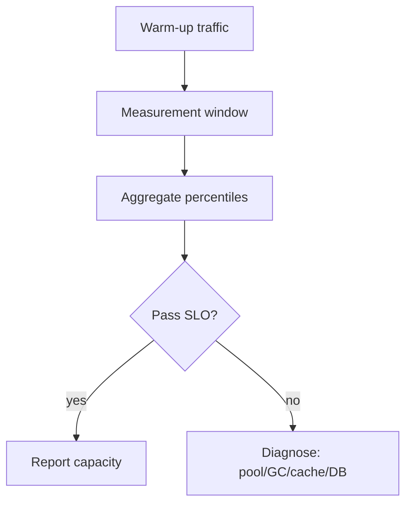

# Load Testing and Capacity

> **Status:** Completed  
> **Module:** 46 — Caching and Performance Engineering  
> **Target Java version:** 21  
> **Last reviewed:** 2026-11-11  
> **Chapter profile:** Technical  
> **Depth target:** Levels 2–3

## 1. Learning Objectives

- Plan **load**, **stress**, **soak**, and **spike** tests with explicit goals and pass/fail criteria.
- Interpret **latency percentiles**, throughput, and error rates together—not averages alone.
- Connect results to **JVM**, **thread pools**, **DB pool**, and **GC** (Modules 26–28) and **cache hit rate** (Ch.01–02).
- Avoid **mistaking load generator limits** for system limits.

## 2. Prerequisites

- **Module 30** — testing mindset; flaky tests erode trust.
- **Module 33** — connection pooling; `maximumPoolSize` vs DB `max_connections`.
- **Chapters 01–02** — caching patterns and stampede behavior after cold deploy.

## 3. Why This Concept Exists

Production traffic exposes bottlenecks unit tests never see: pool exhaustion, lock contention, GC pause tails, cache cold starts, and cascading timeouts. **Load testing before launch** validates SLOs (Module 47) and capacity plans; without it, teams discover limits during revenue events.

## 4. Conceptual Explanation

### Test types

| Type | Goal | Duration |
|------|------|----------|
| **Load** | Expected peak traffic | Minutes |
| **Stress** | Find breaking point | Ramp until failure |
| **Soak** | Leaks, drift, metaspace | Hours–days |
| **Spike** | Sudden burst | Short ramp |

Each type answers a different question: load tests **confidence** at peak; stress tests **headroom**; soak tests **stability**; spike tests **autoscaling** and herd behavior.

### Metrics that matter

- **Throughput:** successful requests per second.
- **Latency:** **p50, p95, p99**—not average alone (long tail drives user pain).
- **Error rate:** 5xx, timeouts, circuit-open counts.
- **Saturation:** CPU, GC pause, Hikari pending threads, Redis latency, hit ratio.

```text
SLO example: 99% of checkout POST < 800ms at 500 RPS with <0.1% errors
```

### Tooling (awareness)

| Tool | Role |
|------|------|
| **JMeter**, **Gatling**, **k6** | Script scenarios; distributed workers for high RPS |
| **JMH** (Module 28) | Microbenchmarks—not a substitute for system tests |

Do not fabricate benchmark numbers in documentation; record JDK, heap, `MaxRAMPercentage`, pool sizes, and generator host when you run tests.

## 5. Mechanism and Execution Flow

### Load test execution pipeline



**Warm-up:** JIT compilation, pool fill, cache heat—exclude first N minutes from SLO accounting unless cold-start is an explicit SLI.

### Bottleneck localization under Java

| Symptom | Likely cause | Where to look |
|---------|--------------|---------------|
| p99 up, CPU low | Pool wait, lock, external timeout | Hikari metrics, thread dump |
| p99 up, GC log spikes | Heap too small, allocation rate | `-Xlog:gc*` (Module 27) |
| Error burst after deploy | Cold cache stampede | Hit ratio metric (Ch.01) |
| Generator CPU 100% | Too few workers | Scale drivers, lower per-node RPS |

### Capacity worksheet (illustrative)

| Input | Formula / note |
|-------|----------------|
| Peak RPS | From product forecast |
| Per-instance RPS | Peak / replicas |
| DB connections | `replicas × Hikari max` < DB `max_connections` |
| Heap | Container limit × `MaxRAMPercentage` + metaspace headroom (Module 48) |

## 6. Test Environment Fidelity

| Aspect | Risk if wrong |
|--------|----------------|
| Smaller DB than prod | False confidence |
| No replica lag modeled | Misleading read paths |
| Mocked payment | Ignores real timeouts |

Use **scaled-down but proportional** stacks or cost-approved prod-like staging.

## 7. Java Service Knobs Under Load

- **Tomcat / virtual threads:** max connections must align with DB pool (Module 24).
- **HikariCP** `maximumPoolSize`—each waiting thread is latency.
- **GC:** G1/ZGC pause targets; heap too small → allocation stalls.

## 8. Caching Under Load

Measure **hit rate** during the test. Cold cache at start mimics deploy—document warm-up policy. A high miss rate during measurement explains DB saturation even when code is “cached.”

## 9. Real-World Use Cases

- Black Friday rehearsal with 3× traffic.
- Soak test finds `ThreadLocal` leak in custom pool.
- Stress test sets autoscaling policy max instances.

## 10. Edge Cases

- **Coordinated omission:** client drops slow responses—use tools reporting corrected latency.
- **Thundering herd** after deploy cold cache—pre-warm or gradual traffic shift.

## 11. Common Mistakes

| Mistake | Fix |
|---------|-----|
| Laptop as sole generator | Separate load driver fleet |
| Ignore think time | Model realistic pacing |
| Single metric focus | CPU low but pool exhausted |
| Skip cache metrics | Misattribute DB pain |

## 12. Design Trade-offs

| Long soak in CI | Nightly / pre-release soak |
|-----------------|----------------------------|
| Slow PR feedback | Catches leaks |

| Stress to destruction in staging | Load at forecast only |
|----------------------------------|----------------------|
| Finds limits | May need repair window |

## 13. Revision and Mastery

- Load vs soak: which catches metaspace leak?
- Why p99 for checkout SLO instead of mean?
- Pool size vs thread count: what happens when threads > pool?

## 14. Exercises

1. Write load test scenario for `GET /products/{id}` with cache-aside; define warm-up and measurement windows.
2. Capacity worksheet: RPS, p95 target, replicas, pool size, Redis hit ratio goal.
3. List three JVM flags you would log alongside test results on Temurin 21.

## 15. Chapter Summary

Load testing validates Java services against percentile latency and error SLOs with realistic drivers and environment parity—interpreting **pools, GC, cache hit rate, and saturation** together.

## Review Checklist

- [x] Technical L2–3; test pipeline mechanism; no fabricated benchmark results
- [x] Preserved test types, metrics, fidelity table, exercises
