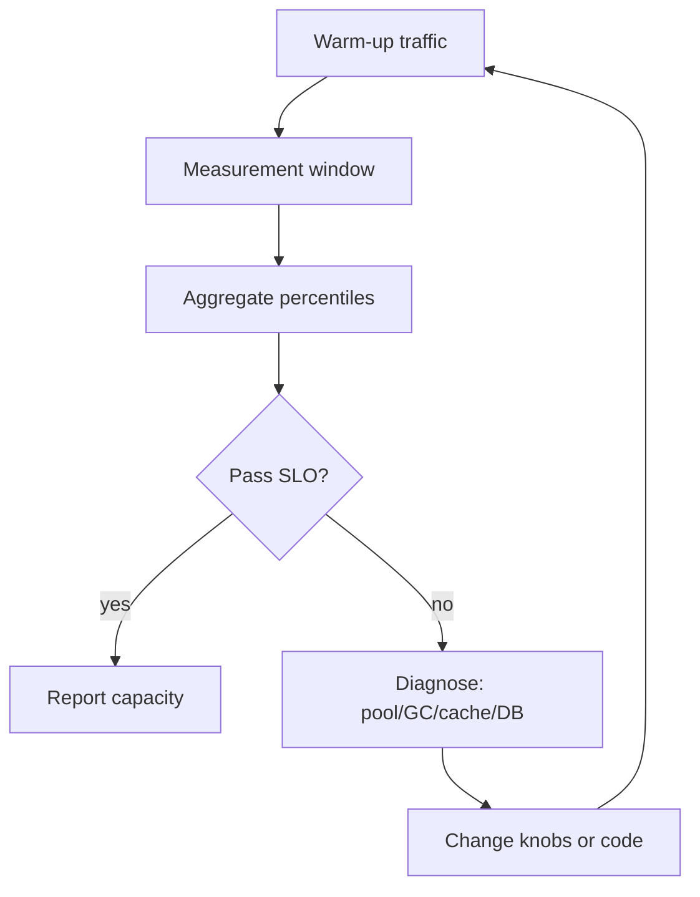

# Load Testing and Capacity

> **Status:** Completed  
> **Module:** 46 — Caching and Performance Engineering  
> **Target Java version:** 21  
> **Last reviewed:** 2026-11-11  
> **Chapter profile:** Technical  
> **Depth target:** Levels 2–3

**Note:** Do not fabricate benchmark numbers. When you run load tests, record JDK vendor/version, heap flags, pool sizes, generator host, and warm-up policy. This chapter teaches method; tables labeled **Illustrative** are worksheets, not Verified results.

## 1. Learning Objectives

After completing this chapter, you should be able to:

- Plan **load**, **stress**, **soak**, and **spike** tests with explicit goals and pass/fail criteria.
- Interpret **latency percentiles**, throughput, and error rates together—not averages alone.
- Connect results to **JVM**, **thread pools**, **DB pool**, and **GC** (Modules 26–28) and **cache hit rate** (Ch.01–02).
- Apply **Little’s Law** sketches to size concurrency and pools.
- Avoid **mistaking load generator limits** for system limits.
- Write a capacity worksheet that survives review (assumptions visible).

## 2. Prerequisites

- **Module 30** — testing mindset; flaky tests erode trust (same for load scripts).
- **Module 33** — connection pooling; `maximumPoolSize` vs DB `max_connections`.
- **Chapters 01–02** — caching patterns and stampede behavior after cold deploy.
- **Module 47 (forward link)** — SLOs consume the percentiles you measure here; briefly: an SLO is a target on an SLI such as “99% of requests < 800ms.”

**Refresher:** A **percentile** (p99) is the latency at which 99% of requests were faster. Averages hide the tail users feel. **Saturation** means a resource (CPU, pool, disk, Redis) is near capacity so queues grow.

## 3. Why This Concept Exists

Production traffic exposes bottlenecks unit tests never see: pool exhaustion, lock contention, GC pause tails, cache cold starts, and cascading timeouts. **Load testing before launch** validates SLOs (Module 47) and capacity plans; without it, teams discover limits during revenue events.

Load testing answers:

1. Can we meet the SLO at forecast peak?
2. What breaks first when we exceed peak?
3. Does the system stay stable for hours (leaks)?
4. What happens on a sudden spike (herd, autoscaling lag)?

## 4. Conceptual Explanation

### 4.1 Test types

| Type | Goal | Duration | Pass criteria idea |
|------|------|----------|--------------------|
| **Load** | Expected peak traffic | Minutes | Meet SLO at peak RPS |
| **Stress** | Find breaking point | Ramp until failure | Document knee of curve |
| **Soak** | Leaks, drift, metaspace | Hours–days | Stable heap/threads/error rate |
| **Spike** | Sudden burst | Short ramp | Recover without cascading failure |

Each type answers a different question: load tests **confidence** at peak; stress tests **headroom**; soak tests **stability**; spike tests **autoscaling** and herd behavior.

### 4.2 Metrics that matter

- **Throughput:** successful requests per second.
- **Latency:** **p50, p95, p99**—not average alone (long tail drives user pain).
- **Error rate:** 5xx, timeouts, circuit-open counts.
- **Saturation:** CPU, GC pause, Hikari pending threads, Redis latency, cache hit ratio.

```text
SLO example (illustrative target, not a measured result):
99% of checkout POST < 800ms at 500 RPS with <0.1% errors
```

### 4.3 Tooling (awareness)

| Tool | Role |
|------|------|
| **JMeter**, **Gatling**, **k6** | Script scenarios; distributed workers for high RPS |
| **JMH** (Module 28) | Microbenchmarks—not a substitute for system tests |
| **JFR / async-profiler** | Explain *why* latency grew under load |

Do not fabricate benchmark numbers in documentation; record JDK, heap, `MaxRAMPercentage`, pool sizes, and generator host when you run tests.

## 5. Mechanism and Execution Flow

### 5.1 Load test execution pipeline



**Warm-up:** JIT compilation, pool fill, cache heat—exclude first N minutes from SLO accounting unless cold-start is an explicit SLI (deploy spike is a real production concern—test it separately).

### 5.2 Bottleneck localization under Java

| Symptom | Likely cause | Where to look |
|---------|--------------|---------------|
| p99 up, CPU low | Pool wait, lock, external timeout | Hikari metrics, thread dump |
| p99 up, GC log spikes | Heap too small, allocation rate | `-Xlog:gc*` (Module 27) |
| Error burst after deploy | Cold cache stampede | Hit ratio metric (Ch.01) |
| Generator CPU 100% | Too few workers | Scale drivers, lower per-node RPS |
| Redis p99 up, app CPU low | Network/pool/Redis CPU | Lettuce pool, Redis `INFO` |

### 5.3 Little’s Law sketch

`concurrency ≈ throughput × latency` (steady state, same units).

If mean service time is 200ms and you need 500 RPS, you need ~100 in-flight requests unless batching—size threads/pools accordingly, not “200 threads because 200 RPS.”

**Worked intuition:** 400 RPS × 0.12 s ≈ 48 concurrent requests. Thread pool and DB pool must cover concurrency **plus** headroom for spikes; DB `max_connections` must cover `replicas × Hikari max`.

### 5.4 Capacity worksheet (illustrative)

| Input | Formula / note |
|-------|----------------|
| Peak RPS | From product forecast |
| Per-instance RPS | Peak / replicas |
| DB connections | `replicas × Hikari max` < DB `max_connections` |
| Heap | Container limit × `MaxRAMPercentage` + metaspace/native headroom (Module 48) |
| Cache | Target hit ratio; miss RPS × origin cost |

## 6. Test Environment Fidelity

| Aspect | Risk if wrong |
|--------|----------------|
| Smaller DB than prod | False confidence |
| No replica lag modeled | Misleading read paths |
| Mocked payment | Ignores real timeouts |
| No Redis / always-hot cache | Misses stampede and RTT |
| Generator on same host as SUT | Contends for CPU/NIC |

Use **scaled-down but proportional** stacks or cost-approved prod-like staging. Document every intentional difference in the report.

## 7. Java Service Knobs Under Load

- **Tomcat / virtual threads:** max connections must align with DB pool (Module 24). Virtual threads do not remove DB pool limits—they make it easier to create more waiters.
- **HikariCP** `maximumPoolSize`—each waiting thread is latency.
- **GC:** G1/ZGC pause targets; heap too small → allocation stalls.
- **Cache:** Caffeine size/TTL; Redis pool; warm-up policy (Ch.01–02).

### Saturation checklist (Java stack)

| Symptom | Likely bottleneck | Confirm with |
|---------|-------------------|--------------|
| Rising p99, flat CPU | Pool wait (Hikari, Lettuce) | Pool pending metrics, thread dumps |
| CPU pegged, flat RPS | GC or inefficient hot path | JFR, async-profiler |
| 5xx spike, flat latency | Downstream timeout | Trace spans, circuit breaker state |
| Cache hit ratio collapse | Deploy or TTL alignment | Micrometer cache stats |

## 8. Caching Under Load

Measure **hit rate** during the test. Cold cache at start mimics deploy—document warm-up policy. A high miss rate during measurement explains DB saturation even when code is “cached.”

**Separate scenarios:**

1. **Steady warm** — hit ratio near production target.
2. **Cold start / post-deploy** — all keys cold; stampede controls matter.
3. **Redis down** — bypass path; circuit breaker open (Ch.02 playbook).

## 9. Profiling Under Load (JDK 21)

1. Start JFR: `jcmd <pid> JFR.start duration=60s filename=load.jfr`
2. Correlate GC pauses with p99 spikes.
3. Compare **JIT warmed** vs **cold** windows—first-minute load after deploy is not steady state.
4. Capture thread dumps when p99 rises with low CPU.

Document **GC flags** and **heap size** in the test report; results are not portable across flag sets. Prefer Oracle/Temurin JDK 21 for handbook alignment; record the exact build.

## 10. Worked Example — Capacity Worksheet (Illustrative)

Assume checkout API on JDK 21:

| Input | Value |
|-------|-------|
| Peak RPS | 400 |
| p99 target | 300 ms |
| Avg service time (warm) | 120 ms |
| Cache hit ratio | 92% |

**Rough in-flight:** 400 × 0.12 ≈ 48 concurrent requests if perfectly pipelined—plan concurrency ≥ 48 + headroom; Hikari max per instance often 20–30 with 4 replicas → verify DB `max_connections > 4 × 30`.

**Load test script shape (k6/JMeter conceptual):**

1. **Warm-up** 5 min at 50% RPS (JIT + cache fill).
2. **Steady** 20 min at 100% RPS; record p50/p95/p99.
3. **Spike** 2 min at 150% RPS; observe error budget burn.
4. **Cool-down** 3 min; watch GC and pool recovery.

Never compare runs with different heap flags or missing cache warm-up.

## 11. Real-World Use Cases

- Black Friday rehearsal with 3× traffic and payment provider latency injection.
- Soak test finds `ThreadLocal` leak in custom pool over 12 hours.
- Stress test sets autoscaling policy max instances and DB connection budget.
- Post-incident: reproduce cache stampede after deploy with cold-start scenario.

## 12. Edge Cases and Limitations

- **Coordinated omission:** client drops slow responses—use tools reporting corrected latency.
- **Thundering herd** after deploy cold cache—pre-warm or gradual traffic shift (Module 48 canary).
- **Generator saturation:** laptop as sole generator understates system capacity.
- **Think time:** zero think time creates unrealistic concurrency; model user pacing.
- **Mixed workloads:** read-heavy vs write-heavy ratios change cache and DB pressure—match production mix.

## 13. Common Mistakes

| Mistake | Fix |
|---------|-----|
| Laptop as sole generator | Separate load driver fleet |
| Ignore think time | Model realistic pacing |
| Single metric focus | CPU low but pool exhausted |
| Skip cache metrics | Misattribute DB pain |
| Compare cold vs warm as same run | Separate windows; label reports |
| Trust average latency | Use percentiles + error rate |

### Incorrect

```text
"Average latency 80ms so we pass the 300ms p99 SLO."
```

### Corrected

```text
Report p50/p95/p99 and error rate in the measurement window; SLO uses the percentile named in the SLI.
```

## 14. Design Trade-offs

| Long soak in CI | Nightly / pre-release soak |
|-----------------|----------------------------|
| Slow PR feedback | Catches leaks |

| Stress to destruction in staging | Load at forecast only |
|----------------------------------|----------------------|
| Finds limits | May need repair window |

| Synthetic perfect data | Production-like skew |
|------------------------|----------------------|
| Repeatable | Exposes hot keys / skew |

| Full prod clone | Proportional staging |
|-----------------|----------------------|
| Highest fidelity / cost | Cheaper; document gaps |

## 15. Performance Considerations

- Exclude warm-up from SLO windows unless cold-start SLO is intentional.
- Pin generator version and script hash in reports for reproducibility.
- Watch **client-side** vs **server-side** latency; load balancer timeouts can inflate errors without true app failure.
- After changing cache TTL or pool sizes, re-baseline—capacity reports age quickly.

## 16. Security Considerations

- Load tests against shared staging must not use production secrets or real PAN.
- Do not DDoS third-party sandboxes; respect provider rate limits and use stubs when contracted.
- Scrub access logs from test PII before sharing reports broadly.

## 17. Revision and Mastery

**Track B gaps:**

- Load vs soak: which catches metaspace leak?
- Why p99 for checkout SLO instead of mean?
- Pool size vs thread count: what happens when threads > pool?
- How does a 40% cache hit ratio change DB connection planning at the same RPS?
- What is coordinated omission and why do averages lie?

## 18. Exercises

1. Write load test scenario for `GET /products/{id}` with cache-aside; define warm-up and measurement windows.
2. Capacity worksheet: RPS, p95 target, replicas, pool size, Redis hit ratio goal; show `replicas × Hikari < max_connections`.
3. List three JVM flags you would log alongside test results on JDK 21.
4. Design a spike test that distinguishes generator saturation from application saturation.

## 19. Reporting Template (What to Record)

Every load-test report should answer “can we reproduce this?”:

| Field | Example |
|-------|---------|
| JDK | Oracle JDK 21.0.9 / Temurin 21.0.x (exact build) |
| Heap / GC | `-XX:MaxRAMPercentage=75`, G1 |
| App image digest | `sha256:…` |
| Pool sizes | Hikari 30, Lettuce 16 |
| Generator | k6 vX on 4 workers; script hash |
| Scenario mix | 80% GET product, 20% POST cart |
| Warm-up | 5 min excluded from SLO window |
| Results | p50/p95/p99, RPS, errors, hit ratio |

Without these fields, “it was fast last month” is folklore.

## 20. Connecting Cache Misses to Capacity

Miss RPS ≈ offered RPS × (1 − hit ratio). If origin costs 15 ms and you suddenly drop from 92% to 40% hit ratio at 400 RPS:

```text
extra origin work ≈ 400 × (0.60 − 0.08) × 15 ms  → large concurrency bump
```

Use this arithmetic in post-deploy reviews when Module 47 burn alerts fire after a “harmless” TTL change.

## 21. Coordinated Omission and Client Limits

If the load generator stops creating new requests while waiting on slow ones, measured latency **understates** user pain (coordinated omission). Prefer tools/modes that account for intended arrival rate. Similarly, if the generator CPU is pegged, you measured the laptop—not the service. Always chart generator CPU alongside SUT metrics.

## 22. Chapter Summary

Load testing validates Java services against percentile latency and error SLOs with realistic drivers and environment parity—interpreting **pools, GC, cache hit rate, and saturation** together. Use Little’s Law to size concurrency, separate warm vs cold cache scenarios, and never publish invented benchmark numbers as Verified results.


## 23. Scenario Matrix — What Each Test Proves

| Scenario | Traffic shape | Primary question |
|----------|---------------|------------------|
| Warm steady | Peak RPS after warm-up | Meet SLO with hot cache/JIT |
| Cold start | Peak immediately after deploy | Stampede / herd controls |
| Spike | 1.5–2× for 1–2 minutes | Autoscaling + queueing behavior |
| Soak | Moderate RPS for hours | Leaks, metaspace, FD growth |
| Dependency slow | Injected 500ms payment delay | Timeout/breaker correctness |

Run at least warm + cold intentionally; mixing them in one unlabeled window produces meaningless percentiles.

## 24. Pool Math vs Virtual Threads

Virtual threads (Module 24) make it easy to have tens of thousands of waiting tasks. They do **not** multiply DB capacity. If Hikari `maximumPoolSize=30`, the 31st waiter blocks regardless of virtual vs platform threads. Load tests that only raise client concurrency without watching pool pending metrics will “prove” the app scales until the database collapses.

**Mechanism:** client RPS ↑ → in-flight ↑ (Little’s Law) → pool wait queue ↑ → p99 ↑ while CPU may stay low.

## 25. Pass/Fail Rubric Example

```text
PASS if measurement window shows:
  - p99(checkout) <= 300ms
  - error rate < 0.1%
  - hikaricp pending p95 < 5
  - cache hit ratio >= 85% (warm scenario only)
FAIL otherwise; attach JFR + thread dump for FAIL runs
```


## 26. Interpreting Flat RPS with Rising Latency

If RPS plateaus while p99 climbs, you likely hit a **concurrency ceiling** (pool, lock, or downstream rate limit), not “CPU done.” Chart:

- Offered load vs accepted RPS
- Pool pending
- Downstream latency

Fixing “add more pods” without pool math often multiplies the bottleneck (more pods × same Hikari max → DB `max_connections` exhaustion).

## Review Checklist

- [x] Technical L2–3; test pipeline mechanism; no fabricated benchmark results
- [x] Test types, metrics, fidelity, Little’s Law, caching under load, profiling
- [x] Reporting template; miss-ratio arithmetic; coordinated omission
- [x] Incorrect/corrected percentile mistake; trade-offs; exercises
- [x] Fourth EXPAND-PRESERVE deepen pass 2026-11-11
