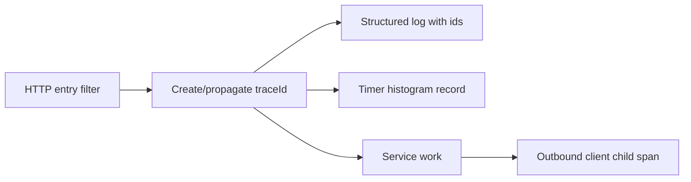
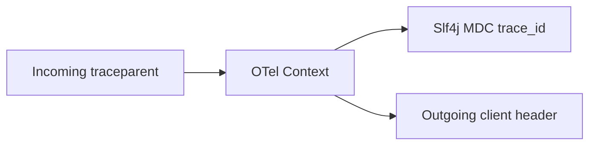
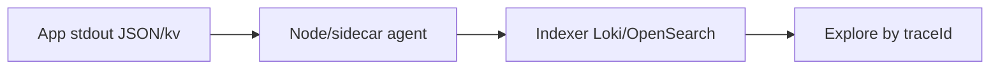

# Logging, Metrics, and Tracing

> **Status:** Completed  
> **Module:** 47 — Observability and Monitoring  
> **Target Java version:** 21  
> **Last reviewed:** 2026-11-11  
> **Chapter profile:** Technical  
> **Depth target:** Levels 2–3  
> **Examples verified with:** Oracle JDK 21.0.9 (re-run 2026-11-11; field values match prior Temurin 21.0.12.1 baseline; timestamps and `Map.of` field order may vary) — [structured-logging-demo](../../examples/observability/structured-logging-demo/)

## 1. Learning Objectives

After completing this chapter, you should be able to:

- Apply the **three pillars**: logs, metrics, traces—and know which answers which question.
- Run [StructuredLoggingDemo](../../examples/observability/structured-logging-demo/) and design key=value fields for search.
- Use **correlation ids** across HTTP and messaging (Modules 32, 45).
- Choose log levels and **avoid secret leakage** (Module 43).
- Reason about **cardinality** budgets before adding metric labels.
- Propagate W3C `traceparent` / MDC consistently so incidents stay searchable.

## 2. Prerequisites

- **Module 31** — diagnostics mindset: reproduce before tune.
- **Module 44** — distributed calls; timeouts and retries affect trace shape.
- **Module 37 (helpful)** — Actuator endpoints for metrics exposure.

**Refresher:** **Observability** is the ability to infer internal state from external outputs (logs, metrics, traces). **Monitoring** is often the operational practice (dashboards, alerts) built on those signals. A **correlation id** is a stable identifier that appears in every log/span for one user request so you can reconstruct the story.

## 3. Why This Concept Exists

Production failures require answering: **what happened** (logs), **how often** (metrics), **which request path** (traces). Unstructured `println` output does not scale across pods, time zones, and centralized search. Without correlation ids, you cannot tie a user's checkout failure to a payment client timeout three hops away.

Teams that only collect metrics know *that* error rate rose; teams with structured logs and traces know *which* dependency and *which* order ids burned the error budget.

## 4. Conceptual Explanation

### 4.1 Three pillars

| Pillar | Question | Examples |
|--------|----------|----------|
| **Logs** | What event occurred? | Error with stack, audit trail |
| **Metrics** | How much / how fast? | RPS, p99 latency, pool usage |
| **Traces** | Which services in one request? | Span tree across calls |

Use all three: **metrics alert**; **logs explain**; **traces localize** latency.

### 4.2 Structured logging

**Structured logging** emits machine-parseable fields (JSON or `key=value`):

Benefits: filter in ELK/Loki/OpenSearch; correlate with `traceId`.

**JDK:** `java.util.logging`. Production Spring apps typically use **SLF4J** façade + Logback/Log4j2.

| Anti-pattern | Prefer |
|--------------|--------|
| Prose sentences only | Stable `event=` names + dimensions |
| String concat always | Parameterized `log.info("user={}", id)` |
| Logging whole entities | Selected fields; watch Hibernate `toString` |

### 4.3 Correlation and context

| Id | Role |
|----|------|
| **traceId** | One user request across services (W3C `traceparent`) |
| **spanId** | Sub-operation within a service |
| **correlationId** | Business-friendly id (order id) in addition |

Propagate on `HttpClient` and message headers (Module 45). Put ids in **MDC** so every log line in the request carries them without manual repetition.

### 4.4 Metrics types

| Type | Use |
|------|-----|
| **Counter** | Monotonic (errors total) |
| **Gauge** | Point-in-time (heap used) |
| **Histogram / Summary** | Latency distribution |

**Micrometer** (Spring Boot Actuator) abstracts Prometheus, Datadog, etc. Expose `/actuator/prometheus` when using Prometheus (Ch.02).

### 4.5 Distributed tracing (conceptual)

Each inbound HTTP call creates a **span**; outbound calls become child spans. **OpenTelemetry** (Ch.02) standardizes API and export. Without a collector, still propagate headers and log ids locally—partial observability beats none.

## 5. Mechanism and Execution Flow

### 5.1 Request observability path



**Prose:** The filter runs once per request: read `traceparent` or generate ids, set MDC, start a server span/timer. Business code logs with event names. Outbound clients inject headers so the next service continues the same trace.

### 5.2 Log → metric → trace during incident

1. **Alert** fires on elevated `http.server.5xx` rate (metric).
2. Engineer filters `level=ERROR` logs with same `traceId` (logs).
3. Trace UI shows payment client span at 30s timeout (trace).

### 5.3 OpenTelemetry context propagation (conceptual)



If the gateway strips `traceparent`, downstream services start **new traces**—incidents look disconnected. Enforce header pass-through at ingress (Module 32 / API gateway).

## 6. Terminology

| Term | Meaning |
|------|---------|
| **Cardinality** | Number of unique label combinations (high = costly) |
| **Golden signals** | Latency, traffic, errors, saturation |
| **Structured field** | Named dimension in log line (`event=order.placed`) |
| **MDC** | Mapped Diagnostic Context — thread-local (or VT-aware) log fields |
| **Sampling** | Exporting a fraction of traces to control cost |

## 7. Step-by-Step Examples

### 7.1 Incorrect vs correct logging

### Incorrect

```java
System.out.println("Order placed " + orderId);
log.info("user=" + userId); // eager concat; no event name
```

### Correct

```java
log.info("order.placed orderId={} userId={}", orderId, userId);
// or map-based fields as in StructuredLoggingDemo
```

### 7.2 Runnable demo — **Verified (Oracle JDK 21.0.9)**

```bash
cd examples/observability/structured-logging-demo
javac StructuredLoggingDemo.java
java StructuredLoggingDemo
```

**Verified output** (re-run 2026-11-11 on Oracle JDK 21.0.9). Timestamps vary by run; `Map.of` field order after `event` may vary; required fields and harness marker are stable:

```text
ts=2026-11-11T03:05:50.555401100Z level=INFO event=order.placed amountCents=1999 orderId=ord-42 userId=user-7
ts=2026-11-11T03:05:50.580522900Z level=WARN event=payment.retry attempt=2 reason=timeout
structured-logging=ok
```

Important lines:

- `event=order.placed` is a stable **event name** for dashboards and alerts.
- `orderId`, `userId`, `amountCents` are **dimensions** for support search—not unstructured prose.
- `structured-logging=ok` is the harness marker.

### 7.3 Correlation ID conventions (Illustrative)

| Header | Typical name | Propagate to |
|--------|--------------|--------------|
| W3C trace | `traceparent` | Outbound HTTP, messaging |
| Legacy | `X-Correlation-Id` | Logs when trace not yet adopted |

In Spring, register a `OncePerRequestFilter` that reads incoming id or generates UUID, sets **MDC** (`mdc.put("correlationId", id)`), and adds to `RestClient` / `WebClient` builders for outbound calls.

**Incorrect:** new UUID per log line inside one request—breaks search in Kibana/Loki.

### 7.4 SLF4J usage patterns

| Pattern | Prefer |
|---------|--------|
| `log.info("user=" + userId)` | `log.info("user={}", userId)` — avoids eager string work when level disabled |
| Logging DTO whole object | Log selected fields; beware `toString()` on lazy Hibernate proxies |
| `ERROR` for business validation | `WARN` or `INFO`; reserve `ERROR` for operator action |

## 8. Log Levels

| Level | Use |
|-------|-----|
| **ERROR** | Action needed; user impact |
| **WARN** | Degraded, retry succeeded |
| **INFO** | Business milestones, startup |
| **DEBUG** | Troubleshooting; off in prod default |

Never **DEBUG** full payloads with PII in production. Prefer sampling or redaction filters for sensitive paths.

## 9. Cardinality Budget

Before adding a label `tenant_id` on a counter, estimate: `tenants × time_series_per_tenant`. Above ~10k active series per scrape interval often hurts Prometheus—use logs/traces for tenant drill-down.

| Put on metrics | Put on logs/traces |
|----------------|--------------------|
| `uri` template (`/users/{id}`) | Raw `/users/7` |
| `status` class | Full exception message |
| `outcome` | `userId`, `orderId` |

## 10. Real-World Use Cases

- Checkout incident: metric spike 503 → trace shows payment client timeout → logs show `orderId`.
- Audit: structured `security.login.failure` with hashed principal only.
- Capacity: gauge of Hikari pending threads before pool exhaustion (Module 46).
- Feature flag evaluation: INFO milestones without DEBUG spam.

## 11. Edge Cases and Limitations

- **High cardinality labels:** `userId` on every Prometheus metric explodes cost—use logs/traces for ids.
- **Async logging:** buffer loss on crash—balance durability vs latency.
- **Virtual threads + MDC:** ensure context propagation libraries are VT-aware; stale MDC is a classic footgun.
- **Sampling:** partial traces can mislead—always keep `traceId` in error logs even when spans are dropped.

## 12. Common Mistakes

| Mistake | Fix |
|---------|-----|
| Logging secrets | Redact filters |
| Only average latency | Histogram percentiles |
| Missing trace propagation | Filter/interceptor inject headers |
| String concat logs | Parameterized / structured fields |
| New correlation id per log line | One id per request in MDC |

## 13. Design Trade-offs

| Verbose logging | Lean logging |
|-----------------|--------------|
| Easier debug | Cost, noise, PII risk |

| Push metrics | Pull (Prometheus, Ch.02) |
|--------------|---------------------------|
| Agent on app | Scraper scrapes Actuator |

| 100% traces | Sampled traces |
|-------------|----------------|
| Max fidelity / cost | Cheaper; risk of missing rare paths |

## 14. Performance Considerations

- Disabled log levels should not allocate heavy strings—use parameterized logging.
- Metric timers have overhead; avoid per-field high-cardinality labels.
- Synchronous console logging under load can stall threads; prefer async appenders with bounded queues and overflow policy documented.

## 15. Security Considerations

- Redact Authorization headers, cookies, PAN, passwords.
- Hash or tokenize principals in security audit events when possible.
- Restrict who can query production logs containing PII (Module 43).

## 16. Revision and Mastery

**Track B gaps:**

- When metric vs log vs trace for “payment slow sometimes”?
- Which fields in the demo line identify the business event?
- Name one high-cardinality label to avoid on metrics.
- Why does stripping `traceparent` at the gateway break incident response?

## 17. Exercises

1. Add `traceId` field to structured logger helper; propagate from incoming header.
2. List three Micrometer metrics for a REST service (traffic, latency, saturation).
3. Define log policy for payment errors (fields, no PAN).
4. Estimate cardinality of `http_server_requests{uri}` if uri is the raw path including ids.

## 18. Worked Incident Narrative (Three Pillars Together)

**Symptom:** Checkout 5xx rate rises from 0.05% to 2% for 12 minutes.

1. **Metric:** Alert on `rate(http_server_requests_seconds_count{uri="/checkout",status=~"5.."}[5m])`.
2. **Trace:** Sampled traces show `payment.charge` span ≈ 30 s with status ERROR; upstream spans normal.
3. **Log:** `event=payment.retry reason=timeout orderId=… traceId=…` confirms client timeout, not deserialization bugs.
4. **Action:** Open breaker / fail soft per Module 44; page payment provider; preserve `traceId`s for the vendor ticket.

Without structured `event=` and propagated `traceId`, step 3 becomes grepping free text across pods.

## 19. MDC and Virtual Threads (Caveat)

Classic MDC is thread-local. Under virtual threads (Module 24), frameworks must copy context when hopping carriers. Prefer libraries that integrate Micrometer Tracing / OTel context with MDC automatically. **Symptom of broken propagation:** logs inside async work lack `traceId` even though the HTTP filter set it.

### Incorrect

```java
CompletableFuture.runAsync(() -> log.info("done")); // may lose MDC
```

### Corrected

```java
// Prefer framework-wrapped executors / TaskDecorator that copies MDC/OTel context
// or capture Map<String,String> context = MDC.getCopyOfContextMap() and restore in task
```

## 20. Event Naming Conventions

| Good | Why |
|------|-----|
| `order.placed` | Stable, past-tense business fact |
| `payment.retry` | Actionable operational event |
| `cache.miss` | Low-cardinality ops signal (count via metrics preferably) |

| Avoid | Why |
|-------|-----|
| `Something went wrong with order` | Unparseable prose |
| `error` | Too vague for dashboards |
| Per-user unique event names | Cardinality explosion |

## 21. Chapter Summary

Observability combines structured logs, metrics with percentiles, and distributed traces linked by correlation ids—the demo proves key=value logging on JDK 21 without external stacks. Keep cardinality under control, propagate context at every hop, and use the three pillars together during incidents.

## 22. Next Steps

[02-opentelemetry-and-prometheus.md](02-opentelemetry-and-prometheus.md)


## 23. Progressive Metrics Example (Illustrative)

Minimal counter:

```java
// Illustrative Micrometer
Counter.builder("orders.placed").register(registry).increment();
```

Realistic timer with low-cardinality tags:

```java
Timer.Sample sample = Timer.start(registry);
try {
    return checkout(order);
} finally {
    sample.stop(Timer.builder("http.server.requests")
        .tag("uri", "/checkout")
        .tag("method", "POST")
        .tag("status", String.valueOf(status))
        .register(registry));
}
```

**Why these tags:** `uri` is a template, `status` is bounded, `method` is tiny cardinality. Adding `orderId` here would destroy Prometheus.

## 24. Log Shipping Pipeline (Mechanism Sketch)



Apps should log to **stdout** in containers (Ch.01/Module 49); agents ship centrally. Filing local disk logs inside ephemeral containers loses data on restart.

## 25. Redaction Patterns

| Field | Approach |
|-------|----------|
| Authorization | Drop or replace with `REDACTED` |
| PAN | Never log; tokenize upstream |
| Email | Hash or truncate in prod |
| Stack traces | Keep for ERROR; scrub query strings with secrets |

## Review Checklist

- [x] Technical L2–3; mechanism flow; three pillars; Mandatory Depth Review
- [x] `structured-logging-demo` Verified Oracle JDK 21.0.9
- [x] Incorrect/correct logging; cardinality; security/performance
- [x] Incident narrative; MDC/VT caveat; event naming
- [x] Fourth EXPAND-PRESERVE deepen pass 2026-11-11
