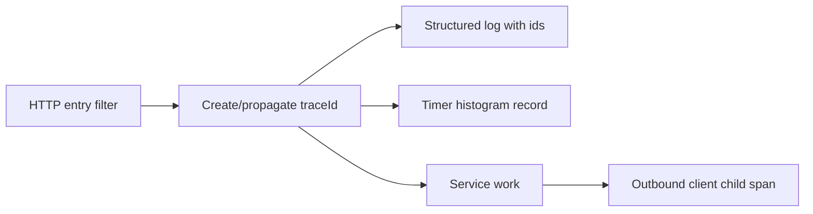

# Logging, Metrics, and Tracing

> **Status:** Completed  
> **Module:** 47 — Observability and Monitoring  
> **Target Java version:** 21  
> **Last reviewed:** 2026-11-11  
> **Chapter profile:** Technical  
> **Depth target:** Levels 2–3  
> **Examples verified with:** Temurin JDK 21.0.12.1 — [structured-logging-demo](../../examples/observability/structured-logging-demo/)

## 1. Learning Objectives

- Apply the **three pillars**: logs, metrics, traces—and know which answers which question.
- Run [StructuredLoggingDemo](../../examples/observability/structured-logging-demo/) and design key=value fields for search.
- Use **correlation ids** across HTTP and messaging (Modules 32, 45).
- Choose log levels and **avoid secret leakage** (Module 43).

## 2. Prerequisites

- **Module 31** — diagnostics mindset: reproduce before tune.
- **Module 44** — distributed calls; timeouts and retries affect trace shape.

**Refresher:** **Observability** is the ability to infer internal state from external outputs (logs, metrics, traces). **Monitoring** is often the operational practice (dashboards, alerts) built on those signals.

## 3. Why This Concept Exists

Production failures require answering: **what happened** (logs), **how often** (metrics), **which request path** (traces). Unstructured `println` output does not scale across pods, time zones, and centralized search. Without correlation ids, you cannot tie a user's checkout failure to a payment client timeout three hops away.

## 4. Conceptual Explanation

### Three pillars

| Pillar | Question | Examples |
|--------|----------|----------|
| **Logs** | What event occurred? | Error with stack, audit trail |
| **Metrics** | How much / how fast? | RPS, p99 latency, pool usage |
| **Traces** | Which services in one request? | Span tree across calls |

Use all three: **metrics alert**; **logs explain**; **traces localize** latency.

### Structured logging

**Structured logging** emits machine-parseable fields (JSON or `key=value`):

Benefits: filter in ELK/Loki/OpenSearch; correlate with `traceId`.

**JDK:** `java.util.logging`. Production Spring apps typically use **SLF4J** façade + Logback/Log4j2.

### Incorrect

```java
System.out.println("Order placed " + orderId);
```

### Correct

```java
log.info("order.placed orderId={} userId={}", orderId, userId);
```

Or map-based fields as in `StructuredLoggingDemo`.

### Correlation and context

| Id | Role |
|----|------|
| **traceId** | One user request across services (W3C `traceparent`) |
| **spanId** | Sub-operation within service |
| **correlationId** | Business-friendly id (order id) in addition |

Propagate on `HttpClient` and message headers (Module 45).

### Metrics types

| Type | Use |
|------|-----|
| **Counter** | Monotonic (errors total) |
| **Gauge** | Point-in-time (heap used) |
| **Histogram / Summary** | Latency distribution |

**Micrometer** (Spring Boot Actuator) abstracts Prometheus, Datadog, etc. Expose `/actuator/prometheus` when using Prometheus (Ch.02).

### Distributed tracing (conceptual)

Each inbound HTTP call creates a **span**; outbound calls become child spans. **OpenTelemetry** (Ch.02) standardizes API and export. Without a collector, still propagate headers and log ids locally.

## 5. Mechanism and Execution Flow

### Request observability path



### Log → metric → trace during incident

1. **Alert** fires on elevated `http.server.5xx` rate (metric).
2. Engineer filters `level=ERROR` logs with same `traceId` (logs).
3. Trace UI shows payment client span at 30s timeout (trace).

## 6. Terminology

| Term | Meaning |
|------|---------|
| **Cardinality** | Number of unique label combinations (high = costly) |
| **Golden signals** | Latency, traffic, errors, saturation (Module 51 overlap) |
| **Structured field** | Named dimension in log line (`event=order.placed`) |

## 7. Examples

### Runnable demo — **Verified (Temurin 21.0.12.1)**

```bash
cd examples/observability/structured-logging-demo
javac StructuredLoggingDemo.java
java StructuredLoggingDemo
```

**Verified output:**

```text
ts=2026-11-10T18:12:07.127607500Z level=INFO event=order.placed amountCents=1999 userId=user-7 orderId=ord-42
ts=2026-11-10T18:12:07.149607800Z level=WARN event=payment.retry attempt=2 reason=timeout
structured-logging=ok
```

Important lines:

- `event=order.placed` is a stable **event name** for dashboards and alerts.
- `orderId`, `userId`, `amountCents` are **dimensions** for support search—not unstructured prose.
- `structured-logging=ok` is the harness marker (timestamps vary by run).

## 8. Log Levels

| Level | Use |
|-------|-----|
| **ERROR** | Action needed; user impact |
| **WARN** | Degraded, retry succeeded |
| **INFO** | Business milestones, startup |
| **DEBUG** | Troubleshooting; off in prod default |

Never **DEBUG** full payloads with PII in production.

## 9. Real-World Use Cases

- Checkout incident: metric spike 503 → trace shows payment client timeout.
- Audit: structured `security.login.failure` with hashed principal only.
- Capacity: gauge of Hikari pending threads before pool exhaustion.

## 10. Edge Cases

- **High cardinality labels:** `userId` on every Prometheus metric explodes cost—use logs/traces for ids.
- **Async logging:** buffer loss on crash—balance durability vs latency.

## 11. Common Mistakes

| Mistake | Fix |
|---------|-----|
| Logging secrets | Redact filters |
| Only average latency | Histogram percentiles |
| Missing trace propagation | Filter/interceptor inject headers |
| String concat logs | Parameterized / structured fields |

## 12. Design Trade-offs

| Verbose logging | Lean logging |
|-----------------|--------------|
| Easier debug | Cost, noise, PII risk |

| Push metrics | Pull (Prometheus, Ch.02) |
|--------------|---------------------------|
| Agent on app | Scraper scrapes Actuator |

## 13. Revision and Mastery

- When metric vs log vs trace for “payment slow sometimes”?
- Which fields in demo line identify the business event?
- Name one high-cardinality label to avoid on metrics.

## 14. Exercises

1. Add `traceId` field to structured logger helper; propagate from incoming header.
2. List three Micrometer metrics for a REST service.
3. Define log policy for payment errors (fields, no PAN).

## 15. Chapter Summary

Observability combines structured logs, metrics with percentiles, and distributed traces linked by correlation ids—the demo proves key=value logging on Temurin 21 without external stacks.

## 16. Next Steps

[02-opentelemetry-and-prometheus.md](02-opentelemetry-and-prometheus.md)

## Review Checklist

- [x] Technical L2–3; mechanism flow; three pillars preserved
- [x] `structured-logging-demo` Verified Temurin 21.0.12.1
- [x] Incorrect/correct logging; cardinality note
