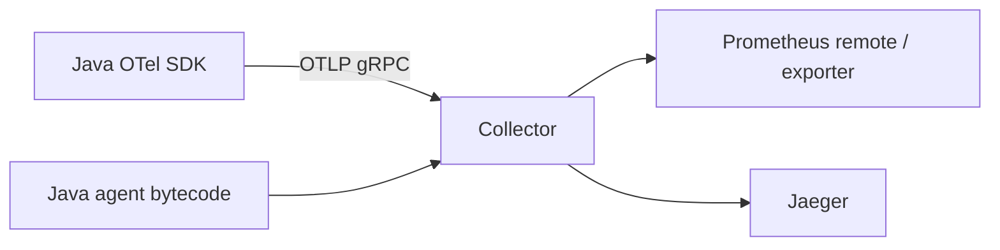
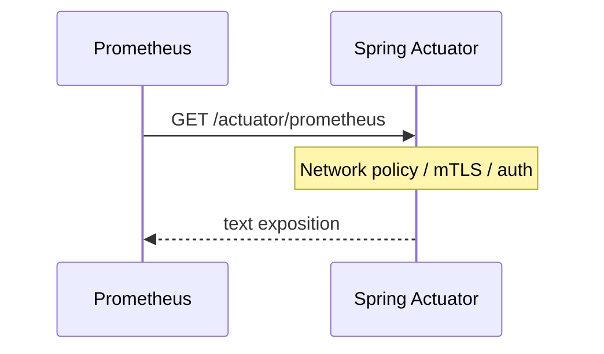

# OpenTelemetry and Prometheus

> **Status:** Completed  
> **Module:** 47 — Observability and Monitoring  
> **Target Java version:** 21  
> **Last reviewed:** 2026-11-11  
> **Chapter profile:** Technical  
> **Depth target:** Levels 2–3

**Note:** Full stack (OTel Collector + Prometheus + Grafana) is a lab exercise; this chapter documents **architecture and contracts**, not fabricated scrape or OTLP output. Validate queries and scrapes in staging—never invent Verified scrape samples here.

## 1. Learning Objectives

After completing this chapter, you should be able to:

- Describe **OpenTelemetry** (OTel) traces, metrics, logs signals and Java agent/SDK roles.
- Explain **Prometheus** pull model and **PromQL** basics for Spring Boot Actuator exports.
- Build **Grafana** dashboards and **alerting** rules at a high level tied to user journeys.
- Avoid vendor lock-in via **OTLP** export through a collector.
- Name Micrometer ↔ Prometheus exposition pitfalls (cardinality, raw paths).

## 2. Prerequisites

- [01-logging-metrics-and-tracing.md](01-logging-metrics-and-tracing.md) — pillars, Micrometer types, cardinality.
- **Module 37** — Spring Boot Actuator awareness.
- **Module 46 (helpful)** — latency percentiles and saturation signals you will query.

**Refresher:** **Instrumentation** means code (or an agent) records timings and spans. **Export** sends those signals to a backend. **OTLP** is the OpenTelemetry Protocol used between apps/agents and collectors. Prometheus **scrapes** (pulls) text exposition endpoints on an interval.

## 3. Why This Concept Exists

Every vendor once shipped proprietary agents. **OpenTelemetry** standardizes instrumentation and export; **Prometheus** excels at pull-based metrics and alerting in Kubernetes. Java teams need one mental model: instrument once, export via **OTLP**, route in the **collector**, scrape Micrometer/Prometheus endpoints for golden signals.

Without a standard:

- You rewrite instrumentation when switching APM vendors.
- Traces stop at service boundaries because headers disagree.
- Dashboards disagree with alerts because metric names drift.

## 4. Conceptual Explanation

### 4.1 OpenTelemetry overview

| Component | Role |
|-----------|------|
| **API** | App code creates spans/metrics |
| **SDK** | Implements export pipelines |
| **Instrumentation** | Auto for JDBC, HTTP, etc. |
| **Collector** | Receives OTLP; fans out to backends |
| **OTLP** | gRPC/HTTP protocol to collector |

Java options:

- **Java agent** (`-javaagent:opentelemetry-javaagent.jar`) — low-code HTTP/JDBC spans.
- **Manual** `Span` in critical business paths (`checkout.authorize`).

**Conceptual without local install:** plan header propagation (`traceparent`) and naming conventions (`http.server.duration`).

### 4.2 Spring Boot integration (awareness)

Spring Boot 3.x aligns with Micrometer tracing + OTel bridge:

```properties
# conceptual application.properties — Illustrative
management.tracing.sampling.probability=1.0
management.otlp.tracing.endpoint=http://collector:4317
```

Export to Jaeger, Tempo, or vendor via collector—not directly from app to many backends. Sampling `1.0` is for staging; production usually uses a lower probability plus always-on error sampling strategies provided by your stack.

### 4.3 Prometheus model

- **Pull:** Prometheus scrapes `GET /actuator/prometheus` periodically.
- **Time series:** `metric_name{label="value"} value timestamp`.
- **PromQL:** `rate(http_server_requests_seconds_count[5m])`.

Common JVM metrics:

- `jvm_memory_used_bytes`
- `http_server_requests_seconds` histogram
- `hikaricp_connections_active`

### 4.4 Micrometer ↔ Prometheus naming

| Micrometer | Prometheus exposition |
|------------|----------------------|
| `http.server.requests` timer | Histogram + `_count`, `_sum`, `_bucket` |
| Tags `uri`, `status` | Label cardinality risk on raw paths |

Prefer **templated routes** (`/api/users/{id}`) as tag values via Spring MVC observation—never raw `/users/7`, `/users/8` as separate time series.

## 5. Mechanism and Execution Flow

### 5.1 Java service → backends

```mermaid
flowchart LR
  JVM[Spring Boot JVM] --> A[/actuator/prometheus]
  JVM --> O[OTLP exporter]
  P[Prometheus] -->|scrape| A
  O --> C[OTel Collector]
  C --> J[Jaeger/Tempo/vendor]
  P --> G[Grafana]
  G --> AL[Alerts]
```

**Prose:** Metrics for Prometheus often leave via Actuator text format (pull). Traces (and optionally metrics/logs) leave via OTLP to a collector that fans out. Grafana queries Prometheus for panels and Alertmanager rules.

### 5.2 Trace propagation across HTTP

1. Incoming filter reads `traceparent` (or generates trace).
2. Outbound `RestTemplate`/`WebClient`/`RestClient` injects headers.
3. Spans exported via agent or Micrometer bridge to collector.

Sampling: 100% traces expensive—use probability in prod, full in staging. Keep structured logs with `traceId` even when spans are sampled out (Ch.01).

### 5.3 OTel collector pipeline sketch



Run collector as sidecar or shared service; apps only speak OTLP to a nearby collector endpoint. Avoid configuring every app with five vendor exporters.

### 5.4 Scrape security path



Exposing metrics without auth on a public network leaks topology and traffic shapes—use network policy + authentication appropriate to your platform (Module 49).

## 6. Terminology

| Term | Meaning |
|------|---------|
| **OTLP** | OpenTelemetry Protocol |
| **ServiceMonitor** | K8s CRD for Prometheus scrape config (Module 49) |
| **PromQL** | Prometheus query language |
| **Histogram bucket** | Latency upper-bound (`le`) used by `histogram_quantile` |
| **Pushgateway** | Push target for short-lived batch jobs (not long-lived services) |

## 7. Example PromQL Patterns (Illustrative)

```promql
# 5xx rate as fraction of all requests (5m window)
sum(rate(http_server_requests_seconds_count{status=~"5.."}[5m]))
  / sum(rate(http_server_requests_seconds_count[5m]))

# p99 from histogram (if buckets configured)
histogram_quantile(0.99, sum(rate(http_server_requests_seconds_bucket[5m])) by (le))

# Hikari pending connections (saturation)
hikaricp_connections_pending
```

Validate queries in staging—bucket layout must match histogram configuration. Wrong buckets → nonsense quantiles.

## 8. Alerting

Alertmanager rules (examples—tune thresholds to your SLO, Ch.03):

- `error_rate > 1%` for 5m on checkout.
- `hikaricp_connections_pending > 10` for 2m.
- Burn-rate alerts on error budget (Ch.03).

Tie alerts to **runbooks**. Page on **symptoms** (user-visible SLI) more than on every ERROR log.

### Incorrect

```text
Page on every log line with level=ERROR
```

### Corrected

```text
Page on SLO burn / 5xx rate / saturation; use ERROR logs for diagnosis after the page
```

## 9. Dashboards

Grafana panels that earn their keep:

- RPS and p95/p99 latency by endpoint (templated uri).
- Saturation: CPU, heap, pool wait, Redis RTT.
- Business KPI: orders/min (counter).
- Canary vs stable comparison during deploys (Module 48).

Start from **user journeys**, not from every JVM metric ever exported.

## 10. Real-World Use Cases

- K8s: ServiceMonitor scrapes each pod; same labels for HPA.
- Canary deploy: compare error metric canary vs stable.
- JDBC trace shows N+1 query span pattern.
- Batch job: Pushgateway for short-lived JVM; still export structured logs with job id.

## 11. Edge Cases and Limitations

- **Sampling:** partial traces can mislead—correlate with logs by trace id.
- **Cardinality:** avoid high-cardinality labels on Prometheus metrics (Ch.01).
- **Multiple agents:** conflicting bytecode instrumentation—use one pipeline.
- **Clock skew** across nodes confuses trace timelines—NTP discipline matters.
- **Actuator exposure:** `/actuator/**` must not be open on the public internet.

## 12. Common Mistakes

| Mistake | Fix |
|---------|-----|
| Multiple conflicting agents | One OTel pipeline |
| Scraping without auth | Network policy + mTLS |
| Dashboards without SLO | Start from user journeys (Ch.03) |
| Raw path as `uri` label | Template routes |
| App exports to five vendors | Collector fan-out |

## 13. Design Trade-offs

| Java agent auto-instrument | Manual spans only |
|------------------------------|-------------------|
| Broad coverage | Precise business events |

| Push gateway | Prometheus pull |
|--------------|-----------------|
| Short jobs | Long-lived services |

| Direct vendor SDK | OTLP → collector |
|-------------------|-------------------|
| Faster first demo | Portable; one ops surface |

| Full trace sampling | Probabilistic sampling |
|---------------------|------------------------|
| Max debug fidelity | Lower cost / storage |

## 14. Performance Considerations

- High scrape frequency × large exposition = CPU and network cost on the app.
- Unbounded label sets can OOM Prometheus; cardinality is a capacity problem (Module 46 mindset).
- Agent overhead is usually small vs network I/O; measure before blaming instrumentation for p99.

## 15. Security Considerations

- Protect Actuator and OTLP receivers; prefer private networks.
- Do not put secrets or PII in span attributes or metric labels.
- Scan agent JARs like any dependency (Module 30 / supply chain).

## 16. Revision and Mastery

**Track B gaps:**

- Pull vs push metrics for a 24/7 Spring service?
- Where does OTLP land before Jaeger?
- Actuator path for Prometheus scrape?
- Why do raw `/users/{uuid}` paths destroy Prometheus?
- When is Pushgateway appropriate vs harmful?

## 17. Exercises

1. Sketch diagram: JVM → Actuator → Prometheus → Grafana; and JVM → OTLP → Collector → Tempo.
2. Write PromQL for 5xx rate over 5m and explain each selector.
3. List three auto-instrumented libraries via OTel Java agent.
4. Draft an alert that pages on checkout SLO burn rather than raw ERROR count.

## 18. Naming and Semantic Conventions

Prefer OpenTelemetry / Micrometer semantic conventions where they exist:

| Signal | Prefer |
|--------|--------|
| HTTP server duration | Framework observation / `http.server.requests` |
| DB client | Auto-instrumented JDBC spans with sanitized statements |
| Custom business | `order.checkout.latency` style names; low-cardinality attrs |

**Incorrect:** span attribute `userEmail=a@b.com` on every request (PII + cardinality).  
**Corrected:** `userId` hashed or only in logs; metrics keep `outcome`/`error.type`.

## 19. Sampling Strategies (Practical)

| Environment | Typical approach |
|-------------|------------------|
| Local / staging | High or 100% sampling for learning |
| Production | Probabilistic (e.g. 1–10%) + always sample errors if supported |
| Incident war room | Temporarily raise sampling with cost awareness |

Sampling must not remove `traceId` from ERROR logs—logs remain the reliable join key when spans are dropped.

## 20. Grafana Panel Starter Set (User Journey)

For a checkout service, start with four panels before vanity JVM charts:

1. Successful checkout RPS and 5xx rate.
2. p95/p99 latency for `POST /checkout`.
3. Dependency latency: payment client + DB.
4. Saturation: Hikari pending, CPU, heap.

Only then add JVM minutiae. Dashboards that start from `jvm_*` alone train teams to watch the wrong thing during SEV-1s.

## 21. Chapter Summary

OpenTelemetry standardizes Java instrumentation and OTLP export; Prometheus scrapes Micrometer metrics for dashboards and alerts—deploy collectors in ops environments to realize the stack. Keep cardinality sane, protect scrape endpoints, and bind panels/alerts to user journeys and SLOs (Ch.03).

## 22. Next Steps

[03-slos-and-incidents.md](03-slos-and-incidents.md)


## 23. Collector as Policy Point

The collector is where you enforce:

- Attribute filtering (drop PII keys).
- Tail-based sampling decisions (if supported by your stack).
- Fan-out to multiple backends without app redeploys.

Treat collector config as production code: review, version, and roll back like any service (Module 48).

## 24. Actuator Exposure Matrix

| Endpoint | Prod default instinct |
|----------|----------------------|
| `/actuator/health` | Often public to LB; careful details |
| `/actuator/prometheus` | Private network / auth |
| `/actuator/env` | Never public — secrets risk |
| `/actuator/heapdump` | Break-glass only |

Misconfigured Actuator has caused credential leaks; pair with Spring Security and network policy.

## 25. Trace–Log Correlation Checklist

1. Same `trace_id` / `traceId` field name across services.
2. Ingress forwards `traceparent`.
3. Messaging carries trace context headers (Module 45).
4. ERROR logs always include trace id even when spans sampled out.
5. Dashboards link from metric alert → Explore traces → logs.

## Review Checklist

- [x] Technical L2–3; mechanism diagrams; OTel/Prometheus conceptual
- [x] No fabricated scrape data; PromQL illustrative; alerting/dashboard topics
- [x] Semantic naming; sampling; journey-first dashboards
- [x] Security/performance/trade-offs; fourth EXPAND-PRESERVE deepen pass 2026-11-11
