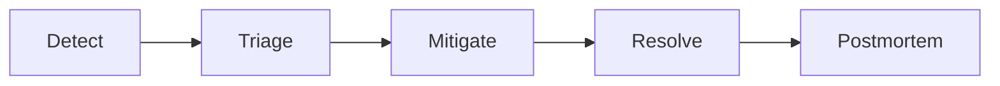
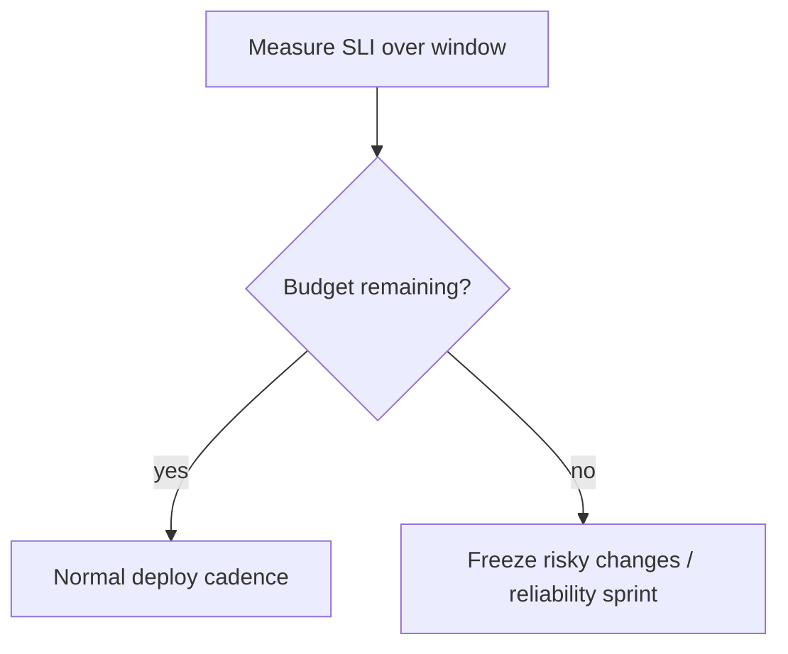

# SLOs and Incidents

> **Status:** Completed  
> **Module:** 47 — Observability and Monitoring  
> **Target Java version:** 21  
> **Last reviewed:** 2026-11-11  
> **Chapter profile:** Technical  
> **Depth target:** Levels 2–3

## 1. Learning Objectives

After completing this chapter, you should be able to:

- Define **SLI**, **SLO**, and **error budget** for Java services with user-centric wording.
- Run **incident response**: detect, triage, mitigate, resolve, postmortem.
- Link SLOs to **load tests** (Module 46), **alerts** (Ch.02), and **on-call**.
- Practice **blameless** postmortems with tracked action items.
- Choose when to freeze risky deploys based on budget burn.

## 2. Prerequisites

- Chapters 01–02 — measurable metrics, traces, and alerts.
- **Module 44** — resilience (breakers, timeouts) as mitigation tools.
- **Module 46** — load tests produce the percentile evidence SLOs consume.
- **Module 48 (forward)** — rollbacks and canaries are common mitigate steps.

**Refresher:** An **SLI** is a *measurement* of reliability from the user’s perspective. An **SLO** is a *target* on that measurement. An **SLA** is a *contract* with business/legal consequences. **Error budget** is the allowed unreliability (`1 − SLO`) before process changes (freeze, reliability sprint).

## 3. Why This Concept Exists

**Uptime percentages** without user-centered goals invite wrong trade-offs (optimizing CPU while checkout fails). **SLOs** align engineering with **reliability customers feel**; **error budgets** balance feature velocity vs stability.

Without SLOs:

- Every outage feels equally urgent (or equally ignored).
- Product and platform argue without shared numbers.
- Alerts page on internals instead of symptoms → fatigue.

## 4. Conceptual Explanation

### 4.1 Terminology

| Term | Meaning |
|------|---------|
| **SLI** | Measurable indicator (successful requests / total) |
| **SLO** | Target for SLI (99.9% monthly) |
| **SLA** | Contract with customer consequences (legal) |
| **Error budget** | Allowed unreliability before freeze (`1 - SLO`) |
| **Burn rate** | How fast the budget is being consumed |

### 4.2 Example SLO

**Checkout API:**

- **SLI:** ratio of `POST /checkout` completing < 1s without 5xx.
- **SLO:** 99.5% over 30 days.
- **Budget:** roughly 3.6 hours of “unreliable” equivalent per month (illustrative—tune window math with product).

When budget burns fast → pause risky deploys; invest in resilience (Module 44).

### 4.3 SLI selection

Good SLIs are:

- **User-centric** (checkout success, not CPU idle).
- **Measurable** from metrics/traces (Ch.01–02).
- **Simple** to explain to product.

Avoid too many SLOs—start with **one golden path** per service. Health endpoints are useful ops signals; they are usually **poor** customer SLIs (`GET /health` can be green while checkout fails).

### 4.4 Windows and math (conceptual)

Teams combine short windows (fast burn detection) and long windows (avoid paging on blips). Google SRE multi-window burn-rate alerting is a common pattern—adapt thresholds to your traffic shape; validate in staging with synthetic burn.

```text
burn_rate ≈ (errors_in_short_window / allowed_errors_in_month) × scaling_factor
```

If burn rate is high enough to exhaust the monthly budget in ~1–2 days, freeze risky releases.

## 5. Mechanism and Execution Flow

### 5.1 Incident lifecycle



| Phase | Actions |
|-------|---------|
| **Detect** | Alert on SLO burn rate; customer reports |
| **Triage** | Severity, incident commander, comms channel |
| **Mitigate** | Rollback, scale, feature flag off, breaker open |
| **Resolve** | Root cause fix, verify metrics green |
| **Postmortem** | Timeline, contributing factors, actions |

### 5.2 Error budget policy (mechanism)



**Mechanism detail:** budget is not a vibe—it is computed from the same SLI Prometheus/Grafana already scrape. Policy documents *who* can approve exceptions and *what* “risky” means (schema migrations, new payment provider, large canaries).

### 5.3 Detection → mitigation loop with observability

1. Burn alert fires (Ch.02 PromQL / Alertmanager).
2. IC opens war room; checks recent deploy digest and feature flags (Module 48).
3. Traces/logs localize dependency (Ch.01).
4. Mitigate first (rollback / flag / scale / breaker); then dig root cause.

## 6. Java-Specific Incident Plays

| Symptom | First moves |
|---------|-------------|
| Thread/pool exhaustion | Thread dump (`jcmd`), reduce traffic, increase pool only if DB allows |
| GC pause storm | Heap/JFR analysis; tune or scale (Modules 27–28) |
| Deploy regression | Compare golden signals canary vs stable (Module 48) |
| Cascading failure | Open breakers (Module 44), disable non-critical consumers |
| Cache stampede | Hit ratio + single-flight (Module 46); gradual traffic |

Capture **JVM flags**, **image digest**, and **DB migration version** in the incident ticket.

### Incident commander checklist (Java backend)

| Minute | Action |
|--------|--------|
| 0–5 | Page acknowledged; war room bridge |
| 5–15 | Recent deploy? Flag/feature diff? Thread dump if CPU spike |
| 15+ | Customer comms; scale replicas only if not DB-bound |

## 7. Communication

- Status page updates for customer-visible SLO breaches.
- Internal timeline with **UTC** timestamps.
- Do not speculate root cause before evidence.
- Separate **customer** wording (impact, ETA) from **engineering** hypothesizing.

## 8. Postmortem Template (blameless)

```markdown
## Impact
- Duration, % users, revenue estimate if known
## Timeline (UTC)
- Detection, escalation, mitigation, recovery
## Root cause
- Technical chain; contributing factors
## What went well / poorly
## Action items (owner, due date)
- [ ] Test added
- [ ] Runbook updated
- [ ] Alert threshold tuned
```

Java-specific annex: JVM version, deploy id, GC log snippet, thread dump if concurrency incident.

**Blameless:** focus on systems and process. Blame culture hides the next incident’s early signals.

### Postmortem action types

| Action | Example |
|--------|---------|
| Prevent | Add ArchUnit rule; integration test for auth path |
| Detect | SLO alert on checkout p99 |
| Mitigate | Runbook for Redis failover |

## 9. Real-World Use Cases

- Payment provider outage: mitigate with queued orders + customer messaging; burn budget knowingly with product approval.
- Cache stampede after deploy: postmortem adds single-flight (Module 46).
- Missing AuthZ test: add security regression (Module 43).
- Load-test evidence used to justify lowering SLO temporarily during migration (document exception).

## 10. Edge Cases and Limitations

- **Multi-tenant:** SLO per tenant tier (enterprise vs free).
- **Maintenance windows:** exclude from SLA if contracted—still measure internally.
- **Partial regional failure:** global averages hide regional pain—slice SLIs by region when needed.
- **Too many SLOs:** dilute attention; start with one golden path.
- **Gaming SLIs:** excluding “bad” traffic without policy is cheating—document exclusions.

## 11. Common Mistakes

| Mistake | Fix |
|---------|-----|
| SLO on internal metrics only | User-visible SLI |
| No error budget policy | Define freeze thresholds |
| Postmortem without tracked actions | Ticket each action item |
| Page on every ERROR | Symptom/SLO-based paging |
| Mitigate forever without resolve | Time-box dig; schedule fix |

### Incorrect

```text
SLO: CPU < 70% averaged monthly
```

### Corrected

```text
SLO: 99.5% of checkout POSTs succeed in < 1s over 30 days
```

## 12. Design Trade-offs

| Tight SLO (99.99%) | Relaxed SLO |
|--------------------|-------------|
| Higher ops cost | Faster feature pace |

| Page on every ERROR log | SLO-based paging |
|-------------------------|------------------|
| Alert fatigue | User-symptom focus |

| Auto-freeze on any burn | Human judgment + policy |
|-------------------------|-------------------------|
| Predictable | Needs clear ownership |

| Long postmortems | Short with sharp actions |
|------------------|--------------------------|
| Narrative detail | Higher completion rate |

## 13. Performance Considerations

SLOs are not free: histogram storage, alert evaluation, and on-call load cost money and attention. Prefer fewer, sharper SLIs. Load-test the SLI definition itself (Module 46) so you are not surprised that “99.9% < 100ms” is unachievable with a 120ms dependency RTT.

## 14. Security Considerations

- Incident bridges may discuss customer data—use approved channels; redact logs in postmortems.
- Do not disable AuthN/AuthZ “to mitigate” without security review (Module 43).
- Status pages should not leak internal topology unnecessarily.

## 15. Revision and Mastery

**Track B gaps:**

- SLI vs SLO vs SLA?
- When burn error budget fast—what process changes?
- Three mitigate steps for payment timeout spike?
- Why is `GET /health` a weak customer SLI?
- What belongs in a Java annex of a postmortem?

## 16. Exercises

1. Write SLI/SLO for `GET /health` vs business API—explain why they differ.
2. Draft postmortem outline for cache outage including Module 46 mitigations.
3. Link an alert rule to runbook section headers (Detect / Mitigate / Escalate).
4. Compute illustrative monthly budget minutes for 99.9% vs 99.5% SLO (show arithmetic).

## 17. Worked Error-Budget Arithmetic (Illustrative)

Assume 30-day window, 10 000 000 checkout attempts, SLO 99.9% success-under-latency.

```text
allowed_failures ≈ 10_000_000 × 0.001 = 10_000
```

If a bad deploy causes 4 000 failures in two hours, you burned **40%** of the monthly budget in a tiny window → freeze risky changes even if “uptime still looks high.”

Contrast with a vanity “uptime” SLO that only counts process liveness: the service can be up while checkout fails, and the budget never moves.

## 18. Severity Rubric (Example)

| Severity | User impact | Response |
|----------|-------------|----------|
| SEV-1 | Checkout down / data risk | Immediate IC, exec notify |
| SEV-2 | Elevated errors, workaround exists | Business hours+ on-call |
| SEV-3 | Minor degradation | Ticket, next business day |

Map severities to SLO burn and customer contracts—do not invent severity from CPU graphs alone.

## 19. Linking Load Tests to SLOs

Module 46 load tests should use the **same SLI definition** as production SLOs (same endpoint, success criteria, percentile). If staging proves p99 450 ms at peak while the SLO says 300 ms, either fix capacity or renegotiate the SLO **before** launch—not during the first SEV-1.

## 20. Chapter Summary

Reliable Java operations define user-centric SLOs and error budgets, respond to incidents with clear phases, and improve via blameless postmortems tied to tests and observability. Metrics and traces from Chapters 01–02 only pay off when they drive **policy**: freeze, fix, and learn.


## 21. Multi-Window Burn Alerting (Conceptual)

A single 1-hour burn window pages too late or too often. Multi-window designs combine:

- Fast window (e.g. 5m / 1h) for rapid pages on sharp burns.
- Slow window (e.g. 6h / 3d) for sustained elevated error rates.

Exact thresholds belong in your SRE workbook—validate with synthetic error injection in staging, never invent production alert fire history here.

## 22. Customer Comms Skeleton

```text
Impact: Checkout failures for ~X% of users since HH:MM UTC
Current status: Mitigating (rollback / flag / provider)
Next update: HH:MM UTC
```

Avoid root-cause speculation on the status page. Engineering hypothesizes in the war room with evidence from Module 47 Ch.01–02.

## 23. Action Item Quality Bar

Weak: “Improve monitoring.”  
Strong: “Add burn-rate alert on checkout SLI; owner Ava; due Friday; link runbook §Mitigate.”

Postmortems without strong actions recycle the same SEV next quarter.


## 24. On-Call Handoff Notes (Java)

When shifting on-call, include:

- Current error-budget remaining for golden paths.
- Known flaky dependencies and their breaker states.
- Pending deploys / migrations in flight (Module 48).
- Links to dashboards: checkout SLI, Hikari pending, Redis hit ratio (Module 46).

A handoff that only says “all green” without budget context hides slow burns.

## 25. Freeze Exception Process

Sometimes product accepts burning budget (major launch). Document:

1. Who approved the exception.
2. Expected burn and time bound.
3. Extra monitoring / staffing.
4. Automatic expiry — freeze returns when the window ends.

Exceptions without expiry become permanent culture.


## 26. SLO Review Cadence

Revisit SLOs quarterly with product:

- Is the SLI still the user journey that matters?
- Is the target achievable with current dependencies (prove with Module 46 load tests)?
- Did we burn budget for good reasons (launches) or recurring unpaid reliability debt?

Stale SLOs become wallpaper—alerts fire, humans ignore them.

## Review Checklist

- [x] Technical L2–3; incident + budget mechanisms; SLI/SLO depth
- [x] Links Modules 44/46/48; burn rate + IC checklist; incorrect/corrected SLI
- [x] Budget arithmetic; severity rubric; load-test alignment
- [x] Postmortem template; security/performance; fourth EXPAND-PRESERVE deepen 2026-11-11
