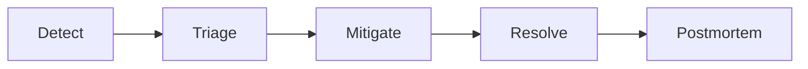
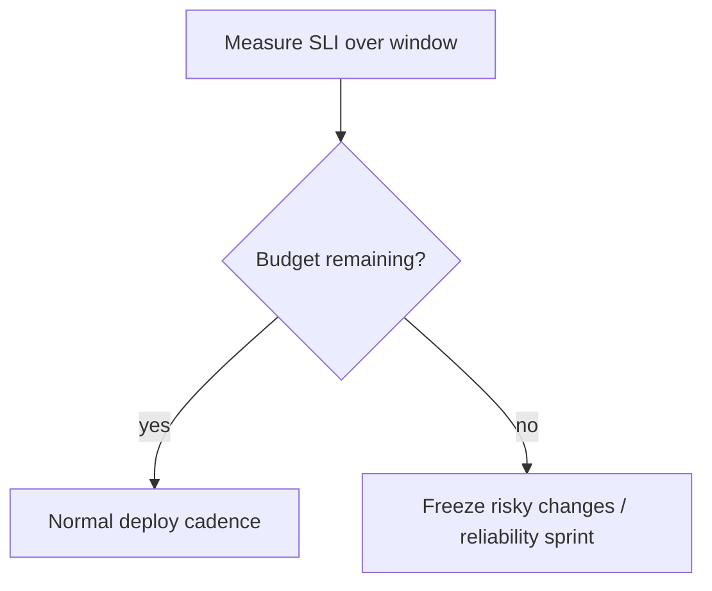

# SLOs and Incidents

> **Status:** Completed  
> **Module:** 47 — Observability and Monitoring  
> **Target Java version:** 21  
> **Last reviewed:** 2026-11-11  
> **Chapter profile:** Technical  
> **Depth target:** Levels 2–3

## 1. Learning Objectives

- Define **SLI**, **SLO**, and **error budget** for Java services.
- Run **incident response**: detect, mitigate, communicate, postmortem.
- Link SLOs to **load tests** (Module 46) and **on-call**.
- Practice **blameless** postmortems with action items.

## 2. Prerequisites

- Chapters 01–02 — measurable metrics and alerts.
- **Module 44** — resilience (breakers, timeouts) as mitigation tools.

## 3. Why This Concept Exists

**Uptime percentages** without user-centered goals invite wrong trade-offs (optimizing CPU while checkout fails). **SLOs** align engineering with **reliability customers feel**; **error budgets** balance feature velocity vs stability.

## 4. Conceptual Explanation

### Terminology

| Term | Meaning |
|------|---------|
| **SLI** | Measurable indicator (successful requests / total) |
| **SLO** | Target for SLI (99.9% monthly) |
| **SLA** | Contract with customer consequences (legal) |
| **Error budget** | Allowed unreliability before freeze (`1 - SLO`) |

### Example SLO

**Checkout API:**

- **SLI:** ratio of `POST /checkout` completing < 1s without 5xx.
- **SLO:** 99.5% over 30 days.
- **Budget:** roughly 3.6 hours of “unreliable” equivalent per month (illustrative—tune window math with product).

When budget burns fast → pause risky deploys; invest in resilience (Module 44).

### SLI selection

Good SLIs are:

- **User-centric** (checkout success, not CPU idle).
- **Measurable** from metrics/traces (Ch.01–02).
- **Simple** to explain to product.

Avoid too many SLOs—start with **one golden path** per service.

## 5. Mechanism and Execution Flow

### Incident lifecycle



| Phase | Actions |
|-------|---------|
| **Detect** | Alert on SLO burn rate; customer reports |
| **Triage** | Severity, incident commander, comms channel |
| **Mitigate** | Rollback, scale, feature flag off, breaker open |
| **Resolve** | Root cause fix, verify metrics green |
| **Postmortem** | Timeline, contributing factors, actions |

### Error budget policy (mechanism)



## 6. Java-Specific Incident Plays

- **Thread/pool exhaustion:** thread dump (`jcmd`), reduce traffic, increase pool only if DB allows.
- **GC pause storm:** heap analysis; tune or scale (Modules 27–28).
- **Deploy regression:** compare golden signals canary vs stable (Module 48).
- **Cascading failure:** open breakers (Module 44), disable non-critical consumers.

## 7. Communication

- Status page updates for customer-visible SLO breaches.
- Internal timeline with **UTC** timestamps.
- Do not speculate root cause before evidence.

## 8. Postmortem Template

1. **Summary** — impact, duration.
2. **Timeline** — detection → mitigation.
3. **Root cause** — technical and systemic factors.
4. **What went well / poorly**
5. **Action items** — owner, due date (tests, alerts, runbooks).

**Blameless:** focus on systems and process.

## 9. Real-World Use Cases

- Payment provider outage: mitigate with queued orders + customer messaging.
- Cache stampede after deploy: postmortem adds single-flight (Module 46).
- Missing AuthZ test: add security regression (Module 43).

## 10. Edge Cases

- **Multi-tenant:** SLO per tenant tier (enterprise vs free).
- **Maintenance windows:** exclude from SLA if contracted—still measure internally.

## 11. Common Mistakes

| Mistake | Fix |
|---------|-----|
| SLO on internal metrics only | User-visible SLI |
| No error budget policy | Define freeze thresholds |
| Postmortem without tracked actions | Ticket each action item |

### Error budget burn alert (conceptual)

```text
burn_rate = (errors_last_1h / allowed_errors_month) × (30×24)
```

If burn rate > 14 (consuming month budget in ~2 days), freeze risky releases and focus on reliability work—Google SRE multi-window pattern adapted here conceptually.

### Incident commander checklist (Java backend)

| Minute | Action |
|--------|--------|
| 0–5 | Page acknowledged; war room bridge |
| 5–15 | Recent deploy? Flag/feature diff? Thread dump if CPU spike |
| 15+ | Customer comms; scale replicas only if not DB-bound |

Capture **JVM flags**, **image digest**, and **DB migration version** in incident ticket.

### Postmortem action types

| Action | Example |
|--------|---------|
| Prevent | Add ArchUnit rule; integration test for auth path |
| Detect | SLO alert on checkout p99 |
| Mitigate | Runbook for Redis failover |

## 12. Design Trade-offs

| Tight SLO (99.99%) | Relaxed SLO |
|--------------------|-------------|
| Higher ops cost | Faster feature pace |

| Page on every ERROR log | SLO-based paging |
|-------------------------|------------------|
| Alert fatigue | User-symptom focus |

## 13. Revision and Mastery

- SLI vs SLO vs SLA?
- When burn error budget fast?
- Three mitigate steps for payment timeout spike?

## 14. Postmortem Template (blameless)

```markdown
## Impact
- Duration, % users, revenue estimate if known
## Timeline (UTC)
- Detection, escalation, mitigation, recovery
## Root cause
- Technical chain; contributing factors
## What went well / poorly
## Action items (owner, due date)
- [ ] Test added
- [ ] Runbook updated
- [ ] Alert threshold tuned
```

Java-specific annex: JVM version, deploy id, GC log snippet, thread dump if concurrency incident.

## 15. Exercises

1. Write SLI/SLO for `GET /health` vs business API—why differ?
2. Draft postmortem outline for cache outage.
3. Link alert rule to runbook section headers.

## 16. Chapter Summary

Reliable Java operations define user-centric SLOs and error budgets, respond to incidents with clear phases, and improve via blameless postmortems tied to tests and observability.

## Review Checklist

- [x] Technical L2–3; incident + budget mechanisms; SLI/SLO preserved
- [x] Links Module 44/46/48; burn rate + IC checklist deepen pass 2026-11-11
