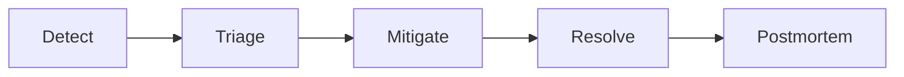

# SLOs and Incidents

> **Status:** Completed  
> **Module:** 47 — Observability and Monitoring  
> **Target Java version:** 21  
> **Last reviewed:** 2026-11-10

## 1. Learning Objectives

- Define **SLI**, **SLO**, and **error budget** for Java services.
- Run **incident response**: detect, mitigate, communicate, postmortem.
- Link SLOs to **load tests** (Module 46) and **on-call**.
- Practice **blameless** postmortems with action items.

## 2. Prerequisites

- Chapters 01–02; Module 44 resilience.

## 3. Why This Concept Exists

**Uptime percentages** without user-centered goals invite wrong trade-offs. SLOs align engineering with **reliability customers feel**; error budgets balance feature velocity vs stability.

## 4. Terminology

| Term | Meaning |
|------|---------|
| **SLI** | Measurable indicator (successful requests / total) |
| **SLO** | Target for SLI (99.9% monthly) |
| **SLA** | Contract with customer consequences (legal) |
| **Error budget** | Allowed unreliability before freeze (`1 - SLO`) |

## 5. Example SLO

**Checkout API:**

- **SLI:** ratio of `POST /checkout` completing < 1s without 5xx.
- **SLO:** 99.5% over 30 days.
- **Budget:** ~3.6 hours downtime equivalent per month (illustrative math—tune per window definition).

When budget burns fast → pause risky deploys; invest in resilience (Module 44).

## 6. SLI selection

Good SLIs are:

- **User-centric** (checkout success, not CPU idle).
- **Measurable** from metrics/traces (Ch.01–02).
- **Simple** to explain to product.

Avoid too many SLOs—start with **one golden path** per service.

## 7. Incident lifecycle

| Phase | Actions |
|-------|---------|
| **Detect** | Alert on SLO burn rate; customer reports |
| **Triage** | Severity, incident commander, comms channel |
| **Mitigate** | Rollback, scale, feature flag off, breaker open |
| **Resolve** | Root cause fix, verify metrics green |
| **Postmortem** | Timeline, contributing factors, actions |

## 8. Java-specific incident plays

- **Thread/pool exhaustion:** thread dump (`jcmd`), reduce traffic, increase pool only if DB allows.
- **GC pause storm:** heap dump analysis; tune or scale.
- **Deploy regression:** compare golden signals canary vs stable.
- **Cascading failure:** open breakers (Module 44), disable non-critical consumers.

## 9. Communication

- Status page updates for customer-visible SLO breaches.
- Internal timeline with **UTC** timestamps.
- Do not speculate root cause before evidence.

## 10. Postmortem template

1. **Summary** — impact, duration.
2. **Timeline** — detection → mitigation.
3. **Root cause** — technical and systemic factors.
4. **What went well / poorly**
5. **Action items** — owner, due date (tests, alerts, runbooks).

**Blameless:** focus on systems and process.

## 11. Real-World Use Cases

- Payment provider outage: mitigate with queued orders + customer messaging.
- Cache stampede after deploy: postmortem adds single-flight (Module 46).
- Missing AuthZ test: add security regression (Module 43).

## 12. Edge Cases

- **Multi-tenant:** SLO per tenant tier (enterprise vs free).
- **Maintenance windows:** exclude from SLA if contracted—still measure internally.

## 13. Common Mistakes

| Mistake | Fix |
|---------|-----|
| SLO on internal metrics only | User-visible SLI |
| No error budget policy | Define freeze thresholds |
| Postmortem without tracked actions | Ticket each action item |

## 14. Revision and Mastery

- SLI vs SLO vs SLA?
- When burn error budget fast?
- Three mitigate steps for payment timeout spike?

## 15. Exercises

1. Write SLI/SLO for `GET /health` vs business API—why differ?
2. Draft postmortem outline for cache outage.
3. Link alert rule to runbook section headers.

## 16. Chapter Summary

Reliable Java operations define user-centric SLOs and error budgets, respond to incidents with clear phases, and improve via blameless postmortems tied to tests and observability.

## Review Checklist

- [x] SLI/SLO/error budget; incident flow; links Module 44/46
