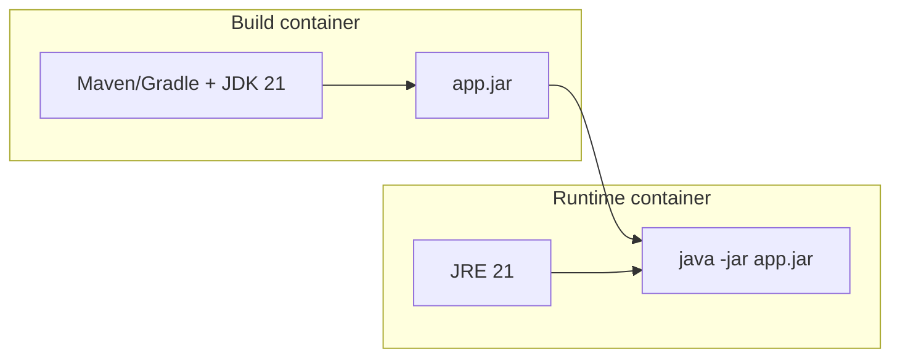
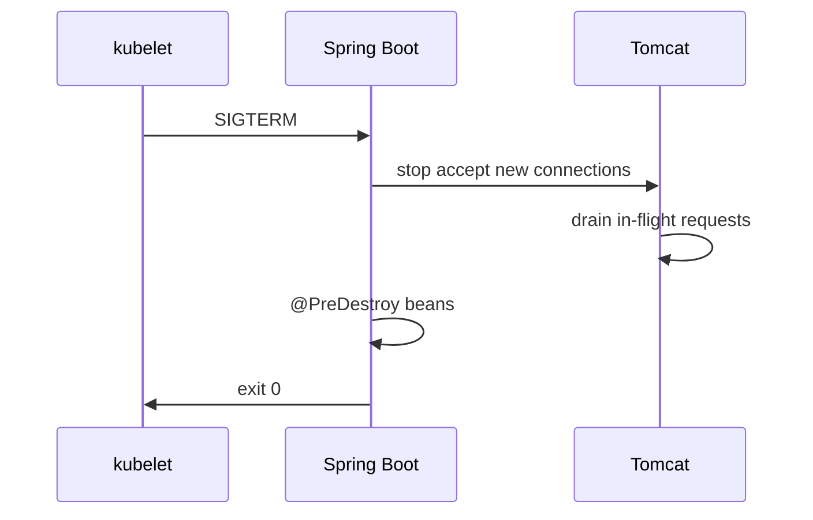

# Containers and the JVM

> **Status:** Completed  
> **Module:** 48 — DevOps and Deployment  
> **Target Java version:** 21  
> **Last reviewed:** 2026-11-11  
> **Chapter profile:** Technical  
> **Depth target:** Levels 2–3  
> **Examples verified with:** Oracle JDK 21.0.9 — [diagnostics-awareness-demo](../../examples/debugging/diagnostics-awareness-demo/) (local JVM diagnostics; Docker smoke remains optional)

## 1. Learning Objectives

After completing this chapter, you should be able to:

- Explain how **Docker/OCI containers** package a Java application and JDK/JRE.
- Configure **container-aware heap** and **CPU limits** for HotSpot on cgroup-backed hosts.
- Choose **JRE vs JDK**, **distroless vs slim** base images, and **layer caching** for faster builds.
- Run a JVM in a container with sensible defaults for **signals**, **time zone**, and **file descriptors**.
- Diagnose OOMKilled vs Java OOME and reason about memory outside the heap.

## 2. Prerequisites

- **Module 01** — `JAVA_HOME`, `java -version`, classpath basics.
- **Module 26** — JVM process model (heap, threads) at overview level.
- **Module 27** — GC pause goals; heap sizing trade-offs.
- **Module 29** — JAR packaging; optional Docker mention in build-tools narrative.
- **Module 31** — `jcmd` / diagnostics awareness (demo below).

**Refresher:** The JVM is a native process (`java`) that loads bytecode, manages heap and threads, and exits when `main` finishes or the process receives a shutdown signal. A **container** adds an isolation boundary: cgroup CPU/memory limits, separate filesystem mount namespace, and optional network isolation. It is **not** a full VM—it shares the host kernel.

## 3. Why This Concept Exists

Developers once said “works on my machine” because OS packages, JDK patch levels, and environment variables differed between laptops and production. **Containers** freeze the **filesystem slice** (OS libraries, JDK build, application JAR) into an **image** that runs the same on a developer laptop, CI agent, and Kubernetes node.

For Java specifically, containers interact badly with JVM defaults if you ignore **cgroup memory limits**: older JVMs sized `-Xmx` from **host RAM**, not the container limit, causing **OOM kills** by the orchestrator. Modern JDKs (8u191+, 11+, 17+, **21**) include **container support** that reads cgroup limits—yet you still must validate heap, metaspace, and native memory in real images.

## 4. Conceptual Explanation

### 4.1 What a container is (and is not)

A **container** is a process (or tree of processes) started with Linux **namespaces** and **cgroups** (or equivalent on other platforms). The **image** is a layered read-only filesystem; a **writable layer** holds runtime changes.

| Idea | Meaning |
|------|---------|
| **Image** | Immutable template (e.g. `eclipse-temurin:21-jre`) |
| **Container** | Running instance of an image + config (env, ports, limits) |
| **Registry** | Image storage (Docker Hub, ECR, GCR, GHCR) |
| **OCI** | Open Container Initiative image/runtime spec |

### 4.2 JVM inside the container

Typical Spring Boot or executable JAR flow:

1. **Build stage** — JDK 21 compiles and packages (`mvn package`, Gradle `bootJar`).
2. **Runtime stage** — smaller image with JRE or custom **jlink** runtime copying only required modules.
3. **Entrypoint** — `java` with container-tuned flags, then the fat JAR or classpath.



### 4.3 Container-aware memory and CPU

On Linux cgroups v1/v2, HotSpot consults limits when **UseContainerSupport** is enabled (default on supported JDKs). Useful flags and environment patterns:

| Concern | Practice |
|---------|----------|
| Heap default | Prefer explicit `-XX:MaxRAMPercentage=75.0` (or similar) when limit is known |
| Native memory | Direct buffers, metaspace, thread stacks sit **outside** heap |
| CPU | `-XX:ActiveProcessorCount=n` when cgroup CPU quota is fractional |
| Diagnostics | `java -XshowSettings:system -version` inside the image during CI smoke tests |

Illustrative local probe (output varies by image tag—capture once in *your* pipeline; not handbook Verified):

```bash
docker run --rm -e JAVA_TOOL_OPTIONS="-XshowSettings:system" \
  --cpus=1 eclipse-temurin:21-jre java -version
```

### 4.4 Signals and graceful shutdown

Kubernetes and Docker send **SIGTERM** before **SIGKILL**. Spring Boot and embedded servers should drain requests; plain `main` apps should register a shutdown hook. **PID 1** problem: some minimal images run Java as PID 1; use an **init** wrapper (`tini`, `dumb-init`) or Kubernetes patterns so signals reach the JVM.

## 5. Mechanism and Execution Flow

### 5.1 Multi-stage build → run

1. CI checks out source; build stage resolves deps and compiles on JDK 21.
2. Runtime stage copies only `app.jar` (+ JRE).
3. Orchestrator starts container with memory/CPU limits.
4. JVM reads cgroup limits → sizes heap (unless `-Xmx` overrides).
5. On deploy replacement: SIGTERM → drain → exit → SIGKILL if overdue.

### 5.2 Graceful shutdown sequence



`terminationGracePeriodSeconds` must exceed worst-case drain + DB flush.

### 5.3 cgroup v2 memory signals (JDK 21, labeled HotSpot/container)

On Linux with cgroup v2, the JVM reads **container memory limit** for default ergonomics. Operators still see:

| Observation | Interpretation |
|-------------|----------------|
| RSS near limit, heap not full | Metaspace, thread stacks, direct buffers, native libs |
| Frequent OOMKilled exit 137 | Limit too tight vs `-XX:MaxRAMPercentage` |
| CPU throttling with flat CPU% in `top` | cgroup quota; threads wait |

Log at startup: `Runtime.version()`, effective `-Xmx` from `MemoryMXBean`, and container limit from orchestrator downward API when available.

## 6. Terminology

| Term | Meaning |
|------|---------|
| **Multi-stage Dockerfile** | First stages build; final stage copies only artifacts |
| **Distroless** | Minimal runtime image without shell—smaller attack surface |
| **Cgroup** | Kernel resource limit (CPU, memory) applied to the container |
| **OOMKilled** | Kernel/orchestrator killed the process for exceeding limit |
| **jlink** | Build a custom modular runtime image |

## 7. Step-by-Step Examples

### 7.1 Minimal Dockerfile (executable JAR) — Illustrative

```dockerfile
# syntax=docker/dockerfile:1
FROM eclipse-temurin:21-jdk AS build
WORKDIR /src
COPY pom.xml mvnw ./
COPY src ./src
RUN ./mvnw -q -DskipTests package

FROM eclipse-temurin:21-jre
WORKDIR /app
COPY --from=build /src/target/app.jar ./app.jar
ENV JAVA_TOOL_OPTIONS="-XX:MaxRAMPercentage=75.0"
USER 10001
EXPOSE 8080
ENTRYPOINT ["java","-jar","app.jar"]
```

**Important lines:** multi-stage keeps JDK out of production; `MaxRAMPercentage` scales heap to container memory; non-root `USER` reduces risk; exec-form `ENTRYPOINT` receives signals correctly.

### 7.2 Local run with memory cap — Illustrative

```bash
docker build -t handbook-java:local .
docker run --rm -m 512m -p 8080:8080 handbook-java:local
```

If heap defaults are wrong, watch for container OOM (exit 137) despite low Java heap usage—check **native** consumers (Netty direct memory, many threads).

### 7.3 jlink slim runtime (advanced)

```bash
jlink --add-modules java.se,jdk.unsupported \
  --strip-debug --no-header-files --no-man-pages \
  --compress=2 -o /opt/jre-custom
```

Ship `/opt/jre-custom` in the final image instead of full JRE when image size and attack surface matter. Retest when adding modules (FFM, etc.).

### 7.4 Diagnostics awareness demo — **Verified (Oracle JDK 21.0.9)**

Local (non-container) smoke of JVM diagnostics helpers used in Module 31 / ops runbooks:

```bash
cd examples/debugging/diagnostics-awareness-demo
javac DiagnosticsAwarenessDemo.java
java DiagnosticsAwarenessDemo
```

**Verified output** (re-run 2026-11-11 on Oracle JDK 21.0.9):

```text
jvmName=Java HotSpot(TM) 64-Bit Server VM
inputArgsCount=0
threadCount=7
note=Use jcmd/jfr for dumps; see Module 31
```

`threadCount` can vary slightly by run; `jvmName` reflects the HotSpot VM on PATH. Use the same APIs inside a container CI smoke to print `maxMemory()` under `-m` limits.

### 7.5 Sample `JAVA_TOOL_OPTIONS` for K8s (Illustrative)

```text
JAVA_TOOL_OPTIONS=-XX:InitialRAMPercentage=50.0 -XX:MaxRAMPercentage=75.0 -XX:+ExitOnOutOfMemoryError -Djava.security.egd=file:/dev/./urandom
```

`-XX:+ExitOnOutOfMemoryError` lets the orchestrator restart the pod instead of a zombie JVM serving errors. Pair with **liveness** only if OOME is truly unrecoverable—some teams prefer halt + alert without auto-restart loops.

Document every flag in the image README; forbid copy-paste from blog posts without JDK 21 validation.

## 8. Real-World Use Cases

- **Spring Boot** services on Kubernetes with readiness/liveness hitting Actuator (Module 37).
- **Batch jobs** as CronJobs: JVM starts, drains queue, exits—container restarts clean state.
- **CI integration tests** with Testcontainers spinning disposable databases beside the build.
- **Pinned patch images** (`21.0.x`) so production matches CI (Ch.02).

## 9. Internal Behavior (HotSpot, labeled)

**Container detection** reads cgroup files; behavior evolved across JDK versions—verify on your JDK distribution (Temurin, Oracle, Corretto, etc.). `-Xmx` set explicitly **overrides** percentage defaults.

**File system:** JIT code cache and class metadata use disk indirectly via paging; **read-only root** images still need writable `/tmp` for some libraries unless configured.

This handbook does not claim identical ergonomics across every JDK vendor build—**record** what your image prints from `-XshowSettings:system`.

## 10. Edge Cases and Limitations

- **Huge pages** and **NUMA** tuning rarely apply in small containers; wrong `-XX:+UseNUMA` on constrained hosts can hurt.
- **Alpine/musl** vs **glibc** images: some agents and JNI libraries require glibc-based images.
- **Windows containers** use different isolation; most Java microservice docs assume Linux.
- **Fractional CPUs:** fork-join/common pool sizing can under-parallelize without `ActiveProcessorCount`.

## 11. Common Mistakes

### Incorrect — no memory limit, default heap from host

Pod limit 512m but JVM `-Xmx` implicit from 32GB node → kernel OOM killer terminates container.

### Corrected

Set pod memory limit **and** `MaxRAMPercentage` or explicit `-Xmx` below limit leaving headroom for metaspace/native.

### Incorrect — running as root in production image

Violates policy; filesystem writes as root inside container ease escalation if combined with kernel bugs.

### Corrected

`USER` non-root; mount volumes with correct permissions.

### Incorrect — shell-form ENTRYPOINT

```dockerfile
ENTRYPOINT java -jar app.jar
```

Signals may not reach the JVM cleanly.

### Corrected

Exec form: `ENTRYPOINT ["java","-jar","app.jar"]`.

## 12. Best Practices

- Pin **JDK vendor and patch** in the image tag.
- Scan images (Trivy, Grype) in CI (Module 30 static analysis theme).
- Log **JDK and container limits** at startup once (`Runtime.getRuntime().maxMemory()`, cgroup-aware metrics).
- Keep **one process per container** for services; sidecars handle mesh proxy/logging.
- Prefer layer-friendly Dockerfile ordering (deps before source) for CI cache hits (Ch.02).

## 13. Design Trade-offs

| Fat JRE image | jlink custom runtime |
|---------------|----------------------|
| Simple, familiar | Smaller, more build work |
| Faster first build | Must retest when adding modules |

| Shell in image | Distroless |
|----------------|------------|
| Easy `docker exec` debugging | Smaller; debug with ephemeral debug containers |

| Explicit `-Xmx` | `MaxRAMPercentage` |
|-----------------|--------------------|
| Predictable absolute size | Scales with limit changes |

## 14. Performance Considerations

- Oversized heaps in small containers → long GC or OOMKilled; undersized → allocation stalls.
- Too many threads × stack size eats RSS outside heap.
- Image pull time matters for scale-out latency—smaller images warm faster (Module 49).

## 15. Security Considerations

- Non-root USER; read-only root filesystem where feasible.
- No secrets baked into image layers—inject at runtime (Module 43).
- Scan base images for CVEs; rebuild on JDK security patches.
- Distroless reduces shell attack surface but complicates live debugging—plan ephemeral debug pods.

## 16. Revision and Mastery

**Track B gaps:**

- Why can a 512m container die with “only” 300m heap used?
- What does `MaxRAMPercentage` reference on JDK 21?
- How does SIGTERM relate to Spring Boot graceful shutdown?
- Why prefer exec-form ENTRYPOINT?
- Distroless vs slim: when is the shell worth the risk?

## 17. Exercises

1. Build a two-stage Dockerfile for any handbook `examples/backend/*` JAR pattern.
2. Run with `-m 256m` and record `maxMemory()` from a one-line JVM main (lab; record your output).
3. List three differences between VM and container isolation.
4. Draft a startup log line that prints JDK version, max heap, and configured CPU count.

## 18. Layer Caching for Faster CI Builds

Order Dockerfile instructions from least to most frequently changing:

1. Copy dependency manifests (`pom.xml` / `build.gradle`) and resolve deps.
2. Copy source and compile.
3. Runtime stage copies only the JAR.

Changing one Java file should not invalidate the dependency download layer. This is a CI performance concern (Ch.02) as much as a Docker concern.

## 19. Native Memory Budget Checklist

When RSS approaches the cgroup limit:

| Consumer | Mitigation |
|----------|------------|
| Heap | Lower `MaxRAMPercentage` or fix leaks |
| Metaspace | Watch classloader leaks; `-XX:MaxMetaspaceSize` |
| Thread stacks | Fewer threads; smaller `-Xss` carefully |
| Direct buffers | Cap Netty/NIO arenas; monitor `BufferPoolMXBean` |
| JNI / agents | Avoid duplicate APM agents (Module 47) |

Print `MemoryMXBean` + thread count at startup (as the diagnostics demo suggests) so on-call has a baseline.

## 20. Time Zone and Locale in Images

Containers often default to UTC—good for servers. Document `TZ` / `LANG` if the app formats local times (Module 22). Never rely on the engineer’s laptop timezone remaining in the image.

## 21. Chapter Summary

Containers standardize Java deployments; JDK 21 expects cgroup-aware defaults but production still needs explicit heap percentages, signal-aware shutdown, slim runtime choices, and non-root images. Validate memory and CPU inside the real orchestrator limits, not only on developer workstations—and treat Docker smoke output as lab evidence, not invented Verified blocks.

## 22. Next Steps

[02-ci-cd.md](02-ci-cd.md)

## Review Checklist

- [x] Container vs VM; cgroup heap; multi-stage Dockerfile; signals; mistakes; trade-offs
- [x] diagnostics-awareness-demo Verified Oracle JDK 21.0.9; no fabricated docker output
- [x] Layer caching; native memory checklist; TZ notes
- [x] Security/performance; fourth EXPAND-PRESERVE deepen pass 2026-11-11
