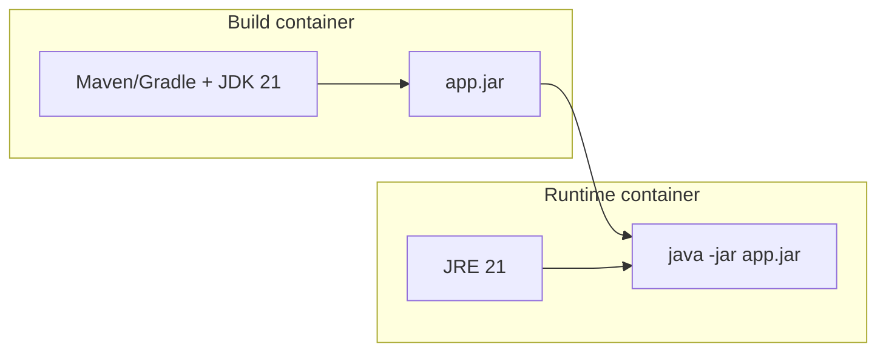

# Containers and the JVM

> **Status:** Completed  
> **Module:** 48 — DevOps and Deployment  
> **Target Java version:** 21  
> **Last reviewed:** 2026-11-11  
> **Chapter profile:** Technical  
> **Depth target:** Levels 2–3  
> **Examples verified with:** Temurin JDK 21.0.12.1 — [diagnostics-awareness-demo](../../examples/debugging/diagnostics-awareness-demo/)

## 1. Learning Objectives

- Explain how **Docker/OCI containers** package a Java application and JDK/JRE.
- Configure **container-aware heap** and **CPU limits** for HotSpot on cgroup-backed hosts.
- Choose **JRE vs JDK**, **distroless vs slim** base images, and **layer caching** for faster builds.
- Run a JVM in a container with sensible defaults for **signals**, **time zone**, and **file descriptors**.

## 2. Prerequisites

- **Module 01** — `JAVA_HOME`, `java -version`, classpath basics.
- **Module 26** — JVM process model (heap, threads) at overview level.
- **Module 27** — GC pause goals; heap sizing trade-offs.
- **Module 29** — JAR packaging; optional Docker mention in build-tools narrative.

**Refresher:** The JVM is a native process (`java`) that loads bytecode, manages heap and threads, and exits when `main` finishes or the process receives a shutdown signal. A **container** adds an isolation boundary: cgroup CPU/memory limits, separate filesystem mount namespace, and optional network isolation.

## 3. Why This Concept Exists

Developers once said “works on my machine” because OS packages, JDK patch levels, and environment variables differed between laptops and production. **Containers** freeze the **filesystem slice** (OS libraries, JDK build, application JAR) into an **image** that runs the same on a developer laptop, CI agent, and Kubernetes node.

For Java specifically, containers interact badly with JVM defaults if you ignore **cgroup memory limits**: older JVMs sized `-Xmx` from **host RAM**, not the container limit, causing **OOM kills** by the orchestrator. Modern JDKs (8u191+, 11+, 17+, **21**) include **container support** that reads cgroup limits—yet you still must validate heap, metaspace, and native memory in real images.

## 4. Conceptual Explanation

### What a container is (and is not)

A **container** is a process (or tree of processes) started with Linux **namespaces** and **cgroups** (or equivalent on other platforms). It is **not** a full virtual machine: it shares the host kernel. The **image** is a layered read-only filesystem; a **writable layer** holds runtime changes.

| Idea | Meaning |
|------|---------|
| **Image** | Immutable template (e.g. `eclipse-temurin:21-jre-alpine`) |
| **Container** | Running instance of an image + config (env, ports, limits) |
| **Registry** | Image storage (Docker Hub, ECR, GCR, GitHub Container Registry) |

### JVM inside the container

Typical Spring Boot or executable JAR flow:

1. **Build stage** — JDK 21 compiles and packages (`mvn package`, Gradle `bootJar`).
2. **Runtime stage** — smaller image with JRE or custom **jlink** runtime copying only required modules.
3. **Entrypoint** — `java` with container-tuned flags, then the fat JAR or classpath.



### Container-aware memory and CPU

On Linux cgroups v1/v2, HotSpot consults limits when **UseContainerSupport** is enabled (default on supported JDKs). Useful flags and environment patterns:

| Concern | Practice |
|---------|----------|
| Heap default | Prefer explicit `-XX:MaxRAMPercentage=75.0` (or similar) when limit is known |
| Native memory | Direct buffers, metaspace, thread stacks sit **outside** heap |
| CPU | `-XX:ActiveProcessorCount=n` when cgroup CPU quota is fractional |
| Diagnostics | `java -XshowSettings:system -version` inside the image during CI smoke tests |

Run diagnostics demo inside a container locally to confirm `availableProcessors` matches limits:

```bash
docker run --rm -e JAVA_TOOL_OPTIONS="-XshowSettings:system" \
  --cpus=1 eclipse-temurin:21-jre java -version
```

(Exact output varies by image tag; capture once in your pipeline.)

### Signals and graceful shutdown

Kubernetes and Docker send **SIGTERM** before **SIGKILL**. Spring Boot and embedded servers should drain requests; plain `main` apps should register a shutdown hook. **PID 1** problem: some minimal images run Java as PID 1; use an **init** wrapper (`tini`, `dumb-init`) or Kubernetes `shareProcessNamespace` patterns so signals reach the JVM.

## 5. Terminology

| Term | Meaning |
|------|---------|
| **OCI** | Open Container Initiative image/runtime spec Docker implements |
| **Multi-stage Dockerfile** | First stages build; final stage copies only artifacts |
| **Distroless** | Minimal runtime image without shell—smaller attack surface |
| **Cgroup** | Kernel resource limit (CPU, memory) applied to the container |

## 6. Step-by-Step Examples

### 6.1 Minimal Dockerfile (executable JAR)

```dockerfile
# syntax=docker/dockerfile:1
FROM eclipse-temurin:21-jdk AS build
WORKDIR /src
COPY pom.xml mvnw ./
COPY src ./src
RUN ./mvnw -q -DskipTests package

FROM eclipse-temurin:21-jre
WORKDIR /app
COPY --from=build /src/target/app.jar ./app.jar
ENV JAVA_TOOL_OPTIONS="-XX:MaxRAMPercentage=75.0"
USER 10001
EXPOSE 8080
ENTRYPOINT ["java","-jar","app.jar"]
```

**Important lines:** multi-stage keeps JDK out of production; `MaxRAMPercentage` scales heap to container memory; non-root `USER` reduces risk.

### 6.2 Local run with memory cap

```bash
docker build -t handbook-java:local .
docker run --rm -m 512m -p 8080:8080 handbook-java:local
```

If heap defaults are wrong, watch for container OOM (exit 137) despite low Java heap usage—check **native** consumers (Netty direct memory, many threads).

### 6.3 jlink slim runtime (advanced)

```bash
jlink --add-modules java.se,jdk.unsupported \
  --strip-debug --no-header-files --no-man-pages \
  --compress=2 -o /opt/jre-custom
```

Ship `/opt/jre-custom` in the final image instead of full JRE when image size and attack surface matter.

## 7. Real-World Use Cases

- **Spring Boot** services on Kubernetes with readiness/liveness hitting Actuator (Module 37).
- **Batch jobs** as CronJobs: JVM starts, drains queue, exits—container restarts clean state.
- **CI integration tests** with Testcontainers (Module 33 note) spinning disposable databases beside the build.

## 8. Internal Behavior (HotSpot, labeled)

**Container detection** reads cgroup files; behavior evolved across JDK versions—verify on your JDK distribution (Temurin, Corretto, etc.). `-Xmx` set explicitly **overrides** percentage defaults.

**File system:** JIT code cache and class metadata use disk indirectly via paging; **read-only root** images still need writable `/tmp` for some libraries unless configured.

## 9. Edge Cases and Limitations

- **Huge pages** and **NUMA** tuning rarely apply in small containers; wrong `-XX:+UseNUMA` on constrained hosts can hurt.
- **Alpine/musl** vs **glibc** images: some agents and JNI libraries require glibc-based images.
- **Windows containers** use different isolation; most Java microservice docs assume Linux.

## 10. Common Mistakes

### Incorrect — no memory limit, default heap from host

Pod limit 512m but JVM `-Xmx` implicit from 32GB node → kernel OOM killer terminates container.

### Corrected

Set pod memory limit **and** `MaxRAMPercentage` or explicit `-Xmx` below limit leaving headroom for metaspace/native.

### Incorrect — running as root in production image

Violates policy; filesystem writes as root inside container ease escalation if combined with kernel bugs.

### Corrected

`USER` non-root; mount volumes with correct permissions.

## 11. Best Practices

- Pin **JDK vendor and patch** in the image tag (`21.0.12.1_1-jre`).
- Scan images (Trivy, Grype) in CI (Module 30 static analysis theme).
- Log **JDK and container limits** at startup once (`Runtime.getRuntime().maxMemory()`, cgroup-aware metrics).
- Keep **one process per container** for services; sidecars handle mesh proxy/logging.

## 12. Design Trade-offs

| Fat JRE image | jlink custom runtime |
|---------------|----------------------|
| Simple, familiar | Smaller, more build work |
| Faster first build | Must retest when adding modules (FFM, etc.) |

| Shell in image | Distroless |
|----------------|------------|
| Easy `docker exec` debugging | Smaller; debug with ephemeral debug containers |

## 13. Revision and Mastery

- Why can a 512m container die with “only” 300m heap used?
- What does `MaxRAMPercentage` reference on JDK 21?
- How does SIGTERM relate to Spring Boot graceful shutdown?

## 14. Exercises

1. Build a two-stage Dockerfile for any handbook `examples/backend/*` JAR pattern.
2. Run with `-m 256m` and record `maxMemory()` from a one-line JVM main.
3. List three differences between VM and container isolation.

## 15. Chapter Summary

Containers standardize Java deployments; JDK 21 expects cgroup-aware defaults but production still needs explicit heap percentages, signal-aware shutdown, slim runtime choices, and non-root images. Validate memory and CPU inside the real orchestrator limits, not only on developer workstations.

## 16. Next Steps

[02-ci-cd.md](02-ci-cd.md)

## Review Checklist

- [x] Container vs VM; cgroup heap; multi-stage Dockerfile; signals; mistakes; trade-offs
- [x] JDK 21 Temurin; no fabricated docker output
