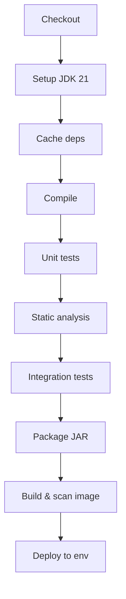
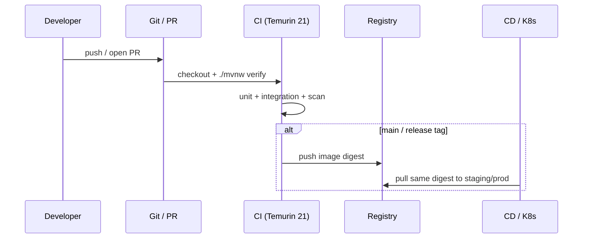

# CI/CD for Java

> **Status:** Completed  
> **Module:** 48 — DevOps and Deployment  
> **Target Java version:** 21  
> **Last reviewed:** 2026-11-11  
> **Chapter profile:** Technical  
> **Depth target:** Levels 2–3

## 1. Learning Objectives

- Define **continuous integration (CI)** and **continuous delivery/deployment (CD)** for JVM projects.
- Assemble a **pipeline** that compiles on JDK 21, runs tests, produces artifacts, and optionally publishes images.
- Apply **caching**, **matrix builds**, and **quality gates** (tests, Checkstyle, OWASP) without hiding failures.
- Separate **build reproducibility** from **environment promotion** (dev → staging → prod).

## 2. Prerequisites

- **Module 29** — Maven/Gradle, dependency scopes, wrapper scripts.
- **Module 30** — JUnit, Mockito, static analysis concepts.
- **Module 48 Ch.01** — container images as deployable artifacts.

## 3. Why This Concept Exists

Manual “build on laptop, SCP JAR to server” does not scale: forgotten tests, wrong JDK, missing dependency updates, and unreviewed config reach production. **CI** runs the same commands on every change; **CD** automates packaging and controlled promotion so releases are **repeatable** and **auditable**.

## 4. Conceptual Explanation

### CI vs CD

| Term | Goal |
|------|------|
| **CI** | Integrate changes frequently; compile + test on each push/PR |
| **Continuous Delivery** | Artifact always deployable; human approves prod |
| **Continuous Deployment** | Successful pipeline auto-releases to prod (rare for regulated domains) |

### Typical Java pipeline stages



### Tooling landscape

| Layer | Examples |
|-------|----------|
| CI engines | GitHub Actions, GitLab CI, Jenkins, Azure Pipelines |
| Build | Maven, Gradle (use **wrapper** committed in repo) |
| Artifact repo | Nexus, Artifactory, GitHub Packages |
| Image registry | ECR, GCR, harbor |

**Rule:** CI must call `./mvnw` or `./gradlew`, not a floating `mvn` on the agent image—pin JDK via `actions/setup-java` with `temurin` and `21`.

### GitHub Actions sketch (illustrative)

```yaml
name: ci
on: [push, pull_request]
jobs:
  test:
    runs-on: ubuntu-latest
    steps:
      - uses: actions/checkout@v4
      - uses: actions/setup-java@v4
        with:
          distribution: temurin
          java-version: '21'
          cache: maven
      - run: ./mvnw -B verify
      - run: docker build -t app:${{ github.sha }} .
```

`verify` runs tests and fails the job on failures—do not swallow test errors.

### Mechanism and execution flow (PR → production)



**Immutability rule:** production deploys the **same artifact SHA** promoted from staging; config changes via env/Secrets, not ad hoc rebuilds on the server.

### Quality gates

| Gate | Purpose |
|------|---------|
| Unit tests | Fast regression signal |
| Integration tests (H2, Testcontainers) | JDBC/JPA/Spring wiring |
| Static analysis | Style, bugs (SpotBugs, Error Prone) |
| Dependency scan | Known CVEs in libraries |
| Coverage (optional) | Trend, not vanity 100% |

Module 30 warned against merging red builds; **the main branch stays green**.

### Secrets and environments

- **Secrets** in CI vault (`GITHUB_SECRET`, Jenkins credentials)—never in `application.properties` in git.
- **Environment** variables per stage: `SPRING_PROFILES_ACTIVE=staging`.
- **Promotion**: same **immutable** JAR/image SHA from staging to prod; change config, not rebuild ad hoc.

## 5. Step-by-Step Examples

### 5.1 Fail-fast local parity

Developers run before push:

```bash
./mvnw -q verify
```

Matches CI; catches Checkstyle/test failures early.

### 5.2 Matrix JDK (optional policy)

Some libraries test on 21 only; enterprise products may matrix 17 and 21. Handbook primary is **21**—document exceptions in `pom.xml` `release` property.

### 5.3 Artifact immutability

Tag release `1.4.0` → publish `com.example:app:1.4.0` once. Never overwrite a released Maven coordinate; use patch version for fixes.

## 6. Real-World Use Cases

- PR checks block merge until `verify` passes (Module 38 OpenAPI contract tests optional stage).
- Nightly pipeline runs heavier integration + performance smoke.
- Release workflow attaches SBOM (CycloneDX) for supply-chain audit.

## 7. Edge Cases

- **Flaky tests** erode trust—quarantine and fix; do not `retry: 3` forever without investigation.
- **Time zones** in CI: use UTC; Module 22 `ZoneId` tests must not depend on agent locale.
- **Fork PRs** and secrets: CI must not expose credentials to untrusted forks.

## 8. Common Mistakes

### Incorrect — `mvn deploy` on every feature branch to production registry

Floods registry; untested SHAs become deployable.

### Corrected

Publish snapshots to snapshot repo only; release tags on main after approval.

### Incorrect — skipping tests with `-DskipTests` in CI “to save time”

Defeats CI purpose.

### Corrected

Split fast (unit) vs slow (integration) jobs; parallelize slow stage.

## 9. Design Trade-offs

| Monolithic pipeline YAML | Reusable workflows/composite actions |
|--------------------------|--------------------------------------|
| Simple at first | Duplication across repos |

| Docker build on every commit | Build image only on main/release |
|----------------------------------|----------------------------------|
| Slower PRs | Faster feedback on compile/test |

## 10. Revision and Mastery

- Difference between `package` and `verify` in Maven lifecycle?
- What artifact should prod deploy match from staging?
- Name two reasons to pin Temurin 21 in CI.

## 11. Exercises

1. Add a CI job step that prints `java -version` and fails if not 21.
2. Diagram your handbook project’s ideal pipeline stages.
3. List which Module 30 tests belong in PR vs nightly job.

## 12. Chapter Summary

CI/CD turns Java builds into repeatable automation: JDK 21 via wrapper, `verify` as the honesty bar, scanned immutable artifacts, and promotion of the same bits through environments. Containers from Ch.01 are the usual deployable output of the CD stage.

## 13. Next Steps

[03-deployment-strategies.md](03-deployment-strategies.md)

## Review Checklist

- [x] CI/CD definitions; pipeline stages; secrets; gates; mistakes; trade-offs
