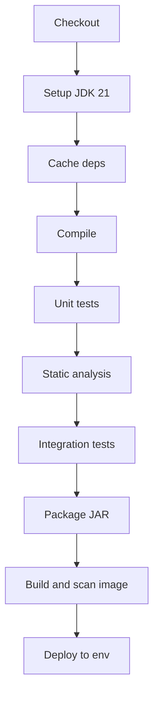
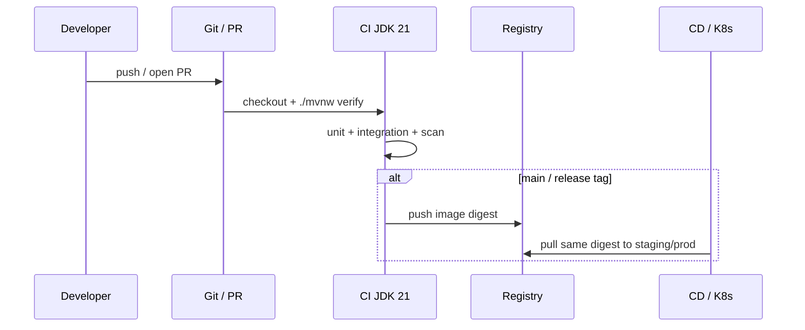

# CI/CD for Java

> **Status:** Completed  
> **Module:** 48 — DevOps and Deployment  
> **Target Java version:** 21  
> **Last reviewed:** 2026-11-11  
> **Chapter profile:** Technical  
> **Depth target:** Levels 2–3

## 1. Learning Objectives

After completing this chapter, you should be able to:

- Define **continuous integration (CI)** and **continuous delivery/deployment (CD)** for JVM projects.
- Assemble a **pipeline** that compiles on JDK 21, runs tests, produces artifacts, and optionally publishes images.
- Apply **caching**, **matrix builds**, and **quality gates** (tests, Checkstyle, OWASP) without hiding failures.
- Separate **build reproducibility** from **environment promotion** (dev → staging → prod).
- Explain artifact **immutability**, SBOM/signing headlines, and branch protection pairing.

## 2. Prerequisites

- **Module 29** — Maven/Gradle, dependency scopes, wrapper scripts.
- **Module 30** — JUnit, Mockito, static analysis concepts.
- **Module 48 Ch.01** — container images as deployable artifacts.
- **Module 43 (helpful)** — secrets must not live in git.

**Refresher:** A **pipeline** is an automated sequence of jobs triggered by git events. **Immutable artifact** means the bytes promoted to production are the same bytes tested in staging (same digest/SHA), with only configuration differing by environment.

## 3. Why This Concept Exists

Manual “build on laptop, SCP JAR to server” does not scale: forgotten tests, wrong JDK, missing dependency updates, and unreviewed config reach production. **CI** runs the same commands on every change; **CD** automates packaging and controlled promotion so releases are **repeatable** and **auditable**.

CI/CD also creates a paper trail: who merged what, which tests ran, which image digest shipped—essential for Module 47 incident timelines.

## 4. Conceptual Explanation

### 4.1 CI vs CD

| Term | Goal |
|------|------|
| **CI** | Integrate changes frequently; compile + test on each push/PR |
| **Continuous Delivery** | Artifact always deployable; human approves prod |
| **Continuous Deployment** | Successful pipeline auto-releases to prod (rare for regulated domains) |

### 4.2 Typical Java pipeline stages



### 4.3 Tooling landscape

| Layer | Examples |
|-------|----------|
| CI engines | GitHub Actions, GitLab CI, Jenkins, Azure Pipelines |
| Build | Maven, Gradle (use **wrapper** committed in repo) |
| Artifact repo | Nexus, Artifactory, GitHub Packages |
| Image registry | ECR, GCR, Harbor, GHCR |

**Rule:** CI must call `./mvnw` or `./gradlew`, not a floating `mvn` on the agent image—pin JDK via `actions/setup-java` with `temurin` (or your vendor) and `21`.

### 4.4 Quality gates

| Gate | Purpose |
|------|---------|
| Unit tests | Fast regression signal |
| Integration tests (H2, Testcontainers) | JDBC/JPA/Spring wiring |
| Static analysis | Style, bugs (SpotBugs, Error Prone) |
| Dependency scan | Known CVEs in libraries |
| Coverage (optional) | Trend, not vanity 100% |
| Image scan | OS/JDK/app layer CVEs (Ch.01) |

Module 30 warned against merging red builds; **the main branch stays green**.

### 4.5 Secrets and environments

- **Secrets** in CI vault (`GITHUB_SECRET`, Jenkins credentials)—never in `application.properties` in git.
- **Environment** variables per stage: `SPRING_PROFILES_ACTIVE=staging`.
- **Promotion**: same **immutable** JAR/image SHA from staging to prod; change config, not rebuild ad hoc.

## 5. Mechanism and Execution Flow

### 5.1 PR → production sequence



**Immutability rule:** production deploys the **same artifact SHA** promoted from staging; config changes via env/Secrets, not ad hoc rebuilds on the server.

### 5.2 Maven lifecycle gates (reference)

| Phase | Typical CI use |
|-------|----------------|
| `compile` | Fast compile-only smoke on huge repos |
| `test` | Unit tests |
| `verify` | Includes integration, failsafe, quality plugins |
| `package` | Produces JAR; still run tests before trusting artifact |

**Handbook standard:** `./mvnw -B verify` on JDK 21 before tagging a release image.

### 5.3 Cache and matrix mechanics

- **Dependency cache** (Actions `cache: maven`) speeds PRs but must invalidate on lockfile/`pom.xml` hash changes.
- **Matrix** (17 + 21) increases confidence for libraries; handbook primary path remains **21**—document exceptions.

## 6. Step-by-Step Examples

### 6.1 GitHub Actions sketch (Illustrative)

```yaml
name: ci
on: [push, pull_request]
jobs:
  test:
    runs-on: ubuntu-latest
    steps:
      - uses: actions/checkout@v4
      - uses: actions/setup-java@v4
        with:
          distribution: temurin
          java-version: '21'
          cache: maven
      - run: ./mvnw -B verify
      - run: docker build -t app:${{ github.sha }} .
```

`verify` runs tests and fails the job on failures—do not swallow test errors.

### 6.2 Fail-fast local parity

Developers run before push:

```bash
./mvnw -q verify
```

Matches CI; catches Checkstyle/test failures early.

### 6.3 Artifact immutability

Tag release `1.4.0` → publish `com.example:app:1.4.0` once. Never overwrite a released Maven coordinate; use patch version for fixes. Container tags may move; **digests** should be what prod pins.

### 6.4 Branch protection pairing

| Rule | Why |
|------|-----|
| Required `verify` status | No merge on red CI |
| No direct push to main | Every change reviewed |
| Required CODEOWNERS on `Dockerfile` | Infra changes reviewed |

## 7. SBOM and Provenance (headline)

Modern supply-chain expectations:

- Attach **CycloneDX/SPDX** SBOM to release artifacts.
- Sign container images (cosign/Sigstore) so prod refuses unsigned digests.

Java-specific: record **dependency tree** (`mvn dependency:tree`) in build logs for CVE diff on upgrades. Treat SBOM generation as a CD stage, not an afterthought PDF.

## 8. Real-World Use Cases

- PR checks block merge until `verify` passes (Module 38 OpenAPI contract tests optional stage).
- Nightly pipeline runs heavier integration + performance smoke (Module 46).
- Release workflow attaches SBOM for supply-chain audit.
- Fork PRs run tests without production secrets.

## 9. Edge Cases and Limitations

- **Flaky tests** erode trust—quarantine and fix; do not `retry: 3` forever without investigation.
- **Time zones** in CI: use UTC; Module 22 `ZoneId` tests must not depend on agent locale.
- **Fork PRs** and secrets: CI must not expose credentials to untrusted forks.
- **Self-hosted runners** with dirty workspaces cause “works in CI only on runner 3” ghosts—ephemeral clean agents preferred.
- **Docker-in-Docker** complexity—prefer buildah/kaniko/remote builders with clear auth.

## 10. Common Mistakes

### Incorrect — `mvn deploy` on every feature branch to production registry

Floods registry; untested SHAs become deployable.

### Corrected

Publish snapshots to snapshot repo only; release tags on main after approval.

### Incorrect — skipping tests with `-DskipTests` in CI “to save time”

Defeats CI purpose.

### Corrected

Split fast (unit) vs slow (integration) jobs; parallelize slow stage.

### Incorrect — rebuild on the production server from `main` HEAD

Produces a different classpath than staging.

### Corrected

Promote the tested digest; config-only differences between envs.

## 11. Design Trade-offs

| Monolithic pipeline YAML | Reusable workflows/composite actions |
|--------------------------|--------------------------------------|
| Simple at first | Duplication across repos |

| Docker build on every commit | Build image only on main/release |
|----------------------------------|----------------------------------|
| Slower PRs | Faster feedback on compile/test |

| Continuous Deployment | Continuous Delivery |
|-----------------------|----------------------|
| Faster to prod | Human gate for regulated apps |

| Matrix many JDKs | JDK 21 only |
|------------------|------------|
| Broader compat signal | Faster CI; handbook default |

## 12. Performance Considerations

- Cache dependencies; avoid redownloading the internet every PR.
- Fail fast: compile/unit before heavy Testcontainers.
- Parallelize independent jobs; serialize only when artifacts depend.
- Keep PR feedback under a team-agreed budget (e.g. 10–15 minutes) or split nightly.

## 13. Security Considerations

- Secrets in vaults; rotate regularly; never echo secrets in logs.
- Pin action versions by SHA for high-assurance repos when supply-chain risk is high.
- Scan dependencies and images; block known critical CVEs with documented exceptions.
- Least privilege for deploy credentials (OIDC to cloud preferred over long-lived keys).

## 14. Revision and Mastery

**Track B gaps:**

- Difference between `package` and `verify` in Maven lifecycle?
- What artifact should prod deploy match from staging?
- Name two reasons to pin Temurin/Oracle JDK 21 in CI.
- Why are floating image tags weaker than digests for rollback?
- How should fork PRs differ from internal PRs regarding secrets?

## 15. Exercises

1. Add a CI job step that prints `java -version` and fails if major version is not 21.
2. Diagram your handbook project’s ideal pipeline stages including image scan.
3. List which Module 30 tests belong in PR vs nightly job.
4. Write a promotion checklist: staging digest → prod digest equality proof.

## 16. Environment Promotion Checklist

Before calling a release “done”:

1. Staging ran `verify` artifact digest `sha256:ABC`.
2. Staging smoke + optional load smoke passed (Module 46).
3. Prod deploy references **the same** digest `sha256:ABC`.
4. Config/secrets differ by env only (URLs, credentials)—not rebuilt code.
5. Rollback digest `sha256:PREV` documented in the runbook (Ch.03).

### Incorrect

```text
Rebuild from main on the prod cluster because “staging was last week”
```

### Corrected

```text
Promote the tested digest; if main moved, cut a new release through the pipeline
```

## 17. Testcontainers in CI (Awareness)

Integration tests that start Redis/Postgres via Testcontainers need Docker-capable runners and generous timeouts. Prefer:

- Reuse containers where the library supports it.
- Mark heavy tests `@Tag("integration")` and run in a dedicated job.
- Fail the job on flaky infrastructure with clear logs—do not hide with endless retries.

## 18. Chapter Summary

CI/CD turns Java builds into repeatable automation: JDK 21 via wrapper, `verify` as the honesty bar, scanned immutable artifacts, and promotion of the same bits through environments. Containers from Ch.01 are the usual deployable output of the CD stage; Ch.03 decides *how* those bits replace running pods safely.

## 19. Next Steps

[03-deployment-strategies.md](03-deployment-strategies.md)


## 20. Reproducible Builds Headline

Aim for: same commit + same JDK major/vendor + wrapper → same artifact bytes (or documented reasons they differ). Practical steps:

- Commit `mvnw` / `gradlew`.
- Pin plugin versions.
- Avoid timestamps in JAR manifests when comparing digests.
- Record `java -version` in CI logs every run.

Perfect bit-for-bit reproducibility is hard; **digest promotion** still beats rebuilding on the server.

## 21. Nightly vs PR Job Split

| Job | Contents |
|-----|----------|
| PR | `verify` unit + fast integration; static analysis |
| Nightly | Full Testcontainers matrix; dependency updates dry-run; soak smoke |
| Release | Image build, scan, SBOM, sign, staging deploy |

Keeping PR fast preserves developer trust; hiding all quality in nightly recreates “broken main.”

## 22. Failure Taxonomy for CI

| Failure class | Response |
|---------------|----------|
| Product bug | Fix code; keep red |
| Flaky test | Quarantine + issue; do not ignore forever |
| Infra (registry down) | Retry infra; do not skip tests permanently |
| Dependency CVE gate | Upgrade or document exception with expiry |


## 23. Artifact Naming Conventions

| Artifact | Good practice |
|----------|---------------|
| Maven version | SemVer; never reuse release numbers |
| Container tag | Prefer git SHA or `1.4.0-<sha>` plus digest pin |
| SBOM file | Attached beside image/`*.jar` in release |

Human-friendly tags help operators; digests keep integrity.

## 24. Local–CI Parity Script

Commit a `scripts/ci-local.sh` / `ci-local.ps1` that runs the same `./mvnw -B verify` flags as CI. Drift between “works on my machine verify” and CI flags is a top cause of red PRs.

## Review Checklist

- [x] CI/CD definitions; pipeline stages; secrets; gates; mistakes; trade-offs
- [x] Immutability/SBOM/branch protection; promotion checklist; Testcontainers note
- [x] Fourth EXPAND-PRESERVE deepen pass 2026-11-11
