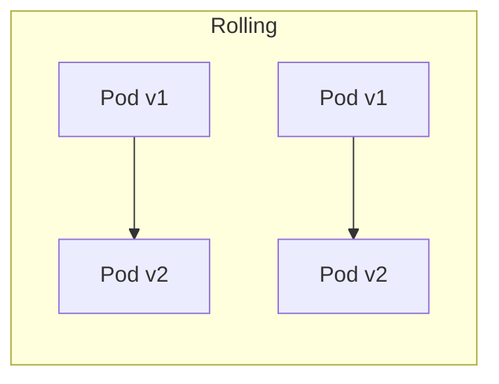
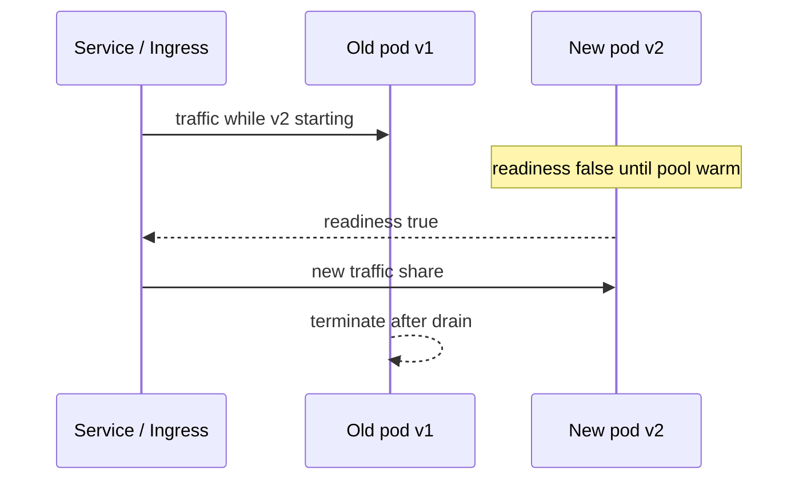

# Deployment Strategies

> **Status:** Completed  
> **Module:** 48 — DevOps and Deployment  
> **Target Java version:** 21  
> **Last reviewed:** 2026-11-11  
> **Chapter profile:** Technical  
> **Depth target:** Levels 2–3

## 1. Learning Objectives

After completing this chapter, you should be able to:

- Compare **rolling**, **blue/green**, **canary**, and **recreate** deployments for JVM services.
- Plan **health checks**, **drain**, and **session** behavior during rollouts.
- Relate deployment choice to **database migrations**, **feature flags**, and **rollback**.
- Recognize when **zero-downtime** is required vs acceptable maintenance windows.
- Analyze canary metrics against Module 47 SLOs before full promotion.

## 2. Prerequisites

- **Module 37** — Spring Boot Actuator health/readiness (conceptual).
- **Module 38** — API versioning and backward compatibility.
- **Module 48 Ch.01–02** — containers and CI-produced immutable artifacts.
- **Module 47** — golden signals and SLOs for canary gates.
- **Module 46** — cold cache / stampede risk on new pods.

**Refresher:** **Readiness** means “safe to receive traffic.” **Liveness** means “process should be restarted if false.” Confusing them causes cascading restarts during dependency blips. A **rollout** replaces old instances with new ones according to a strategy while users keep calling the service.

## 3. Why This Concept Exists

Deploying a new JAR is easy; deploying **without** user-visible errors, data corruption, or thundering herds is not. JVM apps warm up (JIT, connection pools, caches). **Deployment strategy** coordinates how old and new instances share traffic while migrations and caches stay consistent.

Bad rollouts look like “random 500s for 10 minutes,” “half the fleet on schema v2,” or “canary looks fine because it got no traffic.” Strategy makes those failure modes explicit and testable.

## 4. Conceptual Explanation

### 4.1 Strategy overview

| Strategy | Traffic during deploy | Rollback | Typical use |
|----------|------------------------|----------|-------------|
| **Recreate** | Downtime window | Redeploy old image | Dev/low SLA |
| **Rolling** | Gradual instance replacement | Roll forward or pause | Default Kubernetes `Deployment` |
| **Blue/Green** | Instant switch between two pools | Flip traffic back | Strong rollback, duplicate cost |
| **Canary** | Small % on new version | Shrink canary | Risk-sensitive releases |

### 4.2 Choosing a strategy (decision sketch)

| Constraint | Lean toward |
|------------|-------------|
| Strict rollback + budget for 2× capacity | Blue/green |
| Default K8s, stateless API | Rolling |
| High blast-radius risk (payments) | Canary + manual promote |
| Internal tool, off-hours OK | Recreate |

## 5. Mechanism and Execution Flow

### 5.1 Rolling replacement

Rolling replacement (typical Kubernetes `Deployment`) interleaves old and new pods while Service endpoints shift only to **ready** instances:

**JVM warmup and readiness:** A pod can be **running** but not **ready**: JIT has not compiled hot paths, HikariCP pool not filled, Spring context still starting. **Readiness probe** should hit a lightweight endpoint that proves the app can serve (Module 37). **Liveness** should not depend on downstream DB slowness—or cascading restarts occur.

| Probe | Should fail when |
|-------|------------------|
| Liveness | Deadlock/unrecoverable hang |
| Readiness | Not accepting traffic (starting, draining, DB down) |

### 5.2 Blue/green

1. Deploy **green** pool with new digest alongside **blue** (current).
2. Run smoke tests against green.
3. Flip load balancer / ingress to green.
4. Keep blue warm for fast rollback; decommission after soak.

Cost: roughly 2× compute during the window. Benefit: atomic traffic switch and simple rollback.

### 5.3 Canary

1. Route a small percentage (or subset of users) to new pods.
2. Compare error rate, p99, business KPI vs control (Module 47).
3. Promote gradually or abort by shrinking canary weight to zero.

Automated promotion only when gates pass for N minutes—manual approval for payment flows.

### 5.4 Database ordering (expand/contract)

**Expand/contract** pattern:

1. **Expand** — additive schema (new nullable column); deploy app reading both.
2. **Migrate** data in background job.
3. **Contract** — remove old column in later release.

Never deploy code that **requires** new schema before migration runs (ordering: migration job → then app, or backward-compatible dual-write).

```mermaid
flowchart TD
  M[Expand migration] --> A[Deploy app dual-read/write]
  A --> B[Backfill]
  B --> C[Deploy app new-only]
  C --> D[Contract migration]
```

### 5.5 Sessions, caches, and state

| State placement | Deploy impact |
|-----------------|---------------|
| Stateless JWT (Module 39) | Rolling deploy friendly |
| Server sessions + sticky LB | Rolling needs drain; blue/green may drop sessions |
| In-memory cache | Stale entries across versions; version cache keys (Module 46) |
| Redis session | Shared; still drain in-flight requests |

### 5.6 Rollback

- **Blue/green** — switch load balancer back.
- **Rolling** — redeploy previous image tag/digest if kept immutable (Ch.02).
- **Canary** — reduce canary weight to zero.

Keep **previous image digest** in registry; tags alone can be overwritten if policy is weak.

## 6. Migration–Deploy Ordering Matrix

| Schema change | App deploy order |
|---------------|------------------|
| Add nullable column | Migration **before** app reading new column |
| Drop column | App stops using **before** migration drops |
| Rename (expand/contract) | Follow dual-write phases (Module 51) |

**Incorrect:** run destructive migration while old pods still SELECT dropped column.

**Corrected:** expand → dual support → contract after old code is gone.

## 7. Canary Analysis Metrics

| Metric | Canary pass |
|--------|-------------|
| 5xx rate | ≤ control + epsilon |
| p99 latency | ≤ control + SLO margin |
| Business KPI | Conversion not regressed |
| Saturation | Pool wait not worse |

Wire these to Module 47 dashboards before the first canary in prod.

## 8. Real-World Use Cases

- Payment service: **canary** 5% with error-rate SLO dashboard.
- Internal admin tool: **recreate** off-hours acceptable.
- High-traffic API: **rolling** + **PodDisruptionBudget** + maxUnavailable tuned for JVM startup time.
- Feature flag: ship dark code with rolling deploy; flip flag after canary of the flag itself.

## 9. Stateful vs Stateless Deploy Notes

| Workload | Strategy nuance |
|----------|-----------------|
| Stateless REST | Rolling + readiness; any pod interchangeable |
| Quartz / single leader | Ensure one scheduler instance; use DB lease or K8s leadership |
| Kafka consumer | Rebalance on roll; tune `max.poll.interval` |
| Session in JVM memory | Requires sticky sessions or external session store (Module 46) |

**Java batch jobs:** prefer **CronJob** with `restartPolicy: OnFailure` and idempotent processing—do not assume rolling Deployment semantics for one-shot JVM batch.

## 10. Edge Cases and Limitations

- **Breaking API** without versioned URL breaks mobile clients mid-rollout—use Module 38 versioning.
- **Singleton batch** job must not run two versions concurrently without idempotency.
- **Classpath agents** (APM) differing between versions can confuse comparisons during canary.
- **maxSurge: 100%** without capacity plan doubles DB connections during deploy.
- **Cold cache** on new pods can stampede origin (Module 46)—pre-warm or gradual shift.

## 11. Common Mistakes

### Incorrect — liveness probe hits DB under load

DB blip restarts all pods → outage.

### Corrected — readiness fails; liveness stays simple (process alive).

### Incorrect — `maxSurge: 100%` without capacity plan

Doubles traffic to DB during deploy.

### Corrected — limit surge; scale DB/pool; use connection pool max per instance math (Module 46).

### Incorrect — canary with no metric comparison

“Looks fine” without control group.

### Corrected — compare canary vs stable on SLO metrics for N minutes.

## 12. Best Practices

- **Pre-stop hook** / graceful shutdown: stop accepting, drain in-flight HTTP, then exit (align with Ch.01 SIGTERM).
- **Feature flags** decouple deploy from release (toggle new code off in new binary).
- **Smoke tests** after deploy against synthetic traffic.
- Document **rollback runbook** with exact image digest and migration reversal policy.
- Tune `terminationGracePeriodSeconds` > drain time.

## 13. Design Trade-offs

| Faster rollouts | Safer rollouts |
|----------------|----------------|
| Higher `maxUnavailable` | Smaller batches, longer deploy |

| Blue/green cost | Rolling simplicity |
|-----------------|-------------------|
| 2× infrastructure during switch | One pool, trickier partial failure |

| Auto-promote canary | Manual approve |
|---------------------|----------------|
| Speed | Human judgment for high risk |

| Feature flags | Versioned APIs only |
|---------------|---------------------|
| Instant kill switch | Clearer compatibility contracts |

## 14. Performance Considerations

- JVM warmup: exclude first N seconds from canary latency judgments or pre-warm.
- Surge pods multiply DB pool usage—capacity worksheet from Module 46 applies during deploys.
- Image pull + Spring startup dominate wall-clock rollout time—smaller images and lazy init policies help (Ch.01).

## 15. Security Considerations

- Do not disable AuthZ “temporarily” during rollback without review (Module 43).
- Canary routing by user id can leak features—use approved exposure rules.
- Rollback digests must be signed/trusted like forward deploys (Ch.02).

## 16. Revision and Mastery

**Track B gaps:**

- When is recreate acceptable?
- How do readiness and liveness differ for a Spring Boot service?
- Why must migrations often lead application deploys?
- What metrics gate a canary promote?
- How does Module 46 cache stampede show up mid-rollout?

## 17. Exercises

1. Sketch rolling vs canary timeline for a 10-pod service including readiness delays.
2. Write acceptance criteria for “zero-downtime deploy” for a stateless REST API.
3. List rollback steps for failed canary at 10% traffic including digest pin.
4. Design expand/contract steps for renaming `user_name` → `display_name`.

## 18. Worked Rolling Deploy Timeline (10 Pods)

Illustrative timeline (wall clock depends on image pull + Spring startup):

| t | Event |
|---|-------|
| 0 | Start rollout; `maxUnavailable=1`, `maxSurge=1` |
| 1 | New pod scheduled; readiness false |
| 2 | Spring started; Hikari filled; readiness true; takes traffic |
| 3 | Old pod receives SIGTERM; drains; exits |
| … | Repeat until all 10 on v2 |

If readiness is too loose (returns 200 before pool warm), users see timeouts on the “ready” pod—fix probes against a dependency-light endpoint that still proves the app can serve *something* meaningful.

## 19. Feature Flags vs Deploy Strategy

| Goal | Prefer |
|------|--------|
| Ship code dark; enable later | Feature flag + rolling |
| Validate binary under tiny traffic | Canary |
| Instant revert without redeploy | Flag off (if change is flag-guarded) |
| Schema-incompatible change | Expand/contract + ordered deploys |

Flags do not replace canaries for changes that always run (new serialization, new pool defaults).

## 20. PodDisruptionBudget and JVM Startup

During node drains, PDBs prevent too many pods disappearing at once. Size PDB with **startup time** in mind: if each JVM needs 40 s to become ready, aggressive disruptions create capacity holes even when the final replica count looks fine on paper.

## 21. Chapter Summary

Deployment strategy is how safely new JVM instances replace old ones: probes respect warmup, migrations stay backward compatible, and rollback preserves immutable artifacts. Match strategy to SLA, statefulness, and schema change risk—and judge canaries with the same SLOs Module 47 taught you to measure.

## 22. Expand/Contract Walkthrough — Rename Column

Goal: rename `users.name` → `users.display_name` without downtime.

1. **Expand:** add nullable `display_name`; deploy migration.
2. **Dual-write app:** write both columns; read `display_name` with fallback to `name`.
3. **Backfill** job copies values.
4. **Read new-only** deploy after backfill verified.
5. **Contract:** stop writing `name`; later drop column.

Skipping step 2 while old pods run causes null reads or lost updates—the classic migration outage.

## 23. Canary Abort Runbook (Checklist)

1. Set canary weight → 0% (or delete canary ReplicaSet).
2. Confirm stable digest still serves 100%.
3. Capture metrics screenshots / PromQL range for postmortem.
4. File incident if SLO burned (Module 47).
5. Block forward deploys until root cause ticket exists.

## 24. Health Probe Anti-Patterns

| Anti-pattern | Failure mode |
|--------------|--------------|
| Liveness hits DB | DB blip restarts fleet |
| Readiness always 200 from second 0 | Cold pods take traffic |
| Huge grace period | Stuck broken pods linger |
| Tiny grace period | SIGKILL mid-drain → dropped requests |

## 25. Traffic Shifting Mechanisms (Awareness)

| Platform idea | How traffic moves |
|---------------|-------------------|
| K8s Service Endpoints | Ready pods only |
| Ingress / service mesh weights | Canary percentages |
| DNS blue/green | TTL-sensitive; slower flips |
| Feature flag evaluate | In-process decision after deploy |

Mesh weights enable fine canaries; plain Services naturally support rolling. Choose tooling that matches your ops maturity—do not invent weights you cannot observe (Module 47).

## 26. Rollback vs Roll-Forward

| Situation | Prefer |
|-----------|--------|
| Bad config / obvious bug | Rollback to previous digest |
| Forward migration already contract-dropped | Roll-forward fix; rollback may be unsafe |
| Partial canary failure | Abort canary (rollback of weight) |

Always know whether the migration is reversible before choosing rollback.

## Review Checklist

- [x] Four strategies; probes; migrations; rollback; canary metrics; mistakes
- [x] Worked rolling timeline; flags vs strategy; PDB note
- [x] Stateful notes; security/performance; Mandatory Depth Review L2–3
- [x] Fourth EXPAND-PRESERVE deepen pass 2026-11-11
