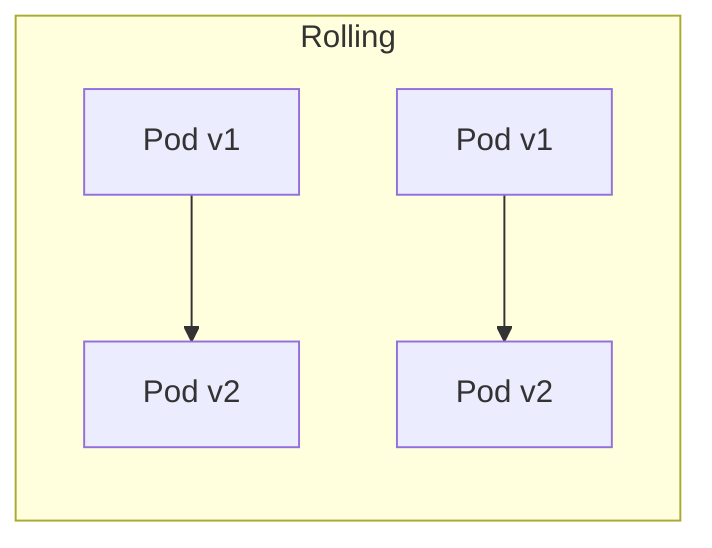

# Deployment Strategies

> **Status:** Completed  
> **Module:** 48 — DevOps and Deployment  
> **Target Java version:** 21  
> **Last reviewed:** 2026-11-10

## 1. Learning Objectives

- Compare **rolling**, **blue/green**, **canary**, and **recreate** deployments for JVM services.
- Plan **health checks**, **drain**, and **session** behavior during rollouts.
- Relate deployment choice to **database migrations**, **feature flags**, and **rollback**.
- Recognize when **zero-downtime** is required vs acceptable maintenance windows.

## 2. Prerequisites

- **Module 37** — Spring Boot Actuator health/readiness (conceptual).
- **Module 38** — API versioning and backward compatibility.
- **Module 48 Ch.01–02** — containers and CI-produced artifacts.

## 3. Why This Concept Exists

Deploying a new JAR is easy; deploying **without** user-visible errors, data corruption, or thundering herds is not. JVM apps warm up (JIT, connection pools, caches). **Deployment strategy** coordinates how old and new instances share traffic while migrations and caches stay consistent.

## 4. Conceptual Explanation

### Strategy overview

| Strategy | Traffic during deploy | Rollback | Typical use |
|----------|------------------------|----------|-------------|
| **Recreate** | Downtime window | Redeploy old image | Dev/low SLA |
| **Rolling** | Gradual instance replacement | Roll forward or pause | Default Kubernetes `Deployment` |
| **Blue/Green** | Instant switch between two pools | Flip traffic back | Strong rollback, duplicate cost |
| **Canary** | Small % on new version | Shrink canary | Risk-sensitive releases |

### JVM warmup and readiness

A pod can be **running** but not **ready**: JIT has not compiled hot paths, HikariCP pool not filled, Spring context still starting. **Readiness probe** should hit a lightweight endpoint that proves the app can serve (Module 37). **Liveness** should not depend on downstream DB slowness—or cascading restarts occur.

| Probe | Should fail when |
|-------|------------------|
| Liveness | Deadlock/unrecoverable hang |
| Readiness | Not accepting traffic (starting, draining, DB down) |

### Sessions and sticky state

| State placement | Deploy impact |
|-----------------|---------------|
| Stateless JWT (Module 39) | Rolling deploy friendly |
| Server sessions + sticky LB | Rolling needs drain; blue/green may drop sessions |
| In-memory cache | Stale entries across versions; version cache keys |

### Database migrations

**Expand/contract** pattern:

1. **Expand** — additive schema (new nullable column); deploy app reading both.
2. **Migrate** data in background job.
3. **Contract** — remove old column in later release.

Never deploy code that **requires** new schema before migration runs (ordering: migration job → then app, or backward-compatible dual-write).

### Rollback

- **Blue/green** — switch load balancer back.
- **Rolling** — redeploy previous image tag if kept immutable.
- **Canary** — reduce canary weight to zero.

Keep **previous image digest** in registry; tags alone can be overwritten if policy is weak.

## 5. Real-World Use Cases

- Payment service: **canary** 5% with error-rate SLO dashboard (Module 47 observability themes).
- Internal admin tool: **recreate** off-hours acceptable.
- High-traffic API: **rolling** + **PodDisruptionBudget** + maxUnavailable tuned for JVM startup time.

## 6. Edge Cases

- **Breaking API** without versioned URL breaks mobile clients mid-rollout—use Module 38 versioning.
- **Singleton batch** job must not run two versions concurrently without idempotency.
- **Classpath agents** (APM) differing between versions can confuse comparisons during canary.

## 7. Common Mistakes

### Incorrect — liveness probe hits DB under load

DB blip restarts all pods → outage.

### Corrected — readiness fails; liveness stays simple (ping “alive”).

### Incorrect — `maxSurge: 100%` without capacity plan

Doubles traffic to DB during deploy.

### Corrected — limit surge; scale DB/pool; use connection pool max per instance math.

## 8. Best Practices

- **Pre-stop hook** / graceful shutdown: stop accepting, drain in-flight HTTP, then exit (align with Ch.01 SIGTERM).
- **Feature flags** decouple deploy from release (toggle new code off in new binary).
- **Smoke tests** after deploy against synthetic traffic.
- Document **rollback runbook** with exact image digest and migration reversal policy.

## 9. Design Trade-offs

| Faster rollouts | Safer rollouts |
|----------------|----------------|
| Higher `maxUnavailable` | Smaller batches, longer deploy |

| Blue/green cost | Rolling simplicity |
|-----------------|-------------------|
| 2× infrastructure during switch | One pool, trickier partial failure |

## 10. Revision and Mastery

- When is recreate acceptable?
- How do readiness and liveness differ for a Spring Boot service?
- Why must migrations often lead application deploys?

## 11. Exercises

1. Sketch rolling vs canary timeline for a 10-pod service.
2. Write acceptance criteria for “zero-downtime deploy” for a stateless REST API.
3. List rollback steps for failed canary at 10% traffic.

## 12. Chapter Summary

Deployment strategy is how safely new JVM instances replace old ones: probes respect warmup, migrations stay backward compatible, and rollback preserves immutable artifacts. Match strategy to SLA, statefulness, and schema change risk.

## Review Checklist

- [x] Four strategies; probes; migrations; rollback; mistakes
