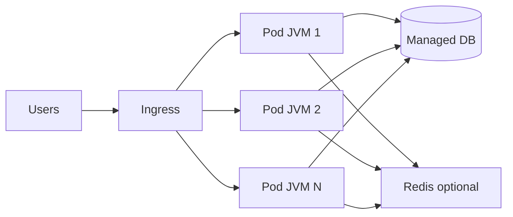
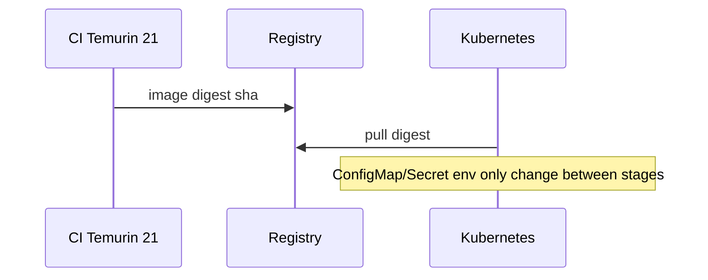

# Cloud-Native Java

> **Status:** Completed  
> **Module:** 49 — Cloud and Containerization  
> **Target Java version:** 21  
> **Last reviewed:** 2026-11-11  
> **Chapter profile:** Technical  
> **Depth target:** Levels 2–3

## 1. Learning Objectives

- Define **cloud-native** properties: elasticity, resilience, observability, automation.
- Map handbook skills (HTTP, JDBC, Spring, testing) to **12-factor** style services.
- Choose **managed services** (DB, cache, queue) vs self-hosted for JVM workloads.
- Configure **externalized config** and **stateless processes** for horizontal scale.

## 2. Prerequisites

- **Modules 37–40** — Spring Boot, REST, architecture patterns.
- **Module 48** — containers, CI/CD, deployment strategies.

## 3. Why This Concept Exists

Running Java in the cloud is not “lift-and-shift VM + one giant application server.” **Cloud-native** design uses **small deployable units**, **declared infrastructure**, and **platform services** so teams scale individual services, recover from zone failures, and ship frequently without sharing one JVM fate.

## 4. Conceptual Explanation

### Cloud-native pillars (for Java backends)

| Pillar | Java manifestation |
|--------|---------------------|
| **Modular deployables** | Spring Boot JARs, Module 40 boundaries |
| **Containers & orchestration** | Modules 48–49 Kubernetes |
| **DevOps automation** | CI/CD pipelines, GitOps |
| **Observability** | Logs, metrics, traces (Module 47) |
| **Resilience** | Timeouts, retries, circuit breakers (Module 32, 44) |

### 12-factor highlights (Java-relevant)

1. **Codebase** — one repo per service (usually).
2. **Dependencies** — Maven/Gradle lock versions; no hidden JARs on server.
3. **Config** — env vars, ConfigMaps (not baked into WAR).
4. **Backing services** — PostgreSQL as attachable resource URL.
5. **Build/release/run** — immutable release artifact (container digest).
6. **Processes** — **stateless** JVM; session in Redis if needed (Module 46, 39).
7. **Port binding** — embedded Tomcat/Netty (Spring Boot default).
8. **Concurrency** — scale **out** processes, not one giant JVM (Module 24).
9. **Disposability** — fast startup; graceful SIGTERM (Module 48).
10. **Dev/prod parity** — same JDK 21 image class.
11. **Logs** — stdout aggregated by platform.
12. **Admin processes** — migrations as K8s Job, not SSH.

### Managed vs self-managed

| Managed (RDS, Cloud SQL) | Self-managed DB in cluster |
|--------------------------|----------------------------|
| Ops offload, backups | Control, cost at scale |

Java apps connect via JDBC URL from env (Modules 33–35); rotate credentials via secrets manager.

### Configuration patterns

Spring Boot reads `SPRING_DATASOURCE_URL` from env (Module 37). `@ConfigurationProperties` binds typed config—**never** commit secrets.

## 5. Mechanism and Execution Flow

### Stateless horizontal scale



Any pod can serve any request when HTTP session state is **not** trapped in local memory. Shared state moves to **Redis**, **DB**, or **token** claims.

### Release immutability



## 6. Terminology

| Term | Meaning |
|------|---------|
| **Lift-and-shift** | Move VM as-is; limited cloud benefit |
| **Immutable release** | Same bits from staging to prod |
| **Backing service** | DB/cache treated as attached resource |

## 7. Real-World Use Cases

- E-commerce checkout service scales on CPU during sales; cart uses Redis.
- Event-driven fulfillment publishes to Kafka; consumer is another Boot app (Module 45).

## 8. Edge Cases

- **Cold start** on serverless—GraalVM native (Ch.03) vs JVM warmup.
- **Clock skew** — use UTC; `java.time` in code (Module 22).
- **Multi-region** — read replicas, write stickiness, Module 34 transactions.

## 9. Common Mistakes

### Incorrect — local absolute paths in config

`/var/app/data` breaks in cloud.

### Corrected — mount volumes or use object storage SDK.

### Incorrect — treating cloud as infinite CPU

Rate limits, pool exhaustion, GC under load still apply.

### Corrected — load test (Module 46); pool sizing; horizontal scale.

### Externalized configuration flow

```mermaid
flowchart LR
  Vault[Secret store] --> K8s[Secret/ConfigMap]
  K8s --> Pod[Spring Boot pod]
  Pod --> Env[Environment + optional file mount]
  Env --> Bind[@ConfigurationProperties]
```

**Mechanism:** Boot reads `SPRING_APPLICATION_JSON`, env vars, and mounted files with documented precedence (Module 37). Cloud-native apps never bake DB passwords into the image layer.

### Health and metrics export

Expose Actuator on management port or restricted network path; scrape metrics from outside user-facing Ingress. **Incorrect:** same public URL for `/actuator/env` and business API.

## 10. Design Trade-offs

| Modular monolith (Module 40) | Microservices |
|------------------------------|---------------|
| Simpler deploy | Independent scale |

| Managed DB | Self-managed |
|------------|--------------|
| Faster launch | Custom tuning |

## 11. Revision and Mastery

- Name three 12-factor items especially relevant to JDBC/Spring.
- Why should JVM processes be stateless at the HTTP layer?
- What is an immutable release in CD terms?

## 12. Twelve-Factor Mapping for Spring Boot

| Factor | Java practice |
|--------|----------------|
| III. Config | `application-{profile}.yml` + env override |
| IV. Backing services | JDBC URL as attached resource via env |
| IX. Disposability | SIGTERM graceful shutdown (Module 48) |
| XII. Admin processes | One-off `java -jar app.jar migrate` Job, not SSH |

**Anti-pattern:** baking `spring.profiles.active=prod` into the image—use orchestrator env per environment.

## 13. Exercises

1. List env vars for a Boot app (DB URL, profile, `JAVA_TOOL_OPTIONS`).
2. Compare lift-and-shift vs cloud-native for a single WAR.

## 14. Chapter Summary

Cloud-native Java emphasizes stateless Spring Boot services in containers, externalized config, managed backing services, and automation from Module 48—not monolithic VMs with manual releases.

## Next Steps

[02-kubernetes-basics-for-java.md](02-kubernetes-basics-for-java.md)

## Review Checklist

- [x] Technical L2–3; mechanism flows; 12-factor preserved
- [x] Cloud-native + managed services; mistakes; deepen pass 2026-11-11
