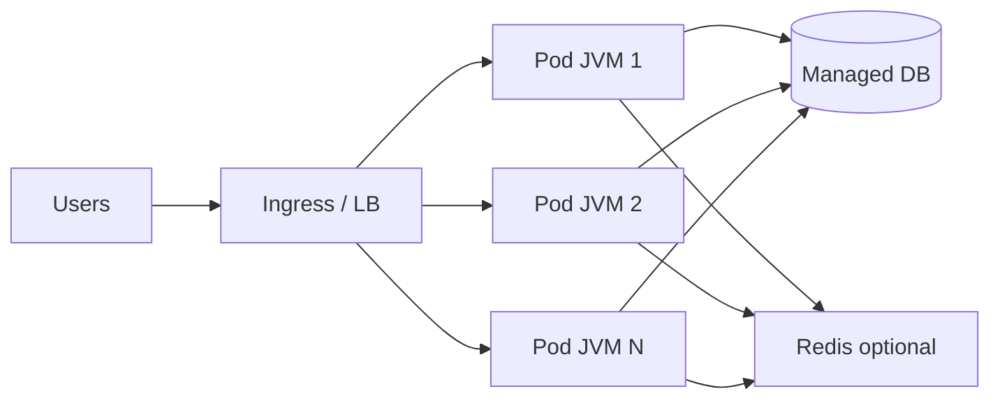
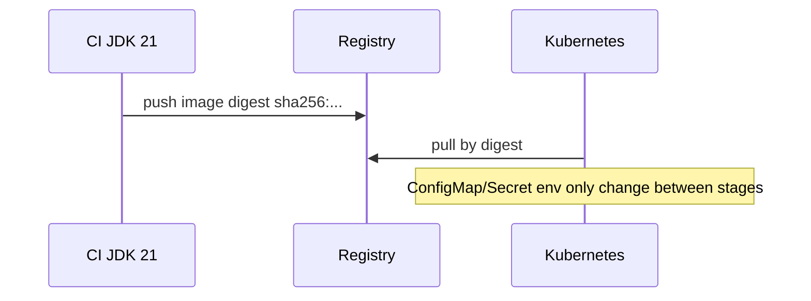
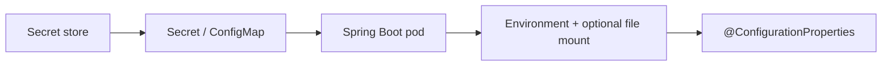

# Cloud-Native Java

> **Status:** Completed  
> **Module:** 49 — Cloud and Containerization  
> **Target Java version:** 21  
> **Last reviewed:** 2026-11-11  
> **Chapter profile:** Technical  
> **Depth target:** Levels 2–3

**Section policy:** Sections are **conditional unless marked mandatory**. Language-syntax and Internal Behavior (JVMS) sections are omitted—this chapter is platform/ops-facing; Spring config and K8s YAML are labeled **Illustrative** unless a runnable demo exists under `examples/`.

| Mandatory for most chapters | Conditional |
| --------------------------- | ----------- |
| Learning objectives | Internal behavior *(omitted — no JVM spec claim)* |
| Prerequisites | Performance |
| Why this exists | Security |
| Conceptual explanation | Language comparisons *(omitted)* |
| Mechanism and execution flow | Advanced examples |
| Terminology | Real-world use cases |
| Examples | Design trade-offs |
| Common mistakes | Compatibility details |
| Summary and references | — |

## 1. Learning Objectives *(mandatory)*

After completing this chapter, you should be able to:

- Define **cloud-native** properties for JVM backends: elasticity, resilience, observability, and automation.
- Map handbook skills (HTTP, JDBC, Spring Boot, testing) to **12-factor** style services with concrete Java practices.
- Choose **managed services** (DB, cache, queue) vs self-hosted for JVM workloads and justify the trade-off.
- Configure **externalized config** and **stateless processes** so horizontal scale does not corrupt sessions or file state.
- Explain why **immutable releases** (image digests) beat mutable “update files on the VM.”

## 2. Prerequisites *(mandatory)*

- **Modules 37–40** — Spring Boot, REST, architecture patterns (modular monolith vs services).
- **Module 48** — containers, JVM memory in cgroups, CI/CD, graceful shutdown.
- **Module 47** — logs, metrics, traces (cloud platforms aggregate stdout and scrape metrics).

**Refresher — Spring Boot process:** A Boot “fat JAR” embeds a servlet container (or reactive server). In the cloud you usually run **one process per container**: `java -jar app.jar`, not a shared application-server install.

**Refresher — horizontal scale:** Adding **replicas** of the same container image behind a load balancer. That only works if any replica can handle any request—hence **stateless** HTTP tiers.

## 3. Why This Concept Exists *(mandatory)*

Running Java in the cloud is not “lift-and-shift VM + one giant application server.” Teams that treat the cloud as a rented VM keep:

- Session state in JVM heap → sticky sessions, uneven load, painful deploys.
- Config baked into WAR/image layers → rebuild for every environment.
- Manual SSH releases → unreproducible production.

**Cloud-native** design uses **small deployable units**, **declared infrastructure**, and **platform services** so teams scale individual services, recover from zone failures, and ship frequently without sharing one JVM’s fate.

## 4. Conceptual Explanation *(mandatory)*

### 4.1 Cloud-native pillars (for Java backends)

| Pillar | Java manifestation | Handbook |
|--------|---------------------|----------|
| **Modular deployables** | Spring Boot JARs; clear Module 40 boundaries | M40 |
| **Containers & orchestration** | OCI images; Kubernetes (Ch.02) | M48–49 |
| **DevOps automation** | CI/CD pipelines, GitOps | M48 |
| **Observability** | Structured logs, metrics, traces | M47 |
| **Resilience** | Timeouts, retries, circuit breakers | M32, M44 |

Cloud-native is a **system property**, not a Spring annotation. `@RestController` alone does not make an app cloud-native if it writes uploads to a local disk path that disappears when the pod dies.

### 4.2 Twelve-factor highlights (Java-relevant)

The [Twelve-Factor App](https://12factor.net/) methodology maps cleanly onto Spring Boot + containers:

| # | Factor | Java practice |
|---|--------|----------------|
| I | **Codebase** | One repo (or clear monorepo module) per deployable |
| II | **Dependencies** | Maven/Gradle lock versions; no hidden JARs on the server |
| III | **Config** | Env vars, ConfigMaps/Secrets—not secrets in `application-prod.yml` committed to git |
| IV | **Backing services** | PostgreSQL, Redis, Kafka as attachable URLs/credentials |
| V | **Build/release/run** | Immutable image digest; config injected at run |
| VI | **Processes** | Stateless JVM; session/token store external if needed |
| VII | **Port binding** | Embedded Tomcat/Netty (Boot default)—bind `PORT` |
| VIII | **Concurrency** | Scale **out** processes; size pools carefully (M24) |
| IX | **Disposability** | Fast start; graceful SIGTERM (M48) |
| X | **Dev/prod parity** | Same JDK 21 image class; Testcontainers for parity |
| XI | **Logs** | stdout/stderr; platform ships to aggregator |
| XII | **Admin processes** | Migrations as Job / one-off container—not SSH |

**Anti-pattern:** baking `spring.profiles.active=prod` and DB passwords into the image layer. Use the orchestrator to inject env per environment so the **same digest** promotes staging → prod.

### 4.3 Managed vs self-managed backing services

| Managed (RDS, Cloud SQL, ElastiCache) | Self-managed in cluster |
|---------------------------------------|-------------------------|
| Ops offload: backups, patching, failover | Fine-grained control; cost leverage at huge scale |
| Clear SLA from vendor | You own paging for disk, failover, upgrades |
| JDBC URL + secrets from platform | Operators become DBAs |

Java apps connect via JDBC URL from env (Modules 33–35). Rotate credentials via a secrets manager; never embed passwords in image history.

### 4.4 Configuration patterns (Spring Boot)

Spring Boot binds environment variables to properties with relaxed binding (Module 37). Example mapping:

| Env var | Typical property |
|---------|------------------|
| `SPRING_DATASOURCE_URL` | `spring.datasource.url` |
| `SPRING_DATASOURCE_USERNAME` | `spring.datasource.username` |
| `SPRING_PROFILES_ACTIVE` | Active profiles |
| `JAVA_TOOL_OPTIONS` | JVM flags (container-friendly) |

`@ConfigurationProperties` binds typed config for validation at startup—fail fast if a required URL is missing.

### 4.5 Statelessness in practice

**Stateless at the HTTP layer** means:

- No in-memory HTTP sessions required for correctness across replicas.
- Uploaded files go to object storage (S3-compatible), not `/tmp` alone.
- Idempotency keys and business state live in DB/cache, not ThreadLocals that survive only one request.

Auth can still use **JWT** or **server-side sessions in Redis** (Modules 39, 46)—those are external stores, not local heap affinity.

## 5. Mechanism and Execution Flow *(mandatory)*

### 5.1 Stateless horizontal scale



**Prose:** Any pod can serve any request when session state is **not** trapped in local memory. Shared state moves to **Redis**, **DB**, or **token** claims. Load balancers can then round-robin or least-conn without sticky session stickiness (sticky sessions are a temporary crutch that hide affinity bugs).

### 5.2 Release immutability



**Mechanism:** CI builds once. Staging and production run the **same bits**. Environment differences are env vars and mounts—not “hot patch the JAR on the server.”

### 5.3 Externalized configuration flow



**Mechanism:** Boot reads `SPRING_APPLICATION_JSON`, env vars, and mounted files with documented precedence (Module 37). Cloud-native apps never bake DB passwords into the image layer—secrets appear at **run** time.

### 5.4 Request path with resilience (conceptual)

1. Ingress TLS terminates; forwards to Service → Pod.
2. Spring Security filter chain authenticates (Module 39).
3. Controller → service → JDBC/Redis with **timeouts** and pool limits.
4. Failure → mapped error response; metrics increment; trace spans export (Module 47).
5. SIGTERM → Boot graceful shutdown drains requests before JVM exit (Module 48).

## 6. Terminology *(mandatory)*

| Term | Meaning |
|------|---------|
| **Lift-and-shift** | Move a VM/app as-is to cloud IaaS; limited elasticity benefit |
| **Immutable release** | Same artifact bits from staging to prod (image digest) |
| **Backing service** | DB/cache/queue treated as an attached resource via URL/credentials |
| **Horizontal scale** | More replicas of the same process, not a bigger single JVM |
| **Ephemeral filesystem** | Container local disk that dies with the pod |
| **Twelve-factor** | Methodology for SaaS-style deployables (config, processes, logs, …) |

## 7. Step-by-Step Examples *(mandatory)*

Cloud YAML and Spring property snippets below are **Illustrative**—no cluster is assumed in the handbook CI. Label remains Illustrative unless you run them in your own lab.

### 7.1 Minimal — env-driven datasource (**Illustrative**)

```bash
# Illustrative — local process mimicking cloud env injection
export SPRING_DATASOURCE_URL="jdbc:postgresql://db.internal:5432/orders"
export SPRING_DATASOURCE_USERNAME="orders_app"
export SPRING_DATASOURCE_PASSWORD="***from-vault***"
export SPRING_PROFILES_ACTIVE="prod"
java -jar orders-api.jar
```

**Why this way:** The JAR does not embed prod credentials. The same digest can run in staging with different env values.

### 7.2 Realistic — twelve-factor checklist for a Boot API (**Illustrative**)

| Check | Pass criteria |
|-------|----------------|
| Config | No secrets in git; `application.yml` has placeholders only |
| Logs | JSON or key=value to stdout; no local `logs/app.log` as sole sink |
| Admin | Flyway/Liquibase via Job or init step, not SSH |
| State | No `HttpSession` required for cart/checkout correctness |
| Health | Actuator readiness/liveness separate from business port if required |

### 7.3 Advanced — JDBC pool math under scale (**Illustrative**)

```text
DB max_connections >= (replicas × hikari.maximum-pool-size) + admin headroom
Example: 10 replicas × 20 pool = 200 + 20 admin = 220 needed
```

**Incorrect variation:** Scale Deployment to 30 replicas overnight without raising DB `max_connections` → connection refused storms.

**Corrected:** Capacity plan (Module 46) before horizontal scale; or reduce pool size per replica intentionally.

## 8. Real-World Use Cases *(conditional)*

- **E-commerce checkout** scales on CPU during sales; cart uses Redis; checkout writes to managed PostgreSQL.
- **Event-driven fulfillment** publishes to Kafka; consumer is another Boot app (Module 45)—independent scale.
- **B2B API** promotes one image digest through staging → canary → prod with ConfigMaps changing only URLs and feature flags.

## 9. Edge Cases and Limitations *(strongly encouraged)*

- **Cold start** on serverless/scale-from-zero — GraalVM native (Ch.03) vs JVM warmup trade-off.
- **Clock skew** across regions — use UTC; `java.time` (Module 22); do not order events by wall clock alone.
- **Multi-region** — read replicas, write stickiness, careful Module 34 transaction boundaries.
- **Local disk** — `/tmp` fills; prefer object storage for user uploads.
- **Sticky sessions** — hide bugs; prefer Redis/JWT; if sticky is temporary, document sunset.

## 10. Common Mistakes *(mandatory)*

### Incorrect — local absolute paths in config

`storage.path=/var/app/data` works on a laptop VM and breaks when the pod reschedules to another node with an empty disk.

### Corrected — mount a volume **or** use an object-storage SDK with a bucket name from env.

### Incorrect — treating cloud as infinite CPU

Rate limits, Hikari pool exhaustion, and GC under load still apply. Cloud only makes **adding replicas** easier—not free.

### Corrected — load test (Module 46); size pools; horizontal scale with DB math.

### Incorrect — mutable “hotfix” on a running container

`kubectl exec` and edit class files / property files in place. Next rollout overwrites; you cannot reproduce the incident.

### Corrected — ship a new image digest; use feature flags for behavioral toggles.

### Incorrect — `/actuator/env` on the public Ingress

Leaks configuration.

### Corrected — management port or network policy; scrape metrics from private network path.

## 11. Best Practices *(include)*

- Prefer **constructor injection** and typed `@ConfigurationProperties` so missing config fails at startup.
- Emit **structured logs** with correlation IDs (Module 47).
- Keep containers **single-process**; sidecars are separate containers in the pod (Ch.02).
- Document `JAVA_TOOL_OPTIONS` / memory percentage flags with the image (Module 48).
- Treat migrations as **versioned artifacts** run before or as coordinated Jobs—not ad-hoc DBA scripts without history.

## 12. Design Trade-offs *(conditional)*

| Modular monolith (Module 40) | Microservices |
|------------------------------|---------------|
| Simpler deploy and refactor | Independent scale and team autonomy |
| Shared DB transactions easier | Network failure modes (Module 44) |

| Managed DB | Self-managed |
|------------|--------------|
| Faster launch, less ops | Custom tuning, possible cost win at scale |

| Sticky sessions | External session store |
|-----------------|------------------------|
| Quick legacy lift | True horizontal scale |

## 13. Performance Considerations *(conditional)*

- **Startup time** affects rolling deploys and scale-out latency—measure Boot start on the **production image class**.
- **Connection pools** dominate many “cloud” outages more than CPU—monitor pending Hikari threads.
- **GC** under dense packing—container memory limits (Module 48) interact with heap sizing.
- Scale **out** for throughput; scale **up** CPU/memory only after profiling (Module 28).

## 14. Security Considerations *(conditional)*

- Secrets: vault → orchestrator Secret → env/file; rotate JDBC passwords.
- Least privilege DB users (DML-only for app role).
- TLS at ingress; configure forwarded headers so secure cookies work behind proxies (Ch.02).
- Dependency CVE gates in CI (Module 51 production readiness).
- Never log secret env values; redact Actuator exposures.

## 15. Java Version and Compatibility Notes *(conditional)*

- Primary path: **Java 21 LTS** containers (Temurin/Oracle/other distributions—record which image you run).
- Spring Boot 3.x requires Java 17+; align Boot, Spring Framework, and JDBC drivers with 21.
- Native Image (Ch.03) is optional; most handbook services stay on HotSpot JVM mode unless cold-start requirements force AOT.

## 16. Revision and Mastery *(Track B)*

**Common gaps**

- Confusing “we use Kubernetes” with “we are cloud-native” while keeping sticky sessions and baked secrets.
- Forgetting DB connection math when raising replica counts.
- Treating stdout logs as optional because “we have SSH.”

**Advanced checks**

- Name three 12-factor items especially relevant to JDBC/Spring.
- Why should JVM processes be stateless at the HTTP layer?
- What is an immutable release in CD terms?
- How does Actuator exposure differ from business API exposure?

## 17. Exercises

1. List env vars for a Boot app (DB URL, profile, `JAVA_TOOL_OPTIONS`) and mark which are secrets.
2. Compare lift-and-shift vs cloud-native for a single legacy WAR on one VM.
3. Given `replicas=8`, `maximum-pool-size=15`, compute minimum DB `max_connections` with 10 admin headroom.
4. Sketch a promotion path for one image digest across staging and prod with different ConfigMaps.

## 18. Chapter Summary

Cloud-native Java emphasizes **stateless** Spring Boot services in containers, **externalized config**, **managed backing services**, and **immutable releases** from Module 48—not monolithic VMs with manual releases. Scale is a product of process design and capacity math, not cloud marketing.

## Next Steps

[02-kubernetes-basics-for-java.md](02-kubernetes-basics-for-java.md)

## References

- Twelve-Factor App methodology (12factor.net) — process/config/logs model.
- Spring Boot Reference — externalized configuration and Actuator.
- Module 48 — containers and JVM; Module 47 — observability; Module 40 — boundaries.

## Review Checklist

- [x] Depth gate: motivation, mechanism flows, progressive Illustrative examples, mistakes, trade-offs
- [x] Mandatory Depth Review Levels 2–3 (Technical); ten-question teaching review passed for pillars, 12-factor, statelessness, config
- [x] Section policy: omitted Internal (JVMS) and language-comparisons — recorded
- [x] No invented Verified output; Spring/K8s snippets Illustrative
- [x] EXPAND-PRESERVE fourth deepen 2026-11-11; useful prior content retained
