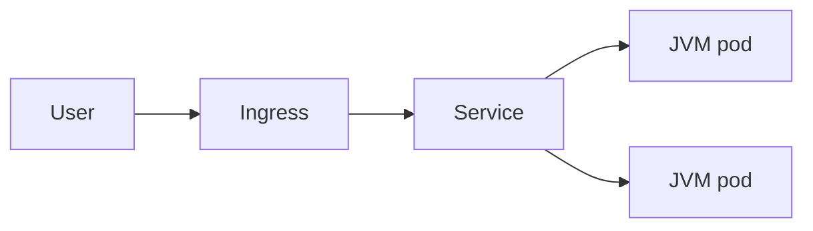

# Kubernetes Basics for Java

> **Status:** Completed  
> **Module:** 49 — Cloud and Containerization  
> **Target Java version:** 21  
> **Last reviewed:** 2026-11-10

## 1. Learning Objectives

- Read a **Deployment**, **Service**, and **Ingress** for a Java HTTP service.
- Set **resources**, **probes**, and **env** for a Spring Boot container.
- Understand **ConfigMap** / **Secret** injection and **rolling** updates.
- Debug common failures: **CrashLoopBackOff**, probe failures, OOM, wrong JDBC URL.

## 2. Prerequisites

- **Module 48** — Docker images, JVM container memory.
- **Module 37** — Actuator `/actuator/health`.
- **Module 38** — HTTP ports and paths.

## 3. Why This Concept Exists

**Kubernetes** schedules container replicas across nodes, restarts failures, exposes stable networking, and rolls out new image versions. Java teams interact with K8s YAML more than with kernel cgroups directly.

## 4. Conceptual Explanation

### Core objects

| Object | Role for Java |
|--------|----------------|
| **Pod** | One or more containers; usually one JVM |
| **Deployment** | Desired replica count, rolling update strategy |
| **Service** | ClusterIP/LB stable DNS to pods |
| **Ingress** | HTTP routing, TLS termination |
| **ConfigMap** | Non-secret config |
| **Secret** | DB passwords, tokens (base64 at rest—not encryption alone) |



### Sample Deployment fragment

```yaml
apiVersion: apps/v1
kind: Deployment
metadata:
  name: orders-api
spec:
  replicas: 3
  selector:
    matchLabels:
      app: orders-api
  template:
    metadata:
      labels:
        app: orders-api
    spec:
      containers:
        - name: app
          image: registry.example/orders-api:21.0.12-sha
          ports:
            - containerPort: 8080
          env:
            - name: SPRING_PROFILES_ACTIVE
              value: prod
            - name: JAVA_TOOL_OPTIONS
              value: "-XX:MaxRAMPercentage=75.0"
          resources:
            requests:
              memory: "512Mi"
              cpu: "250m"
            limits:
              memory: "768Mi"
              cpu: "1"
          readinessProbe:
            httpGet:
              path: /actuator/health/readiness
              port: 8080
            initialDelaySeconds: 30
            periodSeconds: 10
          livenessProbe:
            httpGet:
              path: /actuator/health/liveness
              port: 8080
            initialDelaySeconds: 60
```

**Teaching notes:** `initialDelaySeconds` must exceed typical Spring Boot startup on cold JVM; tune with real metrics.

### Networking

Pods get cluster-internal IP; **Service** `orders-api.default.svc.cluster.local` resolves via DNS. JDBC URL points to **managed DB hostname**, not pod IP.

### Config and secrets

```yaml
envFrom:
  - configMapRef:
      name: orders-config
  - secretRef:
      name: orders-db
```

Mount files for `application.yml` overrides without rebaking image.

## 5. Real-World Use Cases

- Horizontal Pod Autoscaler on CPU or custom metric (request rate).
- **Job** for Flyway migrate-before-deploy pattern (init container or pipeline step).
- **NetworkPolicy** restricting JVM pod egress to DB subnet only.

## 6. Edge Cases

- **Readiness** during long GC pause — rare false failures; tune probe timeouts.
- **Fat JAR** + large metaspace — memory limit must include non-heap.
- **Multiple containers** in pod (sidecar proxy) — share network namespace; localhost calls.

## 7. Common Mistakes

### Incorrect — `latest` image tag in prod

Unreproducible deploys.

### Corrected — immutable digest or versioned tag from CI.

### Incorrect — no resource requests

Scheduler packs nodes; JVM killed by OOM.

### Corrected — requests/limits + MaxRAMPercentage.

## 8. Design Trade-offs

| Helm chart | Plain YAML |
|------------|------------|
| Templating reuse | Simplicity for learning |

| Many small Deployments | One Deployment multi-module monolith |
|------------------------|--------------------------------------|

## 9. Revision and Mastery

- What object provides stable DNS inside the cluster?
- Why readiness initialDelay for JVM?
- Difference ConfigMap vs Secret?

## 10. Exercises

1. Add liveness vs readiness paths for a handbook HttpServer demo (custom `/health`).
2. Calculate total DB connections if replicas=10 and pool size=20.

## 11. Chapter Summary

Kubernetes runs Java containers at scale: Deployments manage replicas and rollouts, Services and Ingress expose HTTP, ConfigMaps/Secrets externalize config, and probes must respect JVM startup and Module 48 memory limits.

## Next Steps

[03-graalvm-and-native-image-concepts.md](03-graalvm-and-native-image-concepts.md)

## Review Checklist

- [x] K8s objects; sample YAML; probes; mistakes
