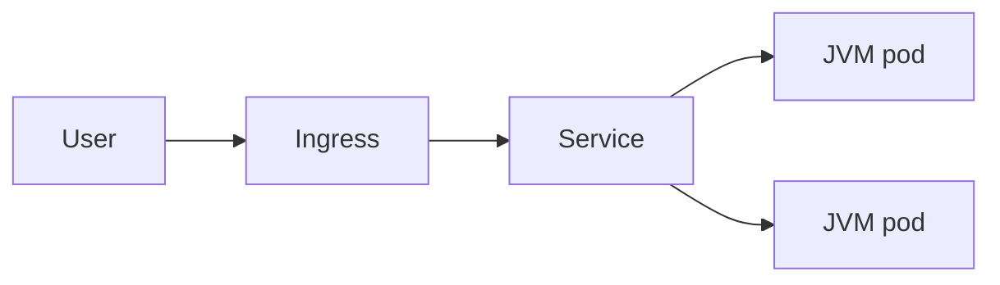
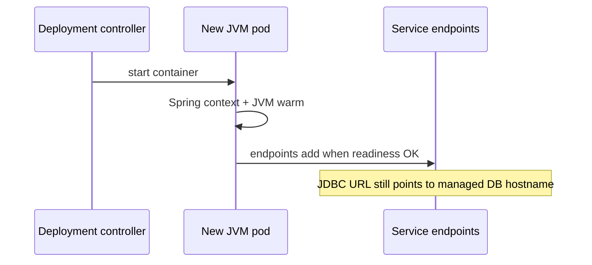

# Kubernetes Basics for Java

> **Status:** Completed  
> **Module:** 49 — Cloud and Containerization  
> **Target Java version:** 21  
> **Last reviewed:** 2026-11-11  
> **Chapter profile:** Technical  
> **Depth target:** Levels 2–3

**Section policy:** Conditional sections omitted when empty of value. All Kubernetes manifests and Spring Actuator path snippets are **Illustrative** (no kind/minikube required for handbook completion). JVM memory interaction with cgroups remains rooted in Module 48.

| Mandatory | Conditional |
|-----------|-------------|
| Learning objectives, prerequisites, why, conceptual, mechanism, terminology, examples, mistakes, summary | Performance, Security, Design trade-offs *(included)*; Internal JVMS *(omitted)* |

## 1. Learning Objectives *(mandatory)*

After completing this chapter, you should be able to:

- Read a **Deployment**, **Service**, and **Ingress** for a Java HTTP service and explain each object’s role.
- Set **resources**, **probes**, and **env** appropriately for a Spring Boot container on JDK 21.
- Understand **ConfigMap** / **Secret** injection and **rolling** updates without sticky-session crutches.
- Debug common failures: **CrashLoopBackOff**, probe failures, OOMKilled, wrong JDBC URL.
- Compute **JDBC connection** demand from `replicas × pool size` before scaling.

## 2. Prerequisites *(mandatory)*

- **Module 48** — Docker/OCI images, JVM container memory (`MaxRAMPercentage`), SIGTERM graceful shutdown.
- **Module 37** — Actuator `/actuator/health`, readiness vs liveness semantics in Boot.
- **Module 38** — HTTP ports and paths.
- **Module 49 Ch.01** — cloud-native config and stateless processes.

**Refresher — Pod:** Smallest deployable unit in Kubernetes: one or more containers sharing network namespace. For most Java APIs, **one JVM container per Pod**.

**Refresher — replica:** A copy of the same Pod template. A Deployment maintains desired replica count.

## 3. Why This Concept Exists *(mandatory)*

**Kubernetes** schedules container replicas across nodes, restarts failures, exposes stable networking, and rolls out new image versions. Java teams interact with K8s YAML and platform abstractions more than with kernel cgroups directly—but cgroup **memory limits** still kill JVMs that ignore them (Module 48).

Without orchestration knowledge, Java developers:

- Ship `latest` tags and cannot roll back.
- Set probes that kill cold JVMs during Spring context startup.
- Scale replicas until PostgreSQL exhausts `max_connections`.

## 4. Conceptual Explanation *(mandatory)*

### 4.1 Core objects

| Object | Role for Java |
|--------|----------------|
| **Pod** | One or more containers; usually one JVM |
| **Deployment** | Desired replica count, rolling update strategy |
| **ReplicaSet** | Owns Pods for a Deployment revision (usually not edited by hand) |
| **Service** | ClusterIP/LB stable DNS and virtual IP to ready pods |
| **Ingress** | HTTP routing, TLS termination at the edge |
| **ConfigMap** | Non-secret config as env or files |
| **Secret** | Credentials (base64 at rest in etcd—not encryption by itself) |
| **Job / CronJob** | One-shot or scheduled processes (migrations, reports) |
| **HPA** | Horizontal Pod Autoscaler on CPU/custom metrics |
| **PDB** | PodDisruptionBudget for voluntary disruptions |



**Prose:** Users hit Ingress (TLS). Ingress forwards to a Service. The Service load-balances to Pods that pass **readiness**. Unready pods stay up for debugging but receive no user traffic.

### 4.2 Sample Deployment fragment (**Illustrative**)

```yaml
# Illustrative — not applied in handbook CI
apiVersion: apps/v1
kind: Deployment
metadata:
  name: orders-api
spec:
  replicas: 3
  selector:
    matchLabels:
      app: orders-api
  template:
    metadata:
      labels:
        app: orders-api
    spec:
      containers:
        - name: app
          image: registry.example/orders-api:21.0.12-sha
          ports:
            - containerPort: 8080
          env:
            - name: SPRING_PROFILES_ACTIVE
              value: prod
            - name: JAVA_TOOL_OPTIONS
              value: "-XX:MaxRAMPercentage=75.0"
          resources:
            requests:
              memory: "512Mi"
              cpu: "250m"
            limits:
              memory: "768Mi"
              cpu: "1"
          readinessProbe:
            httpGet:
              path: /actuator/health/readiness
              port: 8080
            initialDelaySeconds: 30
            periodSeconds: 10
          livenessProbe:
            httpGet:
              path: /actuator/health/liveness
              port: 8080
            initialDelaySeconds: 60
```

**Teaching notes**

- `initialDelaySeconds` must exceed typical Spring Boot startup on a **cold** JVM in that image—tune with real metrics, not folklore.
- Prefer image digests or immutable tags from CI (Ch.01 immutable release).
- Memory **limit** must cover heap **and** non-heap (metaspace, threads, direct buffers)—Module 48.

### 4.3 Probes: readiness vs liveness vs startup

| Probe | Meaning if it fails |
|-------|---------------------|
| **Readiness** | Remove from Service endpoints—no user traffic |
| **Liveness** | Restart container (Kubernetes assumes deadlock/wedged) |
| **Startup** | Delays other probes until app finishes long start |

**Incorrect:** Liveness hitting a dependency-heavy health check that fails when DB blips → restart storm.

**Corrected:** Liveness = process alive (shallow); readiness = can serve (may include DB); use startupProbe for slow Boot starts.

### 4.4 Config and secrets

```yaml
# Illustrative
envFrom:
  - configMapRef:
      name: orders-config
  - secretRef:
      name: orders-db
```

Mount files for `application.yml` overrides without rebaking the image. Secrets are **base64-encoded** in API objects—enable encryption at rest and RBAC; do not treat “it’s a Secret” as sufficient cryptography.

## 5. Mechanism and Execution Flow *(mandatory)*

### 5.1 Rolling update



**Mechanism:** Deployment creates a new ReplicaSet with updated Pod template. Controllers respect `maxUnavailable` / `maxSurge`. **Service** endpoints include only ready pods. Old pods terminate after graceful period—pair with Boot SIGTERM handling (Module 48) so in-flight JDBC work can finish.

### 5.2 Networking

Pods get cluster-internal IPs. Service DNS such as `orders-api.default.svc.cluster.local` resolves via CoreDNS. **JDBC URL points to managed DB hostname**, not Pod IP—Pods are ephemeral.

Cross-namespace: `svc.namespace.svc.cluster.local`. NetworkPolicies can restrict egress so JVM pods may only talk to DB and approved peers.

### 5.3 CrashLoopBackOff diagnosis flow

1. `kubectl describe pod` — Events: OOMKilled? Failed mount? ImagePullBackOff?
2. `kubectl logs` — Spring failure: bad JDBC URL, missing Flyway, port bind.
3. Check probes — failing readiness ≠ CrashLoop; failing liveness + restart = loop.
4. Compare `resources.limits.memory` with actual RSS (Module 48).

### 5.4 PDB during node drain

```yaml
# Illustrative
apiVersion: policy/v1
kind: PodDisruptionBudget
metadata:
  name: api-pdb
spec:
  minAvailable: 2
  selector:
    matchLabels:
      app: api
```

During node drain, PDB prevents eviction below `minAvailable`. Combined with graceful shutdown, this protects SLO during cluster maintenance.

## 6. Terminology *(mandatory)*

| Term | Meaning |
|------|---------|
| **ClusterIP** | Virtual IP for in-cluster access to Pods |
| **Endpoint / EndpointSlice** | Ready Pod IPs backing a Service |
| **OOMKilled** | Kernel/cgroup killed the container for memory |
| **CrashLoopBackOff** | Container exits repeatedly; backoff delay increases |
| **Rollout** | Progressive replacement of Pods under a Deployment |
| **Digest** | Content-addressed image id (`sha256:…`) |

## 7. Step-by-Step Examples *(mandatory)*

### 7.1 Minimal — Service exposing Boot (**Illustrative**)

```yaml
# Illustrative
apiVersion: v1
kind: Service
metadata:
  name: orders-api
spec:
  selector:
    app: orders-api
  ports:
    - port: 80
      targetPort: 8080
```

**Important lines:** `selector` must match Pod labels. `targetPort` is the container port Boot listens on (`server.port`).

### 7.2 Realistic — JDBC connection math

```text
max_connections_db ≥ replicas × spring.datasource.hikari.maximum-pool-size + admin headroom
```

| replicas | pool | headroom | need |
|----------|------|----------|------|
| 3 | 20 | 20 | 80 |
| 10 | 20 | 20 | 220 |

Scale **replicas down** before shrinking DB `max_connections` after a rollback—order matters.

### 7.3 Advanced — Ingress TLS and forwarded headers (**Illustrative**)

Client TLS often ends at Ingress; the Pod may see plain HTTP. Configure Spring:

```properties
# Illustrative
server.forward-headers-strategy=framework
```

so absolute redirects and `Secure` cookies reflect the external HTTPS URL (Module 39).

### 7.4 Job for migration (**Illustrative**)

Run Flyway/Liquibase as a **Job** (or pipeline step) before switching Deployment traffic to a version that **requires** new columns (Module 51 expand/contract). Never rely on “first pod to start wins” without advisory locks.

## 8. Real-World Use Cases *(conditional)*

- **HPA** on CPU or custom Micrometer metric (request rate) for flash sales.
- **Init container** or Job for schema migrate-before-deploy.
- **NetworkPolicy** restricting JVM pod egress to DB subnet only.
- **Canary** Deployment (or service mesh / progressive delivery tool) shifting 5% traffic (Module 48 strategies).

## 9. Edge Cases and Limitations

- **Readiness** during long GC pause — rare false failures; tune timeout/failureThreshold.
- **Fat JAR** + large metaspace — memory limit must include non-heap.
- **Sidecar proxy** (service mesh) — share network namespace; localhost calls to sidecar; memory requests must include sidecar.
- **Multiple containers** competing for the same memory limit sum.
- **Clock skew** between nodes — prefer DB time or logical clocks for ordering.

## 10. Common Mistakes *(mandatory)*

### Incorrect — `latest` image tag in prod

Unreproducible deploys; rollback unclear.

### Corrected — immutable digest or versioned tag from CI.

### Incorrect — no resource requests

Scheduler packs nodes densely; JVM killed by OOM under neighbors’ pressure.

### Corrected — requests/limits + `MaxRAMPercentage` (Module 48).

### Incorrect — liveness = deep dependency check

DB blip restarts all pods → thundering herd.

### Corrected — shallow liveness; dependency-aware readiness (or separate health groups).

### Incorrect — Service selects wrong labels after rename

Traffic goes nowhere; pods look “Running.”

### Corrected — verify Endpoints/EndpointSlices include Pod IPs after rollout.

## 11. Best Practices

- One Deployment per independently scalable service; avoid multi-app Pods unless sidecars.
- Keep probe paths cheap; cache heavy checks carefully.
- Document PDB + `terminationGracePeriodSeconds` with Boot shutdown timeout.
- Prefer `env`/`envFrom` over rebuilding images for config.
- Record image digests in release notes and dashboards (Module 47).

## 12. Design Trade-offs *(conditional)*

| Helm / Kustomize | Plain YAML |
|------------------|------------|
| Templating reuse | Simplicity for learning and small apps |

| Many small Deployments | One Deployment modular monolith |
|------------------------|----------------------------------|
| Independent scale | Fewer moving parts (Module 40) |

| ClusterIP + Ingress | LoadBalancer per service |
|---------------------|--------------------------|
| Central TLS/routing | Simpler networking, more cost |

## 13. Performance Considerations *(conditional)*

- Rolling update speed vs readiness delay — slow starts lengthen deploys.
- CPU **limits** can throttle JIT and increase latency (Module 28)—measure before aggressive limits.
- HPA thrashing — stabilize windows; avoid scaling on noisy metrics.
- Connection pools × HPA max replicas must fit DB capacity.

## 14. Security Considerations *(conditional)*

- RBAC: apps should not use cluster-admin ServiceAccounts.
- Secrets: encrypt etcd; prefer external secret operators/vault injectors.
- NetworkPolicy default-deny + allow DB/DNS.
- Image provenance: signed images, private registries.
- Do not expose Actuator sensitive endpoints on public Ingress (Ch.01).

## 15. Java Version and Compatibility Notes *(conditional)*

- Run **JDK 21** images consistently across namespaces.
- Actuator path changes across Boot majors—match probe paths to Boot 3.x groups (`readiness`, `liveness`).
- Native Image containers (Ch.03) change probe timing (faster start)—retune `initialDelaySeconds`.

## 16. Revision and Mastery

- What object provides stable DNS inside the cluster?
- Why readiness `initialDelay` (or startupProbe) for JVM/Spring?
- Difference ConfigMap vs Secret?
- How do you calculate DB connections for 12 replicas × pool 15?
- What happens to endpoints when readiness fails?

## 17. Exercises

1. Add liveness vs readiness paths for a handbook HttpServer demo (custom `/health`) and explain which should restart vs drain.
2. Calculate total DB connections if `replicas=10` and pool size=`20` with headroom `25`.
3. Write a PDB that keeps at least 2 pods for `app: orders-api`.
4. List five `kubectl` checks for CrashLoopBackOff on a Boot pod.

## 18. Chapter Summary

Kubernetes runs Java containers at scale: **Deployments** manage replicas and rollouts, **Services** and **Ingress** expose HTTP, **ConfigMaps/Secrets** externalize config, and **probes** must respect JVM/Spring startup and Module 48 memory limits. Capacity math—especially JDBC pools—belongs in every scale decision.

## Next Steps

[03-graalvm-and-native-image-concepts.md](03-graalvm-and-native-image-concepts.md)

## References

- Kubernetes documentation — Workloads, Probes, Services.
- Spring Boot Actuator — health groups.
- Module 48 — containers and the JVM.

## Review Checklist

- [x] Technical L2–3; rolling update + probe mechanisms; Illustrative YAML labeled
- [x] Depth gate + Mandatory Depth Review; no invented Verified cluster output
- [x] EXPAND-PRESERVE fourth deepen 2026-11-11; prior Deployment sample preserved and expanded
