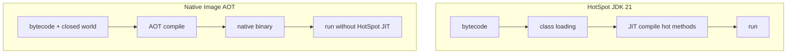

# GraalVM and Native Image Concepts

> **Status:** Completed  
> **Module:** 49 — Cloud and Containerization  
> **Target Java version:** 21  
> **Last reviewed:** 2026-11-11  
> **Chapter profile:** Technical  
> **Depth target:** Levels 2–3

**Section policy:** No runnable Native Image build is required in handbook CI (native toolchain is optional). Maven/Gradle native snippets and reflect-config fragments are **Illustrative**. HotSpot vs Substrate differences are labeled carefully. Deep reflection/proxy mechanisms live in Module 50—this chapter teaches **why** they matter for closed-world builds.

## 1. Learning Objectives *(mandatory)*

After completing this chapter, you should be able to:

- Contrast **HotSpot JIT** with **ahead-of-time (AOT)** native images for startup, memory, and peak throughput.
- List **reachability**, **reflection**, **resources**, and **proxy** challenges for Spring/native workloads.
- Know when **native image** helps (cold start, memory density) vs when **JVM mode** remains better.
- Connect native constraints to **Module 50** reflection, proxies, MethodHandles, and agents.
- Sketch a **decision matrix** stakeholders can use instead of “native everywhere.”

## 2. Prerequisites *(mandatory)*

- **Module 26** — class loading and JIT compilation overview.
- **Modules 36–37** — Spring DI, proxies, reflection-heavy frameworks.
- **Module 49 Ch.01–02** — cloud scale-from-zero and container resource limits.
- **Module 50 Ch.01** (link forward) — reflection and annotations; give enough here for native metadata motivation.

**Refresher — JIT:** HotSpot interprets/compiles **hot** methods at runtime. Peak throughput often appears **after** warmup. Cold start pays class loading + JIT.

**Refresher — reflection:** `Class.forName`, `Method.invoke`, and annotation scanning discover types not named in static call graphs—Native Image cannot see them unless configured.

## 3. Why This Concept Exists *(mandatory)*

Serverless platforms and dense Kubernetes charge for **memory** and **startup time**. A conventional JDK 21 HotSpot process warms up JIT and uses more RSS. **GraalVM Native Image** compiles a closed-world subset of the application to a **native binary** with faster cold start and often smaller footprint—at the cost of **build complexity**, longer CI, and reduced dynamic flexibility.

Teams adopt native for the wrong reasons (“it is modern”) and then discover Hibernate, Jackson, or agents break without metadata. This chapter teaches the **closed-world contract** so you choose deliberately.

## 4. Conceptual Explanation *(mandatory)*

### 4.1 Execution models

| Mode | Startup | Peak throughput | Dynamic reflection | Agents / JVMTI |
|------|---------|-----------------|--------------------|----------------|
| **HotSpot** (Temurin/Oracle 21) | Slower warm | Excellent after warmup | Full | Supported |
| **Native Image** | Fast cold | Workload-dependent | Declared at build time | Generally not applicable |

### 4.2 Closed-world assumption

Native Image **analyzes reachability at build time**. Unreachable code may be stripped. Features that invent types at runtime need **metadata**:

| Dynamic feature | Typical metadata / mitigation |
|-----------------|-------------------------------|
| Reflection | `reflect-config.json`, Spring AOT hints |
| Resources | `resource-config.json` |
| JNI / FFM native | JNI config; verify FFM support for Graal version |
| Dynamic proxies | `proxy-config.json` |
| Serialization | serialization config / avoid Java serialization |

### 4.3 Spring Boot 3 + native (conceptual)

```bash
# Illustrative — requires GraalVM native-image toolchain
./mvnw -Pnative native:compile
```

Build uses **Spring AOT** to generate bean definitions without full classpath scan at runtime. You still need **integration tests on the binary** (JPA, WebClient, messaging)—JVM `mvn test` alone is insufficient.

### 4.4 When to choose native

| Good fit | Poor fit |
|----------|----------|
| CLI tools, small APIs, functions | Heavy long-running JIT-friendly services |
| Strict memory limits / dense packing | Extensive reflection without config budget |
| Fast scale-from-zero | Java agents, deep JVMTI (Module 50) |
| Predictable call graphs | Runtime codegen / exotic scripting |

### 4.5 GraalVM vs Temurin/Oracle JDK

**Handbook primary path:** HotSpot JDK 21 (Oracle 21.0.9 on PATH for this pass; Temurin also common in CI). **GraalVM** distributions provide `native-image`. Many teams run **JVM services on Temurin/Oracle** and adopt native only for specific workloads.

Do not confuse “GraalVM JDK as a HotSpot-compatible runtime” with “everything must be native-compiled.”

## 5. Mechanism and Execution Flow *(mandatory)*

### 5.1 Build-time vs run-time



**Prose:** HotSpot keeps flexibility; optimizes what is hot. Native Image pays a large **build** cost to produce a binary that starts quickly with a fixed world.

### 5.2 Reflection reachability failure path

1. Code calls `Class.forName("com.example.Hidden")` at runtime (or Spring scans a package).
2. Build-time analysis did not see a constant / hint → class not included.
3. Runtime: `ClassNotFoundException`, `NoClassDefFoundError`, or missing resource.

**Fix:** `reflect-config.json`, Spring AOT hints (`@RegisterReflectionForBinding`, etc.), tracing agent during a **training run**, or eliminate dynamic `forName` on hot paths.

### 5.3 Spring Native build pipeline (conceptual)


**Runtime differences:** No dynamic classpath expansion; many `spring.factories` / scan paths are replaced by generated reachability; profile-specific beans still exist but registration is largely **build-time fixed**.

### 5.4 Container implications

Native binaries still run in containers (Ch.02) but:

- Images can be **distroless** / smaller base layers.
- Probe `initialDelaySeconds` often shrinks—**retune**.
- Memory limits change shape (no HotSpot heap flags the same way)—do not copy `-Xmx` folklore blindly onto Substrate.

## 6. Terminology *(mandatory)*

| Term | Meaning |
|------|---------|
| **Reachability analysis** | Build-time graph of classes/methods/fields included |
| **Closed world** | Assumption that no unseen classes appear at runtime |
| **Spring AOT** | Ahead-of-time generation of bean factories and hints |
| **Substrate VM** | Native Image runtime (not HotSpot)—labeled implementation |
| **Tracing agent** | Tool that records reflection/JNI usage during a training run |

## 7. Step-by-Step Examples *(mandatory)*

### 7.1 Minimal — mental model of missing reflection (**Illustrative**)

```java
// Illustrative — shows why closed world breaks
Class<?> c = Class.forName(System.getenv("HANDLER_CLASS"));
Object handler = c.getConstructor().newInstance();
```

If `HANDLER_CLASS` varies and is never constant-folded into the build, Native Image will not include every possible handler.

**Corrected approaches:** enum/switch of known handlers; register each class in reflect-config; generate code at build time.

### 7.2 Realistic — decision checklist before native CI (**Illustrative**)

| Question | If “no” / “unknown” |
|----------|---------------------|
| Do we have integration tests on the **binary**? | Do not ship |
| Are JPA entities and JSON DTOs registered? | Expect runtime failures |
| Do we require a Java agent (APM)? | Prefer HotSpot |
| Is cold start in the SLO? | Maybe native; else optional |

### 7.3 Advanced — stakeholder decision matrix

| Criterion | Weight example | JVM score | Native score |
|-----------|----------------|-----------|--------------|
| Cold start p99 | High | 2 | 5 |
| Peak throughput | High | 5 | 3 |
| Reflection-heavy libs | Medium | 5 | 2 |
| JVMTI agents required | Low/High | 5 | 0 |

Score honestly per workload; many Spring APIs stay on JVM until native CI proves parity.

### 7.4 Debugging native failures (table)

| Symptom | Likely cause |
|---------|--------------|
| `NoClassDefFoundError` at runtime | Reachability gap; add hints / tracing agent |
| Hibernate metadata missing | Entity not registered in AOT hints |
| Actuator endpoint missing | Endpoint not included in closed world |
| Works in `mvn test`, fails as binary | Tests never exercised native path |

Re-run integration tests on the **binary**, not only JVM unit tests.

## 8. Internal Behavior *(conditional — labeled)*

Native Image includes **Substrate VM** (**implementation**, not HotSpot). There is no traditional HotSpot JIT in the same form; optimizations are largely at **build time**. GC choices differ—profile RSS and pause under load; **do not** assume G1 tuning flags transfer.

**JVMS class file execution** still underlies the source language, but the **delivery artifact** is a native executable. Agents that rely on JVMTI (Module 50) generally **do not** apply.

## 9. Real-World Use Cases *(conditional)*

- **Serverless** Java functions where billable duration includes startup.
- **CLI** developer tools shipping a single binary.
- **Sidecar** or edge adapters with tight memory budgets.
- **Not** every long-lived monolith—measure first.

## 10. Edge Cases and Limitations

- **Class.forName** in libraries without config → runtime failure.
- **CGLIB** vs JDK proxies — Spring native prefers paths that cooperate with AOT (Module 50).
- **Preview features** (FFM on JDK 21) — verify native support for the **target GraalVM version**.
- **Build time** — native compiles can be slow; cache thoughtfully in CI.
- **Debuggability** — different tooling than `jcmd` HotSpot habits.
- **Build-time initialization** — some static initializers run at image build; accidental network/file I/O during `<clinit>` can bake wrong state into the binary or fail the build.
- **Locale / timezone data** — ensure required charset and timezone resources are reachable or bundled; missing resources surface late.

### Build-time initialization (conceptual)

Native Image may initialize selected classes at **build time** to reduce startup work. That is powerful and dangerous:

| Safe-ish at build | Dangerous at build |
|-------------------|--------------------|
| Pure constants, immutable caches | Reading `user.home`, env-specific URLs |
| Deterministic math tables | Opening DB connections in static blocks |

**Incorrect:** static block that reads prod secrets from the build agent environment and caches them forever in the binary.  
**Corrected:** initialize connections at **runtime** from env injected by Kubernetes (Ch.01–02).

## 11. Common Mistakes *(mandatory)*

### Incorrect — native build once, never integration-test the binary

Passes smoke; fails on reflective Hibernate/Jackson path in production.

### Corrected — full regression on native binary in CI.

### Incorrect — expecting identical HotSpot `-XX:*` flags

Many flags do not apply to Substrate VM.

### Corrected — native-specific monitoring and tuning docs; measure RSS/latency.

### Incorrect — “Spring Boot 3 means we must go native”

Boot 3 **supports** AOT/native; default production path remains JVM for many teams.

### Corrected — adopt when cold start/memory SLOs justify metadata cost.

## 12. Best Practices

- Start with JVM mode; add native profile when metrics demand it.
- Keep reflection surface small; prefer generated code / explicit registries.
- Pin GraalVM / native-image versions in CI; treat them like JDK upgrades (Module 51).
- Document known missing features (agents, dynamic loaders) for operators.
- Retune K8s probes after switching artifact type (Ch.02).
- Keep a **JVM fallback image** in the registry during native rollout so incidents can revert without rebuilding from source under pressure.

### Production rollout pattern (Illustrative)

1. Ship JVM image as today (Ch.01 immutable digest).
2. Add native binary image under a separate tag/digest; run **shadow** or canary traffic.
3. Compare error rates, p99 latency, RSS, and cold-start histograms (Module 47).
4. Only then make native the default Deployment image—keep JVM digest documented for rollback.

**Incorrect:** replace all prod replicas with an untested native binary on Friday afternoon.  
**Corrected:** canary + binary integration suite + rollback digest ready (Module 48).

## 13. Design Trade-offs *(conditional)*

| JVM container | Native binary |
|---------------|---------------|
| Familiar ops, agents, FFM (with flags) | Smaller image, faster start |
| Peak throughput after warm | Metadata maintenance |
| Faster inner-loop builds | Longer native link times |

## 14. Performance Considerations *(conditional)*

- Native wins **cold start** and often **RSS**; HotSpot may win **sustained throughput** after warmup—**benchmark your workload**.
- Build CPU time is a CI cost center—do not native-compile every PR commit unless needed.
- GC and allocator behavior differ—load test before cutting over (Module 46).

## 15. Security Considerations *(conditional)*

- Smaller attack surface possible with minimal base images—still patch base OS and dependencies.
- Closed world can **exclude** unused vulnerable code paths—but only if reachability analysis is correct.
- Supply chain: protect native toolchains and build caches like any CI secret.

## 16. Java Version and Compatibility Notes *(conditional)*

- Handbook language level: **Java 21**.
- Spring AOT / native support evolves with Boot and Graal versions—read release notes for your pair.
- FFM is **preview** on JDK 21 (Module 50); native support may lag—verify before committing.

## 17. Revision and Mastery

- Why does reflection need configuration in native image?
- Name two workloads better on HotSpot.
- How does Spring AOT relate to the closed-world assumption?
- Why is `mvn test` on HotSpot insufficient for native release gates?
- What happens to Java agents under native image?

## 18. Exercises

1. List handbook demos that would need reflection config (proxy demo, JPA entities, annotation scanners).
2. Compare startup goals for a public API vs a long-running batch job—recommend JVM vs native.
3. Draft a one-page decision matrix for your team’s next service.
4. Sketch K8s probe changes when moving from fat JAR to native binary.

## 19. Related Option: `jlink` (not Native Image)

**`jlink`** builds a custom runtime image containing a subset of JDK modules plus your modular application. It is still a **HotSpot-class** JVM runtime—not an AOT native binary.

| Approach | Artifact | Reflection | Startup |
|----------|----------|------------|---------|
| Full JDK container | Fat-ish runtime | Full | Normal JVM |
| `jlink` image | Smaller JDK + app modules | Full (for included modules) | Still JVM warm |
| Native Image | Native executable | Declared | Fast cold |

Use `jlink` when you want a **smaller JVM distribution** without closed-world reflection constraints. Use Native Image when **cold start / RSS** dominate and you can pay metadata cost.

## 20. Training Runs and Config Generation (Illustrative)

A common workflow:

1. Run the app on HotSpot with the Native Image **tracing agent** attached during representative traffic (happy path + reflective edge cases).
2. Agent emits `reflect-config.json`, `resource-config.json`, `proxy-config.json`.
3. Commit configs (or generate in CI) and feed them to `native-image`.
4. Re-test the binary; iterate when a code path was never trained.

**Limitation:** Training only sees what you exercise. Rare admin endpoints and error paths still break in production if untrained—pair with Spring AOT hints for known frameworks.

```text
# Illustrative shape — exact flags vary by Graal version
java -agentlib:native-image-agent=config-output-dir=./ni-config -jar app.jar
# exercise APIs...
native-image -H:ConfigurationFileDirectories=./ni-config ...
```

## 21. Chapter Summary

GraalVM Native Image trades dynamic flexibility for startup and size under a **closed-world** contract. Java 21 services usually stay on HotSpot (Temurin/Oracle) unless requirements drive native. Plan reflection metadata (Module 50), Spring AOT, training runs, and **binary-level** CI before adopting. Prefer `jlink` when you only need a smaller JVM, not AOT.

## References

- GraalVM Native Image documentation — reachability and configuration.
- Spring Boot Native Image docs — AOT processing.
- Module 50 — reflection, proxies, agents; Module 26 — JIT context.

## Review Checklist

- [x] Technical L2–3; AOT vs HotSpot mechanisms; Substrate labeled implementation
- [x] Illustrative native commands only; no invented Verified native build output
- [x] EXPAND-PRESERVE fourth deepen 2026-11-11; decision matrix and failure tables expanded
