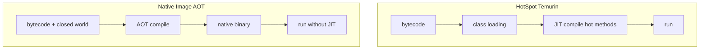

# GraalVM and Native Image Concepts

> **Status:** Completed  
> **Module:** 49 — Cloud and Containerization  
> **Target Java version:** 21  
> **Last reviewed:** 2026-11-11  
> **Chapter profile:** Technical  
> **Depth target:** Levels 2–3

## 1. Learning Objectives

- Contrast **HotSpot JIT** with **ahead-of-time (AOT)** native images.
- List **reachability**, **reflection**, and **classpath** challenges for Spring/native.
- Know when **native image** helps (cold start, memory) vs when **JVM mode** remains better (peak throughput, dynamic features).
- Connect native constraints to **Module 50** reflection and agents.

## 2. Prerequisites

- **Module 26** — JIT compilation overview.
- **Modules 36–37** — Spring DI, proxies, reflection-heavy frameworks.
- **Module 50 Ch.01** — reflection and annotations (native metadata).

## 3. Why This Concept Exists

Serverless and dense Kubernetes charge for **memory** and **startup time**. A conventional Temurin JVM warms up JIT and uses more RSS. **GraalVM Native Image** compiles a closed-world subset to a **native binary** with faster cold start and smaller footprint—at build complexity and dynamic-language cost.

## 4. Conceptual Explanation

### Execution models

| Mode | Startup | Peak throughput | Dynamic reflection |
|------|---------|-----------------|---------------------|
| **HotSpot** (Temurin 21) | Slower warm | Excellent after warmup | Full |
| **Native Image** | Fast cold | Workload-dependent | Declared at build time |

### Closed-world assumption

Native Image **analyzes reachability at build time**. Unreachable code may be stripped. **Reflection**, **JNI**, **classpath resources**, **dynamic proxies**, and **serialization** need **metadata** (`reflect-config.json`, Spring AOT in Boot 3).

### Spring Boot 3 + native (conceptual)

```bash
./mvnw -Pnative native:compile
```

Build uses **Spring AOT** to generate bean definitions without full classpath scan at runtime. Still requires integration testing (JPA, WebClient, etc.).

### When to choose native

| Good fit | Poor fit |
|----------|----------|
| CLI tools, small APIs, functions | Heavy JIT workloads, dynamic codegen |
| Strict memory limits | Extensive reflection without config |
| Fast scale-from-zero | Java agents, deep JVMTI (Module 50) |

### GraalVM vs Temurin

**Temurin** — handbook primary HotSpot path. **GraalVM** distribution provides `native-image`. Many teams run **JVM services on Temurin** and adopt native only for specific workloads.

## 5. Mechanism and Execution Flow

### Build-time vs run-time (HotSpot vs native)



### Reflection reachability failure path

1. Code calls `Class.forName("com.example.Hidden")` at runtime.
2. Build-time analysis did not see constant → class not included.
3. Runtime: `ClassNotFoundException` or missing resource.

**Fix:** `reflect-config.json`, Spring AOT hints, or eliminate dynamic `forName` in hot paths.

## 6. Internal Behavior (labeled)

Native Image includes **Substrate VM** (not HotSpot). No traditional HotSpot JIT; optimizations largely at **build time**. GC choices differ—profile RSS and pause under load; do not assume G1 tuning flags transfer.

## 7. Terminology

| Term | Meaning |
|------|---------|
| **Reachability analysis** | Build-time graph of classes/methods |
| **Spring AOT** | Generated bean factories for native |
| **Closed world** | No unseen classes at runtime |

## 8. Edge Cases

- **Class.forName** in libraries without config → runtime failure.
- **CGLIB** vs JDK proxies — Spring native prefers different paths (Module 50).
- **Preview features** (FFM on 21) — verify native support for target GraalVM version.

## 9. Common Mistakes

### Incorrect — native build once, never integration-test

Passes smoke; fails on reflective Hibernate path.

### Corrected — full regression on native binary in CI.

### Incorrect — expecting identical HotSpot `-XX:*` flags

Many flags do not apply to Substrate VM.

### Corrected — native-specific monitoring and tuning docs.

### Spring Native build pipeline (conceptual)


**Runtime differences:** No dynamic classpath expansion; `spring.factories` replaced by generated reachability; profile-specific beans still exist but registration is build-time fixed.

### Debugging native failures

| Symptom | Likely cause |
|---------|--------------|
| `NoClassDefFoundError` at runtime | Reachability gap; add tracing agent at build with `-H:TraceClassInitialization` (build-time tool, version-specific) |
| Hibernate metadata missing | Entity not registered in AOT hints |
| Actuator endpoint missing | Endpoint not included in closed world |

Re-run integration tests on the **binary**, not only JVM `mvn test`.

## 10. Design Trade-offs

| JVM container | Native binary |
|---------------|---------------|
| Familiar ops, agents, FFM | Smaller image, faster start |
| Peak throughput after warm | Metadata maintenance |

## 11. Revision and Mastery

- Why does reflection need configuration in native image?
- Name two workloads better on HotSpot.
- How does Spring AOT relate to closed-world assumption?

## 12. Decision Matrix (when stakeholders ask for native)

| Criterion | Weight | JVM score | Native score |
|-----------|--------|-----------|--------------|
| Cold start p99 | High | 2 | 5 |
| Peak throughput | High | 5 | 3 |
| Reflection-heavy libs | Medium | 5 | 2 |
| JVMTI agents required | Low | 5 | 0 |

Score honestly per workload; many Spring APIs stay on JVM until native CI proves parity.

## 13. Exercises

1. List handbook demos needing reflection config (proxy demo, JPA).
2. Compare startup goals for API vs batch job.

## 14. Chapter Summary

GraalVM Native Image trades dynamic flexibility for startup and size; Java 21 services usually stay on Temurin unless requirements drive native. Plan reflection metadata (Module 50) and Spring AOT when adopting.

## Review Checklist

- [x] Technical L2–3; AOT mechanism diagram; HotSpot vs AOT preserved
- [x] Closed world; Spring; when to use; deepen pass 2026-11-11
