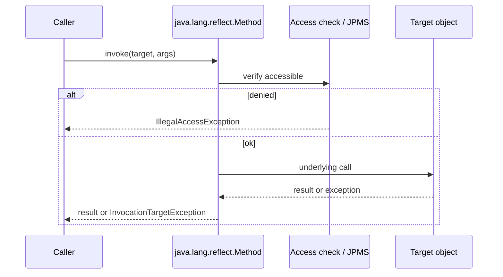
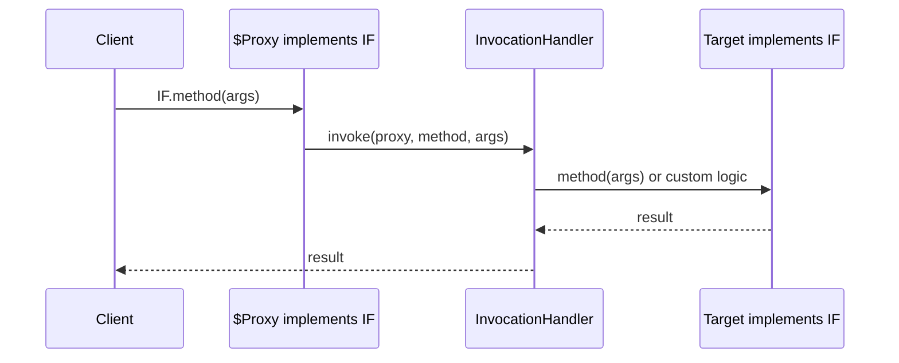

# Reflection, Proxies, and Annotations

> **Status:** Completed  
> **Module:** 50 — Advanced Java  
> **Target Java version:** 21  
> **Last reviewed:** 2026-11-11  
> **Chapter profile:** Deep-dive  
> **Depth target:** Levels 3–4 (critical mechanisms)  
> **Examples verified with:** Temurin JDK 21.0.12.1 — [reflection-annotations-demo](../../examples/advanced/reflection-annotations-demo/); [jdk-dynamic-proxy-demo](../../examples/backend/jdk-dynamic-proxy-demo/)

## 1. Learning Objectives

- Use **reflection** to inspect types and invoke members with correct exception handling (`InvocationTargetException` unwrapping).
- Contrast **compile-time** types with **runtime** `Class` metadata and generics **erasure**.
- Build **JDK dynamic proxies** and relate them to Spring AOP (Module 36).
- Define **annotations** with retention and process them at compile time vs runtime.
- Explain **HotSpot inflation** and **JPMS** opens for production frameworks (Level 4).

## 2. Prerequisites

- **Modules 05–08** — classes, inheritance, interfaces.
- **Module 36** — `Proxy`, `InvocationHandler` in AOP narrative.
- **Module 29** — JPMS basics (`--add-opens`).

## 3. Why This Concept Exists

Frameworks (Spring, JPA, JUnit) discover behavior from **metadata** instead of hard-coded lists: which methods are endpoints, which fields are columns, which tests to run. **Reflection** reads that metadata at runtime; **annotations** attach declarative markers; **proxies** intercept interface calls for cross-cutting logic without editing every business class.

## 4. Conceptual Explanation

### Reflection API core

| Type | Examples |
|------|----------|
| **Class<?>** | `String.class`, `obj.getClass()` |
| **Method** | `getMethod`, `invoke` |
| **Field** | `getDeclaredField`, `setAccessible` (JPMS may restrict) |
| **Constructor** | `getConstructor().newInstance()` |

**invoke** can throw `InvocationTargetException` — unwrap `getCause()` for the real failure (NPE inside target method, business exception, etc.).

### Annotations and retention

```java
@Target(ElementType.METHOD)
@Retention(RetentionPolicy.RUNTIME)
public @interface Audited {
    String value() default "";
}
```

| Retention | Visible when |
|-----------|--------------|
| `SOURCE` | Compiler only (e.g. `@Override`) |
| `CLASS` | Bytecode, not runtime reflection |
| `RUNTIME` | Reflection, frameworks |

**Repeating** and **container** annotations (Java 8+) support multiple markers on one element.

### JDK dynamic proxies

Only **interfaces** can be proxied with `java.lang.reflect.Proxy` (JLS proxy rules).

| Approach | Requirement |
|----------|-------------|
| JDK proxy | Target implements interface(s) |
| CGLIB (Spring) | Subclass concrete class; no `final` methods/class |

## 5. Mechanism and Execution Flow

### Reflection invoke sequence



### JDK dynamic proxy call path



Spring `@Transactional` applies similar **proxy around bean**—self-invocation bypasses proxy (Module 36).

## 6. Examples

### Runnable demo — **Verified (Temurin 21.0.12.1)**

[reflection-annotations-demo](../../examples/advanced/reflection-annotations-demo/):

```bash
javac ReflectionAnnotationsDemo.java
java ReflectionAnnotationsDemo
```

**Verified output:**

```text
hasTimed=true
result=Hello, Lin
reflectionDemo=ok
```

`@Retention(RetentionPolicy.RUNTIME)` makes `@Timed` visible to `isAnnotationPresent`.

See also [jdk-dynamic-proxy-demo](../../examples/backend/jdk-dynamic-proxy-demo/) for interface interception order.

## 7. Internal Behavior (Level 4)

**JVMS / language:** Reflection respects accessibility and module exports (Module 29). **Illegal reflective access** on JDK internals may require `--add-opens`; frameworks document required opens for JDK 21.

**HotSpot (implementation, not universal JVM law):** Frequent `Method.invoke` may **inflate** to generated accessor bytecode after a threshold, reducing overhead. First calls pay security and access checks. **Do not** treat inflation timing as a cross-vendor guarantee.

**Generics erasure (JLS):** `List<String>` appears as raw `List` at runtime; use `ParameterizedType` when inspecting generic signatures.

## 8. Real-World Use Cases

- Spring **component scan** and `@Autowired` injection.
- JPA attribute mapping via field annotations.
- Jackson JSON naming via annotations.
- Test frameworks discovering `@Test` methods.

## 9. Edge Cases

- **Records** — reflection exposes canonical constructor and accessors (Module 15).
- **SecurityManager** — deprecated/removal path; fewer deployments; access checks still matter via modules.
- **Native Image** — reflection must be reachability-configured (Module 49).

## 10. Common Mistakes

### Incorrect — reflection in hot paths without caching

Re-resolving `Method` every request adds overhead.

### Corrected — cache `MethodHandle` or framework metadata once (Ch.02).

### Incorrect — swallowing `InvocationTargetException`

Hides real NPE inside invoked method.

### Corrected — unwrap and rethrow cause.

### HotSpot inflation (Level 4, labeled implementation)

First reflective invocations on a method may use **native** accessors; after a threshold, HotSpot may **inflate** to a generated bytecode accessor for speed. High-frequency frameworks cache `Method`/`MethodHandle` to avoid repeated lookup and inflation churn.

**Not a JLS guarantee** — other JVMs may differ; do not cite inflation in API contracts.

### JPMS `opens` for frameworks

```text
--add-opens java.base/java.lang=ALL-UNNAMED
```

Spring/Hibernate may require opens for deep reflection on JDK internals in edge cases—document in runbook, prefer upgrading library over blanket opens in production.

### Annotation processing vs runtime reflection

| Path | When |
|------|------|
| Annotation processor (compile time) | Generate code (Lombok-style, MapStruct) |
| `RetentionPolicy.RUNTIME` | Spring scan, Jackson, JPA |

Compile-time processors cannot replace runtime scan for arbitrary user-defined `@Component` classes.

## 11. Design Trade-offs

| Explicit wiring | Reflection/DI |
|-----------------|---------------|
| Compile-time clarity | Framework ergonomics |
| Refactoring safe in IDE | Runtime discovery failures |

## 12. Revision and Mastery

- Why must JDK proxy target implement an interface?
- Difference `RetentionPolicy.CLASS` vs `RUNTIME`?
- What does HotSpot inflation optimize, and why prefer MethodHandles at extreme frequency?

## 13. Exercises

1. Reflectively invoke `Integer.parseInt` and handle `InvocationTargetException`.
2. Add a runtime annotation and print it from `main`.
3. Re-run jdk-dynamic-proxy-demo and explain call order.

## 14. Chapter Summary

Reflection, annotations, and proxies underpin modern Java frameworks: metadata at runtime, interface interception for AOP, and retention policies that decide visibility. Prefer MethodHandles for heavy invocation (Ch.02); native image needs explicit reflection config (Module 49).

## Next Steps

[02-method-handles-varhandles-and-ffm.md](02-method-handles-varhandles-and-ffm.md)

## Review Checklist

- [x] Deep-dive L3–4; mechanism flows; HotSpot labeled implementation
- [x] Reflection demo Verified Temurin 21.0.12.1
- [x] Proxies; annotations; JPMS note; deepen pass 2026-11-11
