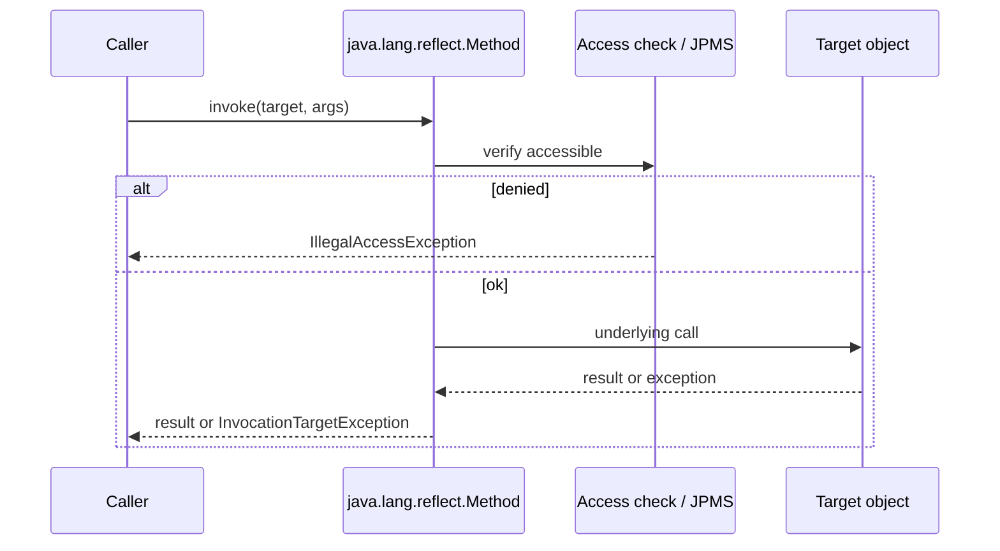
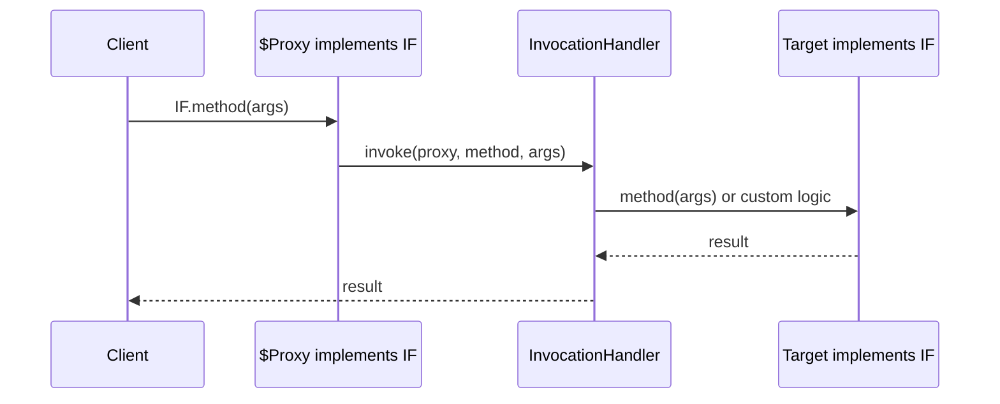

# Reflection, Proxies, and Annotations

> **Status:** Completed  
> **Module:** 50 — Advanced Java  
> **Target Java version:** 21  
> **Last reviewed:** 2026-11-11  
> **Chapter profile:** Deep-dive  
> **Depth target:** Levels 3–4 (critical mechanisms)  
> **Examples verified with:** Oracle JDK 21.0.9 — [reflection-annotations-demo](../../examples/advanced/reflection-annotations-demo/); [jdk-dynamic-proxy-demo](../../examples/backend/jdk-dynamic-proxy-demo/)

**Section policy:** Deep-dive weight on **invoke pipeline**, **JDK proxy dispatch**, **retention**, **HotSpot inflation** (labeled), and **JPMS opens**. Language-comparisons omitted.

## 1. Learning Objectives *(mandatory)*

After completing this chapter, you should be able to:

- Use **reflection** to inspect types and invoke members with correct exception handling (`InvocationTargetException` unwrapping).
- Contrast **compile-time** types with **runtime** `Class` metadata and generics **erasure**.
- Build **JDK dynamic proxies** and relate them to Spring AOP (Module 36).
- Define **annotations** with retention and process them at compile time vs runtime.
- Explain **HotSpot inflation** and **JPMS** opens for production frameworks (Level 4).
- State why Native Image (Module 49) needs reflection metadata for the same APIs.

## 2. Prerequisites *(mandatory)*

- **Modules 05–08** — classes, inheritance, interfaces.
- **Module 13** — generics erasure (runtime view of parameterized types).
- **Module 36** — `Proxy`, `InvocationHandler` in AOP narrative.
- **Module 29** — JPMS basics (`--add-opens`).

**Refresher — interface:** A reference type that declares abstract methods (and may declare `default`/`static` methods). JDK dynamic proxies can implement interfaces at runtime.

**Refresher — annotation:** A special interface (`@interface`) whose instances are metadata attached to program elements. Visibility depends on `@Retention`.

## 3. Why This Concept Exists *(mandatory)*

Frameworks (Spring, JPA, JUnit, Jackson) discover behavior from **metadata** instead of hard-coded lists: which methods are endpoints, which fields are columns, which tests to run. **Reflection** reads that metadata at runtime; **annotations** attach declarative markers; **proxies** intercept interface calls for cross-cutting logic without editing every business class.

Without these mechanisms you would wire every collaborator and every cross-cut by hand—or generate source at build time for every case (still common, and complementary).

## 4. Conceptual Explanation *(mandatory)*

### 4.1 Reflection API core

| Type | Examples | Role |
|------|----------|------|
| **Class&lt;?&gt;** | `String.class`, `obj.getClass()` | Runtime type token |
| **Method** | `getMethod`, `invoke` | Invocable member |
| **Field** | `getDeclaredField`, `get`/`set` | Field access |
| **Constructor** | `getConstructor().newInstance()` | Reflective construction |
| **Annotation** | `getAnnotation`, `isAnnotationPresent` | Metadata query |

**`invoke`** can throw `InvocationTargetException` — unwrap `getCause()` for the real failure (NPE inside target method, business exception, etc.). Swallowing ITE hides production bugs.

**Public vs declared:** `getMethod` sees public API (including inherited). `getDeclaredMethod` sees all methods declared on that class (including private) but not superclass methods—and may need `setAccessible` / module opens.

### 4.2 Annotations and retention

```java
@Target(ElementType.METHOD)
@Retention(RetentionPolicy.RUNTIME)
public @interface Audited {
    String value() default "";
}
```

| Retention | Visible when |
|-----------|--------------|
| `SOURCE` | Compiler only (e.g. `@Override`) |
| `CLASS` | Bytecode, not runtime reflection |
| `RUNTIME` | Reflection, frameworks |

**Repeating** and **container** annotations (Java 8+) support multiple markers on one element. Meta-annotations (`@Target`, `@Retention`, Spring’s `@Component` stereotypes) compose frameworks.

### 4.3 JDK dynamic proxies vs subclass proxies

Only **interfaces** can be proxied with `java.lang.reflect.Proxy` (JLS proxy rules).

| Approach | Requirement | Typical user |
|----------|-------------|--------------|
| JDK proxy | Target implements interface(s) | Spring when interface present |
| CGLIB / Byte Buddy subclass | Concrete class; no `final` methods/class | Spring class-based proxies |

**Self-invocation trap:** calling `this.transactionalMethod()` inside the same class bypasses the proxy—Spring `@Transactional` appears “broken” (Module 36). Root cause is **proxy boundary**, not magic annotations.

### 4.4 Erasure and reflective generics

At runtime, `List<String>` is largely a raw `List` for invocation purposes (**JLS erasure**). Reflective code that needs `T` uses `ParameterizedType` from field/method generic signatures, or requires callers to pass a `Class<T>` / `TypeToken`.

## 5. Mechanism and Execution Flow *(mandatory)*

### 5.1 Reflection invoke sequence



**Prose:** Access checks and argument boxing occur before the target runs. Checked exceptions from the target are wrapped; Error/RuntimeException policy follows reflection rules—always inspect cause for diagnosis.

### 5.2 JDK dynamic proxy call path



Spring `@Transactional` / AOP applies a similar **proxy around the bean**. The client must hold the **proxy reference**, not the raw target, for advice to run.

### 5.3 Annotation discovery at startup (framework-shaped)

1. Classpath scan finds candidate classes (or indexed list / AOT).
2. Reflection reads `@Component` / `@RestController` / `@Entity` with `RUNTIME` retention.
3. Framework registers definitions; later creates proxies as needed.
4. Native Image (Module 49) must have seen these classes at build time—or fail.

## 6. Terminology *(mandatory)*

| Term | Meaning |
|------|---------|
| **Reflective access** | Inspecting or invoking members via `java.lang.reflect` |
| **InvocationHandler** | Callback that receives every proxy method call |
| **Retention** | Whether annotation data survives to class file / runtime |
| **Inflation** | HotSpot may replace slow reflective accessors with generated bytecode (**implementation**) |
| **setAccessible** | Attempt to suppress Java language access checks (modules may still deny) |

## 7. Step-by-Step Examples *(mandatory)*

### 7.1 Runnable demo — **Verified (Oracle JDK 21.0.9)**

[reflection-annotations-demo](../../examples/advanced/reflection-annotations-demo/):

```bash
javac ReflectionAnnotationsDemo.java
java ReflectionAnnotationsDemo
```

**Verified output (Oracle JDK 21.0.9, 2026-11-11):**

```text
hasTimed=true
result=Hello, Lin
reflectionDemo=ok
```

**Important lines:** `@Retention(RetentionPolicy.RUNTIME)` makes `@Timed` visible to `isAnnotationPresent`. `getMethod("greet", String.class)` looks up the public method; `invoke(null, "Lin")` calls the static method.

### 7.2 JDK dynamic proxy — **Verified (Oracle JDK 21.0.9)**

[jdk-dynamic-proxy-demo](../../examples/backend/jdk-dynamic-proxy-demo/):

```text
before=greet
result=Hello, Ada
proxyAop=ok
```

**Why this way:** Handler runs **before** the target—models AOP “around” advice order at the Java SE level.

### 7.3 Incorrect — swallowing `InvocationTargetException`

```java
// Incorrect sketch
try {
    method.invoke(target, args);
} catch (Exception e) {
    log.warn("failed"); // hides NPE cause
}
```

### Corrected

```java
try {
    method.invoke(target, args);
} catch (InvocationTargetException e) {
    Throwable cause = e.getCause();
    throw cause instanceof RuntimeException re ? re : new RuntimeException(cause);
}
```

### 7.4 Advanced — caching `Method` lookup

```java
// Illustrative — cache reflective lookup once
private static final Method GREET =
    ReflectionAnnotationsDemo.class.getMethod("greet", String.class);
```

Re-resolving `Method` every request adds overhead; frameworks cache metadata. Extreme frequency → prefer **MethodHandle** (Ch.02).

## 8. Real-World Use Cases *(conditional)*

- Spring **component scan** and `@Autowired` injection.
- JPA attribute mapping via field/method annotations.
- Jackson JSON naming via annotations.
- Test frameworks discovering `@Test` methods.
- Plugin loaders using `Class.forName` + interface casts.

## 9. Internal Behavior *(Level 4, labeled)*

**JVMS / language:** Reflection respects accessibility and module exports (Module 29). **Illegal reflective access** on JDK internals may require `--add-opens`; frameworks document required opens for JDK 21.

**HotSpot (implementation, not universal JVM law):** Frequent `Method.invoke` may **inflate** to generated accessor bytecode after a threshold, reducing overhead. First calls pay security and access checks. **Do not** treat inflation timing as a cross-vendor guarantee or API contract.

**Generics erasure (JLS):** `List<String>` appears as raw `List` at runtime for many reflective purposes; use `ParameterizedType` when inspecting generic signatures on fields/methods.

### JPMS `opens` for frameworks

```text
--add-opens java.base/java.lang=ALL-UNNAMED
```

Spring/Hibernate may require opens for deep reflection on JDK internals in edge cases—document in runbook; prefer upgrading libraries over blanket opens in production.

## 10. Edge Cases and Limitations

- **Records** — reflection exposes canonical constructor and accessors (Module 15).
- **SecurityManager** — deprecated/removal path; module boundaries remain the real gate.
- **Native Image** — reflection must be reachability-configured (Module 49).
- **Sealed types** — reflective instantiation of non-permitted subtypes fails.
- **Hidden classes / method handles** — advanced loaders (Ch.02–03) interact carefully with reflection.

## 11. Common Mistakes *(mandatory)*

### Incorrect — reflection in hot paths without caching

Re-resolving `Method` every request adds overhead and allocation.

### Corrected — cache `Method` / prefer `MethodHandle` for extreme frequency (Ch.02).

### Incorrect — swallowing `InvocationTargetException`

Hides real NPE inside invoked method.

### Corrected — unwrap and rethrow cause.

### Incorrect — JDK proxy on a concrete class with no interface

`IllegalArgumentException` at proxy creation.

### Corrected — extract interface or use subclass proxy technology (framework).

### Annotation processing vs runtime reflection

| Path | When |
|------|------|
| Annotation processor (compile time) | Generate code (MapStruct-style) |
| `RetentionPolicy.RUNTIME` | Spring scan, Jackson, JPA |

Compile-time processors cannot replace runtime scan for arbitrary user-defined `@Component` classes unless you also generate an index (Spring AOT does related work for native).

## 12. Best Practices

- Prefer public APIs and constructor injection over deep private-field reflection in application code.
- Keep annotations `RUNTIME` only when something must read them reflectively.
- Document required `--add-opens` next to the Dockerfile/K8s env (Module 49).
- For libraries: minimize reflective surface; provide explicit SPI registries when possible.
- Test proxy boundaries (self-invocation) explicitly in Spring apps (Module 36).

## 13. Design Trade-offs *(conditional)*

| Explicit wiring | Reflection / DI |
|-----------------|-----------------|
| Compile-time clarity | Framework ergonomics |
| Refactoring-safe in IDE | Runtime discovery failures |
| Verbose | Annotation-driven productivity |

| JDK proxy | Subclass proxy |
|-----------|----------------|
| Interface-only; JRE built-in | Works on concrete classes; final limits |

## 14. Performance Considerations *(conditional)*

- Lookup cost vs invoke cost—cache lookups.
- Boxing for primitives on reflective invoke.
- Inflation helps HotSpot but MethodHandles / direct calls still win for megamorphic frameworks.
- Classpath scanning at startup dominates Boot start—indexed/AOT modes help (Modules 37, 49).

## 15. Security Considerations *(conditional)*

- Untrusted class names in `Class.forName` → gadget / injection risks; allowlists only.
- `setAccessible` on sensitive fields can break encapsulation—treat as privileged.
- Deserialization + reflection historically combine into RCE chains—avoid Java serialization at boundaries (Module 51).

## 16. Java Version and Compatibility Notes *(conditional)*

- Reflection APIs long-standing; JPMS (9+) changed illegal access defaults—JDK 21 is strongly encapsulated.
- Proxy behavior stable; prefer interfaces for portable interception.
- Native Image metadata evolves with Graal/Spring—re-verify on upgrades (Module 49).

## 17. Revision and Mastery

- Why must JDK proxy target implement an interface?
- Difference `RetentionPolicy.CLASS` vs `RUNTIME`?
- What does HotSpot inflation optimize, and why prefer MethodHandles at extreme frequency?
- How does self-invocation bypass Spring transactional proxies?
- What breaks for reflection under Native Image without config?

## 18. Exercises

1. Reflectively invoke `Integer.parseInt` and handle `InvocationTargetException` for bad input.
2. Add a runtime annotation and print it from `main`.
3. Re-run jdk-dynamic-proxy-demo and explain call order.
4. Sketch why a `final` method cannot be advised by a CGLIB-style subclass proxy.

## 19. Chapter Summary

Reflection, annotations, and proxies underpin modern Java frameworks: metadata at runtime, interface interception for AOP, and retention policies that decide visibility. Prefer MethodHandles for heavy invocation (Ch.02); native image needs explicit reflection config (Module 49). Always unwrap `InvocationTargetException` and respect JPMS opens in production.

## Next Steps

[02-method-handles-varhandles-and-ffm.md](02-method-handles-varhandles-and-ffm.md)

## References

- JLS — binary compatibility, proxies, annotations.
- Java SE API — `java.lang.reflect`, `Proxy`.
- Module 36 — Spring AOP; Module 49 — Native Image reachability.

## Review Checklist

- [x] Deep-dive L3–4; mechanism flows; HotSpot inflation labeled implementation
- [x] Reflection + proxy demos Verified Oracle JDK 21.0.9 (2026-11-11)
- [x] EXPAND-PRESERVE fourth deepen 2026-11-11; useful prior content retained
