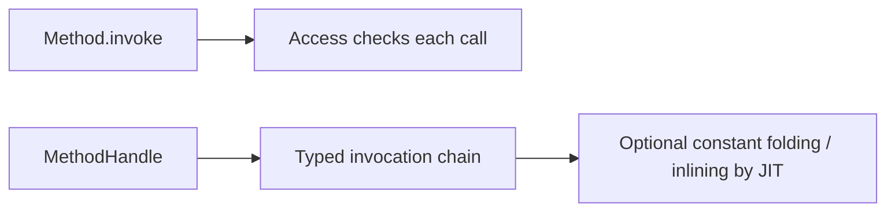
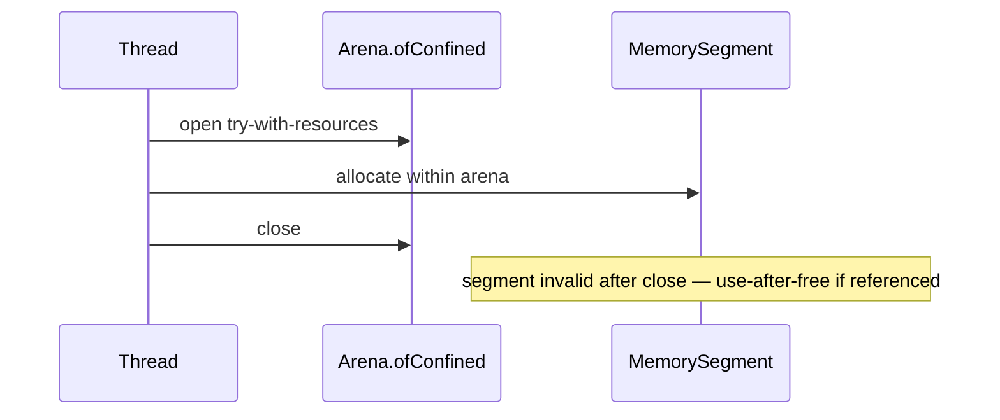

# Method Handles, VarHandles, and FFM

> **Status:** Completed  
> **Module:** 50 — Advanced Java  
> **Target Java version:** 21  
> **Last reviewed:** 2026-11-11  
> **Chapter profile:** Deep-dive  
> **Depth target:** Levels 3–4  
> **Examples verified with:** Temurin JDK 21.0.12.1 — [method-handles-varhandles-demo](../../examples/advanced/method-handles-varhandles-demo/); [ffm-arena-demo](../../examples/advanced/ffm-arena-demo/)

## 1. Learning Objectives

- Invoke code via **MethodHandle** with types checked at lookup time.
- Update fields with **VarHandle** and specified memory ordering modes.
- Allocate off-heap memory with **Foreign Function & Memory (FFM)** on JDK 21 (preview status).
- Compare reflection, method handles, and JNI for performance, safety, and module access (Level 4).

## 2. Prerequisites

- **Module 50 Ch.01** — reflection basics.
- **Module 25** — happens-before, `volatile` (VarHandle ordering).

## 3. Why This Concept Exists

`Method.invoke` is flexible but loosely typed and can be slower. **Method handles** are JVM-supported callable references with **signature polymorphism** (invokedynamic, lambda metafactory, Module 16). **VarHandles** unify `volatile`, CAS, and array element access. **FFM** replaces many JNI patterns with explicit **arena** lifetimes and bounds-checked **MemorySegment** (Project Panama).

## 4. Conceptual Explanation

### MethodHandles.Lookup

| Lookup kind | Typical use |
|-------------|-------------|
| `findStatic` / `findVirtual` | Methods |
| `findConstructor` | Constructors |
| `findVarHandle` | Fields |

Lookup is **capability-based**: caller class limits accessible members (JPMS-aware).

### VarHandle vs synchronized / AtomicInteger

VarHandle exposes `compareAndSet`, `getVolatile`, `setVolatile` on fields or arrays with documented ordering—same conceptual layer as `java.util.concurrent` atomics internals.

### FFM (JDK 21 status)

In **Java 21**, `java.lang.foreign` is a **preview** API (later releases finalized). Handbook demos require:

```bash
javac --enable-preview --release 21 FfmArenaDemo.java
java --enable-preview FfmArenaDemo
```

| Concept | Role |
|---------|------|
| **Arena** | Owns memory lifetime; `ofConfined` tied to thread |
| **MemorySegment** | Off-heap region with bounds checks |
| **ValueLayout** | Size/alignment of primitives in memory |

Native function linking via `Linker.defaultLinker()` may require `--enable-native-access=...` on newer JDKs; off-heap-only samples run with preview on Temurin 21.0.12.1.

## 5. Mechanism and Execution Flow

### MethodHandle call vs reflection



### Lambda linkage (invokedynamic) — conceptual tie-in

1. Bootstrap method receives `MethodHandles.Lookup`.
2. Metafactory produces `CallSite` pointing at implementation handle.
3. Caller invokes `lambda$...` via invokedynamic bytecode (Module 16).

### FFM confined arena lifetime



## 6. Examples — **Verified (Temurin 21.0.12.1)**

[method-handles-varhandles-demo](../../examples/advanced/method-handles-varhandles-demo/):

```text
fromHandle=Hello, Ada
counter=1
methodHandlesDemo=ok
```

[ffm-arena-demo](../../examples/advanced/ffm-arena-demo/) (preview):

```text
sum=63
ffmDemo=ok
```

Compiler note on preview is expected: `FfmArenaDemo.java uses preview features of Java SE 21.`

## 7. Internal Behavior (Level 4)

**invokedynamic (JVMS):** Bootstrap spec uses method handles; this is language/runtime machinery, not library convention.

**VarHandles on HotSpot:** May lower to atomic CPU instructions (`LOCK` cmpxchg on x86) for CAS—**implementation detail**.

**FFM:** Bounds checks on `MemorySegment` catch many overruns JNI would allow. **Shared** arenas require explicit coordination; misuse after `close()` is undefined and can crash the process.

## 8. Real-World Use Cases

- **Libraries** wrapping native code via FFM instead of handwritten JNI.
- **Concurrent algorithms** on VarHandle counters.
- **Bytecode generators** emitting invokedynamic.

## 9. Edge Cases

- **Preview warnings** — CI must pass `--enable-preview` for FFM demos on 21.
- **Misaligned layouts** — `ValueLayout` alignment for native structs.
- **Final fields** — VarHandle rules differ; illegal writes throw.

## 10. Common Mistakes

### Incorrect — using FFM segment after arena closed

Use-after-free; may crash JVM.

### Corrected — keep arena open for entire native call scope (try-with-resources).

### Incorrect — ignoring preview in CI

Build fails without flags.

### Corrected — document flags in README and pipeline.

### MethodHandle lookup modes (JLS access rules)

| Lookup | Capability |
|--------|------------|
| `publicLookup()` | Public members only |
| `lookup()` in same class | Private members of defining class |
| `privateLookupIn` | Explicit module/package private access |

Incorrect: obtain handle in class A and invoke private method on instance of unrelated class B—`IllegalAccessException` at runtime.

### VarHandle coordinate types

| Layout | Use |
|--------|-----|
| `int[]` element | Parallel array updates with `getAndAdd` |
| `static` field on class | Counter without instance |
| Byte array view | Manual serialization parsers |

**Happens-before:** VarHandle access modes include volatile/plain/opaque—match JMM intent to operation (Module 25).

### FFM arena lifecycle (preview on 21)

```java
try (Arena arena = Arena.ofConfined()) {
    MemorySegment seg = arena.allocate(16);
    // native calls use seg
} // arena closed — segment invalid
```

Cross-thread use of confined arena is illegal—use `Arena.ofShared()` when multiple threads coordinate lifetime with explicit close protocol.

## 11. Design Trade-offs

| Reflection | MethodHandle |
|------------|--------------|
| Easier discovery | Faster, stricter types |

| JNI | FFM |
|-----|-----|
| Mature ecosystem | Safer memory model, learning curve |

## 12. Revision and Mastery

- Why preview flags for FFM on JDK 21?
- VarHandle vs `synchronized` on a counter field?
- What does `Arena.ofConfined()` guarantee on close?

## 13. Exercises

1. Extend demo with `compareAndSet` on counter via VarHandle.
2. Allocate 1 KiB segment, write bytes, read back sum.
3. Read JEP summary for FFM standardization version.

## 14. Chapter Summary

Method handles and VarHandles are low-level invocation and concurrency primitives beneath lambdas and atomics. FFM on JDK 21 provides scoped off-heap access with preview flags; native linking needs extra access on newer releases.

## Next Steps

[03-bytecode-and-agents.md](03-bytecode-and-agents.md)

## Review Checklist

- [x] Deep-dive L3–4; mechanism flows; preview labeled
- [x] MH, VarHandle, FFM Verified Temurin 21.0.12.1; deepen pass 2026-11-11
