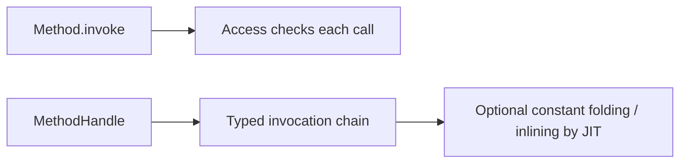
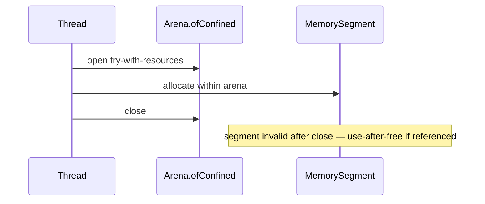

# Method Handles, VarHandles, and FFM

> **Status:** Completed  
> **Module:** 50 — Advanced Java  
> **Target Java version:** 21  
> **Last reviewed:** 2026-11-11  
> **Chapter profile:** Deep-dive  
> **Depth target:** Levels 3–4  
> **Examples verified with:** Oracle JDK 21.0.9 — [method-handles-varhandles-demo](../../examples/advanced/method-handles-varhandles-demo/); [ffm-arena-demo](../../examples/advanced/ffm-arena-demo/)

**Section policy:** Level 4 on lookup capabilities, VarHandle memory modes (tie to Module 25), and FFM arena lifetimes. FFM is **preview** on JDK 21—flags mandatory.

## 1. Learning Objectives *(mandatory)*

After completing this chapter, you should be able to:

- Invoke code via **MethodHandle** with types checked at lookup time.
- Update fields with **VarHandle** and choose memory ordering modes deliberately.
- Allocate off-heap memory with **Foreign Function & Memory (FFM)** on JDK 21 (preview).
- Compare reflection, method handles, and JNI/FFM for performance, safety, and module access (Level 4).
- Explain how **invokedynamic** / lambda metafactory relate to method handles (Module 16 link).

## 2. Prerequisites *(mandatory)*

- **Module 50 Ch.01** — reflection basics and why invoke can be costly.
- **Module 25** — happens-before, `volatile` (VarHandle ordering).
- **Module 16** — lambdas use invokedynamic bootstraps under the hood.

**Refresher — volatile:** A field access mode that establishes visibility/ordering edges in the JMM. VarHandle can apply volatile (and other) modes to fields and array elements without declaring the field `volatile` in source—though declaring intent in source remains clearer for humans.

## 3. Why This Concept Exists *(mandatory)*

`Method.invoke` is flexible but loosely typed and can be slower. **Method handles** are JVM-supported callable references with **signature polymorphism**—the same machinery behind **invokedynamic**, lambda metafactory, and many dynamic languages on the JVM. **VarHandles** unify `volatile`, CAS, and array element access under one API. **FFM** (Project Panama) replaces many JNI patterns with explicit **arena** lifetimes and bounds-checked **MemorySegment**.

These APIs are what serious libraries reach for when reflection is too blunt and JNI is too unsafe.

## 4. Conceptual Explanation *(mandatory)*

### 4.1 MethodHandles.Lookup

| Lookup kind | Typical use |
|-------------|-------------|
| `findStatic` / `findVirtual` | Methods |
| `findSpecial` | `super` / private special |
| `findConstructor` | Constructors |
| `findGetter` / `findSetter` | Fields as handles |
| `findVarHandle` | Concurrent field/array access |

Lookup is **capability-based**: the caller class limits accessible members (JPMS-aware). Receiving a `Lookup` object is receiving permission—treat it like a capability token.

### 4.2 MethodHandle vs Method

| Aspect | `Method` (reflection) | `MethodHandle` |
|--------|----------------------|----------------|
| Type checking | Mostly at invoke | Emphasized at lookup / adapt |
| Typical speed | Good after inflation | Often better for hot paths |
| API style | Easy discovery | Explicit `MethodType` |
| Exception model | Wrapped ITE | Throwable from `invoke` |

### 4.3 VarHandle vs synchronized / AtomicInteger

VarHandle exposes `compareAndSet`, `getVolatile`, `setVolatile`, `getAndAdd`, etc. on fields or arrays with documented ordering—same conceptual layer as `java.util.concurrent.atomic` internals.

| Need | Tool |
|------|------|
| Simple counter | `AtomicInteger` (wraps VarHandle-like ops) |
| Custom field layout / arrays | VarHandle directly |
| Mutual exclusion of critical section | `synchronized` / Lock |

### 4.4 FFM (JDK 21 status)

In **Java 21**, `java.lang.foreign` is a **preview** API (later releases finalized). Handbook demos require:

```bash
javac --enable-preview --release 21 FfmArenaDemo.java
java --enable-preview FfmArenaDemo
```

| Concept | Role |
|---------|------|
| **Arena** | Owns memory lifetime; `ofConfined` tied to thread |
| **MemorySegment** | Off-heap (or heap-backed) region with bounds checks |
| **ValueLayout** | Size/alignment of primitives in memory |
| **Linker** | Downcalls/upcalls to native functions |

Native function linking via `Linker.defaultLinker()` may require `--enable-native-access=...` on newer JDKs; off-heap-only samples run with preview on Oracle JDK 21.0.9.

## 5. Mechanism and Execution Flow *(mandatory)*

### 5.1 MethodHandle call vs reflection



### 5.2 Lambda linkage (invokedynamic) — conceptual tie-in

1. Bootstrap method receives `MethodHandles.Lookup`.
2. Metafactory produces `CallSite` pointing at implementation handle.
3. Caller invokes via `invokedynamic` bytecode (Module 16).

This is why method handles are not an obscure niche—they are **language runtime machinery**.

### 5.3 FFM confined arena lifetime



**Mechanism:** Confined arenas are single-threaded. Closing the arena invalidates segments. Holding a segment after close is a severe bug—may crash the process (unlike typical Java GC safety).

### 5.4 VarHandle CAS loop (conceptual)

1. `getVolatile` current value.
2. Compute next.
3. `compareAndSet` old → next; retry on failure.
4. Happens-before edges follow the access mode used (Module 25).

## 6. Terminology *(mandatory)*

| Term | Meaning |
|------|---------|
| **MethodType** | Return + parameter types for a handle |
| **Signature polymorphism** | `invoke`/`invokeExact` adapt to call-site types |
| **Access mode** | plain / opaque / acquire-release / volatile (VarHandle) |
| **Arena** | Lifetime scope for FFM allocations |
| **Downcall** | Java calling native function via Linker |

## 7. Examples — **Verified (Oracle JDK 21.0.9)** *(mandatory)*

### 7.1 MethodHandles + VarHandle demo

[method-handles-varhandles-demo](../../examples/advanced/method-handles-varhandles-demo/):

```bash
javac MethodHandlesVarHandlesDemo.java
java MethodHandlesVarHandlesDemo
```

**Verified output (Oracle JDK 21.0.9, 2026-11-11):**

```text
fromHandle=Hello, Ada
counter=1
methodHandlesDemo=ok
```

**Important lines:** `findStatic` binds `greet`; `invoke("Ada")` calls it. `findVarHandle` + `setVolatile`/`getVolatile` update `counter` with volatile semantics.

### 7.2 FFM arena demo (preview)

[ffm-arena-demo](../../examples/advanced/ffm-arena-demo/):

```bash
javac --enable-preview --release 21 FfmArenaDemo.java
java --enable-preview FfmArenaDemo
```

Compiler note expected: `FfmArenaDemo.java uses preview features of Java SE 21.`

**Verified output (Oracle JDK 21.0.9, 2026-11-11):**

```text
sum=63
ffmDemo=ok
```

**Why 63:** writes `21` and `42` as ints; sum is `63`.

### 7.3 Incorrect — use after arena close

```java
// Incorrect sketch
MemorySegment seg;
try (Arena arena = Arena.ofConfined()) {
    seg = arena.allocate(16);
}
seg.get(ValueLayout.JAVA_BYTE, 0); // INVALID
```

### Corrected — keep arena open for entire native call scope (try-with-resources).

### 7.4 MethodHandle lookup modes (JLS access rules)

| Lookup | Capability |
|--------|------------|
| `publicLookup()` | Public members only |
| `lookup()` in same class | Private members of defining class |
| `privateLookupIn` | Explicit module/package private access |

Incorrect: obtain handle in class A and invoke private method on unrelated class B—`IllegalAccessException`.

## 8. Internal Behavior *(Level 4, labeled)*

**invokedynamic (JVMS):** Bootstrap spec uses method handles; this is language/runtime machinery, not library convention.

**VarHandles on HotSpot:** May lower to atomic CPU instructions (`LOCK` cmpxchg on x86) for CAS—**implementation detail**, not a portable guarantee of instruction selection.

**FFM:** Bounds checks on `MemorySegment` catch many overruns JNI would allow. **Shared** arenas require explicit coordination; misuse after `close()` is undefined and can crash the process.

## 9. Real-World Use Cases *(conditional)*

- **Libraries** wrapping native code via FFM instead of handwritten JNI.
- **Concurrent algorithms** on VarHandle counters and arrays.
- **Bytecode generators** / dynamic languages emitting invokedynamic.
- **High-performance frameworks** replacing reflective invoke with handles.

### Progressive rewrite: reflection → MethodHandle (**Illustrative**)

```java
// Before — reflection each call (cache Method at least!)
Method m = Demo.class.getMethod("greet", String.class);
String s = (String) m.invoke(null, "Ada");

// After — lookup once, invoke many
MethodHandle mh = MethodHandles.lookup().findStatic(
    Demo.class, "greet", MethodType.methodType(String.class, String.class));
String s2 = (String) mh.invoke("Ada");
```

Same observable result as the Verified demo; the rewrite pays off when call volume is high or argument adaptation is complex (`asType`, `bindTo`).

## 10. Edge Cases and Limitations

- **Preview warnings** — CI must pass `--enable-preview` for FFM demos on 21.
- **Misaligned layouts** — `ValueLayout` alignment for native structs.
- **Final fields** — VarHandle write rules are strict; illegal writes throw.
- **Cross-thread confined arena** — illegal; use `Arena.ofShared()` with discipline.
- **Native Image** — verify FFM/Linker support for target Graal version (Module 49).

## 11. Common Mistakes *(mandatory)*

### Incorrect — using FFM segment after arena closed

Use-after-free; may crash JVM.

### Corrected — arena open for entire native call scope.

### Incorrect — ignoring preview in CI

Build fails without flags on JDK 21.

### Corrected — document flags in README and pipeline.

### Incorrect — treating VarHandle `get` (plain) as `volatile`

Visibility bugs under the JMM.

### Corrected — match access mode to intent (Module 25).

### VarHandle coordinate types

| Layout | Use |
|--------|-----|
| `int[]` element | Parallel array updates with `getAndAdd` |
| `static` field on class | Counter without instance |
| Byte array view | Manual serialization parsers |

### FFM arena lifecycle (preview on 21)

```java
try (Arena arena = Arena.ofConfined()) {
    MemorySegment seg = arena.allocate(16);
    // native calls use seg
} // arena closed — segment invalid
```

## 12. Best Practices

- Prefer `Atomic*` wrappers when they fit—VarHandle when you need custom shapes.
- Keep `Lookup` in the class that should have access; do not widen carelessly.
- Use try-with-resources for arenas always.
- Isolate FFM in a small module; fuzz bounds and lifetime tests.
- Track FFM standardization status when moving past JDK 21.

## 13. Design Trade-offs *(conditional)*

| Reflection | MethodHandle |
|------------|--------------|
| Easier discovery | Faster, stricter types |

| JNI | FFM |
|-----|-----|
| Mature ecosystem | Safer memory model, learning curve |

| synchronized | VarHandle CAS |
|---------------|---------------|
| Simple critical sections | Fine-grained lock-free updates |

## 14. Performance Considerations *(conditional)*

- MethodHandles can inline better than reflective invoke on HotSpot—measure.
- CAS contention still burns CPU—backoff strategies matter.
- Off-heap avoids GC for large buffers but shifts responsibility to arenas.
- Do not micro-optimize with VarHandle before proving a hotspot (Module 28).

## 15. Security Considerations *(conditional)*

- `Lookup` privilege escalation via careless sharing.
- Native downcalls expand attack surface—validate inputs before crossing the boundary.
- Off-heap memory not zeroed by default in all paths—clear sensitive buffers.

## 16. Java Version and Compatibility Notes *(conditional)*

- MethodHandle / VarHandle: long stable (JSR 292 era / JEP 193).
- FFM: **preview in Java 21**; finalized in later releases—recheck flags when upgrading.
- Native access flags evolve—read release notes for your JDK vendor build.

## 17. Revision and Mastery

- Why preview flags for FFM on JDK 21?
- VarHandle vs `synchronized` on a counter field?
- What does `Arena.ofConfined()` guarantee on close?
- How do lambdas relate to MethodHandles?
- Why is plain `get` not enough for cross-thread publication?

## 18. Exercises

1. Extend demo with `compareAndSet` on counter via VarHandle.
2. Allocate 1 KiB segment, write bytes, read back sum (preview flags).
3. Read JEP summary for FFM standardization version after 21.
4. Adapt a reflective `Method.invoke` call site to `MethodHandle.invoke`.

## 19. Chapter Summary

Method handles and VarHandles are low-level invocation and concurrency primitives beneath lambdas and atomics. FFM on JDK 21 provides scoped off-heap access with preview flags; native linking needs extra access on newer releases. Prefer these tools in libraries and hot paths—not as a first resort in ordinary application code.

## Next Steps

[03-bytecode-and-agents.md](03-bytecode-and-agents.md)

## References

- JEP 193 (VarHandles); FFM JEPs for your target release.
- JVMS — invokedynamic.
- Module 25 — JMM; Module 16 — lambdas.

## Review Checklist

- [x] Deep-dive L3–4; mechanism flows; preview labeled
- [x] MH, VarHandle, FFM Verified Oracle JDK 21.0.9; deepen fourth pass 2026-11-11
