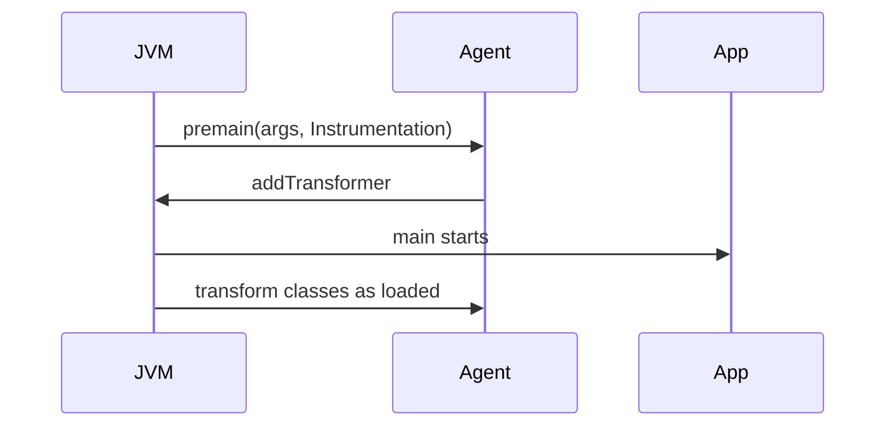

# Bytecode and Java Agents

> **Status:** Completed  
> **Module:** 50 — Advanced Java  
> **Target Java version:** 21  
> **Last reviewed:** 2026-11-10  
> **Examples verified with:** Temurin JDK 21.0.12.1 — [java-agent-premain-demo](../../examples/advanced/java-agent-premain-demo/); [bytecode-demo](../../examples/jvm/bytecode-demo/)

## 1. Learning Objectives

- Read **class file** structure at overview level (`javap`, major version).
- Explain **bytecode** execution in the JVM (stack, opcodes) connecting Module 26.
- Load a **Java agent** via `-javaagent` and describe **Instrumentation**.
- Categorize **uses** (APM, security) vs **risks** (fragile transforms, startup cost).

## 2. Prerequisites

- **Module 26** — class loading, verification.
- **Module 50 Ch.01** — reflection (agents often pair with transforms).

## 3. Why This Concept Exists

Some behavior cannot be expressed in source alone: tracing every JDBC call, enforcing security sandboxes, migrating legacy APIs. **Agents** hook the JVM early via `premain` / `agentmain` and register **ClassFileTransformer** to rewrite bytecode before classes load. Understanding bytecode helps debug verifier errors and read decompiler output.

## 4. Conceptual Explanation

### Class file essentials

| Part | Holds |
|------|-------|
| Constant pool | Literals, name/type refs |
| Methods | Code attribute = bytecode |
| Attributes | StackMapTable, LineNumberTable |

```bash
javap -c -p com.example.Foo
```

Handbook [bytecode-demo](../../examples/jvm/bytecode-demo/) illustrates stack behavior.

### Agent lifecycle



### Runnable premain demo

[java-agent-premain-demo](../../examples/advanced/java-agent-premain-demo/):

```bash
javac AgentMain.java AppMain.java
jar cfm agent.jar MANIFEST.MF AgentMain.class
java -javaagent:agent.jar AppMain
```

**Verified:** output includes `agent=premain`, `app=running`, `agentDemo=ok` (`loadedClasses` count varies, e.g. `817` on validation host).

`Premain-Class` in manifest is mandatory; optional `Can-Retransform-Classes` enables retransform APIs.

### Instrumentation capabilities

| API | Use |
|-----|-----|
| `addTransformer` | Modify bytes at load |
| `retransformClasses` | Re-run transformer on loaded classes |
| `getAllLoadedClasses` | Diagnostics (demo prints count) |

Production agents (New Relic, Datadog, Byte Buddy) hide ASM/Javassist complexity.

## 5. Internal Behavior (JVMS vs HotSpot)

**Verification** ensures stack discipline and type safety after transform. Bad bytecode → `ClassFormatError` / `VerifyError`. Transformers must not break contract of methods (JLS overrides).

**Redefinition limits:** cannot add fields/methods arbitrarily on retransform; constraints per JVM spec.

## 6. Real-World Use Cases

- APM tracing HTTP and JDBC boundaries.
- Mockito inline mocks / bytecode generation (test scope).
- OpenTelemetry Java agent auto-instrumentation.

## 7. Edge Cases

- **Module system** — agents may need `--add-opens` to transform JDK classes.
- **Native image** — JVMTI agents do not apply (Module 49).
- **Signed JARs** — transform restrictions if security policy enforced.

## 8. Common Mistakes

### Incorrect — heavyweight transform all classes

Startup regression, subtle bugs.

### Corrected — narrow pointcuts; cache transformed bytes.

### Incorrect — shipping agent without testing on target JDK 21

Hidden verify errors on new class file version.

### Corrected — CI smoke with agent enabled.

## 9. Design Trade-offs

| Source-only observability | Agent-based tracing |
|----------------------------|---------------------|
| Explicit code | Zero-touch coverage |
| Compile-time types | Runtime overhead |

## 10. Revision and Mastery

- What manifest entry starts an agent?
- Difference `premain` vs `agentmain`?
- Why might `javap` help when debugging agent failures?

## 11. Exercises

1. Run bytecode-demo and name two opcodes you see.
2. Modify agent to print agent args string.
3. Research one production agent’s required JVM flags.

## 12. Chapter Summary

Bytecode is what the JVM executes; agents instrument class loading through Instrumentation. The premain demo proves the hook sequence; production use demands careful transform scope and JDK 21 verification testing.

## Review Checklist

- [x] Class files; agents; verified premain demo
