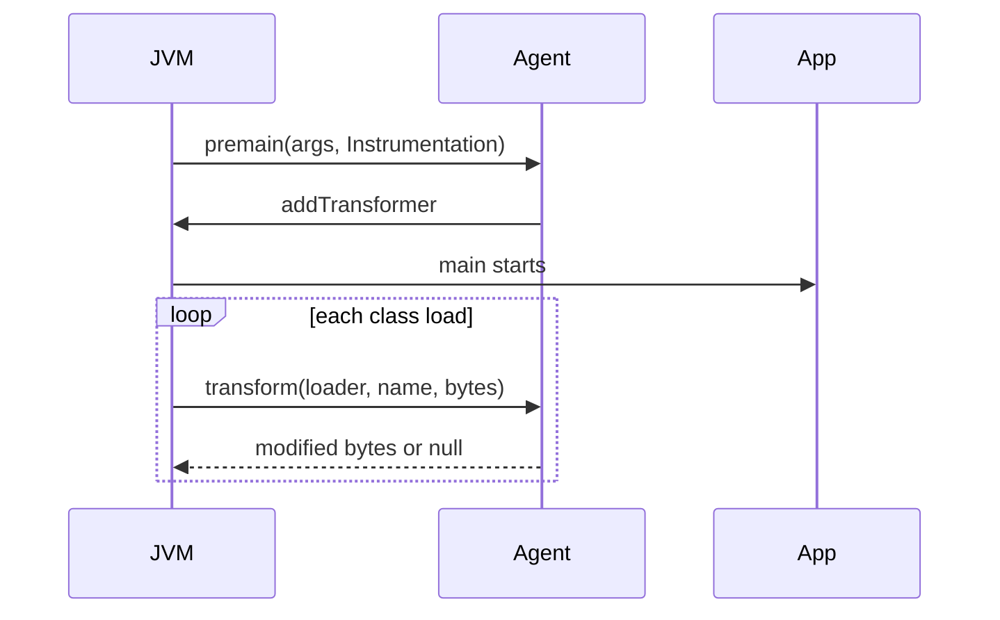
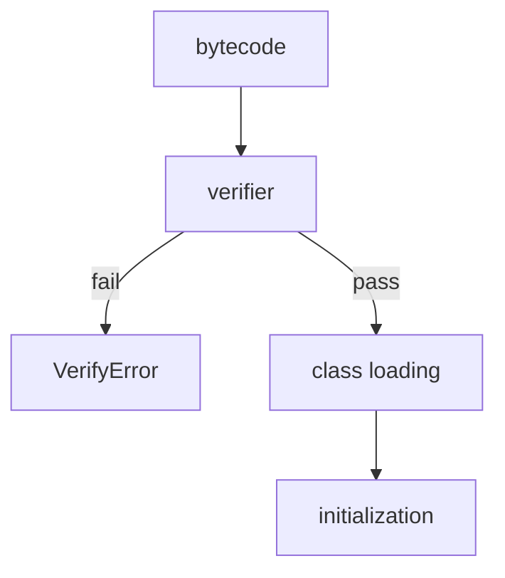

# Bytecode and Java Agents

> **Status:** Completed  
> **Module:** 50 — Advanced Java  
> **Target Java version:** 21  
> **Last reviewed:** 2026-11-11  
> **Chapter profile:** Deep-dive  
> **Depth target:** Levels 3–4  
> **Examples verified with:** Temurin JDK 21.0.12.1 — [java-agent-premain-demo](../../examples/advanced/java-agent-premain-demo/); [bytecode-demo](../../examples/jvm/bytecode-demo/)

## 1. Learning Objectives

- Read **class file** structure at overview level (`javap`, major version 65 for Java 21).
- Explain **bytecode** execution model (operand stack, opcodes) connecting Module 26.
- Load a **Java agent** via `-javaagent` and describe **Instrumentation** API.
- Categorize **uses** (APM, security) vs **risks** (fragile transforms, startup cost) at Level 4.

## 2. Prerequisites

- **Module 26** — class loading, verification.
- **Module 50 Ch.01** — reflection (agents pair with transforms).

## 3. Why This Concept Exists

Some behavior cannot be expressed in source alone: tracing every JDBC call, enforcing sandboxes, migrating APIs. **Agents** hook the JVM early via `premain` / `agentmain` and register **ClassFileTransformer** to rewrite bytecode before or during load. Understanding bytecode helps debug **VerifyError** and mis-sized stack frames.

## 4. Conceptual Explanation

### Class file essentials (JVMS)

| Part | Holds |
|------|-------|
| Constant pool | Literals, name/type refs |
| Methods | `Code` attribute = bytecode + stack maps |
| Attributes | `StackMapTable`, `LineNumberTable` |

```bash
javap -c -p com.example.Foo
```

Handbook [bytecode-demo](../../examples/jvm/bytecode-demo/) illustrates stack behavior.

### Agent manifest

`Premain-Class` in `MANIFEST.MF` is mandatory; `Can-Retransform-Classes: true` enables retransform APIs.

## 5. Mechanism and Execution Flow

### Agent lifecycle (JVMTI layer — implementation)



### Class loading with transformer

1. Bytes read from JAR or module path.
2. **ClassFileTransformer** chain may replace bytes.
3. **Verification** (JVMS) checks stack map and types.
4. **Initialization** runs `<clinit>` when first used.

### Runnable premain demo — **Verified (Temurin 21.0.12.1)**

[java-agent-premain-demo](../../examples/advanced/java-agent-premain-demo/):

```bash
javac AgentMain.java AppMain.java
jar cfm agent.jar MANIFEST.MF AgentMain.class
java -javaagent:agent.jar AppMain
```

**Verified output (representative):**

```text
agent=premain
loadedClasses=817
app=running
agentDemo=ok
```

`loadedClasses` count varies by JDK and classpath; verify on your host. `agentDemo=ok` is the harness marker.

## 6. Instrumentation capabilities

| API | Use |
|-----|-----|
| `addTransformer` | Modify bytes at load |
| `retransformClasses` | Re-run transformer on loaded classes |
| `getAllLoadedClasses` | Diagnostics (demo prints count) |

Production agents (OpenTelemetry, Byte Buddy) hide ASM/Javassist complexity.

## 7. Internal Behavior (JVMS vs HotSpot, Level 4)

**Verification (JVMS requirement):** Ensures stack discipline and type safety after transform. Bad bytecode → `ClassFormatError` / `VerifyError`.

**Redefinition limits (JVMS):** Retransform cannot arbitrarily add fields/methods; constraints apply—agents must respect contracts.

**HotSpot note:** Transform at load adds startup work; wide pointcuts inflate startup and metaspace.

## 8. Real-World Use Cases

- APM tracing HTTP and JDBC boundaries.
- Mockito inline mocks / bytecode generation (test scope).
- OpenTelemetry Java agent auto-instrumentation (Module 47).

## 9. Edge Cases

- **Module system** — agents may need `--add-opens` to transform JDK classes.
- **Native image** — JVMTI agents do not apply (Module 49).
- **Signed JARs** — transform restrictions under security policy.

## 10. Common Mistakes

### Incorrect — heavyweight transform on all classes

Startup regression, subtle verifier failures.

### Corrected — narrow pointcuts; cache transformed bytes; CI smoke with agent.

### Incorrect — shipping agent without testing on target JDK 21

New class file version surprises.

### Corrected — matrix test Temurin 21.0.12.1 with agent enabled.

### Verification pipeline (JVMS)



Verifier checks stack map frames, type safety, and illegal jumps—agents that inject broken bytecode fail here or at first execution.

### Retransformation constraints

`Instrumentation.retransformClasses` requires `canRetransform=true` in manifest and may not change schema of already-loaded classes beyond supported cases—test on Temurin 21 before production rollout.

### Sample `premain` manifest (reference)

```text
Premain-Class: com.example.Agent
Can-Redefine-Classes: true
Can-Retransform-Classes: true
```

Launch: `java -javaagent:agent.jar=verbose -jar app.jar`

## 11. Design Trade-offs

| Source-only observability | Agent-based tracing |
|----------------------------|---------------------|
| Explicit code | Zero-touch coverage |
| Compile-time types | Runtime overhead |

## 12. Revision and Mastery

- What manifest entry starts an agent?
- Difference `premain` vs `agentmain`?
- Why might `javap` help when debugging agent failures?

## 13. Reading `javap` Output (Illustrative)

```bash
javap -c -p MyClass.class
```

Look for:

| Opcode | Meaning |
|--------|---------|
| `aload_0` | Load `this` |
| `invokevirtual` | Virtual dispatch |
| `invokeinterface` | Interface call |
| `return` | Void return |

Agents that inject calls at method entry often add `invokestatic` to a tracing helper—verify stack map frames still verify.

## 14. Exercises

1. Run bytecode-demo and name two opcodes you see.
2. Modify agent to print agent args string.
3. Research one production agent’s required JVM flags.

## 15. Chapter Summary

Bytecode is what the JVM executes; agents instrument class loading through Instrumentation. The premain demo proves the hook sequence; production use demands transform scope limits and JDK 21 verification testing.

## Review Checklist

- [x] Deep-dive L3–4; JVMS verification vs HotSpot startup cost
- [x] Class files; agents; Verified premain demo Temurin 21.0.12.1; deepen pass 2026-11-11
