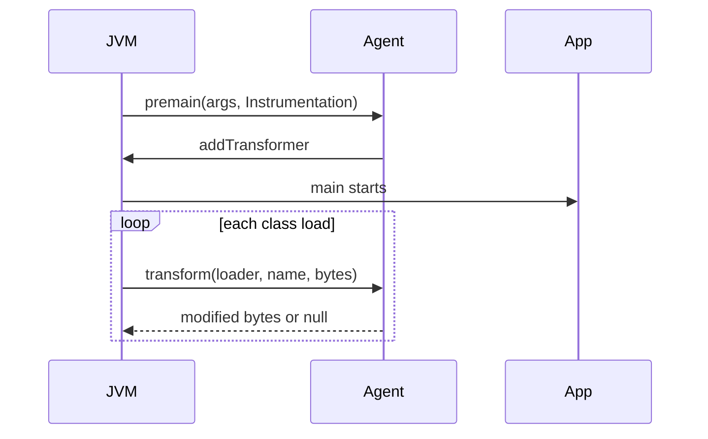
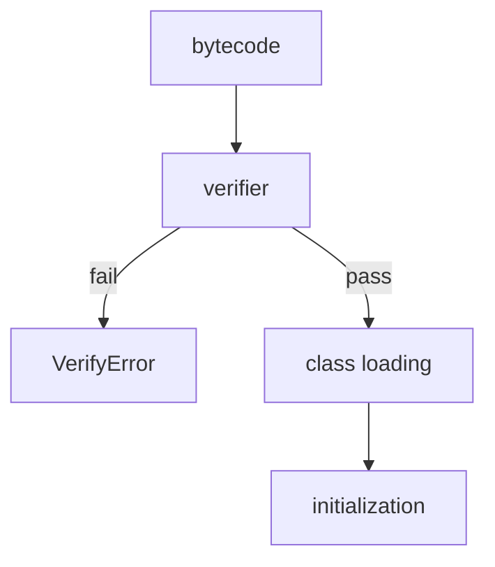

# Bytecode and Java Agents

> **Status:** Completed  
> **Module:** 50 — Advanced Java  
> **Target Java version:** 21  
> **Last reviewed:** 2026-11-11  
> **Chapter profile:** Deep-dive  
> **Depth target:** Levels 3–4  
> **Examples verified with:** Oracle JDK 21.0.9 — [java-agent-premain-demo](../../examples/advanced/java-agent-premain-demo/); [bytecode-demo](../../examples/jvm/bytecode-demo/)

**Section policy:** Level 4 on **Instrumentation lifecycle**, **JVMS verification**, and retransformation limits. HotSpot startup cost labeled implementation. Native Image incompatibility called out (Module 49).

## 1. Learning Objectives *(mandatory)*

After completing this chapter, you should be able to:

- Read **class file** structure at overview level (`javap`, major version **65** for Java 21).
- Explain **bytecode** execution model (operand stack, opcodes) connecting Module 26.
- Load a **Java agent** via `-javaagent` and describe the **Instrumentation** API.
- Categorize **uses** (APM, security) vs **risks** (fragile transforms, startup cost) at Level 4.
- Distinguish `premain` (start) vs `agentmain` (attach) agent entry points.

## 2. Prerequisites *(mandatory)*

- **Module 26** — class loading, verification, execution engine overview.
- **Module 50 Ch.01** — reflection (agents often pair with transforms + metadata).
- **Module 47** — why APM agents exist (traces/metrics without code changes).

**Refresher — class loading:** Bytes → define class → link (verify, prepare) → initialize. Agents can rewrite bytes **before** define/verify completes for load-time transforms.

## 3. Why This Concept Exists *(mandatory)*

Some behavior cannot be expressed in source alone: tracing every JDBC call, enforcing policies, migrating APIs at load time. **Agents** hook the JVM early via `premain` / `agentmain` and register **ClassFileTransformer** to rewrite bytecode before or during load. Understanding bytecode helps debug **VerifyError**, mis-sized stack frames, and mysterious APM overhead.

Without this chapter, “just add the OpenTelemetry Java agent” is cargo cult—when it breaks, you need the model.

## 4. Conceptual Explanation *(mandatory)*

### 4.1 Class file essentials (JVMS)

| Part | Holds |
|------|-------|
| Header / versions | Magic, major/minor (65 = Java 21) |
| Constant pool | Literals, name/type refs |
| Methods | `Code` attribute = bytecode + exception tables |
| Attributes | `StackMapTable`, `LineNumberTable`, annotations |

```bash
javap -c -p com.example.Foo
```

Handbook [bytecode-demo](../../examples/jvm/bytecode-demo/) illustrates stack-oriented execution at source level.

### 4.2 Operand stack model (conceptual)

Bytecode is **stack-based**: instructions push/pop the operand stack and read locals. Example mental model for `a + b` on ints: load `a`, load `b`, `iadd`, store. Agents that inject calls must keep stack maps valid or verification fails.

### 4.3 Agent manifest

`Premain-Class` in `MANIFEST.MF` is mandatory for `-javaagent` startup agents; `Can-Retransform-Classes: true` enables retransform APIs.

```text
Premain-Class: AgentMain
Can-Redefine-Classes: true
Can-Retransform-Classes: true
```

Launch: `java -javaagent:agent.jar=verbose -jar app.jar`

### 4.4 What agents are (and are not)

| Agents are | Agents are not |
|------------|----------------|
| JVMTI/Instrumentation hooks | A substitute for good design |
| Powerful for cross-cutting | Guaranteed compatible with Native Image |
| Useful for APM/security | Free of startup and metaspace cost |

## 5. Mechanism and Execution Flow *(mandatory)*

### 5.1 Agent lifecycle



**Prose:** `premain` runs **before** application `main`. Transformers see many JDK and library classes—narrow your pointcuts.

### 5.2 Class loading with transformer

1. Bytes read from JAR or module path.
2. **ClassFileTransformer** chain may replace bytes.
3. **Verification** (JVMS) checks stack map and types.
4. **Initialization** runs `<clinit>` when first used.

### 5.3 Verification pipeline



Verifier checks stack map frames, type safety, and illegal jumps—agents that inject broken bytecode fail here or at first execution.

### 5.4 Runnable premain demo — **Verified (Oracle JDK 21.0.9)**

[java-agent-premain-demo](../../examples/advanced/java-agent-premain-demo/):

```bash
javac AgentMain.java AppMain.java
jar cfm agent.jar MANIFEST.MF AgentMain.class
java -javaagent:agent.jar AppMain
```

**Verified output (Oracle JDK 21.0.9, 2026-11-11):**

```text
agent=premain
loadedClasses=814
app=running
agentDemo=ok
```

`loadedClasses` count varies by JDK distribution, version, and classpath; **814** was observed on this Oracle 21.0.9 run. Treat the count as diagnostic, not a golden constant. `agentDemo=ok` is the harness marker.

### 5.5 Bytecode demo — **Verified (Oracle JDK 21.0.9)**

[bytecode-demo](../../examples/jvm/bytecode-demo/):

```text
sum=42
```

Use `javap -c` on the class to see opcodes for the arithmetic path (Module 26 for deeper JVMS reading).

## 6. Instrumentation capabilities

| API | Use |
|-----|-----|
| `addTransformer` | Modify bytes at load |
| `retransformClasses` | Re-run transformer on loaded classes |
| `redefineClasses` | Replace class bytes (stricter constraints) |
| `getAllLoadedClasses` | Diagnostics (demo prints count) |

Production agents (OpenTelemetry, Byte Buddy-based tools) hide ASM/Javassist complexity behind safe pointcut DSLs.

## 7. Terminology *(mandatory)*

| Term | Meaning |
|------|---------|
| **premain** | Agent entry at JVM start (`-javaagent`) |
| **agentmain** | Agent entry on dynamic attach |
| **ClassFileTransformer** | Hook that receives/returns class bytes |
| **VerifyError** | Verification failed—usually bad bytecode |
| **Pointcut** | Which classes/methods an agent targets |

## 8. Internal Behavior *(JVMS vs HotSpot, Level 4)*

**Verification (JVMS requirement):** Ensures stack discipline and type safety after transform. Bad bytecode → `ClassFormatError` / `VerifyError`.

**Redefinition limits (JVMS):** Retransform cannot arbitrarily add fields/methods; schema constraints apply—agents must respect contracts. Test on your JDK before production.

**HotSpot note (implementation):** Transform at load adds startup work; wide pointcuts inflate startup time and metaspace. Not a universal JVM law for absolute timings.

## 9. Real-World Use Cases *(conditional)*

- APM tracing HTTP and JDBC boundaries (Module 47).
- Mockito inline mocks / bytecode generation (test scope).
- OpenTelemetry Java agent auto-instrumentation.
- Security agents enforcing policy or detecting known bad patterns.

### Walkthrough: what a JDBC tracing agent typically does

1. Transformer matches classes implementing `java.sql.Connection` / statement types (vendor drivers).
2. At method entry of `execute*`, inject call to tracer that opens a span.
3. On exit/exception, end span and record SQL (possibly sanitized).
4. Span context propagates via ThreadLocal or OpenTelemetry context (Module 47).

**Risk:** Matching too broadly (all classes named `*Connection*`) transforms unrelated types → VerifyError or huge startup. Vendors maintain allowlists of known drivers.

### Multiple agents

Order on the command line matters:

```bash
# Illustrative
java -javaagent:first.jar -javaagent:second.jar -jar app.jar
```

Each transformer chain runs in registration order. Two agents rewriting the same method can conflict—reproduce with only one agent enabled when debugging.

## 10. Edge Cases and Limitations

- **Module system** — agents may need `--add-opens` / `--add-exports` to transform JDK classes.
- **Native image** — JVMTI agents do not apply (Module 49).
- **Signed JARs** — transform restrictions under security policy.
- **Parallel class loading** — transformers must be thread-safe.
- **Java 21 class file version** — agents built for older ASM may need upgrades.

## 11. Common Mistakes *(mandatory)*

### Incorrect — heavyweight transform on all classes

Startup regression, subtle verifier failures, surprising interactions with other agents.

### Corrected — narrow pointcuts; cache transformed bytes; CI smoke with agent.

### Incorrect — shipping agent without testing on target JDK 21

New class file version / JDK internals surprises.

### Corrected — matrix test Oracle/Temurin 21 with agent enabled.

### Incorrect — assuming `loadedClasses` is stable across machines

Boot classpath and modules differ.

### Corrected — assert behavioral markers (`agentDemo=ok`), not absolute counts.

### Retransformation constraints

`Instrumentation.retransformClasses` requires `canRetransform=true` in manifest and may not change schema of already-loaded classes beyond supported cases—test before production rollout.

## 12. Best Practices

- Prefer library-maintained agents over hand-rolled ASM in apps.
- Order multiple agents deliberately; document conflicts.
- Keep agent args (`-javaagent:jar=opts`) in runbooks next to image digests (Module 49).
- Smoke-test Boot app start with agent in CI (Module 48).
- Use `javap` and verifier errors as first debugging tools.

## 13. Design Trade-offs *(conditional)*

| Source-only observability | Agent-based tracing |
|----------------------------|---------------------|
| Explicit code | Zero-touch coverage |
| Compile-time types | Runtime overhead + fragility |

| Load-time transform | Attach later (`agentmain`) |
|---------------------|----------------------------|
| Sees early classes | Useful for diagnostics on live PID |

## 14. Performance Considerations *(conditional)*

- Each transform costs CPU at class load—wide wildcards hurt Boot startup.
- Extra methods/fields (when allowed) increase metaspace.
- Runtime advice on hot paths can prevent inlining—profile with JFR (Module 28).
- Disable unused instrumentations in APM config.

## 15. Security Considerations *(conditional)*

- Agents run with high privilege—supply-chain risk if jar is tampered.
- Sign and pin agent artifacts in CI.
- Transforming security-sensitive classes can weaken guarantees—review vendor docs.
- Do not accept arbitrary agent jars from untrusted users on multi-tenant hosts.

## 16. Java Version and Compatibility Notes *(conditional)*

- Class major version **65** = Java 21.
- Instrumentation API long-standing; module encapsulation tightened since 9.
- Attach API / tools may differ by distribution—verify on Oracle and Temurin alike.
- Native Image: plan JVM-mode for agent-based APM or use native-compatible telemetry options.

## 17. Reading `javap` Output (Illustrative)

```bash
javap -c -p MyClass.class
```

| Opcode | Meaning |
|--------|---------|
| `aload_0` | Load `this` |
| `invokevirtual` | Virtual dispatch |
| `invokeinterface` | Interface call |
| `invokestatic` | Static call (common for injected tracers) |
| `return` | Void return |

Agents that inject calls at method entry often add `invokestatic` to a tracing helper—verify stack map frames still verify.

## 18. Revision and Mastery

- What manifest entry starts an agent?
- Difference `premain` vs `agentmain`?
- Why might `javap` help when debugging agent failures?
- What does the verifier guarantee after a transform?
- Why don’t JVMTI agents apply to Native Image?

## 19. Exercises

1. Run bytecode-demo and name two opcodes you see via `javap -c`.
2. Modify agent to print agent args string (`premain` first parameter).
3. Research one production agent’s required JVM flags for JDK 21.
4. Predict what happens if a transformer returns invalid stack maps.

## 20. Debugging Agent Failures (playbook)

| Symptom | First checks |
|---------|--------------|
| `VerifyError` | `javap -c -v` transformed class; narrow pointcut |
| Slow startup | Count transformed classes; disable wildcards |
| Missing spans | Wrong class name (shaded packages); order of agents |
| Attach fails | Permissions; JDK version; already-loaded classes |

### `premain` vs `agentmain` table

| Entry | When | Typical use |
|-------|------|-------------|
| `premain` | `-javaagent` at start | APM always on |
| `agentmain` | Attach API / tools | Hot diagnostics |

Both receive `Instrumentation`; capabilities depend on manifest flags.

## 21. Chapter Summary

Bytecode is what the JVM executes; agents instrument class loading through Instrumentation. The premain demo proves the hook sequence on Oracle JDK 21.0.9; production use demands narrow transforms, verification awareness, and JDK 21 matrix testing. Pair with Module 47 for why APM exists and Module 49 for why native binaries change the story.

## References

- JVMS — class file format, verification.
- Java SE API — `java.lang.instrument`.
- Module 26 — internals; Module 47 — observability agents.

## Review Checklist

- [x] Deep-dive L3–4; JVMS verification vs HotSpot startup cost labeled
- [x] Premain + bytecode demos Verified Oracle JDK 21.0.9; fourth deepen 2026-11-11
