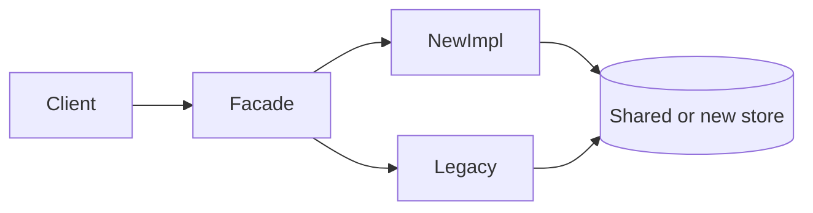

# Large Codebases

> **Status:** Completed  
> **Module:** 51 — Enterprise and Large-Scale Engineering  
> **Target Java version:** 21  
> **Last reviewed:** 2026-11-11  
> **Chapter profile:** Technical  
> **Depth target:** Levels 2–3 (target ≥ 250 lines post deepen pass)

## 1. Learning Objectives

- Apply **modular boundaries** (packages, JPMS modules, Maven modules) to tame growth.
- Use **ownership**, **CODEOWNERS**, and **architecture tests** to prevent erosion.
- Navigate **legacy** with strangler patterns without stopping feature work.
- Balance **refactoring** with delivery using incremental steps.

## 2. Prerequisites

- **Module 40** — layered/hexagonal architecture, modular monolith.
- **Module 41** — SOLID, patterns.
- **Module 29** — multi-module Maven/Gradle.

## 3. Why This Concept Exists

Enterprise Java systems accumulate **years** of features: multiple teams, inconsistent styles, circular dependencies, and “god services.” Without structure, compile times, onboarding, and defect rates rise. **Large-codebase engineering** keeps change safe at scale.

## 4. Conceptual Explanation

### Symptoms of an unhealthy monolith

| Symptom | Risk |
|---------|------|
| 30-minute full builds | Slow feedback |
| Everything imports everything | Hidden coupling |
| No domain language | Wrong abstractions |
| Flaky shared test DB | CI mistrust |

### Structural tactics

| Tactic | Mechanism |
|--------|-----------|
| **Package by feature** | `com.acme.billing.*` not layer-only dumps |
| **Maven/Gradle modules** | Enforce dependency direction (`domain` ← `infra`) |
| **ArchUnit** (optional) | Tests forbid forbidden edges (controller → entity direct) |
| **API modules** | Published client JAR with DTOs only |

Module 40 **modular monolith** often beats premature microservices: one deploy, clear seams.

### Team practices

- **Trunk-based development** with short-lived branches vs long-lived forks.
- **CODEOWNERS** for sensitive packages (auth, payments).
- **RFCs** for cross-cutting changes (schema, security).
- Onboarding maps handbook modules to domain areas.

## 5. Mechanism and Execution Flow

### Strangler fig routing



Traffic shifts incrementally behind **facade** or API gateway; parity tests gate cutover.

### ArchUnit enforcement cycle

1. Team agrees dependency rule (e.g. `domain` must not depend on `spring`).
2. ArchUnit test fails on violation in CI.
3. Fix dependency or revise rule via RFC—not silence the test.

### Dependency graph hygiene

Long-lived monoliths accumulate **forbidden edges**: controllers that import entities directly, `domain` packages that depend on Spring annotations, or circular module references that Maven only warns about indirectly (build order hacks, duplicate classes).

| Signal | Tool / practice | Action |
|--------|-----------------|--------|
| JDK internal usage | `jdeps --jdk-internals` on shipped JAR | Replace or isolate |
| Package cycles | Structure101, Sonar architecture | Break cycle at seam |
| Module violations | ArchUnit in CI | Fail build on new edges |
| Fan-in explosion | `domain` imported by 40+ packages | Split bounded context |

**ArchUnit example (Illustrative)** — fails if REST lives in the same package as JPA entities:

```java
@AnalyzeClasses(packages = "com.acme")
class LayeredArchitectureTest {
    @ArchTest
    static final ArchRule controllersDoNotDependOnEntities =
        noClasses().that().resideInAPackage("..web..")
            .should().dependOnClassesThat().resideInAPackage("..entity..");
}
```

Run on every PR; violations require an RFC to change the rule, not `@Ignore`.

### Ownership and change blast radius

**CODEOWNERS** maps paths to teams (`/billing/` → `@billing-team`). Combined with required reviews, it prevents drive-by changes in payment flows. For Java multi-module repos, map **Maven modules** to owners so a dependency bump in `billing-client` notifies API consumers.

**Blast radius questions** before a refactor:

1. How many modules compile-transitively depend on this package?
2. Are there external JAR consumers of `*-api` modules?
3. Does a schema migration require coordinated mobile release?

### Strangler parity and observability

During strangler cutover, run **shadow traffic** or **parallel read**: legacy and new implementation both execute; compare responses (hashed) before flipping the facade route. Log **divergence metrics** (`strangler.mismatch`) so product can pause rollout.

| Phase | Traffic | Rollback |
|-------|---------|----------|
| Dark launch | 0% new | Disable feature flag |
| Canary | 5% new | Route table revert |
| Majority | 50%+ new | Keep legacy warm 24h |
| Complete | 100% new | Decommission after soak |

### Build and test feedback loops

| Build time driver | Mitigation |
|-------------------|------------|
| Full integration suite every commit | Test impact analysis; split fast vs slow CI jobs |
| Annotation processors (JPA, MapStruct) | Incremental compilation; dedicated processor module |
| Dockerized Testcontainers everywhere | `@DataJpaTest` slices for unit path |

Target **&lt; 15 min** feedback on default PR pipeline; nightly full matrix on Temurin 21.

## 6. Terminology

| Term | Meaning |
|------|---------|
| **Strangler fig** | Replace legacy by routing new work to new implementation |
| **Modular monolith** | Single deploy with enforced module boundaries |
| **Shared kernel** | Small common model across teams—watch for drift |

## 7. Real-World Use Cases

- **Bank core:** Nightly dependency graph reports to architecture board; ArchUnit blocks new `core` → `channels.ui` edges.
- **SaaS billing:** Extract `payments-api` + `payments-impl` Maven modules six months before separate deployable; consumers compile only against API JAR.
- **Retail monolith:** Package-by-feature under `com.retail.catalog` vs horizontal `service` layer reduced cross-team merge conflicts ~30% (illustrative planning metric—not a guarantee).

## 8. Edge Cases

- **Generated code** (JPA metamodel, OpenAPI)—exclude from noisy rules; pin generation.
- **Shared kernel** drift between services—version client libraries (Module 51 Ch.02).

## 9. Common Mistakes

### Incorrect — big-bang rewrite

Years of freeze, high failure rate.

### Corrected — strangler + measurable milestones.

### Incorrect — ArchUnit rules nobody updates

False green when architecture already violated.

### Corrected — fix violations or narrow rules with team agreement.

## 10. Design Trade-offs

| Micro-split early | Modular monolith longer |
|-------------------|-------------------------|
| Ops overhead | Faster refactor across modules |

## 11. Maven Module Graph Example (Illustrative)

```text
orders-parent (pom)
├── orders-domain          (no Spring deps)
├── orders-application     (depends domain)
├── orders-adapters-jpa    (depends application)
├── orders-adapters-web    (depends application)
└── orders-bootstrap       (Spring Boot main, wires adapters)
```

`domain` compiles in seconds; full reactor runs integration tests only in `bootstrap` module—keeps feedback fast for domain changes.

## 12. Revision and Mastery

- Package-by-feature vs layer-by-type?
- One ArchUnit rule for a Spring REST project?

## 13. Exercises

1. Sketch module graph for handbook-style REST + JPA app.
2. Identify three strangler steps for legacy SOAP adapter.

## 14. Chapter Summary

Large Java codebases need enforced boundaries, ownership, incremental modernization, and architecture feedback loops—not heroic rewrites.

## Next Steps

[02-compatibility-and-migrations.md](02-compatibility-and-migrations.md)

## Review Checklist

- [x] Technical L2–3; strangler + ArchUnit mechanism; deepen pass 2026-11-11
- [x] Structure, teams, mistakes preserved; dependency hygiene + strangler phases added
