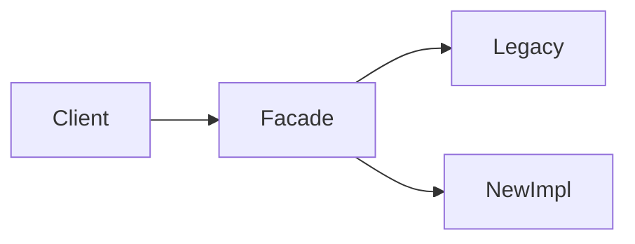

# Large Codebases

> **Status:** Completed  
> **Module:** 51 — Enterprise and Large-Scale Engineering  
> **Target Java version:** 21  
> **Last reviewed:** 2026-11-10

## 1. Learning Objectives

- Apply **modular boundaries** (packages, modules, Maven modules) to tame growth.
- Use **ownership**, **CODEOWNERS**, and **architecture tests** to prevent erosion.
- Navigate **legacy** areas with strangler patterns without stopping feature work.
- Balance **refactoring** with delivery using incremental steps.

## 2. Prerequisites

- **Module 40** — layered/hexagonal architecture, modular monolith.
- **Module 41** — SOLID, patterns.
- **Module 29** — multi-module Maven/Gradle.

## 3. Why This Concept Exists

Enterprise Java systems accumulate **years** of features: multiple teams, inconsistent styles, circular dependencies, and “god services.” Without structure, compile times, onboarding, and defect rates rise. **Large-codebase engineering** is the discipline of keeping change safe at scale.

## 4. Conceptual Explanation

### Symptoms of an unhealthy monolith

| Symptom | Risk |
|---------|------|
| 30-minute full builds | Slow feedback |
| Everything imports everything | Hidden coupling |
| No domain language | Wrong abstractions |
| Flaky shared test DB | CI mistrust |

### Structural tactics

| Tactic | Mechanism |
|--------|-----------|
| **Package by feature** | `com.acme.billing.*` not `com.acme.services` dump |
| **Maven/Gradle modules** | Enforce dependency direction (`domain` ← `infra`) |
| **ArchUnit** (optional) | Tests forbid `..controller..` → `..repository..` skips |
| **API modules** | Published client JAR with DTOs only |

Module 40 **modular monolith** often beats premature microservices: one deploy, clear module seams.

### Team practices

- **Trunk-based development** with short-lived branches vs long-lived forks.
- **CODEOWNERS** for sensitive packages (auth, payments).
- **RFCs** for cross-cutting changes (schema, security).
- **Reading lists** — map chapters of handbook to domains for onboarding.

### Strangler fig pattern

Replace legacy submodule by routing new traffic to new implementation behind facade; retire old path when parity proven.

## 5. Real-World Use Cases

- Bank core: 2M LOC, nightly module dependency report.
- SaaS: extract `payments` module before separate deployable.

## 6. Edge Cases

- **Generated code** (JPA metamodel, OpenAPI) — exclude from style wars; pin generation.
- **Shared kernel** drift between services — version client libraries.

## 7. Common Mistakes

### Incorrect — big-bang rewrite

Years of freeze, high failure rate.

### Corrected — strangler + measurable milestones.

### Incorrect — ArchUnit rules nobody updates

False green when architecture already violated.

### Corrected — fix violations or narrow rules with team agreement.

## 8. Design Trade-offs

| Micro-split early | Modular monolith longer |
|-------------------|-------------------------|
| Ops overhead | Faster refactor across modules |

## 9. Revision and Mastery

- Package-by-feature vs layer-by-type?
- One ArchUnit rule you would add to a Spring REST project?

## 10. Exercises

1. Sketch module graph for handbook-style REST + JPA app.
2. Identify three strangler steps for legacy SOAP adapter.

## 11. Chapter Summary

Large Java codebases need enforced boundaries, ownership, incremental modernization, and architecture feedback loops—not heroic rewrites.

## Next Steps

[02-compatibility-and-migrations.md](02-compatibility-and-migrations.md)

## Review Checklist

- [x] Structure, teams, strangler, mistakes
