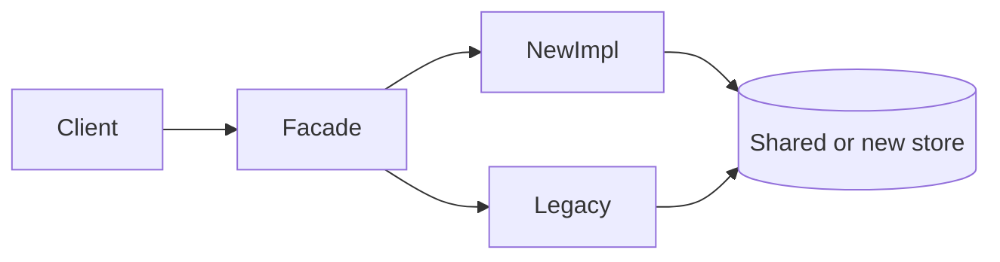

# Large Codebases

> **Status:** Completed  
> **Module:** 51 — Enterprise and Large-Scale Engineering  
> **Target Java version:** 21  
> **Last reviewed:** 2026-11-11  
> **Chapter profile:** Technical  
> **Depth target:** Levels 2–3

**Section policy:** ArchUnit and Maven graphs are **Illustrative** (optional dependency). No JVMS internal section—focus is engineering process and structure. Security omitted beyond ownership of sensitive packages (see Ch.03).

## 1. Learning Objectives *(mandatory)*

After completing this chapter, you should be able to:

- Apply **modular boundaries** (packages, JPMS modules, Maven/Gradle modules) to tame growth.
- Use **ownership**, **CODEOWNERS**, and **architecture tests** to prevent erosion.
- Navigate **legacy** with strangler patterns without stopping feature work.
- Balance **refactoring** with delivery using incremental steps and blast-radius questions.
- Design a **multi-module** reactor that keeps domain compile feedback fast.

## 2. Prerequisites *(mandatory)*

- **Module 40** — layered/hexagonal architecture, modular monolith.
- **Module 41–42** — SOLID, clean code habits.
- **Module 29** — multi-module Maven/Gradle.
- **Module 30** — testing as a feedback loop.

**Refresher — modular monolith:** One deployable with **enforced** internal module boundaries—often the right step before microservices (Module 40, 44).

## 3. Why This Concept Exists *(mandatory)*

Enterprise Java systems accumulate **years** of features: multiple teams, inconsistent styles, circular dependencies, and “god services.” Without structure, compile times, onboarding, and defect rates rise. **Large-codebase engineering** keeps change safe at scale—tools alone do not; **boundaries + ownership + feedback** do.

## 4. Conceptual Explanation *(mandatory)*

### 4.1 Symptoms of an unhealthy monolith

| Symptom | Risk |
|---------|------|
| 30-minute full builds | Slow feedback; batching bad changes |
| Everything imports everything | Hidden coupling; fear of refactor |
| No domain language | Wrong abstractions |
| Flaky shared test DB | CI mistrust; green builds lie |
| “Just add it to utils” | Shared kernel becomes junk drawer |

### 4.2 Structural tactics

| Tactic | Mechanism |
|--------|-----------|
| **Package by feature** | `com.acme.billing.*` not only layer dumps |
| **Maven/Gradle modules** | Enforce dependency direction (`domain` ← `infra`) |
| **ArchUnit** (optional) | Tests forbid forbidden edges |
| **API modules** | Published client JAR with DTOs only |
| **CODEOWNERS** | Review gates on sensitive paths |

Module 40 **modular monolith** often beats premature microservices: one deploy, clear seams.

### 4.3 Team practices

- **Trunk-based development** with short-lived branches vs long-lived forks.
- **CODEOWNERS** for auth, payments, schema migrations.
- **RFCs** for cross-cutting changes (schema, security, shared libraries).
- Onboarding maps handbook modules to domain areas so new engineers know where truth lives.

### 4.4 Package-by-feature vs layer-by-type

| Package-by-feature | Layer-by-type only |
|--------------------|--------------------|
| `billing.api`, `billing.domain` | `controller`, `service`, `repository` mega-packages |
| Changes localize | Every feature touches every layer package |
| Ownership clearer | Ownership blurry |

Hybrid is common: feature packages with internal layers.

## 5. Mechanism and Execution Flow *(mandatory)*

### 5.1 Strangler fig routing



Traffic shifts incrementally behind a **facade** or API gateway; parity tests gate cutover.

### 5.2 ArchUnit enforcement cycle

1. Team agrees dependency rule (e.g. `domain` must not depend on Spring).
2. ArchUnit test fails on violation in CI.
3. Fix dependency or revise rule via RFC—not silence the test with `@Disabled`.

### 5.3 Dependency graph hygiene

| Signal | Tool / practice | Action |
|--------|-----------------|--------|
| JDK internal usage | `jdeps --jdk-internals` | Replace or isolate (Ch.02) |
| Package cycles | Architecture tools / ArchUnit | Break cycle at seam |
| Module violations | ArchUnit in CI | Fail build on new edges |
| Fan-in explosion | Review who imports `domain` | Split bounded context |

**ArchUnit example (Illustrative):**

```java
@AnalyzeClasses(packages = "com.acme")
class LayeredArchitectureTest {
    @ArchTest
    static final ArchRule controllersDoNotDependOnEntities =
        noClasses().that().resideInAPackage("..web..")
            .should().dependOnClassesThat().resideInAPackage("..entity..");
}
```

### 5.4 Ownership and blast radius

**CODEOWNERS** maps paths to teams (`/billing/` → `@billing-team`). For Java multi-module repos, map **Maven modules** to owners so a dependency bump in `billing-client` notifies API consumers.

**Blast radius questions** before a refactor:

1. How many modules compile-transitively depend on this package?
2. Are there external JAR consumers of `*-api` modules?
3. Does a schema migration require coordinated mobile release?

### 5.5 Strangler phases

| Phase | Traffic | Rollback |
|-------|---------|----------|
| Dark launch | 0% new | Disable feature flag |
| Canary | 5% new | Route table revert |
| Majority | 50%+ new | Keep legacy warm 24h |
| Complete | 100% new | Decommission after soak |

During cutover, **shadow traffic** or parallel read compares responses; log `strangler.mismatch` metrics.

### 5.6 Build and test feedback loops

| Build time driver | Mitigation |
|-------------------|------------|
| Full integration suite every commit | Split fast vs slow CI jobs |
| Annotation processors | Incremental compilation; dedicated module |
| Testcontainers everywhere | Slice tests for unit path (`@DataJpaTest`) |

Target **&lt; 15 min** feedback on default PR pipeline; nightly full matrix on JDK 21.

## 6. Terminology *(mandatory)*

| Term | Meaning |
|------|---------|
| **Strangler fig** | Replace legacy by routing new work to new implementation |
| **Modular monolith** | Single deploy with enforced module boundaries |
| **Shared kernel** | Small common model across teams—watch for drift |
| **Blast radius** | How many systems/teams a change can break |
| **Architecture test** | Automated rule checking dependency directions |

## 7. Step-by-Step Examples *(mandatory)*

### 7.1 Minimal — forbidden dependency story (**Illustrative**)

Controller imports JPA entity → JSON accidentally exposes lazy fields → production N+1 and leaky abstractions. ArchUnit rule in §5.3 prevents the edge.

### 7.2 Realistic — Maven module graph (**Illustrative**)

```text
orders-parent (pom)
├── orders-domain          (no Spring deps)
├── orders-application     (depends domain)
├── orders-adapters-jpa    (depends application)
├── orders-adapters-web    (depends application)
└── orders-bootstrap       (Spring Boot main, wires adapters)
```

`domain` compiles in seconds; full reactor runs integration tests in `bootstrap`—keeps feedback fast for domain changes.

### 7.3 Advanced — strangler parity checklist

1. Define golden request/response fixtures for legacy SOAP/REST.
2. Implement new path behind flag.
3. Compare hashes/fields in shadow mode.
4. Ramp canary; watch mismatch + error SLO (Ch.03).
5. Remove legacy only after soak + on-call comfort.

## 8. Real-World Use Cases *(conditional)*

- **Bank core:** Nightly dependency graph reports; ArchUnit blocks new `core` → `channels.ui` edges.
- **SaaS billing:** Extract `payments-api` + `payments-impl` months before separate deployable.
- **Retail monolith:** Package-by-feature under `com.retail.catalog` reduced cross-team merge conflicts (planning anecdote—not a guarantee).

## 9. Edge Cases and Limitations

- **Generated code** (JPA metamodel, OpenAPI)—exclude from noisy rules; pin generation versions.
- **Shared kernel** drift between services—version client libraries (Ch.02).
- **JPMS** adoption mid-monolith—optional; Maven modules often enough first.
- **False confidence** — ArchUnit green while runtime coupling via DB remains.

## 10. Common Mistakes *(mandatory)*

### Incorrect — big-bang rewrite

Years of freeze, high failure rate.

### Corrected — strangler + measurable milestones.

### Incorrect — ArchUnit rules nobody updates

False green when architecture already violated; or `@Disabled` forever.

### Corrected — fix violations or narrow rules with team agreement via RFC.

### Incorrect — microservices to escape a ball of mud

Distributed mud (Module 44).

### Corrected — modularize first; split when boundaries and ops maturity exist.

## 11. Best Practices

- Prefer feature packages with thin shared libraries.
- Keep `*-api` modules free of implementation deps.
- Measure build times as a product metric.
- Pair CODEOWNERS with required reviews on money/auth paths.
- Document strangler runbooks next to Deployment manifests (Module 49).

## 12. Design Trade-offs *(conditional)*

| Micro-split early | Modular monolith longer |
|-------------------|-------------------------|
| Ops overhead | Faster refactor across modules |

| Strict ArchUnit | Social conventions only |
|-----------------|-------------------------|
| CI enforcement | Faster short-term; erodes |

## 13. Performance Considerations *(conditional)*

- Compile/test time is developer throughput—optimize reactor and CI caching.
- Annotation processors and Lombok can dominate—isolate.
- Do not confuse app runtime performance (Module 46) with build performance—both matter.

## 14. Java Version and Compatibility Notes *(conditional)*

- Target **Java 21** across modules; avoid mixed `--release` in one reactor without reason (Ch.02).
- Spring Boot 3.x requires 17+; align all modules.

## 15. Revision and Mastery

- Package-by-feature vs layer-by-type?
- One ArchUnit rule for a Spring REST project?
- Four strangler phases and a rollback for each?
- What belongs in `*-api` vs `*-impl`?

## 16. Exercises

1. Sketch module graph for handbook-style REST + JPA app.
2. Identify three strangler steps for legacy SOAP adapter.
3. Write a CODEOWNERS snippet for `**/payments/**` and `**/security/**`.
4. List five blast-radius questions for renaming a public DTO in `billing-api`.

## 17. Incremental Refactor Playbook

Large changes fail when they try to be clever in one PR. Use a **vertical thin slice**:

1. **Characterize** — characterization tests around the legacy path (Module 30).
2. **Seal** — ArchUnit / module boundary so new code cannot re-introduce the old edge.
3. **Extract** — move one use case behind an interface in `application`.
4. **Swap** — feature-flag the new adapter; keep legacy callable.
5. **Delete** — remove dead code only after metrics show zero traffic.

**Incorrect:** “refactor while adding the new product feature” in the same PR without tests.  
**Corrected:** separate risk—behavior-preserving refactor commits, then feature commits.

### Onboarding map (Illustrative)

| New engineer question | Where to send them |
|-----------------------|--------------------|
| How do we structure packages? | This chapter + Module 40 |
| How do we ship? | Modules 48–49 |
| How do we change schema? | Ch.02 |
| How do we know prod is healthy? | Ch.03 + Module 47 |

Publish the map in the repo README—onboarding time is a large-codebase metric.

## 18. Anti-Patterns Catalog

| Anti-pattern | Symptom | Countermeasure |
|--------------|---------|----------------|
| Utility god class | Everything static in `Utils` | Move to domain services |
| Shared mutable singleton state | Flaky tests, races | Explicit scopes / DI |
| Circular Maven modules | Reactor pain | Introduce `api` seam |
| Copy-paste bounded contexts | Drift | Shared kernel carefully versioned |
| Forever feature branch | Merge hell | Trunk-based + flags |

### Definition of Done for refactors

- Characterization tests green.
- ArchUnit green (or RFC for rule change).
- No new public API in `impl` modules.
- Build time not regressing beyond agreed budget.
- Rollback plan if strangler flag misbehaves.

## 19. Chapter Summary

Large Java codebases need **enforced boundaries**, **ownership**, **incremental modernization**, and **architecture feedback loops**—not heroic rewrites. Modular monoliths with ArchUnit and fast CI often outperform premature microservice splits.

## Next Steps

[02-compatibility-and-migrations.md](02-compatibility-and-migrations.md)

## References

- Module 40 — architecture; Module 29 — builds; Module 44 — distributed costs of early split.

## Review Checklist

- [x] Technical L2–3; strangler + ArchUnit mechanisms; Illustrative samples labeled
- [x] EXPAND-PRESERVE fourth deepen 2026-11-11; prior hygiene content preserved
