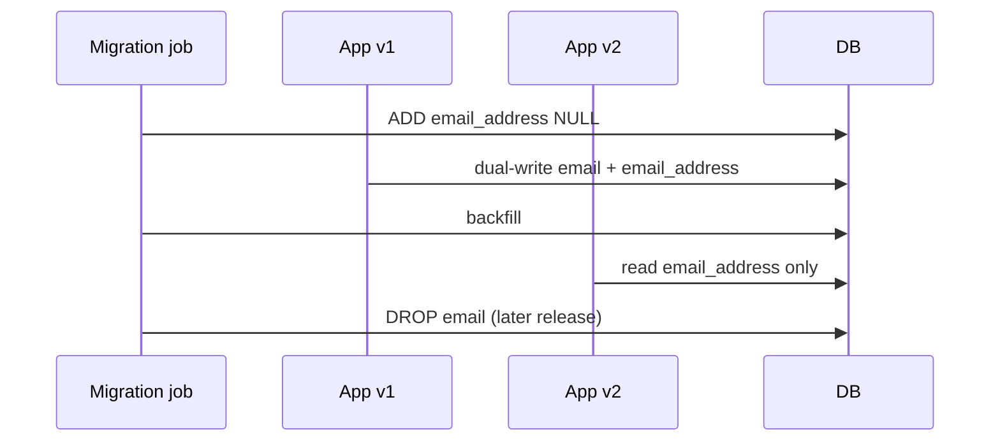

# Compatibility and Migrations

> **Status:** Completed  
> **Module:** 51 — Enterprise and Large-Scale Engineering  
> **Target Java version:** 21  
> **Last reviewed:** 2026-11-11  
> **Chapter profile:** Technical  
> **Depth target:** Levels 2–3

**Section policy:** `jdeps`/`jdeprscan` commands are **Illustrative** unless you run them on your JAR (record real output when you do). Expand/contract diagrams are conceptual. Language-comparisons omitted.

## 1. Learning Objectives *(mandatory)*

After completing this chapter, you should be able to:

- Plan **JDK upgrades** (8→11→17→21) with dependency and bytecode checks on JDK 21.
- Maintain **binary and semantic compatibility** for published APIs.
- Execute **database** and **API** migrations with expand/contract.
- Use **deprecation**, feature flags, and dual-read/write where needed.
- Interpret `jdeps --jdk-internals` and `jdeprscan` in an upgrade ticket.

## 2. Prerequisites *(mandatory)*

- **Module 19** — modern Java features and version policy.
- **Module 38** — API versioning.
- **Module 48 Ch.03** — deploy/migration ordering.
- **Module 51 Ch.01** — multi-module blast radius.

**Refresher — class file version:** `javac --release 21` emits major version **65**. Running those classes on JDK 17 fails at load with `UnsupportedClassVersionError`.

## 3. Why This Concept Exists *(mandatory)*

Enterprises cannot stop the world for every JDK or schema change. **Compatibility** preserves callers (teams, mobile apps, partners). **Migrations** move data and behavior safely across versions. Skipping expand/contract or dual-support windows causes outages that look like “random prod bugs.”

## 4. Conceptual Explanation *(mandatory)*

### 4.1 JDK migration checklist

| Step | Action |
|------|--------|
| Inventory | `jdeps`, `jdeprscan` on application JAR |
| Build | `--release 21` / `maven.compiler.release` |
| Dependencies | Upgrade frameworks (Spring 6 needs 17+) |
| Removed APIs | JAXB, Java EE modules → standalone deps |
| JPMS | `--add-opens` for reflection-heavy libs (Module 50) |
| Test | Full CI on JDK 21 (Oracle 21.0.9 / Temurin as documented) |

### 4.2 API compatibility

| Change type | Client impact |
|-------------|----------------|
| Add method to interface | Breaks unless `default` method |
| Narrow return type | Binary break |
| Add optional JSON field | Usually safe |
| Rename field | Break unless versioned media type |
| Tighten validation | Semantic break for previously accepted inputs |

Use **semantic versioning** for public JARs; **consumer-driven contracts** for REST.

### 4.3 Schema expand/contract (recap)

1. Add nullable column → deploy code tolerating null.
2. Backfill job.
3. Make NOT NULL → remove old path → drop column later.

Never deploy code that **requires** new schema before migration runs (Module 48).

### 4.4 Library ecosystem lag

Hibernate, agents, Graal metadata must match target JDK (Modules 49–50). Agents compiled for older class versions may need upgrades.

## 5. Mechanism and Execution Flow *(mandatory)*

### 5.1 Expand/contract column rename



### 5.2 Dual-write and dual-read phases

| Version | Read | Write |
|---------|------|-------|
| v1 | `email` only | `email` only |
| v2 | prefer `email_address`, fallback `email` | **dual-write** both |
| v3 | `email_address` only | `email_address` only |

**Incorrect:** deploy v3 while v1 mobile clients still send `email` in JSON.  
**Corrected:** version REST media type or explicit API version header (Module 38).

### 5.3 jdeps and jdeprscan workflow

```bash
# Illustrative — run against your artifact; record real output
jdeps --multi-release 21 --jdk-internals myapp.jar
jdeprscan --release 21 myapp.jar
```

- **`jdeps --jdk-internals`:** flags `sun.*`, `jdk.internal.*` access that may break under strong encapsulation.
- **`jdeprscan`:** lists uses of **deprecated for removal** APIs before they disappear in a future LTS.

### 5.4 Semantic versioning for published Java APIs

| Artifact | Rule |
|----------|------|
| `com.acme:billing-api` | Minor: add `default` methods; Major: remove/break |
| Internal `billing-impl` | Can move faster if not published |

**Consumer-driven contracts (REST):** partners publish expected JSON fixtures; provider CI verifies responses (pact-style) before release.

### 5.5 Feature flags and kill switches

- `features.email_address_read` toggles which column Hibernate maps.
- Kill switch routes traffic to legacy pod if error rate spikes during dual-write.

Flags **gate** paths during overlap—they do not replace expand/contract.

### 5.6 Flyway/Liquibase ordering (labeled framework)

Migrations run in **version order** at startup or in a dedicated Job. Concurrent pods need **advisory locks** so migrations are not applied twice. Never hand-edit `flyway_schema_history` in production without runbook approval.

## 6. Terminology *(mandatory)*

| Term | Meaning |
|------|---------|
| **Binary compatibility** | Existing compiled clients keep linking |
| **Semantic compatibility** | Behavior remains acceptable to callers |
| **Expand/contract** | Additive then removal migration pattern |
| **Dual-write** | Write old and new representations during transition |
| **Sunset** | Announced end-of-life for an API version |

## 7. Step-by-Step Examples *(mandatory)*

### 7.1 Minimal — class version mismatch (**Illustrative**)

Compile on 21, run on 11 → `UnsupportedClassVersionError`. Align CI image, container base, and prod JDK.

### 7.2 Realistic — expand/contract for `email` → `email_address`

1. Migration V101: `ADD email_address VARCHAR NULL`.
2. App v2: dual-write; read prefer new.
3. Backfill job copies data.
4. App v3: read/write new only.
5. Migration V110 (weeks later): `DROP email`.

### 7.3 Advanced — JDK 21 upgrade war room checklist

| Gate | Owner |
|------|-------|
| `jdeprscan` clean or exceptions filed | Platform |
| Spring Boot parent BOM bump | App team |
| Integration suite green on JDK 21 | QA/CI |
| Agent compatibility (Module 50) | Observability |
| Canary 5% for 24h | SRE |

## 8. Real-World Use Cases *(conditional)*

- LTS jump with Spring Boot parent BOM bump.
- Mobile on v1 API while v2 rolls out with sunset header.
- Removing `sun.misc.Unsafe` usages discovered by `jdeps`.

## 9. Edge Cases and Limitations

- **Serialization** across versions — `serialVersionUID`; prefer not using Java serialization at public boundaries.
- **Time zone** rule changes in JDK — retest `java.time`.
- **Multi-release JARs** — verify with `--multi-release`.
- **Preview APIs** (FFM on 21) — flags and later finalization (Module 50).

## 10. Common Mistakes *(mandatory)*

### Incorrect — compile on 21, run on 11

`UnsupportedClassVersionError`.

### Corrected — align CI, container image, prod JDK.

### Incorrect — breaking API without version bump

Silent client crashes.

### Corrected — `/v2` prefix or version header (Module 38).

### Incorrect — drop column in the same release that stops writing it while old pods run

Data loss / errors during rollout.

### Corrected — wait until all pods are on code that never reads the old column.

## 11. Best Practices

- Keep a living “JDK upgrade” runbook with last `jdeps` output attached.
- Prefer additive API changes; use `default` methods carefully.
- Automate contract tests for external clients.
- Treat schema migrations as code reviewed like Java.
- Document `--add-opens` as debt with removal tickets.

## 12. Design Trade-offs *(conditional)*

| Big-bang JDK weekend | Rolling team migration |
|----------------------|-------------------------|
| Intense window | Longer dual support |

| Strict semver on internal jars | Monorepo-only versioning |
|--------------------------------|---------------------------|
| Clear breaks | Simpler if single repo |

## 13. Performance Considerations *(conditional)*

- Backfill jobs need throttling to protect OLTP (Module 46).
- Dual-write doubles write amplification temporarily—capacity plan.
- JDK upgrades can change GC defaults—re-validate latency SLOs (Module 27).

## 14. Security Considerations *(conditional)*

- Deprecated crypto/APIs may be removed for security—track `jdeprscan`.
- Dual-write systems must not log secrets from either column.
- API sunsets reduce long-lived vulnerable clients.

## 15. Java Version and Compatibility Notes *(conditional)*

- Primary handbook path: **Java 21 LTS**.
- Spring Framework 6 / Boot 3 require 17+.
- Record bytecode level and vendor (Oracle 21.0.9 vs Temurin) in release notes.

## 16. Revision and Mastery

- What does `jdeprscan` help find?
- Safe order: DB migration vs app for column rename?
- Why is adding an abstract method to a published interface a break?
- How do feature flags interact with expand/contract?

## 17. Exercises

1. List handbook modules to revisit before JDK 21 production cutover.
2. Write expand/contract steps for `email` → `email_address`.
3. Draft a semver decision for removing a deprecated method from `billing-api`.
4. Sketch dual-read logic in pseudocode for the v2 phase.

## 18. API Sunset Timeline (Illustrative)

| Time | Action |
|------|--------|
| T0 | Announce `/v2`; document migration guide |
| T0–T1 | Both versions supported; metrics on `/v1` usage |
| T1 | Deprecation header on `/v1` responses |
| T2 | Reject new `/v1` clients (partner allowlist only) |
| T3 | Remove `/v1` code + tests; keep redirect docs |

Pair sunsets with **mobile app store** review delays—server teams often outpace client releases.

### Broken default method pitfall

Adding a `default` method is binary-compatible for many clients, but if the default calls abstract methods the client never implemented correctly, you get **runtime** failures. Treat defaults as carefully as any shared code.

### Matrix testing sketch

| Client JAR | Server | Expected |
|------------|--------|----------|
| billing-api 1.4 | Boot app 2.1 | OK |
| billing-api 1.3 | Boot app 2.1 | OK if minor-compatible |
| billing-api 2.0 | Boot app 2.0 | Major train only |

Automate in CI where artifacts are published (Module 48).

## 19. Rollback Decision Tree

```text
Was schema expanded (additive)?
  yes → roll back app digests; leave new columns
  no (destructive already) → STOP; restore from backup / forward fix
Are old pods still serving?
  yes → do not drop columns/tables yet
Is API major bump live?
  yes → keep previous major until sunset metrics near zero
```

### Communication template (**Illustrative**)

Subject: `billing-api` 2.0 sunset  
Body: breaking changes list, migration snippets, date T3, metrics dashboard link, contact.

## 20. Chapter Summary

Compatibility is explicit versioning, staged schema change, dual-read/write overlap, JDK tooling (`jdeps`, `jdeprscan`), and JDK 21 CI alignment—not silent breaks. Migrations succeed when **old and new** coexist safely until data and clients catch up.

## Next Steps

[03-production-readiness.md](03-production-readiness.md)

## References

- Oracle/OpenJDK tools — `jdeps`, `jdeprscan`.
- Module 38 — API versioning; Module 48 — deploy order.

## Review Checklist

- [x] Technical L2–3; expand/contract + dual-write mechanisms
- [x] Illustrative tool commands; no invented jdeps output
- [x] Fourth EXPAND-PRESERVE deepen 2026-11-11
