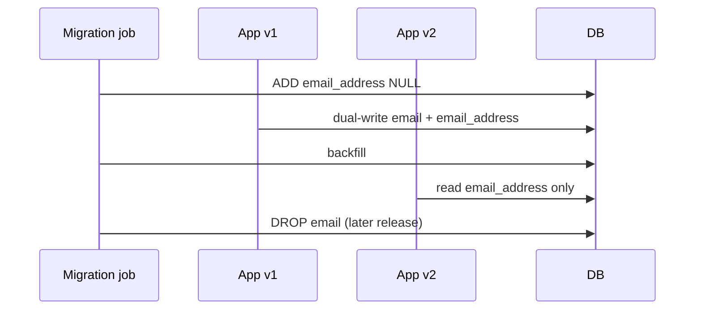

# Compatibility and Migrations

> **Status:** Completed  
> **Module:** 51 — Enterprise and Large-Scale Engineering  
> **Target Java version:** 21  
> **Last reviewed:** 2026-11-11  
> **Chapter profile:** Technical  
> **Depth target:** Levels 2–3

## 1. Learning Objectives

- Plan **JDK upgrades** (8→11→17→21) with dependency and bytecode checks on Temurin 21.
- Maintain **binary and semantic compatibility** for published APIs.
- Execute **database** and **API** migrations with expand/contract.
- Use **deprecation**, feature flags, and dual-read/write where needed.

## 2. Prerequisites

- **Module 19** — modern Java features and version policy.
- **Module 38** — API versioning.
- **Module 48 Ch.03** — deploy/migration ordering.

## 3. Why This Concept Exists

Enterprises cannot stop the world for every JDK or schema change. **Compatibility** preserves callers (teams, mobile apps, partners). **Migrations** move data and behavior safely across versions.

## 4. Conceptual Explanation

### JDK migration checklist

| Step | Action |
|------|--------|
| Inventory | `jdeps`, `jdeprscan` on application JAR |
| Build | `--release 21` / `maven.compiler.release` |
| Dependencies | Upgrade frameworks (Spring 6 needs 17+) |
| Removed APIs | JAXB, JavaEE modules → standalone deps |
| JPMS | `--add-opens` for reflection-heavy libs (Module 50) |
| Test | Full CI on Temurin 21.0.12.1 |

**jdeps --jdk-internals** flags illegal JDK internal access.

### API compatibility

| Change type | Client impact |
|-------------|----------------|
| Add method to interface | Breaks unless `default` method |
| Narrow return type | Binary break |
| Add optional JSON field | Usually safe |
| Rename field | Break unless versioned media type |

Use **semantic versioning** for public JARs; **consumer-driven contracts** for REST.

### Schema expand/contract (recap)

1. Add nullable column → deploy tolerating null.
2. Backfill job.
3. Make NOT NULL → remove old path → drop column later.

### Library ecosystem lag

Hibernate, agents, Graal metadata must match target JDK (Modules 49–50).

## 5. Mechanism and Execution Flow

### Expand/contract column rename



Never deploy code that **requires** new schema before migration runs (Module 48).

### Dual-write and dual-read phases

Rename and type-change migrations often need **three application versions** alive briefly:

| Version | Read | Write |
|---------|------|-------|
| v1 | `email` only | `email` only |
| v2 | prefer `email_address`, fallback `email` | **dual-write** both columns |
| v3 | `email_address` only | `email_address` only |

**Incorrect:** deploy v3 while v1 mobile clients still send `email` in JSON.

**Corrected:** version REST media type (`Accept: application/vnd.acme.v2+json`) or explicit API version header (Module 38).

### jdeps and jdeprscan workflow (Temurin 21)

```bash
jdeps --multi-release 21 --jdk-internals myapp.jar
jdeprscan --release 21 myapp.jar
```

- **`jdeps --jdk-internals`:** flags `sun.*`, `jdk.internal.*` access that may break under strong encapsulation.
- **`jdeprscan`:** lists uses of **deprecated for removal** APIs before they disappear in a future LTS.

Record output in the upgrade ticket; fix or file exceptions with `--add-opens` only when libraries lag (Module 50 JPMS).

### Semantic versioning for published Java APIs

| Artifact | Rule |
|----------|------|
| `com.acme:billing-api` | Minor bump: add `default` methods on interfaces |
| Same artifact | Major bump: remove type, change generic bounds |
| Internal `billing-impl` | Can move faster if not published |

**Consumer-driven contracts (REST):** partner teams publish expected JSON fixtures; provider CI verifies responses against pact files before release.

### Feature flags and kill switches

Long migrations pair **schema expand** with **flags**:

- `features.email_address_read` toggles which column Hibernate maps.
- Kill switch routes traffic to legacy pod if error rate spikes during dual-write.

Flags are not a substitute for expand/contract—they **gate** which code path runs during overlap.

## 6. Real-World Use Cases

- LTS jump with Spring Boot parent BOM bump.
- Mobile on v1 API while v2 rolls out with sunset header.

## 7. Edge Cases

- **Serialization** across versions — `serialVersionUID`; avoid Java serialization at public boundaries when possible.
- **Time zone** rule changes in JDK — retest `java.time`.

## 8. Common Mistakes

### Incorrect — compile on 21, run on 11

`UnsupportedClassVersionError`.

### Corrected — align CI, container image, prod JDK.

### Incorrect — breaking API without version bump

Silent client crashes.

### Corrected — `/v2` prefix or version header (Module 38).

## 9. Design Trade-offs

| Big-bang JDK weekend | Rolling team migration |
|----------------------|-------------------------|
| Intense window | Longer dual support |

## 10. Revision and Mastery

- What does `jdeprscan` help find?
- Safe order: DB migration vs app for column rename?

## 11. Exercises

1. List handbook modules to revisit before JDK 21 production cutover.
2. Write expand/contract steps for `email` → `email_address`.

## 12. Internal Behavior (labeled)

**Flyway/Liquibase ordering:** Migrations run in **version order** at application startup (or in a dedicated job). Two pods starting concurrently must use **advisory locks** (Flyway) so migrations are not applied twice. Never hand-edit `flyway_schema_history` in production without runbook approval.

**Bytecode level:** `javac --release 21` emits major version 65; running on JDK 17 fails at class load. CI must compile, test, and package on the **same** release train as production images (Module 48).

## 13. Chapter Summary

Compatibility is explicit versioning, staged schema change, dual-read/write overlap, JDK tooling (`jdeps`, `jdeprscan`), and Temurin 21 CI alignment—not silent breaks.

## Next Steps

[03-production-readiness.md](03-production-readiness.md)

## Review Checklist

- [x] Technical L2–3; expand/contract mechanism; deepen pass 2026-11-11
- [x] JDK, API, schema migration preserved; dual-write + jdeps workflow added
