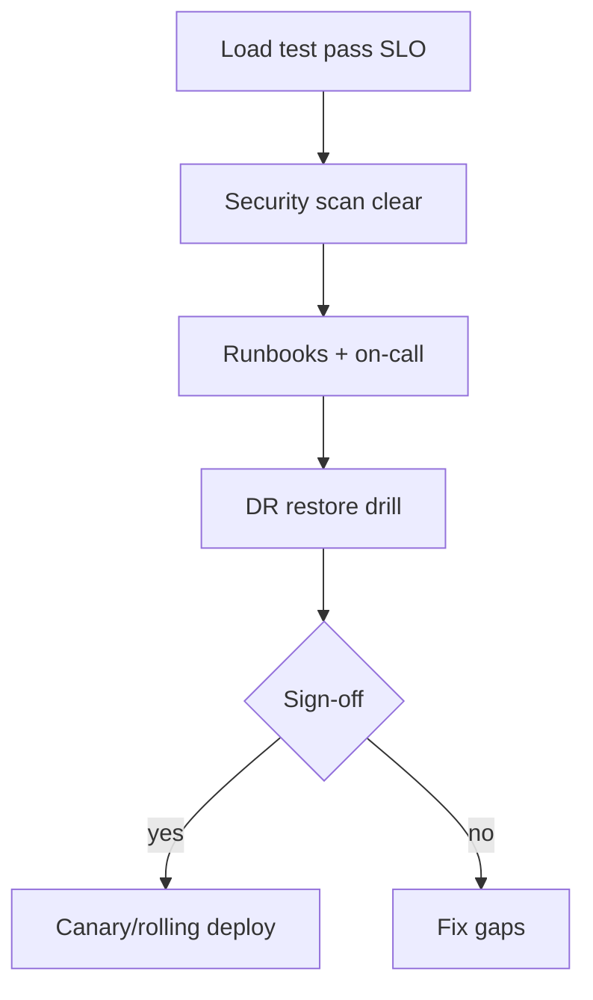

# Production Readiness

> **Status:** Completed  
> **Module:** 51 — Enterprise and Large-Scale Engineering  
> **Target Java version:** 21  
> **Last reviewed:** 2026-11-11  
> **Chapter profile:** Technical  
> **Depth target:** Levels 2–3

## 1. Learning Objectives

- Use a **production readiness checklist** before launch (SRE-style).
- Define **SLOs**, **runbooks**, **on-call**, and **capacity** for JVM services.
- Plan **security** hardening, **secrets**, **backups**, and **disaster recovery**.
- Connect handbook topics into a **go-live** review.

## 2. Prerequisites

- **Modules 31, 47** — debugging, observability.
- **Modules 39, 48** — security, deploy/CI.
- **Module 37** — Actuator, health.

## 3. Why This Concept Exists

“Works in demo” differs from **production**: failure modes, abuse, data loss, and on-call pages. **Production readiness** asks whether operators can **run**, **observe**, **restore**, and **secure** the Java system.

## 4. Conceptual Explanation

### Readiness dimensions

| Area | Questions |
|------|-----------|
| **Reliability** | SLOs, error budget, redundancy, probes |
| **Performance** | Load test, pool sizes, GC under peak (Module 46) |
| **Security** | AuthZ, TLS, CVE scan, least privilege (Module 43) |
| **Operability** | Dashboards, logs, traces, runbooks |
| **Data** | Backups, restore tested, migration rollback |
| **Compliance** | PII handling, retention, audit logs |

### SLO sketch for REST API

- **Availability:** 99.9% monthly.
- **Latency:** p99 < 500ms at expected RPS.
- **Error rate:** < 0.1% 5xx excluding client 4xx.

Measure with Micrometer/APM (Module 47).

### Runbook essentials

1. Service overview and dependencies.
2. Dashboard links (golden signals).
3. Common failures (DB, pool, GC) with steps.
4. Rollback (image digest, migration policy).
5. Contacts and escalation.

### Security baseline

- Dependency scan in CI (Module 48).
- Secrets in vault; rotate JDBC passwords.
- TLS at ingress (Module 32).
- Rate limiting / auth (Module 39).

### Capacity

| Input | Derived |
|-------|---------|
| Peak RPS | Thread pool + CPU |
| DB connections | `replicas × poolMax` < DB max |

Load test **before** launch on Temurin 21 images matching prod.

## 5. Mechanism and Execution Flow

### Go-live gate



### Launch process

1. Pre-prod soak test.
2. Checklist sign-off (eng + ops).
3. Canary or rolling deploy (Module 48).
4. Hypercare with elevated monitoring.

### Error budget and release policy

| SLO | Monthly error budget (99.9%) | Policy |
|-----|------------------------------|--------|
| Availability | ~43 minutes downtime | Freeze risky releases when budget burned |
| Latency p99 | Burn via slow traces | Prioritize perf over features |

**Java service signals during hypercare:**

- JVM **GC pause** percentiles (Module 27).
- **HikariCP** pool pending threads (Module 34).
- **HTTP 5xx** rate excluding client 4xx (Module 47).
- **Deployment annotation** on dashboards (`version`, `git_sha`).

### Disaster recovery drill script

1. Restore RDS snapshot to isolated VPC **T+0**.
2. Point staging Boot app at restored endpoint; run smoke `@SpringBootTest`.
3. Measure **RTO** (time to first successful transaction) and **RPO** (data loss window).
4. Document JDBC URL swap and secret rotation steps in runbook.

Quarterly drill; failing drill blocks major marketing launches.

### Dependency and CVE gate

```text
CI stage: mvn org.owasp:dependency-check-maven:check
         or Gradle dependencyCheckAnalyze
```

Block release on **CVSS ≥ 7** without exception ticket; Spring Boot BOM bumps often clear transitive CVEs—track parent POM version in readiness checklist.

## 6. Real-World Use Cases

- Financial service: mandatory DR drill.
- B2B API: status page tied to SLO burn alerts.

## 7. Edge Cases

- **Thundering herd** on cache expiry — TTL jitter (Module 46).
- **Certificate expiry** — automate renewal alerts.

## 8. Common Mistakes

### Incorrect — no restore drill

Backups untested.

### Corrected — quarterly restore to isolated env.

### Incorrect — alerting on every ERROR log

Alert fatigue.

### Corrected — SLO-based paging on user symptoms (Module 47 Ch.03).

## 9. Design Trade-offs

| Higher SLO | Cost |
|------------|------|
| Multi-AZ redundancy | Infra spend |

## 10. Revision and Mastery

- Four golden signals?
- Minimum three runbook sections for JDBC Spring service?

## 11. On-Call and Runbook Template

```markdown
## Service: orders-api
### Dependencies
- PostgreSQL (primary), Redis cache, payment provider REST
### Dashboards
- Golden signals, JVM memory, pool pending, 5xx rate
### Playbook: DB connection refused
1. Check Hikari metrics; verify DB status page
2. If failover in progress, scale reads to replica endpoint
3. Roll back last deploy if migration mismatch suspected
### Rollback
- Image: ghcr.io/acme/orders-api@sha256:...
- Migrations: forward-only; contact DBA for manual revert script
```

Rotate on-call with **shadow** week for new engineers—page only low-severity alerts first.

## 12. Exercises

1. Draft SLO table for a handbook REST demo at 1k RPS.
2. Production readiness gap list from Modules 30–48.

## 13. Chapter Summary

Production readiness unifies testing, observability, security, deploy strategy, error budgets, DR drills, and operational docs so Java services survive real traffic—not just compile.

## Review Checklist

- [x] Technical L2–3; go-live mechanism; checklist preserved; deepen pass 2026-11-11
- [x] SLO; runbooks; security; capacity; error budget + DR drill added
