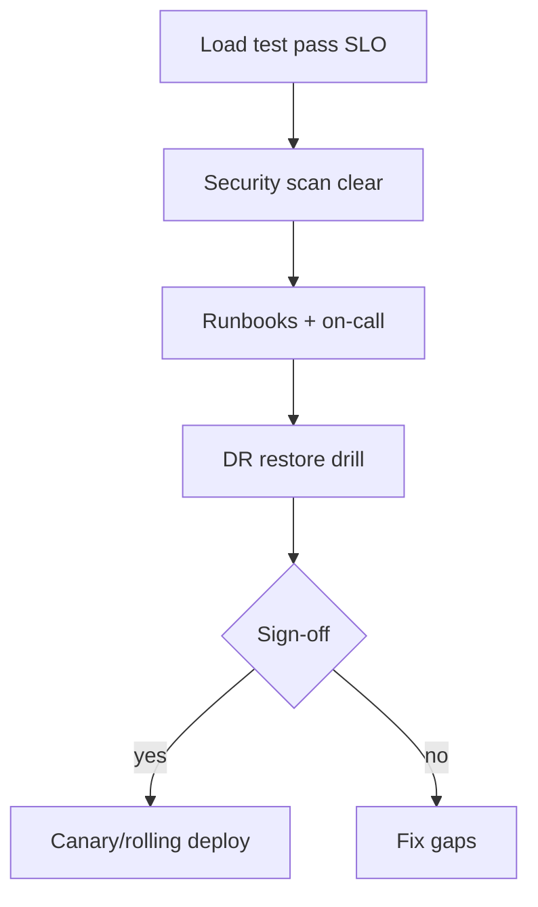

# Production Readiness

> **Status:** Completed  
> **Module:** 51 — Enterprise and Large-Scale Engineering  
> **Target Java version:** 21  
> **Last reviewed:** 2026-11-11  
> **Chapter profile:** Technical  
> **Depth target:** Levels 2–3

**Section policy:** Checklists and runbook templates are **Illustrative** operational artifacts. No runnable demo required. Ties Modules 30–50 into a go-live gate.

## 1. Learning Objectives *(mandatory)*

After completing this chapter, you should be able to:

- Use a **production readiness checklist** before launch (SRE-style).
- Define **SLOs**, **runbooks**, **on-call**, and **capacity** for JVM services.
- Plan **security** hardening, **secrets**, **backups**, and **disaster recovery**.
- Connect handbook topics into a **go-live** review with error budgets.
- Run a **DR restore drill** script and record RTO/RPO.

## 2. Prerequisites *(mandatory)*

- **Modules 31, 47** — debugging, observability.
- **Modules 39, 43, 48** — security, deploy/CI.
- **Module 37** — Actuator, health.
- **Module 49** — cloud probes, immutable releases.
- **Module 51 Ch.01–02** — structure and safe migrations.

## 3. Why This Concept Exists *(mandatory)*

“Works in demo” differs from **production**: failure modes, abuse, data loss, and on-call pages. **Production readiness** asks whether operators can **run**, **observe**, **restore**, and **secure** the Java system—before marketing flips the switch.

## 4. Conceptual Explanation *(mandatory)*

### 4.1 Readiness dimensions

| Area | Questions |
|------|-----------|
| **Reliability** | SLOs, error budget, redundancy, probes |
| **Performance** | Load test, pool sizes, GC under peak (Module 46) |
| **Security** | AuthZ, TLS, CVE scan, least privilege (Module 43) |
| **Operability** | Dashboards, logs, traces, runbooks |
| **Data** | Backups, restore tested, migration rollback |
| **Compliance** | PII handling, retention, audit logs |

### 4.2 SLO sketch for REST API

- **Availability:** 99.9% monthly (~43 minutes error budget).
- **Latency:** p99 &lt; 500ms at expected RPS.
- **Error rate:** &lt; 0.1% 5xx excluding client 4xx.

Measure with Micrometer/APM (Module 47).

### 4.3 Runbook essentials

1. Service overview and dependencies.
2. Dashboard links (golden signals).
3. Common failures (DB, pool, GC) with steps.
4. Rollback (image digest, migration policy).
5. Contacts and escalation.

### 4.4 Security baseline

- Dependency scan in CI (Module 48).
- Secrets in vault; rotate JDBC passwords.
- TLS at ingress (Modules 32, 49).
- Rate limiting / auth (Module 39).

### 4.5 Capacity

| Input | Derived |
|-------|---------|
| Peak RPS | Thread pool + CPU |
| DB connections | `replicas × poolMax` &lt; DB max (Module 49) |

Load test **before** launch on JDK 21 images matching prod.

## 5. Mechanism and Execution Flow *(mandatory)*

### 5.1 Go-live gate



### 5.2 Launch process

1. Pre-prod soak test.
2. Checklist sign-off (eng + ops).
3. Canary or rolling deploy (Module 48).
4. Hypercare with elevated monitoring.

### 5.3 Error budget and release policy

| SLO | Monthly error budget (99.9%) | Policy |
|-----|------------------------------|--------|
| Availability | ~43 minutes downtime | Freeze risky releases when budget burned |
| Latency p99 | Burn via slow traces | Prioritize perf over features |

**Java signals during hypercare:**

- JVM **GC pause** percentiles (Module 27).
- **HikariCP** pool pending threads (Module 34).
- **HTTP 5xx** rate excluding client 4xx (Module 47).
- **Deployment annotation** on dashboards (`version`, `git_sha`).

### 5.4 Disaster recovery drill script

1. Restore DB snapshot to isolated network **T+0**.
2. Point staging Boot app at restored endpoint; run smoke tests.
3. Measure **RTO** (time to first successful transaction) and **RPO** (data loss window).
4. Document JDBC URL swap and secret rotation in runbook.

Quarterly drill; failing drill blocks major launches.

### 5.5 Dependency and CVE gate

```text
# Illustrative CI stage
mvn org.owasp:dependency-check-maven:check
# or Gradle dependencyCheckAnalyze
```

Block release on **CVSS ≥ 7** without exception ticket; Spring Boot BOM bumps often clear transitive CVEs—track parent POM version in the checklist.

## 6. Terminology *(mandatory)*

| Term | Meaning |
|------|---------|
| **SLO** | Service level objective—target reliability/latency |
| **Error budget** | Allowed unreliability derived from SLO |
| **RTO / RPO** | Recovery time / recovery point objectives |
| **Hypercare** | Elevated watch period after launch |
| **Runbook** | Step-by-step operational guide for incidents |

## 7. Step-by-Step Examples *(mandatory)*

### 7.1 Minimal — golden signals for a Boot API

| Signal | Example metric |
|--------|----------------|
| Latency | `http.server.requests` p99 |
| Traffic | RPS |
| Errors | 5xx rate |
| Saturation | CPU, heap, pool pending |

### 7.2 Realistic — on-call runbook template (**Illustrative**)

```markdown
## Service: orders-api
### Dependencies
- PostgreSQL (primary), Redis cache, payment provider REST
### Dashboards
- Golden signals, JVM memory, pool pending, 5xx rate
### Playbook: DB connection refused
1. Check Hikari metrics; verify DB status page
2. If failover in progress, scale reads to replica endpoint
3. Roll back last deploy if migration mismatch suspected
### Rollback
- Image: ghcr.io/acme/orders-api@sha256:...
- Migrations: forward-only; contact DBA for manual revert script
```

### 7.3 Advanced — production readiness scorecard

| Item | Pass? |
|------|-------|
| Load test meets SLO on prod-like JDK 21 image | |
| Probes tuned (Module 49) | |
| Secrets not in image | |
| DR restore drill &lt; RTO | |
| Runbooks reviewed by on-call | |
| CVE gate green | |
| Migration expand/contract documented (Ch.02) | |

## 8. Real-World Use Cases *(conditional)*

- Financial service: mandatory DR drill before launch.
- B2B API: status page tied to SLO burn alerts.
- Retail flash sale: capacity + HPA + DB connection math reviewed together.

## 9. Edge Cases and Limitations

- **Thundering herd** on cache expiry — TTL jitter (Module 46).
- **Certificate expiry** — automate renewal alerts.
- **Partial region failure** — multi-AZ assumptions documented.
- **Vendor dependency outage** — circuit breakers and degraded modes (Module 44).

## 10. Common Mistakes *(mandatory)*

### Incorrect — no restore drill

Backups untested.

### Corrected — quarterly restore to isolated env.

### Incorrect — alerting on every ERROR log

Alert fatigue.

### Corrected — SLO-based paging on user symptoms (Module 47 Ch.03).

### Incorrect — canary skipped because “small change”

Config/flags cause large incidents.

### Corrected — default to canary/rolling with digest rollback (Module 48–49).

## 11. Best Practices

- Treat readiness as a **gate**, not a slideshow.
- Keep runbooks next to the service repo; link from dashboards.
- Rotate on-call with a **shadow** week for new engineers.
- Annotate deploys on graphs.
- Revisit capacity after each major feature.

## 12. Design Trade-offs *(conditional)*

| Higher SLO | Cost |
|------------|------|
| Multi-AZ redundancy | Infra spend |

| Strict freeze on burned budget | Ship features anyway |
|--------------------------------|----------------------|
| Protects users | Short-term product pressure |

## 13. Performance Considerations *(conditional)*

- Load tests must use production-like data shapes and JDK flags.
- Watch GC and pools under peak—not only average CPU.
- Native vs JVM (Module 49) changes capacity envelopes—retest if switching.

## 14. Security Considerations *(conditional)*

- CVE gate in CI; exception process with expiry dates.
- Least-privilege DB roles and network policies.
- Actuator exposure locked down (Module 49).
- Audit logs for sensitive admin actions.

## 15. Java Version and Compatibility Notes *(conditional)*

- Prod images: **JDK 21** matching CI (record vendor/build).
- Align agents and native metadata if used (Module 50 / 49).
- After JDK upgrade, re-run readiness load + DR smoke (Ch.02).

## 16. Revision and Mastery

- Four golden signals?
- Minimum three runbook sections for JDBC Spring service?
- How does error budget change release policy?
- What fails if DR is never drilled?

## 17. Exercises

1. Draft SLO table for a handbook REST demo at 1k RPS.
2. Production readiness gap list from Modules 30–50 for one sample service.
3. Fill the scorecard in §7.3 for a service you know.
4. Write a playbook for “Hikari pool exhausted.”

## 18. Incident Review Linkage

After a Sev-1/2, readiness artifacts should change:

| Finding | Artifact to update |
|---------|-------------------|
| Missing dashboard | Module 47 dashboards + runbook links |
| Unknown rollback | Digest + migration policy in runbook |
| Pool exhaustion surprise | Capacity sheet + HPA/DB limits (Module 49) |
| Silent dependency CVE | CI gate threshold / exception expiry |

Blameless reviews that do not update checklists will repeat.

### Sample go-live agenda (90 minutes)

1. Walk SLO + error budget (10m).
2. Demo dashboards + alert routes (15m).
3. Tabletop: DB down, bad deploy, region blip (30m).
4. Show last DR drill evidence (15m).
5. Sign-off or create blocking tickets (20m).

**Incorrect:** slide deck of green checkmarks without evidence links.  
**Corrected:** ticket links to load-test report, CVE scan, drill notes, and image digest.

### Capacity worksheet fields (**Illustrative**)

- Peak RPS and payload size assumptions.
- Pod CPU/memory requests/limits.
- Hikari `maximum-pool-size` × max replicas.
- Redis max connections if used.
- Expected p99 with and without cache hit.

Revisit after each major launch (Module 46).

## 19. Hypercare Dashboard Checklist

| Panel | Why |
|-------|-----|
| RPS + p99 + 5xx | User symptoms |
| GC pause p99 | JVM health |
| Hikari pending / active | DB saturation |
| Deploy markers | Correlate changes |
| Dependency error rates | Cascades |

### Sign-off roles

| Role | Signs |
|------|-------|
| Eng lead | Code + tests + migrations |
| SRE/on-call | Runbooks + alerts + DR |
| Security | CVE gate + secrets |
| Product | Accepts residual risk |

No single role can rubber-stamp alone for high-risk launches.

## 20. Chapter Summary

Production readiness unifies testing, observability, security, deploy strategy, error budgets, DR drills, and operational docs so Java services survive real traffic—not just compile. It is the capstone checklist connecting Modules 30–50.

## References

- SRE workbook ideas — SLOs and error budgets.
- Module 47 — signals; Module 48–49 — deploy and cloud; Module 43 — security.

## Review Checklist

- [x] Technical L2–3; go-live mechanism; error budget + DR drill
- [x] Illustrative runbooks; no invented metrics as Verified
- [x] Fourth EXPAND-PRESERVE deepen 2026-11-11
