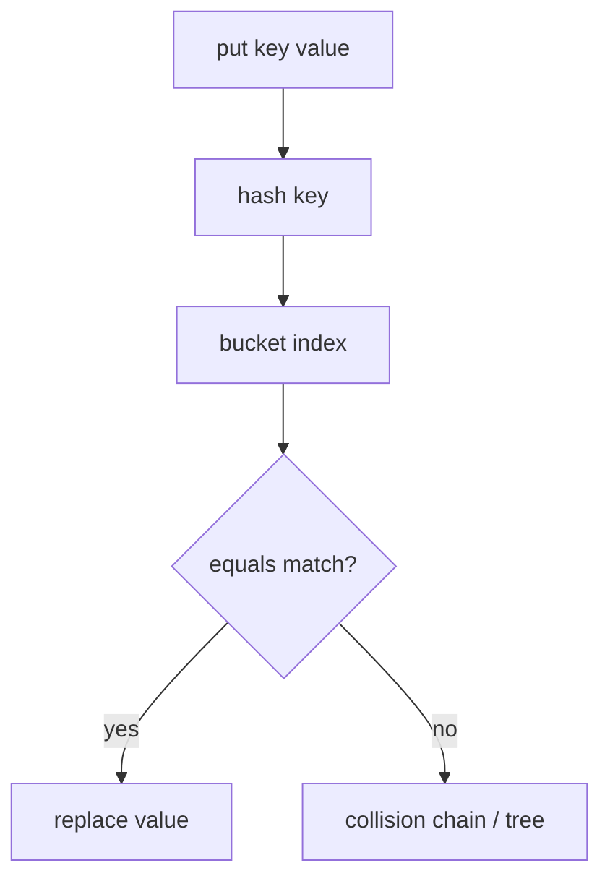

# Core Java Interviews

> **Status:** Completed  
> **Module:** 52 — Interview Preparation  
> **Target Java version:** 21  
> **Last reviewed:** 2026-11-11  
> **Chapter profile:** Technical  
> **Depth target:** Levels 2–3

**Section policy:** Code drills are **Illustrative** unless you run them (preferred on Oracle/Temurin 21). This chapter teaches **why** answers are correct with progressive depth—not a flashcard dump. Internal JVMS sections omitted; link Modules 12–14 for depth.

## 1. Learning Objectives *(mandatory)*

After completing this chapter, you should be able to:

- Answer **core Java** questions on types, OOP, collections, generics, and exceptions with precise language.
- Predict **output** and explain **equals/hashCode**, **String** behavior, and **autoboxing** pitfalls.
- Map question topics to **handbook modules** for targeted revision.
- Practice **structured answers**: definition → rule → example → trade-off → follow-up.
- Explain **why** a wrong popular answer fails (not only state the right one).

## 2. Prerequisites *(mandatory)*

- **Modules 02–18** — fundamentals through Optional/null.
- **Modules 12–13** — collections and generics (frequent focus).
- **Module 15** — records and sealed types (modern refreshers).

**Refresher — equals contract:** Reflexive, symmetric, transitive, consistent, and non-null. `hashCode` must agree: equal objects → equal hash codes.

## 3. Why This Concept Exists *(mandatory)*

Interview loops filter for **accurate mental models**, not trivia. Candidates stumble on `==` vs `equals`, mutable keys in `HashMap`, generics erasure, and exception hierarchy—not from lack of experience, but from uncollated detail. Structured answers show you can **teach** the idea under pressure.

## 4. Conceptual Explanation *(mandatory)*

### 4.1 Answer shape (use every time)

1. **Definition** — one precise sentence.
2. **Rule** — what the language/API guarantees.
3. **Example** — tiny code or scenario.
4. **Trade-off / pitfall** — when the naive answer fails.
5. **Stop** — invite follow-up; do not monologue.

### 4.2 High-yield topics

#### Types and memory

| Question theme | Key points | Handbook |
|----------------|------------|----------|
| `==` vs `equals` | References vs logical equality; contract | M02, M06 |
| `String` immutability | pool, concatenation, `StringBuilder` | M11 |
| Autoboxing / NPE | `Integer` cache -128..127; unboxing null | M02 |

**Why `==` on Strings is wrong for content:** `==` compares references. Two `new String("a")` instances are distinct objects even if contents match—unless you rely on interning (do not in interviews as your primary answer).

#### OOP

| Theme | Key points | Why interviewers care |
|-------|------------|------------------------|
| Inheritance vs composition | fragile base class | Design judgment |
| Interfaces vs abstract classes | multiple inheritance of type | API design |
| Overload vs override | compile-time vs virtual dispatch | Predict output questions |

**Why overload is compile-time:** The compiler chooses the signature from static types. Override uses runtime type of the receiver for virtual dispatch.

#### Collections

| Theme | Key points |
|-------|------------|
| `List` vs `Set` vs `Map` | ordering, uniqueness |
| `HashMap` | `hashCode`+`equals`; immutable keys |
| `ConcurrentHashMap` | not synchronized `HashMap` |

**Why mutable keys break maps:** `HashMap` places an entry in a bucket from `hashCode` at insert time. If the key mutates fields used in `hashCode`/`equals`, lookup uses a different bucket → **lost entry**.

#### Generics

- **Erasure** — no `List<String>` at runtime as a reified type.
- **PECS** — producer `extends`, consumer `super`.
- Cannot `new T()`.

**Why erasure exists (interview depth):** Binary compatibility and migration from pre-generics Java; cost is no reified type arguments and no `instanceof List<String>`.

#### Exceptions

- Checked vs unchecked philosophy (recoverable vs programming errors—debated, know the rule).
- try-with-resources and suppressed exceptions (M14).

#### Records and sealed types (Java 21 refresh)

| Question | Answer skeleton | Why |
|----------|-----------------|-----|
| Record vs class | Canonical constructor, accessors, value-based equality | Less boilerplate, clearer intent |
| `equals` on record | Field-wise; avoid mutable components | Keeps contract honest |
| Sealed hierarchy | `permits` limits subtypes | Exhaustive `switch` safety |

#### Streams (light touch)

- **Lazy** intermediates; one terminal consumes pipeline (M17).
- `parallelStream()` only when CPU-bound and splittable—wrong default for IO.

## 5. Mechanism and Execution Flow *(mandatory)*

### 5.1 `HashMap.put` (interview whiteboard)



**Why tree bins (Java 8+):** Long collision chains degrade to O(n); under thresholds, bins may treeify for better lookup—mention as “implementation detail of OpenJDK HashMap,” not as a must-cite unless asked.

### 5.2 Virtual dispatch vs overload (progressive)

```text
compile time: pick overload signature from static types
runtime:      invokevirtual / invokeinterface uses receiver type for overrides
```

**Drill:** Parent/Child with overloaded `m(Object)` / `m(String)` and overridden method—predict which runs; explain **why**.

## 6. Terminology *(mandatory)*

| Term | Meaning |
|------|---------|
| **Contract** | Rules callers may rely on (`equals`/`hashCode`, collection specs) |
| **Erasure** | Removal of generic type arguments at runtime |
| **Fail-fast iterator** | Detects concurrent structural modification (best-effort) |
| **Interning** | String pool reuse—do not hang correctness on it casually |

## 7. Sample Questions with Progressive Depth

### Q1: Why must equal objects have equal hash codes?

**Level 1:** So `HashMap` can find them.  
**Level 2:** Hash selects bucket; `equals` confirms match. Broken contract → lost keys.  
**Level 3:** Unequal objects may share hash codes (collisions OK); equal objects must share.

### Q2: What does `final` mean on a reference field?

**Level 1:** Cannot reassign the field.  
**Level 2:** Referent object may still mutate.  
**Level 3:** Safe publication nuances with finals (Module 25)—mention only if interviewer goes deep.

### Q3: `ArrayList` vs `LinkedList`?

**Level 1:** Array vs nodes.  
**Level 2:** Index access O(1) vs O(n); locality favors `ArrayList`.  
**Level 3:** Almost always `ArrayList` unless algorithmic need for deque mid-remove patterns—and even then `ArrayDeque` often wins.

### Q4: Why is `String` safe as `HashMap` key?

Immutability keeps `hashCode` stable while the key is in the map (M11).

### Follow-up prompts interviewers use

| After your answer | They may ask |
|-------------------|--------------|
| `equals` contract | What breaks if symmetry fails? |
| `HashMap` buckets | When does bin become tree? |
| Generics erasure | Can you `instanceof List<String>`? |
| `Optional` | Is it a field type? (usually avoid) |

## 7b. More Progressive Q&A

### Q5: Difference between `Comparable` and `Comparator`?

**L1:** One is natural order on the class; the other is external.  
**L2:** `Comparable.compareTo` lives on the element; `Comparator` is a separate object—useful for multiple sort orders.  
**L3:** TreeSet/TreeMap need consistent ordering with `equals` or you get surprising contains behavior—explain consistency recommendation.

### Q6: What does `trimToSize` / capacity mean on `ArrayList`?

**L1:** Capacity ≥ size; growth reallocates.  
**L2:** Amortized O(1) add via geometric growth.  
**L3:** Pre-size with expected capacity when you know N to reduce copies—micro-optimization, mention only if asked.

### Q7: `HashSet` internals?

Backed by `HashMap` with dummy values (**OpenJDK** detail—say “commonly implemented as”). Uniqueness via `equals`/`hashCode`.

### Q8: Checked exception in overriding?

Overriding method cannot throw new checked exceptions broader than the overridden method’s throws clause—**JLS** override rules. **Why:** Callers typed against the parent must remain valid.

### Q9: `record` + validation?

Compact canonical constructor can validate; throwing there prevents invalid state. Prefer this over setters (records expose accessors, not classic setters).

## 8. Code Reading Drills

Practice in `jshell` or small `main` on **JDK 21**:

### Drill A — String keys (**Illustrative**)

```java
Map<String, Integer> m = new HashMap<>();
String s = new String("a");
m.put(s, 1);
s = new String("a");
System.out.println(m.get(s));
```

`String` overrides `equals` → content-equal keys match → prints `1`.

**Why not `==`?** The second `new String("a")` is a different reference; `get` still succeeds via `equals`.

### Drill B — autoboxing trap (**Illustrative**)

```java
Integer a = 127;
Integer b = 127;
Integer c = 128;
Integer d = 128;
System.out.println(a == b);
System.out.println(c == d);
```

Cache applies -128..127 → first line `true`, second `false` (distinct objects). **Why:** `==` on Integer compares references, not numeric value—use `equals` or `intValue`.

### Drill C — concurrent modification (**Illustrative**)

```java
List<String> list = new ArrayList<>(List.of("a", "b"));
for (String s : list) {
    if ("a".equals(s)) list.remove(s);
}
```

Fails with `ConcurrentModificationException`—use `Iterator.remove` or `removeIf`.

**Why:** Enhanced-for uses a fail-fast iterator that detects structural modification.

### Drill D — overload surprise (**Illustrative**)

```java
void m(Object o) { System.out.println("object"); }
void m(String s) { System.out.println("string"); }
m(null); // picks String — most specific
```

**Why:** Overload resolution prefers more specific applicable method.

## 9. Common Candidate Mistakes

- “Generics are only syntax sugar” without erasure consequences (`instanceof`, `new T[]`).
- Claiming `volatile` makes `i++` atomic (Module 52 Ch.02).
- Confusing `ConcurrentModificationException` with multi-thread-only issues (single-threaded remove-during-for also fails).
- Saying `LinkedList` is “always faster for inserts” without locality/context.

## 10. Design Trade-offs (interview narration)

| Choice | Say this |
|--------|----------|
| Interface vs abstract class | Prefer interface for type; abstract class for shared state/partial impl |
| Checked exceptions | Force handling vs clutter APIs—know both sides |
| `Optional` return | Better than null for returns; avoid Optional fields/parameters usually |

## 11. Revision and Mastery

- Explain `equals` contract informally (reflexive, symmetric, transitive, consistent, non-null).
- Whiteboard `HashMap.put` flow and mutable-key failure.
- Predict Drill B and explain **why** without running it first.

## 12. Exercises

1. Five self-quiz questions from Modules 11–13 with hidden answers.
2. Two-minute spoken answer: interfaces vs abstract classes (use answer shape).
3. Write a wrong `equals` that breaks symmetry; explain map symptoms.
4. Explain PECS with `List<? extends Number>` vs `List<? super Integer>` copy example.

## 13. Mapping to handbook modules

| Topic | Module |
|-------|--------|
| Equality, objects | 06 |
| Strings | 11 |
| Collections | 12 |
| Generics | 13 |
| Exceptions | 14 |
| Records/sealed | 15 |
| Streams | 17 |

## 14. Spoken Answer Scripts (90 seconds)

### Interfaces vs abstract classes

"An interface defines a type and, since Java 8, can carry `default`/`static` methods—but historically it was pure capability. Abstract classes share state and protected helpers among a hierarchy. I prefer interfaces for API boundaries so implementers stay free to inherit elsewhere; I use abstract classes when subclasses truly share fields and template methods. Multiple interface implementation gives mixin-like types without the fragile base class problem of deep abstract trees."

### `equals` / `hashCode`

"Equal objects must have equal hash codes so hash-based collections can find them after hashing to a bucket. I override both together, use the same fields, and keep those fields immutable while the object is used as a key—otherwise the entry is lost in the wrong bucket."

### Generics erasure

"Type arguments are erased for runtime compatibility. I cannot do `instanceof List<String>` or `new T()`. At boundaries I pass `Class<T>` or use super-type tokens carefully. PECS guides wildcards: producers extend, consumers super."

## 15. Incorrect Popular Answers (and WHY)

| Popular wrong answer | Why it fails |
|----------------------|--------------|
| "`String` is a primitive" | It is a reference type; primitives are `int`, etc. |
| "`final` makes objects immutable" | Only the reference is fixed |
| "`ArrayList` is synchronized" | It is not; `Vector` legacy / `Collections.synchronizedList` |
| "`Optional` replaces all nulls" | Misuse as fields/parameters spreads clutter |
| "Checked exceptions are always better" | Debated; noise vs safety—know both sides |

## 16. Timed Practice Plan

| Day | Focus | Artifact |
|-----|-------|----------|
| 1 | Equality + String drills | Run Drill A/B; speak answers |
| 2 | Collections whiteboard | HashMap.put + mutable key |
| 3 | Generics PECS | Copy between wildcards |
| 4 | Exceptions + try-with-resources | Suppressed exceptions story |
| 5 | Records/sealed + mixed quiz | Java 21 refresh |

## 17. Collections Complexity Cheatsheet (interview)

| Structure | Get/index | Add end | Notes |
|-----------|-----------|---------|-------|
| `ArrayList` | O(1) | Amortized O(1) | Default list |
| `LinkedList` | O(n) | O(1) ends | Rarely best |
| `HashMap` | Avg O(1) | Avg O(1) | Hash/equals dependent |
| `TreeMap` | O(log n) | O(log n) | Sorted keys |

**Spoken caveat:** Big-O ignores constants and locality—`ArrayList` usually beats `LinkedList` in real JVMs.

### Immutability checklist

- Prefer `List.of` / unmodifiable copies at API boundaries.
- Defensive copy if you must accept mutable inputs.
- Records help for shallow immutability—mutable components still mutate.

## 18. Chapter Summary

Core Java interviews reward precise contracts: equality, collections, generics erasure, OOP dispatch, and exceptions. Use the **definition → rule → example → pitfall** shape; attach a small example; explain **why** wrong answers fail. Use handbook modules as a revision map.

## Next Steps

[02-jvm-and-concurrency-interviews.md](02-jvm-and-concurrency-interviews.md)

## Review Checklist

- [x] Technical L2–3; progressive WHY depth; HashMap mechanism
- [x] Illustrative drills labeled; fourth EXPAND-PRESERVE 2026-11-11
