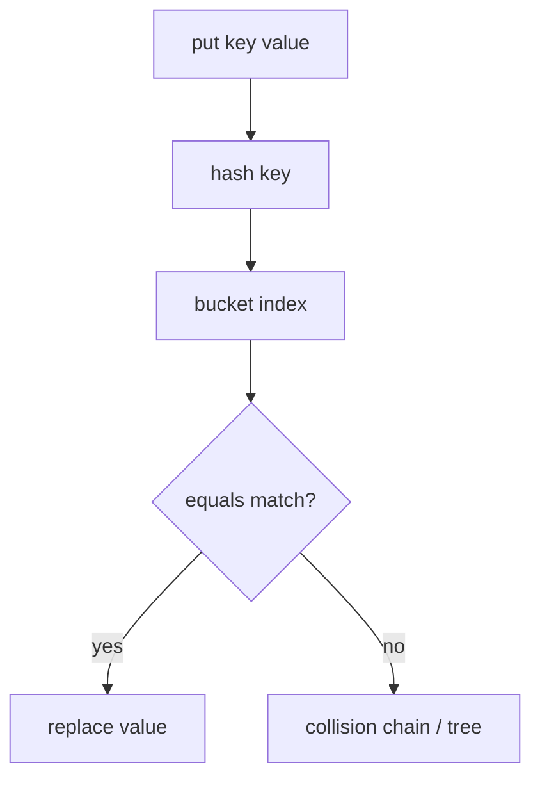

# Core Java Interviews

> **Status:** Completed  
> **Module:** 52 — Interview Preparation  
> **Target Java version:** 21  
> **Last reviewed:** 2026-11-11  
> **Chapter profile:** Technical  
> **Depth target:** Levels 2–3

## 1. Learning Objectives

- Answer **core Java** questions on types, OOP, collections, generics, and exceptions with precise language.
- Predict **output** and explain **equals/hashCode**, **String** behavior, and **autoboxing** pitfalls.
- Map question topics to **handbook modules** for targeted revision.
- Practice **structured answers**: definition → rule → example → trade-off.

## 2. Prerequisites

- **Modules 02–18** — fundamentals through Optional/null.
- **Modules 12–13** — collections and generics (frequent focus).

## 3. Why This Concept Exists

Interview loops filter for **accurate mental models**, not trivia. Candidates stumble on `==` vs `equals`, mutable keys in `HashMap`, generics erasure, and exception hierarchy—not from lack of experience, but from uncollated detail.

## 4. Conceptual Explanation

### High-yield topics

#### Types and memory

| Question theme | Key points | Handbook |
|----------------|------------|----------|
| `==` vs `equals` | References vs logical equality; contract | M02, M06 |
| `String` immutability | pool, concatenation, `StringBuilder` | M11 |
| Autoboxing / NPE | `Integer` cache -128..127; unboxing null | M02 |

#### OOP

| Theme | Key points |
|-------|------------|
| Inheritance vs composition | fragile base class | M07 |
| Interfaces vs abstract classes | multiple inheritance of type | M08 |
| Overload vs override | compile-time vs virtual dispatch | M04, M07 |

#### Collections

| Theme | Key points |
|-------|------------|
| `List` vs `Set` vs `Map` | ordering, uniqueness | M12 |
| `HashMap` | `hashCode`+`equals`; immutable keys | M12 |
| `ConcurrentHashMap` | not synchronized `HashMap` | M12, M24 |

#### Generics

- **Erasure** — no `List<String>` at runtime.
- **PECS** — producer `extends`, consumer `super`.
- Cannot `new T()`.

#### Exceptions

- Checked vs unchecked philosophy.
- try-with-resources and suppressed exceptions (M14).

#### Records and sealed types (Java 21 refresh)

| Question | Answer skeleton |
|----------|-----------------|
| Record vs class | Canonical constructor, accessors, `equals`/`hashCode` generated; no inheritance of state |
| `equals` on record | Field-wise equality; do not add mutable fields |
| Sealed hierarchy | `permits` list limits subclasses; interviewers test exhaustiveness in `switch` |

#### Streams (light touch)

- **Lazy** intermediates; one terminal consumes pipeline (M17).
- `parallelStream()` only when workload is CPU-bound and splittable—wrong default for IO.

## 5. Mechanism and Execution Flow

### `HashMap.put` (interview whiteboard)



If `hashCode` changes while key is in map → **lost entry** (why immutable keys matter).

## 6. Sample Questions with Answer Shape

**Q: Why must equal objects have equal hash codes?**  
**A:** `HashMap` uses hash for bucket; broken contract breaks lookup. Override both (M06).

**Q: What does `final` mean on a reference field?**  
**A:** Reference cannot be reassigned; object may still mutate unless immutable (M06).

**Q: Difference `ArrayList` vs `LinkedList`?**  
**A:** Array-backed O(1) index vs nodes; locality usually favors `ArrayList` (M12).

**Q: Can you add to an immutable list?**  
**A:** `List.of` / `Collections.unmodifiableList` throw; copy-on-write pattern or new list (M12).

**Q: Why is `String` safe as `HashMap` key?**  
**A:** Immutability keeps `hashCode` stable while referenced (M11).

### Follow-up prompts interviewers use

| After your answer | They may ask |
|-------------------|--------------|
| "`equals` contract" | What breaks if symmetry fails? |
| `HashMap` buckets | When does bin become tree? (Java 8+: threshold on chain length) |
| Generics erasure | Can you `instanceof List<String>`? |
| `Optional` | Is it a field type? (usually avoid; collections better) |

## 7. Code Reading Drills

Practice in `jshell` or small `main` on **Temurin 21**:

```java
Map<String, Integer> m = new HashMap<>();
String s = new String("a");
m.put(s, 1);
s = new String("a");
System.out.println(m.get(s));
```

`String` overrides `equals` → content-equal keys match → prints `1`.

### Drill B — autoboxing trap (Illustrative)

```java
Integer a = 127;
Integer b = 127;
Integer c = 128;
Integer d = 128;
System.out.println(a == b);
System.out.println(c == d);
```

Cache applies -128..127 → first line `true`, second `false` (distinct objects).

### Drill C — concurrent modification (Illustrative)

```java
List<String> list = new ArrayList<>(List.of("a", "b"));
for (String s : list) {
    if ("a".equals(s)) list.remove(s);
}
```

Fails with `ConcurrentModificationException`—use `Iterator.remove` or removeIf.

## 8. Common Candidate Mistakes

- “Generics are only syntax sugar” without erasure consequences.
- Claiming `volatile` makes `i++` atomic.
- Confusing `ConcurrentModificationException` (fail-fast iterator).

## 9. Revision and Mastery

- Explain `equals` contract informally (reflexive, symmetric, transitive, consistent, non-null).
- Whiteboard `HashMap.put` flow.

## 10. Exercises

1. Five self-quiz questions from Modules 11–13 with hidden answers.
2. Two-minute spoken answer: interfaces vs abstract classes.

## 11. Chapter Summary

Core Java interviews reward precise contracts: equality, collections, generics erasure, OOP dispatch, and exceptions. Use handbook modules as revision map; attach a small example.

## Next Steps

[02-jvm-and-concurrency-interviews.md](02-jvm-and-concurrency-interviews.md)

## Review Checklist

- [x] Technical L2–3; HashMap mechanism; topic map preserved; deepen pass 2026-11-11
