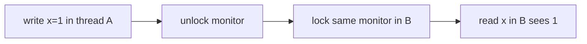
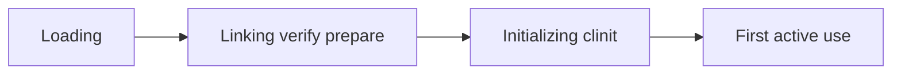

# JVM and Concurrency Interviews

> **Status:** Completed  
> **Module:** 52 — Interview Preparation  
> **Target Java version:** 21  
> **Last reviewed:** 2026-11-11  
> **Chapter profile:** Technical  
> **Depth target:** Levels 2–3

**Section policy:** Prefer JLS/JMM-backed claims; label HotSpot/collector specifics. Demo links are for practice—re-run on JDK 21; do not invent outputs. Progressive WHY depth over trivia lists.

## 1. Learning Objectives *(mandatory)*

After completing this chapter, you should be able to:

- Explain **JVM structure**, **class loading**, and **GC** at interview depth without folklore.
- Answer **JMM** questions: happens-before, `volatile`, `synchronized`.
- Compare **thread pools**, **virtual threads** (Java 21), and **concurrency utilities**.
- Diagnose **deadlock**, **livelock**, and **visibility** bugs verbally with a structured method.
- Narrate a **memory leak** investigation using dumps and histograms.

## 2. Prerequisites *(mandatory)*

- **Modules 24–28** — concurrency, JMM, GC, JIT.
- **Module 26** — JVM internals overview.
- **Module 52 Ch.01** — core Java answer shape.

**Refresher — happens-before:** A JLS partial order ensuring visibility/ordering between actions. Without an edge, there is **no** portable visibility guarantee—even if a machine “usually” sees the write.

## 3. Why This Concept Exists *(mandatory)*

Backend interviews probe **production failures**: memory leaks, GC pauses, races, pool exhaustion—not just syntax. Interviewers listen for whether you distinguish **JLS guarantees** from **HotSpot habits**.

## 4. Conceptual Explanation *(mandatory)*

### 4.1 JVM topics — answer skeletons with WHY

| Topic | Answer skeleton | Why it matters |
|-------|-----------------|----------------|
| Heap vs stack | Objects heap; frames hold locals/refs | Explains sharing vs thread-local |
| Class loading | load → link → initialize | Explains first-use costs, agents |
| GC | Generational idea; name collectors carefully | Avoid “all GC is stop-the-world” |
| OOM types | heap, metaspace, direct | Points debugging tool |

**Q: What triggers full GC?**  
Collector-specific; avoid universal folklore without naming collector. **Why:** G1/ZGC/Parallel differ—showing humility scores points.

### 4.2 JMM essentials

- **happens-before** establishes visibility ordering (**JLS**).
- **volatile** — visibility/order; **not** atomic `i++`.
- **synchronized** — mutual exclusion + release/acquire on monitor unlock/lock.

**Why `volatile` is not enough for `i++`:** Read-modify-write is three steps; two threads can interleave. Use `AtomicInteger` or synchronize the update.

### 4.3 Utilities

| Type | Use | Interview angle |
|------|-----|-----------------|
| `ExecutorService` | Bounded task submission | Rejection policies |
| `CountDownLatch` | One-shot wait | Cannot reset |
| `Semaphore` | Limit concurrency | Permits ≠ mutex always fair |
| `ConcurrentHashMap` | Concurrent map | Not “fully lock-free” slogan |

### 4.4 Java 21 virtual threads

Lightweight; cheap blocking on I/O. **Pinning** when carrier blocked on `synchronized` or native—know headline; verify current JDK notes for interview date.

**Why pools still matter with virtual threads:** You may still bound **concurrent blocking resources** (JDBC connections), not platform threads.

## 5. Mechanism and Execution Flow *(mandatory)*

### 5.1 happens-before example



Without such an edge, **no visibility guarantee**.

### 5.2 Virtual thread mount (conceptual)

1. Virtual thread starts on carrier platform thread.
2. Blocking I/O parks virtual thread; carrier may run other virtual threads.
3. Pinning prevents unmount during `synchronized` block on some JDK builds.

### 5.3 Class loading interview sequence



**Parent delegation:** custom classloader asks parent first so JDK classes load consistently. **Wrong:** “class loaders only load from network.”

### 5.4 GC talking points (collector-neutral)

| Question | Safe answer shape |
|----------|-------------------|
| Young vs old gen | Most objects die young; minor collections cheaper |
| Pause vs throughput | G1/ZGC tune for pause targets; measure don't guess |
| `System.gc()` | Hint only; production avoid explicit calls |

**Why measurement beats flags folklore:** Wrong collector story loses senior interviews.

### 5.5 `java.util.concurrent` depth

| API | Interview angle |
|-----|-----------------|
| `CompletableFuture` | Async chain; `orTimeout`; exceptional completion |
| `BlockingQueue` | Producer-consumer backpressure |
| `Phaser` | Rare; mention only if asked |

## 6. Terminology *(mandatory)*

| Term | Meaning |
|------|---------|
| **Visibility** | Whether a read is guaranteed to see a prior write |
| **Race** | Concurrent conflicting accesses without happens-before |
| **Pinning** | Virtual thread stuck on carrier due to blocking in constrained regions |
| **Saturation** | Thread pool queue full + max threads busy |

## 7. Scenario Questions (progressive WHY)

### Q: Two threads increment static `int`?

**L1:** Race.  
**L2:** Use `AtomicInteger` or synchronization.  
**L3:** Explain lost updates on read-modify-write; happens-before needs.

### Q: Detect deadlock?

Thread dumps (`jcmd`/`jstack`), JFR; prevention via lock ordering. **Why dumps:** Show waiting-for cycles concretely.

### Q: Is `ConcurrentHashMap` lock-free?

Fine-grained locking / CAS evolved by JDK version—say **concurrent**, not blanket “lock-free map.”

### Q: Virtual thread pin when using JDBC?

Blocking JDBC parks; size connection pools for concurrency, not “millions of platform threads.”

### Whiteboard: fixed thread pool saturation

Given `core=2`, `max=2`, `queue=10`, `CallerRunsPolicy`: when queue full, submit runs on **caller thread**—backpressure propagates (e.g., to servlet thread). **Why interviewers ask:** proves you know rejection policies, not only `newFixedThreadPool`.

## 7b. More Progressive Scenarios

### Q: `wait` / `notify` vs higher-level utilities?

**L1:** Prefer `BlockingQueue`, latches, etc.  
**L2:** `wait` must be in loop checking condition—spurious wakeup.  
**L3:** Easy to miss `synchronized` ownership → `IllegalMonitorStateException`. Show you know why libraries exist.

### Q: Fair vs unfair locks?

Fairness reduces barging starvation risk; unfair usually higher throughput. **Why default unfair:** performance under contention.

### Q: StackOverflowError vs OutOfMemoryError?

Stack overflow: deep recursion / huge frames. OOM: heap/metaspace/direct—different dumps and fixes. **Why distinguish:** tool choice and mitigation differ.

### Q: JIT and “warm-up”?

Hot methods get compiled (**HotSpot**). Benchmarks must warm up; production latency changes after load. Do not claim exact thresholds.

### Q: `ThreadLocal` leak?

Values stick to thread pool workers; use `remove()` in finally. **Why:** pooled threads outlive requests.

## 8. Links to demos

- [happens-before-demo](../../examples/jvm/happens-before-demo/)
- [executors-futures-demo](../../examples/core-java/executors-futures-demo/)
- [virtual-threads-demo](../../examples/core-java/virtual-threads-demo/)

Run on JDK 21 when practicing; record your own outputs.

### Practice protocol

1. Predict output **before** running.
2. Run on your JDK 21; compare.
3. Explain any surprise using JMM/API rules—not “timing.”

## 9. Common Mistakes

- “All GC stops the world” without low-pause collector nuance.
- `Thread.sleep` as synchronization design.
- Claiming `volatile` fixes all races.
- Ignoring rejection policies until production saturates.

## 10. Memory leak interview narrative

| Leak pattern | Signal | Tool |
|--------------|--------|------|
| Static map grows | Old gen climbs | Heap histogram `jcmd GC.class_histogram` |
| Thread leak | Thread count rises | Thread dump |
| Classloader leak | Metaspace OOM | Duplicate loaded classes |

**Answer shape:** "I'd capture heap dump during growth, compare dominator tree, tie to redeploy cycle or unbounded cache."

### Double-checked locking (classic)

```java
// Incorrect without volatile
if (instance == null) {
    synchronized (Lock.class) {
        if (instance == null) instance = new Singleton();
    }
}
```

Without `volatile` on `instance`, another thread may see a partially constructed object (**JMM**). Fix: `volatile` field or initialize-on-demand holder idiom (M24).

**Why partial construction?** Publishing the reference before constructor finishes writes fields—another thread can read defaults.

## 11. Design Trade-offs (say aloud)

| Choice | Trade-off line |
|--------|----------------|
| Synchronized vs concurrent collections | Simplicity vs scalability under contention |
| Platform vs virtual threads | Familiar tooling vs huge concurrency for blocking IO |
| Bounded vs unbounded queues | Backpressure vs memory blowups |

## 12. Revision and Mastery

- happens-before for broken double-checked locking without `volatile`.
- Three `ThreadPoolExecutor` rejection policies.
- Explain pinning in one minute with a JDBC example.
- Distinguish livelock vs deadlock with examples.

## 13. Exercises

1. Explain Module 25 thesis in 90 seconds.
2. Predict happens-before demo output before running.
3. Draw a saturated pool with `CallerRunsPolicy` and a servlet caller.
4. Outline leak debug steps for a growing static cache.

## 14. Spoken Scripts (90–120 seconds)

### happens-before

"The JMM defines happens-before edges. Unlock of a monitor happens-before a later lock of the same monitor, so writes before unlock are visible after lock. Volatile write happens-before subsequent volatile read of that variable. Without an edge, seeing a write is not guaranteed—even if it 'usually works' on my laptop."

### Thread pool saturation

"A fixed pool with a bounded queue and CallerRunsPolicy applies backpressure by running the task on the caller. That can stall HTTP threads—which is sometimes desired. AbortPolicy throws; DiscardPolicy drops silently—dangerous for money paths. I choose policy based on whether loss or latency is worse."

### Virtual threads

"Virtual threads make blocking cheap by unmounting carriers on many blocking calls. I still bound JDBC pools because the scarce resource is connections, not threads. I watch for pinning on synchronized blocks in hot libraries."

## 15. Folklore vs Precise Claims

| Folklore | Precise |
|----------|---------|
| "GC always stops the world for a long time" | Collectors differ; measure pauses |
| "ConcurrentHashMap never locks" | Concurrent design; not a slogan |
| "volatile makes i++ safe" | Visibility/order only |
| "Virtual threads replace all pools" | Still bound scarce resources |

## 16. Whiteboard Kit Checklist

Bring to practice sessions:

1. Monitor lock HB diagram.
2. Double-checked locking with/without `volatile`.
3. `ThreadPoolExecutor` parameters table.
4. Leak debug flow: symptom → tool → fix.
5. Class loading stages one-liner.

## 17. Rejection Policies Cheatsheet

| Policy | Behavior | When |
|--------|----------|------|
| `AbortPolicy` | Throws `RejectedExecutionException` | Default; fail loudly |
| `CallerRunsPolicy` | Runs on caller | Backpressure |
| `DiscardPolicy` | Drops silently | Rarely OK |
| `DiscardOldestPolicy` | Drop oldest queued | Latency-sensitive shedding |

**Spoken line:** "I never use Discard on payment traffic; I prefer Abort or CallerRuns with metrics."

### CompletableFuture traps

- Forgetting `exceptionally` / `handle` → failures vanish until join.
- Blocking `.get()` on virtual-thread-unfriendly paths in event loops.
- Using default `ForkJoinPool.commonPool()` for blocking IO—prefer custom executor.

## 18. Mapping to handbook modules

| Topic | Module |
|-------|--------|
| Threads, executors, VT | 24 |
| JMM | 25 |
| Class loading / bytecode | 26 |
| GC | 27 |
| JIT / perf | 28 |

## 19. Chapter Summary

JVM and concurrency interviews need JMM precision, collector vocabulary without folklore, pool/virtual-thread awareness, and leak-debugging narratives from Modules 24–28. Always separate **guarantees** from **HotSpot behavior**.

## Next Steps

[03-spring-and-system-design-interviews.md](03-spring-and-system-design-interviews.md)

## Review Checklist

- [x] Technical L2–3; happens-before mechanism; progressive WHY
- [x] Demo links only; no invented Verified output; fourth deepen 2026-11-11
