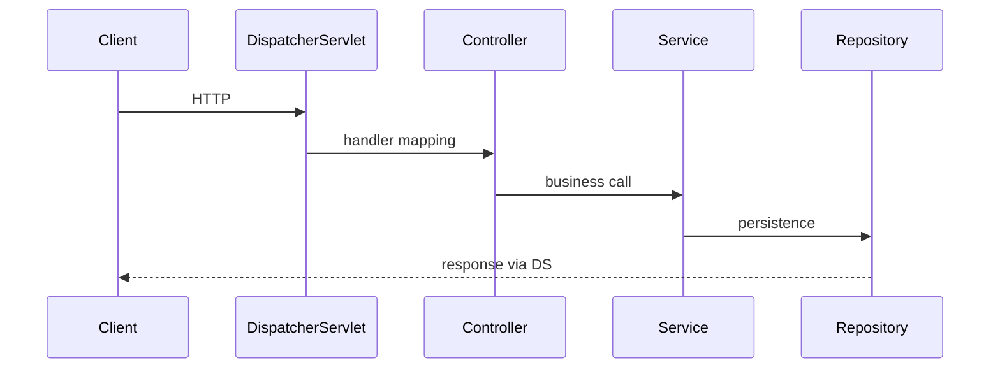

# Spring and System Design Interviews

> **Status:** Completed  
> **Module:** 52 — Interview Preparation  
> **Target Java version:** 21  
> **Last reviewed:** 2026-11-11  
> **Chapter profile:** Technical  
> **Depth target:** Levels 2–3

## 1. Learning Objectives

- Answer **Spring Framework / Boot** questions on DI, scopes, transactions, and MVC flow.
- Structure **system design** responses for Java backends (REST, JDBC, cache, queue).
- Relate **security**, **scalability**, and **data** choices to handbook modules.
- Use **trade-off narration** instead of buzzword lists.

## 2. Prerequisites

- **Modules 36–40** — Spring, REST, auth, architecture.
- **Module 52 Ch.01–02** — Java/JVM baseline.

## 3. Why This Concept Exists

Many Java roles blend **framework fluency** with **design** questions. Interviewers want clear APIs, data models, failure handling, and awareness of Spring’s **proxy-based** transaction/AOP limits.

## 4. Conceptual Explanation

### Spring interview topics

| Topic | Depth |
|-------|-------|
| DI | Constructor vs field; `@Component` scanning |
| Bean scope | singleton vs prototype trap (M36) |
| `@Transactional` | Proxy boundaries; rollback rules |
| MVC flow | DispatcherServlet → controller → service → repo |
| Spring Boot | auto-config; profiles; Actuator |
| Security filter chain | order; JWT vs session (M39) |

**Q: Why constructor injection?**  
Immutability, testability, explicit dependencies (M36).

**Q: Self-invocation breaks `@Transactional` — why?**  
Bypasses proxy; needs external bean call (M36).

## 5. Mechanism and Execution Flow

### Spring MVC request (simplified)



### `@Transactional` proxy boundary

External caller → **proxy** → target bean method runs inside transaction. **Internal** `this.method()` skips proxy (classic interview trap).

### Filter chain vs DispatcherServlet (security)

```mermaid
flowchart TD
  Req[HTTP] --> F1[SecurityFilterChain]
  F1 --> F2[Other filters]
  F2 --> DS[DispatcherServlet]
  DS --> C[@RestController]
```

**Order matters:** authentication before authorization; custom filters declare `@Order`. Misordered filters cause "anonymous user authenticated" bugs.

### Transaction propagation (headline)

| Propagation | Interview use |
|-------------|---------------|
| `REQUIRED` (default) | Join caller txn or create new |
| `REQUIRES_NEW` | Suspend caller; independent commit |
| `NESTED` | Savepoint semantics (JDBC dependent) |

Rollback: **unchecked** exceptions roll back by default; **checked** exceptions commit unless configured—common trick question.

## 6. System Design Framework

1. **Clarify** — scale, SLA, read/write ratio, consistency.
2. **API** — REST resources, idempotency keys (M38).
3. **Data** — schema, indexes, cache, partitioning (M33–34).
4. **Components** — JVM services, DB, cache, queue.
5. **Deep dives** — hot path, failures, observability (M47).

Example: **Rate-limited public API**

- Token bucket at gateway (M39).
- JDBC write + read replica.
- Stateless Boot pods (M49).
- Metrics on 429 and p99.

### Estimation prompts

Interviewers expect **order-of-magnitude** reasoning, not fake precision:

1. **RPS** × **payload KB** × **8** ≈ egress Mbps.
2. **DB writes/sec** ≤ connection pool × replicas × (1 / txn latency).
3. **Cache hit 90%** → DB load ÷ 10 on read path (still plan stampede, Module 46).

Document **assumptions** aloud; revise when interviewer gives new constraints.

### Failure modes to mention unprompted

| Component fails | User symptom | Mitigation |
|-----------------|-------------|------------|
| Redis cache | Higher latency | Circuit breaker to DB + alert |
| Broker lag | Stale notifications | DLQ + retry with backoff |
| DB primary | 5xx | Read replica for reads; failover runbook |

## 7. Trade-off Tables

| Choice | Pro | Con |
|--------|-----|-----|
| Monolith | Simpler deploy | Scale limits |
| Cache-aside Redis | Fast reads | Invalidation (M46) |
| Sync REST | Simple | Latency coupling |

## 8. Common Mistakes

- Happy path only—no DB/cache failure.
- “Microservices” without boundary justification (M40).
- Payment POST without idempotency.

## 9. Revision and Mastery

- Draw Spring request lifecycle for one `@GetMapping`.
- 15-minute outline: notification service with queue.

## 10. Behavioral Pairing with Technical

Structured answers still need **collaboration signals**: clarify requirements, state assumptions, check interviewer constraints mid-design, summarize trade-offs before deep-diving one component.

| Signal | Phrase example |
|--------|----------------|
| Clarify | "Is strong consistency required for inventory?" |
| Estimate | "Order of magnitude 2k RPS before we pick queue topology" |
| Trade-off | "Cache-aside is faster but needs invalidation on price change" |

## 11. Exercises

1. Mock interview: 25 min design + 5 min questions.
2. Map three Spring annotations to Java mechanism (reflection/proxy, M50).

### Mock system design: notification fan-out

**Prompt:** Email + SMS on order placed; 2k orders/min peak.

| Component | Choice | Trade-off |
|-----------|--------|-----------|
| API | Spring Boot REST | Sync acknowledge order, async notify |
| Queue | Broker topic (M45) | At-least-once; idempotent consumers |
| Workers | Separate JVM services | Scale notifications independently |
| Template store | DB + cache | Invalidation on template edit |

**Deep dives interviewer expects:** idempotency key on `POST /orders`, DLQ for failed SMS, observability trace from API → consumer.

### Spring Boot auto-config smoke questions

- What does `@ConditionalOnClass` do?
- Why might `DataSource` auto-config skip?
- How do profiles change beans without duplicate `@Configuration` classes?

## 12. Chapter Summary

Spring interviews test DI, proxies, transactions, and web flow; system design tests REST/data/scale using Modules 36–40 and 46–49 with explicit failure and idempotency stories.

## Review Checklist

- [x] Technical L2–3; MVC + transactional proxy mechanisms; deepen pass 2026-11-11
- [x] Spring topics; design framework preserved; security filter + estimation added
