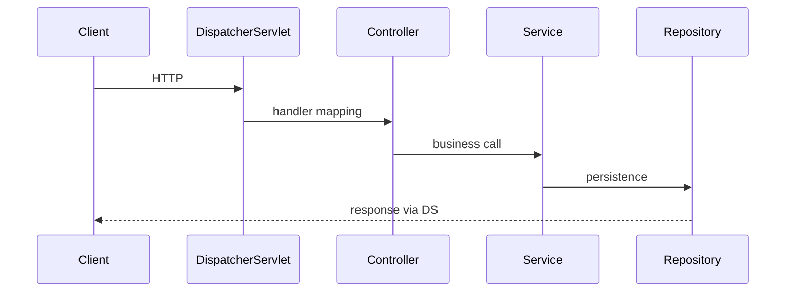

# Spring and System Design Interviews

> **Status:** Completed  
> **Module:** 52 — Interview Preparation  
> **Target Java version:** 21  
> **Last reviewed:** 2026-11-11  
> **Chapter profile:** Technical  
> **Depth target:** Levels 2–3

## 1. Learning Objectives

- Answer **Spring Framework / Boot** questions on DI, scopes, transactions, and MVC flow.
- Structure **system design** responses for Java backends (REST, JDBC, cache, queue).
- Relate **security**, **scalability**, and **data** choices to handbook modules.
- Use **trade-off narration** instead of buzzword lists.

## 2. Prerequisites

- **Modules 36–40** — Spring, REST, auth, architecture.
- **Module 52 Ch.01–02** — Java/JVM baseline.

## 3. Why This Concept Exists

Many Java roles blend **framework fluency** with **design** questions. Interviewers want clear APIs, data models, failure handling, and awareness of Spring’s **proxy-based** transaction/AOP limits.

## 4. Conceptual Explanation

### Spring interview topics

| Topic | Depth |
|-------|-------|
| DI | Constructor vs field; `@Component` scanning |
| Bean scope | singleton vs prototype trap (M36) |
| `@Transactional` | Proxy boundaries; rollback rules |
| MVC flow | DispatcherServlet → controller → service → repo |
| Spring Boot | auto-config; profiles; Actuator |
| Security filter chain | order; JWT vs session (M39) |

**Q: Why constructor injection?**  
Immutability, testability, explicit dependencies (M36).

**Q: Self-invocation breaks `@Transactional` — why?**  
Bypasses proxy; needs external bean call (M36).

## 5. Mechanism and Execution Flow

### Spring MVC request (simplified)

### `@Transactional` proxy boundary

External caller → **proxy** → target bean method runs inside transaction. **Internal** `this.method()` skips proxy (classic interview trap).

## 6. System Design Framework

1. **Clarify** — scale, SLA, read/write ratio, consistency.
2. **API** — REST resources, idempotency keys (M38).
3. **Data** — schema, indexes, cache, partitioning (M33–34).
4. **Components** — JVM services, DB, cache, queue.
5. **Deep dives** — hot path, failures, observability (M47).

Example: **Rate-limited public API**

- Token bucket at gateway (M39).
- JDBC write + read replica.
- Stateless Boot pods (M49).
- Metrics on 429 and p99.

## 7. Trade-off Tables

| Choice | Pro | Con |
|--------|-----|-----|
| Monolith | Simpler deploy | Scale limits |
| Cache-aside Redis | Fast reads | Invalidation (M46) |
| Sync REST | Simple | Latency coupling |

## 8. Common Mistakes

- Happy path only—no DB/cache failure.
- “Microservices” without boundary justification (M40).
- Payment POST without idempotency.

## 9. Revision and Mastery

- Draw Spring request lifecycle for one `@GetMapping`.
- 15-minute outline: notification service with queue.

## 10. Exercises

1. Mock interview: 25 min design + 5 min questions.
2. Map three Spring annotations to Java mechanism (reflection/proxy, M50).

## 11. Chapter Summary

Spring interviews test DI, proxies, transactions, and web flow; system design tests REST/data/scale using Modules 36–40 and 46–49.

## Review Checklist

- [x] Technical L2–3; MVC + transactional proxy mechanisms
- [x] Spring topics; design framework preserved
