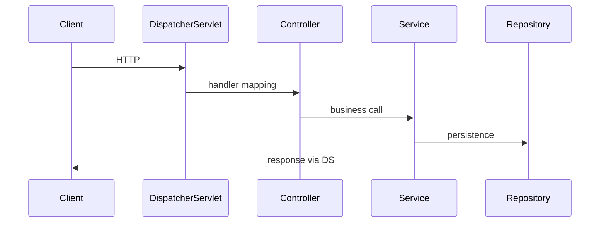
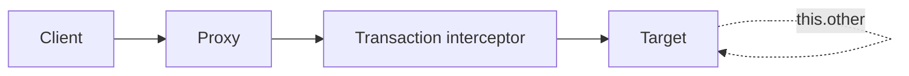
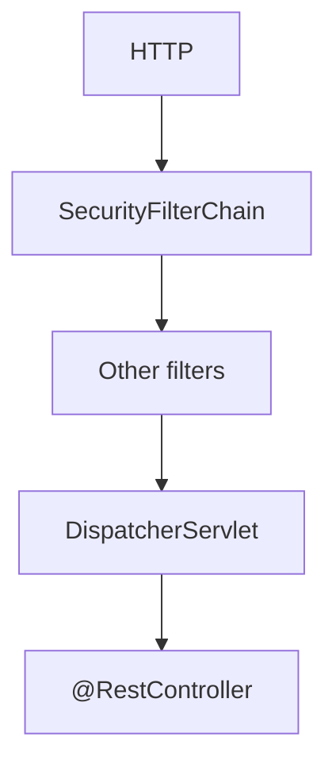

# Spring and System Design Interviews

> **Status:** Completed  
> **Module:** 52 — Interview Preparation  
> **Target Java version:** 21  
> **Last reviewed:** 2026-11-11  
> **Chapter profile:** Technical  
> **Depth target:** Levels 2–3

**Section policy:** Spring snippets and design tables are **Illustrative**. Teach **why** proxy/transaction answers work (Module 36, 50 mechanisms). System design emphasizes trade-offs and failure modes over buzzwords.

## 1. Learning Objectives *(mandatory)*

After completing this chapter, you should be able to:

- Answer **Spring Framework / Boot** questions on DI, scopes, transactions, and MVC flow with mechanism depth.
- Structure **system design** responses for Java backends (REST, JDBC, cache, queue).
- Relate **security**, **scalability**, and **data** choices to handbook modules.
- Use **trade-off narration** instead of buzzword lists.
- Connect annotations to **Java mechanisms** (interfaces, proxies, reflection).

## 2. Prerequisites *(mandatory)*

- **Modules 36–40** — Spring, REST, auth, architecture.
- **Module 50** — reflection/proxies under the annotations.
- **Module 52 Ch.01–02** — Java/JVM baseline answer discipline.
- **Modules 44–49** — distributed, messaging, cache, cloud (for design).

## 3. Why This Concept Exists *(mandatory)*

Many Java roles blend **framework fluency** with **design** questions. Interviewers want clear APIs, data models, failure handling, and awareness of Spring’s **proxy-based** transaction/AOP limits—not a list of annotations memorized without mechanism.

## 4. Conceptual Explanation *(mandatory)*

### 4.1 Spring interview topics

| Topic | Depth | Why it trips candidates |
|-------|-------|-------------------------|
| DI | Constructor vs field; scanning | Field injection hides deps |
| Bean scope | singleton vs prototype | Prototype in singleton inject once |
| `@Transactional` | Proxy boundaries; rollback rules | Self-invocation |
| MVC flow | DispatcherServlet → … | Filter vs interceptor confusion |
| Boot | auto-config; profiles; Actuator | “Magic” without conditions |
| Security | filter chain order; JWT vs session | Misordered filters |

**Q: Why constructor injection?**  
Immutability, testability, explicit required dependencies (M36). **Why not field:** harder testing, optional deps unclear, reflection/mutation.

**Q: Self-invocation breaks `@Transactional` — why?**  
Bypasses proxy; needs external bean call (M36). **Why mechanism:** client must call through proxy for advice (Module 50 Ch.01).

### 4.2 From annotation to Java mechanism (progressive)

| Annotation | Underlying idea |
|------------|-----------------|
| `@Component` | Classpath metadata + reflection/scan (or AOT index) |
| `@Autowired` | DI wiring by type/name |
| `@Transactional` | Proxy/interceptor around method |
| `@RestController` | MVC handler mapping stereotypes |

**Interview win:** “Annotations are metadata; Spring uses proxies/reflection—and that is why self-invocation fails.”

## 5. Mechanism and Execution Flow *(mandatory)*

### 5.1 Spring MVC request (simplified)



### 5.2 `@Transactional` proxy boundary

External caller → **proxy** → target bean method runs inside transaction. **Internal** `this.method()` skips proxy (classic trap).



**Why the dotted path fails:** no interceptor on self-call.

### 5.3 Filter chain vs DispatcherServlet (security)



**Order matters:** authentication before authorization. Misordered filters cause “anonymous user” bugs.

### 5.4 Transaction propagation (headline)

| Propagation | Interview use | Why it exists |
|-------------|---------------|---------------|
| `REQUIRED` | Join or create | Default composition |
| `REQUIRES_NEW` | Independent commit | Audit/log survives rollback |
| `NESTED` | Savepoint | Partial rollback (JDBC dependent) |

Rollback: **unchecked** exceptions roll back by default; **checked** exceptions commit unless configured—common trick. **Why:** historical Spring default matches “runtime = unexpected.”

## 6. System Design Framework *(mandatory)*

1. **Clarify** — scale, SLA, read/write ratio, consistency.
2. **API** — REST resources, idempotency keys (M38).
3. **Data** — schema, indexes, cache, partitioning (M33–34).
4. **Components** — JVM services, DB, cache, queue.
5. **Deep dives** — hot path, failures, observability (M47).

### Example: Rate-limited public API

- Token bucket at gateway (M39).
- JDBC write + read replica.
- Stateless Boot pods (M49).
- Metrics on 429 and p99.

### Estimation prompts

1. **RPS** × **payload KB** × **8** ≈ egress Mbps.
2. **DB writes/sec** ≤ connection pool × replicas × (1 / txn latency).
3. **Cache hit 90%** → DB load ÷ 10 on read path (still plan stampede, Module 46).

Document **assumptions** aloud; revise when constraints change.

### Failure modes to mention unprompted

| Component fails | User symptom | Mitigation |
|-----------------|-------------|------------|
| Redis cache | Higher latency | Circuit breaker to DB + alert |
| Broker lag | Stale notifications | DLQ + retry with backoff |
| DB primary | 5xx | Failover runbook; read replica for reads |

**Why unprompted failures matter:** Senior signal—designs that only work on the happy path fail interviews.

## 7. Terminology *(mandatory)*

| Term | Meaning |
|------|---------|
| **Auto-configuration** | Conditional bean registration based on classpath/properties |
| **Idempotency key** | Client token making retries safe for writes |
| **Backpressure** | Slowing producers when consumers/resources saturate |
| **Blast radius** | How much fails when one component fails |

## 7b. Progressive Spring Q&A

### Q: Singleton bean with prototype dependency?

**L1:** Prototype injected once into singleton—looks like singleton.  
**L2:** Use `ObjectFactory`/`Provider` or lookup method for fresh instances.  
**L3:** Why: singleton created once; constructor injection captures one prototype.

### Q: `@Transactional` on private method?

Typically ignored for proxy-based Spring AOP—proxy cannot override private. **Why:** self-invocation + visibility.

### Q: Controller advice vs filter for errors?

Filters wrap servlet stack earlier; `@ControllerAdvice` handles MVC exceptions. Pick based on where failure occurs.

### Q: Actuator in prod?

Expose health carefully; lock down `env`/`beans` (Module 49). **Why:** config leakage.

### Q: How does Boot know to configure Redis?

Starter on classpath + properties + `@Conditional*` auto-config. Override by defining your own bean.

## 8. Trade-off Tables

| Choice | Pro | Con |
|--------|-----|-----|
| Monolith | Simpler deploy | Scale limits |
| Cache-aside Redis | Fast reads | Invalidation (M46) |
| Sync REST | Simple | Latency coupling |
| Queue + workers | Decouple peaks | Delivery semantics (M45) |

### Consistency spectrum (say in designs)

| Need | Approach |
|------|----------|
| Strong for ledger | Single DB txn / consensus |
| Eventual for feed | Cache + async rebuild |
| Read-your-writes | Sticky session temporary or version tokens |

## 9. Common Mistakes

- Happy path only—no DB/cache failure.
- “Microservices” without boundary justification (M40).
- Payment POST without idempotency.
- Explaining `@Transactional` as “Spring magic” without proxies.
- Ignoring connection pool math under replica scale (M49).

## 10. Behavioral Pairing with Technical

| Signal | Phrase example |
|--------|----------------|
| Clarify | "Is strong consistency required for inventory?" |
| Estimate | "Order of magnitude 2k RPS before we pick queue topology" |
| Trade-off | "Cache-aside is faster but needs invalidation on price change" |
| Mechanism | "Transactions apply via proxy—self-call won't start one" |

## 11. Mock system design: notification fan-out

**Prompt:** Email + SMS on order placed; 2k orders/min peak.

| Component | Choice | Trade-off |
|-----------|--------|-----------|
| API | Spring Boot REST | Sync ack order, async notify |
| Queue | Broker topic (M45) | At-least-once; idempotent consumers |
| Workers | Separate JVM services | Scale notifications independently |
| Template store | DB + cache | Invalidation on template edit |

**Deep dives interviewer expects:** idempotency key on `POST /orders`, DLQ for failed SMS, trace from API → consumer (M47).

### Progressive depth on “at-least-once”

**L1:** Messages may duplicate.  
**L2:** Consumers must be idempotent (dedupe table / natural key).  
**L3:** Outbox pattern links DB commit to publish (Module 45).

## 12. Spring Boot auto-config smoke questions

| Question | Direction of answer |
|----------|---------------------|
| What does `@ConditionalOnClass` do? | Register beans only if class present |
| Why might `DataSource` auto-config skip? | No driver / excluded / user-defined DataSource |
| How do profiles change beans? | `@Profile` / property-specific config |

**Why conditionals exist:** Boot can be opinionated without forcing every starter’s beans when unused.

## 13. Design Trade-offs *(conditional)*

| Approach | When to prefer |
|----------|----------------|
| Modular monolith | Early product, one team, shared txn needs |
| Microservices | Independent scale/release, clear boundaries, ops maturity |
| Sync + cache | Read-heavy, invalidation manageable |
| Event-driven | Fan-out, peak smoothing |

## 14. Revision and Mastery

- Draw Spring request lifecycle for one `@GetMapping`.
- 15-minute outline: notification service with queue.
- Explain transactional self-invocation with a proxy diagram.
- Estimate DB connections for 20 pods × pool 15.

## 15. Exercises

1. Mock interview: 25 min design + 5 min questions.
2. Map three Spring annotations to Java mechanism (reflection/proxy, M50).
3. Redesign the notification prompt for exactly-once *effect* (not delivery).
4. List five clarifying questions before drawing boxes.

## 16. Spoken Scripts

### Transactional proxy

"Spring applies transactions by wrapping the bean in a proxy. The interceptor begins a transaction before the method and commits or rolls back after. If the bean calls `this.otherTransactionalMethod()`, that call does not go through the proxy, so no new advice runs. Fix by injecting self, restructuring, or AspectJ weaving—knowing the proxy model is the point."

### System design opening (first 2 minutes)

"I'll clarify scale, consistency, and latency targets, then propose an API with idempotent writes, a primary store, optional cache, and failure modes for each dependency. I'll estimate order-of-magnitude load before picking Kafka vs sync fan-out."

### Idempotency

"For payment-like POSTs I require an Idempotency-Key. Retries from mobile networks must not double-charge. The server stores key → result and returns the same response on replay."

## 17. End-to-End Mini Design: URL shortener (practice)

| Concern | Sketch |
|---------|--------|
| API | `POST /links` → code; `GET /{code}` → redirect |
| Data | key-value store or SQL with unique code |
| Scale | cache hot redirects; shard by code hash if huge |
| Failure | cache miss → DB; DB down → 503 with Retry-After |
| Idempotency | optional client token on create |

**Follow-ups:** analytics async via queue; custom domains; abuse rate limits (M39).

## 18. Annotation → Mechanism Flash Drill

| Prompt | Answer |
|--------|--------|
| `@Transactional` | Proxy/interceptor |
| `@ComponentScan` | Reflection/index metadata |
| `@ConditionalOnClass` | Classpath condition |
| `@Async` | Usually proxy + executor |

## 19. Capacity Math Flash Card

```text
pods = ceil(peak_rps / rps_per_pod)
db_conn >= pods * hikari_max + admin
cache_qps ≈ peak_rps * read_ratio * (1 - hit_ratio_miss_path)
```

Say assumptions aloud; offer to recalculate when interviewer changes RPS.

### Security design lines (Module 39)

- AuthN vs AuthZ in one sentence each.
- JWT vs session: stateless scale vs revocation ease.
- Never store passwords reversible; mention hashing at high level.

### Observability design lines (Module 47)

- Golden signals on the critical path.
- Trace id across API → queue → worker.
- Alert on SLO burn, not every exception.

## 20. Chapter Summary

Spring interviews test DI, proxies, transactions, and web flow; system design tests REST/data/scale using Modules 36–40 and 44–49 with explicit failure and idempotency stories. Lead with **mechanisms and trade-offs**, not annotation name-drops.

## References

- Modules 36–40, 44–50; Module 52 Ch.01–02 for answer discipline.

## Review Checklist

- [x] Technical L2–3; MVC + transactional proxy mechanisms; WHY depth
- [x] Illustrative Spring/design content; fourth EXPAND-PRESERVE 2026-11-11
