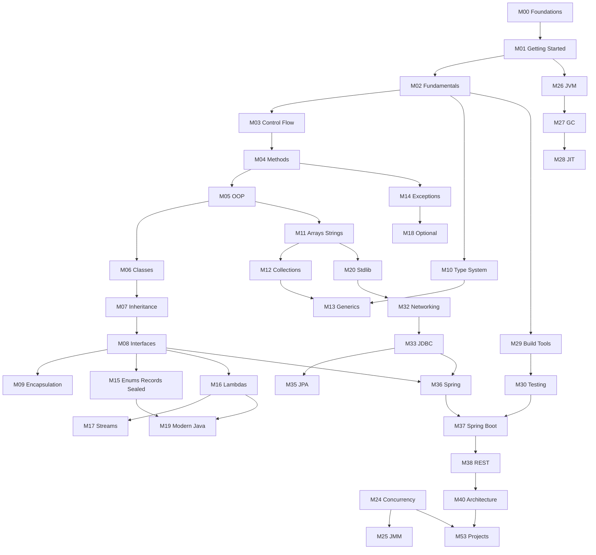

# Learning Roadmap

**Primary Java version:** 21 LTS  
**Audiences:** Track A (complete beginner) and Track B (revision and mastery)

Planned ≠ written. See [PROGRESS.md](PROGRESS.md) for real completion status.

## How to use this roadmap

| Track | Start | Rule |
|-------|-------|------|
| **A — Beginner** | Module 00 | Do not skip prerequisites. Read linearly unless a section is marked optional. |
| **B — Experienced** | [Diagnostic](assessments/diagnostic/README.md) | Jump to gap chapters; use **Revision and Mastery** sections; skim Track A-only foundations carefully if rusty. |

## Dependency overview

## Progressive explanation (curriculum-wide)

Important ideas appear more than once. Future chapters must follow **explain it now, expand it later**:

| Concept | First introduction (minimum viable) | Dedicated deepening |
|---------|-------------------------------------|---------------------|
| JVM / bytecode / GC | M00–M01 (purpose, responsibilities, GC why) | M26–M28 |
| Class / `main` / `static` | M00–M01 (enough to run programs) | M04–M06 |
| Types / references | M00–M02 | M10–M11 |
| Methods / stack frames | M00–M02 preview; M04 full | M25 |
| Objects / `equals` | M02–M05 previews | M06 |
| Interfaces / contracts | When first needed for polymorphism | M08; Spring DI later |
| Generics | When collections demand type parameters | M13 (erasure, PECS) |
| Threads / concurrency | Plain-language thread idea before shared mutable state | M24–M25 |
| Dependency injection | Idea of supplying dependencies before Spring annotations | M36–M37 |
| JDBC / ORM | SQL + JDBC before Hibernate mapping magic | M33–M35 |

Authors: give a usable explanation at first appearance; later modules must **add depth**, not only repeat slogans. See `DOCUMENTATION-STANDARDS.md`.

## Prerequisite highlights

| Topic | Requires | Why | Later dependents | Beginners | Experienced |
|-------|----------|-----|------------------|-----------|-------------|
| Objects / classes | Variables, methods, basic data | OOP builds on state and behavior | Inheritance, collections, Spring | Required | Quick revise if rusty |
| Collections | Arrays, objects, equals/hashCode intro | APIs store objects; hashing needs equality | Streams, concurrency, Spring Data | Required | Deep-dive internals recommended |
| Generics | Types, classes, collections intro | Type parameters assume the type system | Collections APIs, streams | Required | Focus on erasure / PECS gaps |
| Concurrency | Threads concept, memory basics | Otherwise locks and visibility are folklore | JMM, virtual threads, backends | Required before production concurrency | Often largest gap |
| JVM internals | Compilation, bytecode idea, runtime | Classloading/GC need execution model | GC, JIT, diagnostics | After core Java | High value revision |
| Spring DI | Interfaces, composition, annotations | DI is object graph wiring | Boot, REST, security | After core + testing intro | Revise mechanisms, not only annotations |
| Hibernate / JPA | SQL, JDBC, object relationships | ORM maps tables to objects | Spring Data | After JDBC | Focus on fetching / N+1 |
| Spring Boot | Core Java, HTTP, SQL/JDBC, build tools, testing | Boot accelerates; it does not replace foundations | REST, security, projects | Only after prerequisites | Use as productivity layer |

## Track A — Beginner path (summary)

1. **M00–M01** — What programming and Java are; tooling  
2. **M02–M04** — Syntax, control flow, methods  
3. **M05–M09** — OOP and design  
4. **M10–M18** — Types, collections, generics, exceptions, functional style  
5. **M19–M23** — Modern Java, stdlib, I/O, date/time, regex, networking intro  
6. **M29–M31** — Build tools, testing, debugging  
7. **M24–M28** — Concurrency, JMM, JVM, GC, performance (serious track)  
8. **M32–M39** — HTTP, SQL, JDBC, JPA, Spring, Boot, REST, auth  
9. **M40–M51** — Architecture, patterns, security, distributed systems, advanced/enterprise  
10. **M52–M53** — Interviews and projects  

## Track B — Revision and mastery path (summary)

1. Complete [diagnostic assessments](assessments/diagnostic/README.md).  
2. For each weak area, open the mapped module and read **Revision and Mastery** first.  
3. Prioritize high-leverage gaps: equality/hashing, generics/erasure, collections internals, JMM/concurrency, JVM/GC, Spring mechanisms.  
4. Use projects and interview modules to stress-test understanding.

## Module index

Each module folder contains a `README.md` with planned chapters. Chapters are created only when content is ready.

| Module | Title | Beginners | Experienced may |
|--------|-------|-----------|-----------------|
| [00](00-programming-foundations/) | Programming Foundations | Required | Skim if solid |
| [01](01-java-getting-started/) | Introduction to Java | Required | Skim tooling |
| [02](02-java-fundamentals/) | Java Fundamentals | Required | Quick revise |
| [03](03-control-flow/) | Control Flow | Required | Skim |
| [04](04-methods-and-functions/) | Methods | Required | Revise pass-by-value |
| [05](05-object-oriented-programming/) | OOP | Required | Revise |
| [06](06-classes-and-objects/) | Classes and Objects | Required | Deep-dive equals/hashCode |
| [07](07-inheritance-and-polymorphism/) | Inheritance | Required | Revise LSP/sealed |
| [08](08-interfaces-and-abstraction/) | Interfaces | Required | Required before Spring |
| [09](09-encapsulation-and-design/) | Encapsulation and Design | Required | Revise |
| [10](10-java-type-system/) | Type System | Required | Deep-dive |
| [11](11-arrays-and-strings/) | Arrays and Strings | Required | Revise pool/encoding |
| [12](12-collections-framework/) | Collections | Required | Internals required |
| [13](13-generics/) | Generics | Required | Erasure/PECS focus |
| [14](14-exceptions-and-error-handling/) | Exceptions | Required | Design focus |
| [15](15-enums-records-and-sealed-types/) | Enums, Records, Sealed | Required | Revise |
| [16](16-lambdas-and-functional-programming/) | Lambdas / FP | Required | Revise |
| [17](17-stream-api/) | Streams | Required | Pitfalls focus |
| [18](18-optional-and-null-handling/) | Optional | Required | Misuse focus |
| [19](19-modern-java-features/) | Modern Java | Recommended | Required for currency |
| [20](20-java-standard-library/) | Standard Library | Required survey | Reference use |
| [21](21-file-io-and-serialization/) | File I/O | Required | Security focus |
| [22](22-date-time-and-internationalization/) | Date/Time / i18n | Required | Skim if fluent |
| [23](23-regular-expressions/) | Regex | Recommended | As needed |
| [24](24-concurrency-and-multithreading/) | Concurrency | After core | Major track |
| [25](25-java-memory-model/) | JMM | With concurrency | Major track |
| [26](26-jvm-internals/) | JVM Internals | After core | Major track |
| [27](27-garbage-collection/) | GC | After JVM intro | Major track |
| [28](28-jit-and-performance/) | JIT / Performance | After JVM | Major track |
| [29](29-build-tools-and-dependency-management/) | Build Tools | Before large projects | Revise modules |
| [30](30-testing-and-quality/) | Testing | Before Spring Boot apps | Required |
| [31](31-debugging-and-troubleshooting/) | Debugging | Ongoing | Production focus |
| [32](32-networking-and-http/) | Networking / HTTP | Before REST | Revise |
| [33](33-databases-and-jdbc/) | Databases / JDBC | Before JPA/Spring Data | Revise |
| [34](34-sql-and-data-access/) | SQL / Data Access | With JDBC | Revise |
| [35](35-hibernate-and-jpa/) | Hibernate / JPA | After JDBC | N+1 focus |
| [36](36-spring-framework/) | Spring Framework | After interfaces + JDBC | Mechanisms |
| [37](37-spring-boot/) | Spring Boot | After Spring + testing | Practical track |
| [38](38-rest-api-development/) | REST | After Boot/HTTP | Revise |
| [39](39-authentication-and-authorization/) | AuthN/AuthZ | After REST | Security focus |
| [40](40-backend-architecture/) | Backend Architecture | After REST apps | Trade-offs |
| [41](41-design-patterns/) | Design Patterns | After OOP | As needed |
| [42](42-clean-code-and-solid/) | Clean Code / SOLID | With patterns | Revise |
| [43](43-security/) | Security | Before production | Required |
| [44](44-microservices-and-distributed-systems/) | Microservices / Distributed | After architecture | When relevant |
| [45](45-messaging-and-event-driven-systems/) | Messaging | After distributed intro | When relevant |
| [46](46-caching-and-performance/) | Caching / Perf Eng | After DB + HTTP | When relevant |
| [47](47-observability-and-monitoring/) | Observability | With production | Required for ops |
| [48](48-devops-and-deployment/) | DevOps / Deploy | Before cloud projects | Required |
| [49](49-cloud-and-containerization/) | Cloud / Containers | After DevOps | When relevant |
| [50](50-advanced-java/) | Advanced Java | After JVM + core | Expert track |
| [51](51-enterprise-java/) | Enterprise Engineering | After backend | Expert track |
| [52](52-interview-preparation/) | Interviews | Ongoing | Ongoing |
| [53](53-projects/) | Projects | Parallel to level | Parallel to level |

## Appendix

See [appendix/README.md](appendix/README.md). Comparisons (Java vs Go/C#/Python) supplement Java learning; they are not prerequisites.
