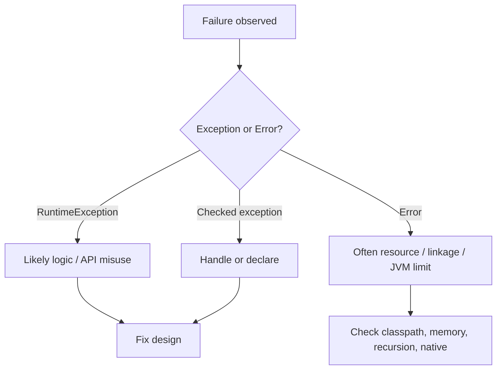

# Common Errors and Exceptions

> **Status:** Completed  
> **Profile:** Technical reference (Levels 2–3)  
> **Purpose:** Fast diagnosis of frequent beginner and intermediate failures—with enough explanation to fix the root cause, not only the symptom.  
> **Last updated:** 2026-11-11  
> **Target:** Java 21

Each entry gives **what you see**, **why it happens**, a **fix direction**, and a **chapter link** for depth. Snippets are **Illustrative**.

## How to use this guide

1. Match the exception or symptom name.
2. Read the cause—do not only copy a stack-trace “fix” from a search engine.
3. Apply the smallest correct fix, then follow the chapter if the concept is still fuzzy.
4. Distinguish **bugs in your code** from **environment/classpath** problems.



---

## 1. `NullPointerException` (NPE)

**What:** You dereferenced a `null` reference—called a method, accessed a field, or unboxed a null wrapper.

**Why (common):**

- Forgot to initialize a field or collection
- Method returned `null` and the caller assumed a value
- Map `get` missed a key
- Autoboxing/unboxing of a null wrapper (see §10)

**Fix direction:**

- Find the exact line in the stack trace (first frame in *your* package).
- Decide whether `null` is illegal (`Objects.requireNonNull`) or optional (`Optional` / explicit branch).
- Prefer returning empty collections over `null` lists.

```java
String name = user.name();           // NPE if user is null
Objects.requireNonNull(user, "user");
String safe = Objects.requireNonNullElse(user.nickname(), "");
```

**Depth:** [06-classes-and-objects](../06-classes-and-objects/README.md) (object lifecycle), [18-optional-and-null-handling](../18-optional-and-null-handling/README.md)

---

## 2. `ClassCastException`

**What:** You cast a reference to an incompatible runtime type.

**Why:** The compile-time type allowed the cast, but the object’s actual class does not match. Generics erasure can hide this until runtime.

**Fix direction:**

- Prefer `instanceof` patterns (Java 16+) before using the value as that type.
- Fix the collection/API type parameters instead of casting.
- For sealed hierarchies, use exhaustive `switch` instead of blind casts.

```java
if (shape instanceof Circle c) {
    use(c.radius());
}
```

**Depth:** [10-java-type-system](../10-java-type-system/README.md), [13-generics](../13-generics/README.md), [15-enums-records-and-sealed-types](../15-enums-records-and-sealed-types/README.md)

---

## 3. `ConcurrentModificationException`

**What:** A fail-fast iterator detected structural modification of a collection while iterating (typical for `ArrayList`, `HashMap`, …).

**Why:**

- Calling `list.add` / `remove` inside an enhanced-for loop
- One thread mutates while another iterates (even if you did not intend concurrency)

**Fix direction:**

- Use `Iterator.remove()` for single-threaded removals during iteration.
- Or collect IDs to remove, then remove after the loop.
- For concurrent access, use concurrent collections / proper synchronization—not unsynchronized `ArrayList`.

```java
Iterator<String> it = list.iterator();
while (it.hasNext()) {
    if (it.next().isBlank()) {
        it.remove();
    }
}
```

**Depth:** [12-collections-framework](../12-collections-framework/README.md), [24-concurrency-and-multithreading/04-concurrent-collections.md](../24-concurrency-and-multithreading/04-concurrent-collections.md)

---

## 4. `ClassNotFoundException` vs `NoClassDefFoundError`

These look similar but signal different stages of failure.

| | `ClassNotFoundException` | `NoClassDefFoundError` |
|--|--------------------------|-------------------------|
| Type | Checked exception | Error |
| Typical trigger | Explicit load (`Class.forName`, certain loaders) fails to find the class | JVM already saw the name (often at compile time) but cannot link/initialize it now |
| Mental model | “Loader API: I looked and failed” | “Runtime needed this class and the definition is missing or failed earlier” |

**Why:**

- JAR missing from classpath/module path
- Wrong dependency version / shaded package relocated
- Static initializer failed earlier → later use surfaces as `NoClassDefFoundError` / `ExceptionInInitializerError`

**Fix direction:**

- Print the classpath/module path actually used to launch.
- Confirm the class exists in the expected JAR (`jar tf`).
- If initialization failed, fix the root exception in the “Caused by” chain.

**Depth:** [01-java-getting-started](../01-java-getting-started/README.md), [26-jvm-internals/02-class-loading-and-linking.md](../26-jvm-internals/02-class-loading-and-linking.md), [29-build-tools-and-dependency-management](../29-build-tools-and-dependency-management/README.md)

---

## 5. `OutOfMemoryError`

**What:** The JVM could not allocate requested memory (heap, or sometimes Metaspace / native—read the message).

**Why (common):**

- Heap too small for the working set (`-Xmx`)
- Memory leak (unbounded caches, forgotten listeners, growing static collections)
- Loading huge files entirely into memory
- Metaspace exhaustion from runaway class generation

**Fix direction:**

1. Read the subtype in the message (`Java heap space`, `Metaspace`, …).
2. Capture a heap dump (`-XX:+HeapDumpOnOutOfMemoryError`) when reproducing.
3. Fix leaks before blindly raising `-Xmx`.
4. Stream large data instead of buffering everything.

**Depth:** [27-garbage-collection](../27-garbage-collection/README.md), [jvm-reference.md](jvm-reference.md), [31-debugging-and-troubleshooting](../31-debugging-and-troubleshooting/README.md)

---

## 6. `StackOverflowError`

**What:** A thread’s JVM stack ran out of space—almost always unbounded recursion or extreme call depth.

**Why:**

- Missing base case in recursion
- Accidental self-calls (`equals` ↔ `equals`, circular delegation)
- Very deep object graphs processed recursively

**Fix direction:**

- Fix the algorithm (base case, iterate instead of recurse).
- Increasing `-Xss` only masks bugs for most application code.
- For intentional deep recursion, prefer explicit stacks/queues.

**Depth:** [04-methods-and-functions](../04-methods-and-functions/README.md), [25-java-memory-model/01-stack-heap-and-references.md](../25-java-memory-model/01-stack-heap-and-references.md), [jvm-reference.md](jvm-reference.md)

---

## 7. Broken `equals` / `hashCode` contracts

**What:** Objects “disappear” in `HashSet`/`HashMap`, duplicates appear, or lookups fail after mutation.

**Why:**

- Overrode `equals` but not `hashCode` (or inconsistent pair)
- Equality depends on mutable fields that change while the object is in a hash-based collection
- Asymmetric/transitive violations

**Rules (JLS / `Object` contract):**

- Equal objects ⇒ same `hashCode`
- `equals` reflexive, symmetric, transitive, consistent; `x.equals(null)` is `false`

**Fix direction:**

- Prefer records for plain data (generated correct pair).
- Include the same fields in both methods.
- Do not mutate fields that participate in equality while the instance is a map key.

**Depth:** [06-classes-and-objects](../06-classes-and-objects/README.md) (equality chapters), [15-enums-records-and-sealed-types/02-records.md](../15-enums-records-and-sealed-types/02-records.md)

---

## 8. Checked exceptions mishandled

**What:** Code does not compile (`unreported exception must be caught or declared`), or runtime swallows failures silently.

**Why:**

- Forgot `throws` / `try` for checked exceptions (`IOException`, …)
- Empty `catch` blocks that hide bugs
- Wrapping incorrectly so callers cannot recover

**Fix direction:**

- Catch only where you can recover or add context.
- Translate to domain exceptions at API boundaries when appropriate.
- Prefer try-with-resources for `AutoCloseable`.
- Do not catch `Exception`/`Throwable` casually in library code.

```java
try (var reader = Files.newBufferedReader(path)) {
    return reader.readLine();
} catch (IOException e) {
    throw new UncheckedIOException("read failed: " + path, e);
}
```

**Depth:** [14-exceptions-and-error-handling](../14-exceptions-and-error-handling/README.md)

---

## 9. Autoboxing `NullPointerException`

**What:** An NPE appears on a line with arithmetic or assignment involving wrappers—no obvious `.` dereference.

**Why:** Unboxing a null `Integer`/`Long`/… inserts a call like `intValue()` on null.

```java
Integer total = null;
int next = total + 1;   // NPE on unboxing
```

**Fix direction:**

- Keep arithmetic on primitives when null is possible.
- Null-check wrappers before unboxing.
- Be careful with generic collections of wrappers (`List<Integer>` can hold `null`).

**Depth:** [02-java-fundamentals/04-type-conversion-and-inference.md](../02-java-fundamentals/04-type-conversion-and-inference.md), [common-errors.md](common-errors.md) §1

---

## 10. `switch` fall-through bugs

**What:** Multiple `case` arms run unexpectedly; wrong branch “wins.”

**Why:** Classic `switch` **statements** with `:` fall through without `break`/`return`/`throw`. Arrow `case … ->` forms do **not** fall through.

```java
// Fragile (fall-through)
switch (code) {
    case 1:
        doOne();
        // missing break — also runs case 2
    case 2:
        doTwo();
        break;
    default:
        doOther();
}

// Prefer arrow form when each arm is independent
switch (code) {
    case 1 -> doOne();
    case 2 -> doTwo();
    default -> doOther();
}
```

**Fix direction:**

- Prefer `->` switch forms or switch expressions for new code.
- If you need classic fall-through intentionally, comment it—accidental fall-through is a defect.
- For pattern switches, remember exhaustiveness requirements.

**Depth:** [03-control-flow](../03-control-flow/README.md)

---

## Quick triage table

| Symptom | First place to look |
|---------|---------------------|
| NPE | Null reference or null unboxing at stack-trace line |
| Wrong type at runtime | Cast / generic heap pollution |
| CME while looping | Structural modify during iteration |
| Class missing | Classpath, module path, failed static init |
| OOME | Heap size vs leak vs dataset size |
| SOE | Recursion depth / accidental recursion |
| HashMap weirdness | `equals`/`hashCode` + mutability |
| Compile error on I/O | Checked exception not handled |
| Surprise switch behavior | Fall-through vs arrow cases |

## Related pages

- [java-quick-reference.md](java-quick-reference.md)  
- [jvm-reference.md](jvm-reference.md)  
- [java-version-history.md](java-version-history.md)  

## References

1. JDK 21 API docs for `Throwable` hierarchy types (`NullPointerException`, `OutOfMemoryError`, …): [docs.oracle.com/en/java/javase/21/docs/api/](https://docs.oracle.com/en/java/javase/21/docs/api/)
2. JLS rules for definite assignment, switch, and binary compatibility via [Java SE Specifications](https://docs.oracle.com/javase/specs/)
3. JVMS class loading / linking errors — see Module 26 and the JVMS
