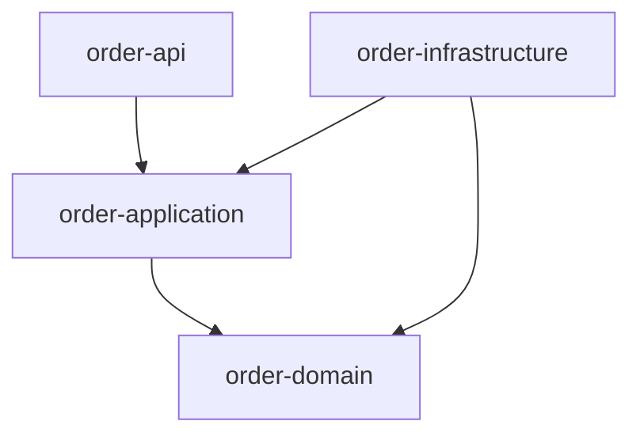

# Project: Modular Order Platform (Multi-Module)

> **Level:** Expert  
> **Status:** Completed  
> **Prerequisites:** Modules 40–41, 35 JPA or JDBC, 37–39, 48–49 awareness  
> **Last reviewed:** 2026-11-10

## Goals

Deliver a **modular monolith** with Maven modules: `order-domain`, `order-application`, `order-infrastructure`, `order-api` (Spring Boot or minimal servlet). Orders, payments (fake adapter), and inventory client (in-process or HTTP stub).

## Learning objectives

- Enforce module dependencies (`domain` has zero Spring).
- Outbox or transactional email stub for “order placed” (in-process queue).
- Flyway/Liquibase migration in infrastructure module.
- Dockerfile multi-stage (Module 48) producing runnable image.

## Architecture



## Data model

- `orders`, `order_lines`, `outbox_events` (status pending/sent).

## Milestones

1. Domain + place-order use case unit tests.
2. JPA/JDBC persistence + migration.
3. REST `POST /orders` idempotent with `Idempotency-Key` header.
4. CI script: `mvn verify` + docker build smoke.
5. K8s Deployment sample YAML (readiness on `/actuator/health` if Boot).

## Acceptance criteria

- [ ] `mvn -q verify` on Temurin 21 from root aggregator POM.
- [ ] Idempotent retry does not double-charge inventory.
- [ ] Module graph documented; illegal dependency fails build (Enforcer rule or ArchUnit).
- [ ] Runbook section: rollback image + DB expand/contract note.

## Starter hints

- Module 40 modular monolith chapter; Spring Boot parent only in `order-api`.
- Fake payment: `PaymentPort` returns success unless amount > limit.

## Verification steps

```bash
./mvnw -q verify
docker build -t order-platform:local .
docker run --rm -p 8080:8080 order-platform:local
curl -X POST -H "Idempotency-Key: abc-1" -d '{"sku":"A","qty":1}' ...
```

Repeat POST with same key → same order id, single inventory decrement.

## Extension

Extract inventory client to real HTTP service; contract test with WireMock.
